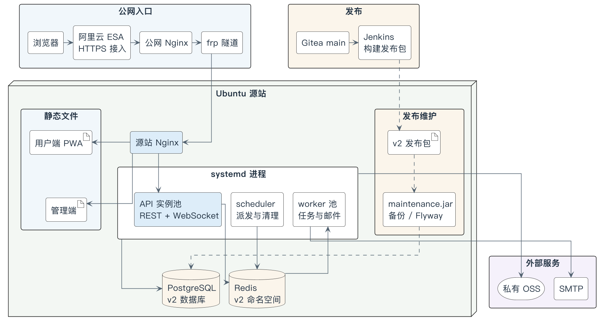
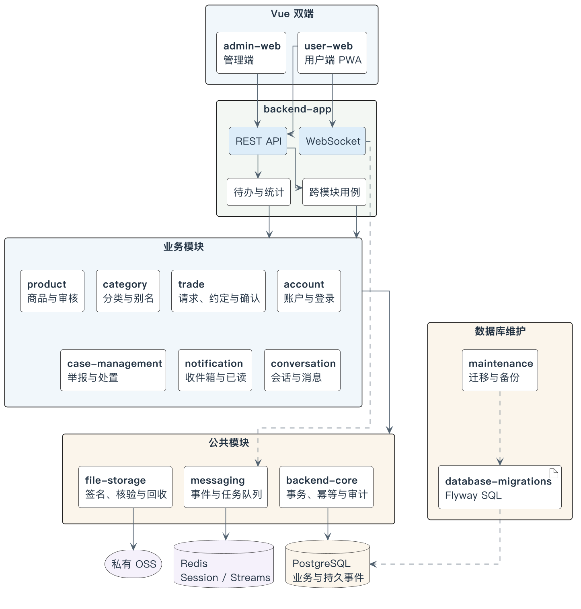

<!--
Version: 0.1.67
Version-Datetime: 2026-11-28T17:18:35+08:00
-->

# 校园二手交易与物品流转平台

## 生产部署

| 入口 | 地址 |
|---|---|
| 用户端 PWA | [mobile.v2.cm.iy88.site](https://mobile.v2.cm.iy88.site/) |
| 管理端 | [admin.v2.cm.iy88.site](https://admin.v2.cm.iy88.site/) |

两端通过各自域名同源访问 `/api/v1`，用户端通过 `/api/v1/realtime` 建立 WebSocket 连接。

### 生产测试用户

本批演示账号使用同一个登录密码。

```text
cIgKKqpp_NVvarTTo0uAM5cUYKYqAsDN
```

| 登录入口 | 测试角色 | 显示名称 | 登录邮箱 |
|---|---|---|---|
| 管理端 | 测试管理员 | 管理员 | `seed-demo-0394b5bbeafe-manager@example.test` |
| 用户端 | 卖家 | 计科23级·陈子航 | `demo-seller@example.test` |
| 用户端 | 卖家 2 | 建筑20级·罗文博 | `demo-seller2@example.test` |
| 用户端 | 卖家 3 | 生物23级·吴桐 | `demo-seller3@example.test` |
| 用户端 | 买家 | 汉语言22级·林晓雨 | `demo-buyer@example.test` |
| 用户端 | 买家 2 | 机械21级·赵一鸣 | `demo-buyer2@example.test` |
| 用户端 | 买家 3 | 新闻22级·孙可 | `demo-buyer3@example.test` |
| 用户端 | 无关用户 | 视觉传达23级·何佳 | `demo-outsider@example.test` |
| 用户端 | 冻结交易卖家 | 电子22级·郑博 | `demo-frozen_seller@example.test` |
| 用户端 | 冻结交易买家 | 数学23级·许安 | `demo-frozen_buyer@example.test` |

### 生产部署架构

[](docs/design/architecture/diagrams/生产部署架构.png)

[PlantUML 源文件](docs/design/architecture/diagrams/生产部署架构.puml)

### 项目详细架构

[](docs/design/architecture/diagrams/项目详细架构.png)

[PlantUML 源文件](docs/design/architecture/diagrams/项目详细架构.puml)

## 技术栈

- 前端采用 Vue 3、TypeScript 和 Rsbuild。用户端支持 PWA，双端使用由 OpenAPI 生成的接口类型。
- 后端采用 Java 27、Spring Boot 和 Maven 多模块，使用 Spring Data JPA／JDBC 访问 PostgreSQL，以 Flyway 管理数据库迁移。
- Redis 支持会话、实时事件和后台任务。阿里云私有 OSS 保存图片与事项证据，SMTP 投递验证码。Nginx 提供静态站点和反向代理，systemd 管理后端进程。

日常开发使用 `scripts/dev.py` 或 `scripts/dev.ps1` 启停服务，通过 `maintenance.jar` 初始化或迁移数据库。

## 快速开始

以下命令从仓库根目录执行。

### 1. 准备依赖与配置

启动 PostgreSQL 和 Redis，并准备 OpenJDK 27、Maven 3.10.1、Node.js 26.13.1、pnpm 12.21.0、Python 3.10+。Node.js 版本以根目录 [`.node-version`](.node-version) 为准。

macOS 或 Linux：

```bash
umask 077
cp -n backend/.env.dev.example backend/.env.dev
```

Windows PowerShell 5.1 或更高版本：

```powershell
Copy-Item backend/.env.dev.example backend/.env.dev -ErrorAction SilentlyContinue
```

按[开发配置](#开发配置)填写数据库、Redis 和所需的外部服务凭据。

### 2. 构建并初始化

```bash
mvn -f backend/pom.xml install
java -jar backend/maintenance/target/maintenance-0.0.1-SNAPSHOT.jar db init --env-file=backend/.env.dev --admin-user "<已有 PostgreSQL 管理员登录名>"
```

`db init` 创建缺失的数据库和角色并执行 Flyway 迁移。数据库已初始化时跳过此命令；拉取新迁移后执行下文的 `db migrate`。

### 3. 安装前端依赖并启动

```bash
pnpm --dir frontend install --frozen-lockfile
```

macOS 或 Linux：

```bash
python3 scripts/dev.py start --env-file=backend/.env.dev
```

Windows PowerShell 5.1 或更高版本：

```powershell
.\scripts\dev.ps1 start -EnvFile backend/.env.dev
```

两个启动器均启动 API、一个调度器、两个工作进程 JVM 和两个前端。访问：

- 用户端：`http://127.0.0.1:3000`
- 管理端：`http://127.0.0.1:3001`
- API：`http://127.0.0.1:8080`

常用启停命令：

| 操作 | macOS／Linux | Windows PowerShell 5.1+ |
|---|---|---|
| 查看状态 | `python3 scripts/dev.py status` | `.\scripts\dev.ps1 status` |
| 查看日志 | `tail -f var/dev/dev.log` | `Get-Content -Wait var/dev/dev.log` |
| 调整工作进程数并重启 | `python3 scripts/dev.py restart --env-file=backend/.env.dev --workers 3` | `.\scripts\dev.ps1 restart -EnvFile backend/.env.dev -Workers 3` |
| 使用其他配置 | `python3 scripts/dev.py start --env-file /path/to/.env` | `.\scripts\dev.ps1 start -EnvFile path\to\.env` |
| 停止 | `python3 scripts/dev.py stop` | `.\scripts\dev.ps1 stop` |

任一受管进程退出时，启动器会停止本次启动的其他服务。Windows 启动器要求 PowerShell 5.1 或更高版本，并允许执行本地 `.ps1` 脚本；PID 与锁文件沿用 `var/dev/`，服务输出分别写入 `var/dev/logs/`。

## 开发配置

`.env.dev` 已被 Git 忽略。文件使用 Java properties 语法：值不额外加引号，反斜杠写成两个反斜杠。复制 [`backend/.env.dev.example`](backend/.env.dev.example) 后替换示例值，不要把实际凭据提交到仓库。

| 资源 | 必需配置 |
|---|---|
| PostgreSQL | `DATABASE_URL`、`DATABASE_USERNAME`、`DATABASE_PASSWORD`、`DATABASE_OWNER_USERNAME`、`DATABASE_OWNER_PASSWORD`。URL 必须包含数据库名，应用账号与迁移账号使用不同凭据。 |
| Redis | `REDIS_URL` 和独立的 `REDIS_NAMESPACE`，例如 `project1:dev:iy88`。不同开发环境使用不同命名空间。 |
| OSS | `OSS_REGION`、`OSS_ENDPOINT`、`OSS_BUCKET`、`OSS_PREFIX` 和开发 RAM 用户的 AccessKey。开发 Bucket 保持私有并关闭版本控制，且专用于对应部署。 |
| SMTP | `SMTP_HOST`、`SMTP_PORT`、`SMTP_TLS_MODE`、`SMTP_USERNAME`、`SMTP_PASSWORD` 和 `SMTP_FROM`。常用配置为 587 端口配 `starttls`，或 465 端口配 `ssl`。 |

可用以下命令生成 PostgreSQL 应用账号和迁移账号的 URL 安全密码：

```bash
python3 -c 'import secrets; print(secrets.token_urlsafe(32))'
```

`owner` 持有数据库及迁移创建的对象，具有 `CREATEDB`，维护工具使用 `DATABASE_OWNER_USERNAME` 和 `DATABASE_OWNER_PASSWORD` 执行 Flyway 和常规重置。`app` 只有连接、`public` schema 使用、业务表读写和序列权限，后端使用 `DATABASE_USERNAME` 和 `DATABASE_PASSWORD` 连接。

## 初始化与全量重置

维护工具通过必需的 `--env-file` 参数指定配置。以下命令在仓库根目录运行。

`db init` 的 `--admin-user` 必须是目标 PostgreSQL 实例上已有的管理员登录名。该账号需要能创建角色和数据库，并将新库的所有权授予 `DATABASE_OWNER_USERNAME`。初始化会把 owner 更新为具有 `CREATEDB`，密码在终端中无回显输入。

首次创建数据库、角色并执行迁移：

```bash
java -jar backend/maintenance/target/maintenance-0.0.1-SNAPSHOT.jar \
  db init --env-file="$PWD/backend/.env.dev" --admin-user "<已有 PostgreSQL 管理员登录名>"
```

仅执行增量迁移：

```bash
java -jar backend/maintenance/target/maintenance-0.0.1-SNAPSHOT.jar \
  db migrate --env-file="$PWD/backend/.env.dev"
```

部署新版本时先执行 `db migrate`，再启动应用。`db init` 会创建缺失的 `owner`、`app` 角色和数据库；已有角色沿用现有密码，并确保 owner 具有 `CREATEDB`。

重置会删除数据。执行前停止所选环境的所有应用进程和任务。PostgreSQL 按配置的专用数据库、Redis 按配置的命名空间、OSS 按整个 Bucket 分别处理；先预览目标：

```bash
java -jar backend/maintenance/target/maintenance-0.0.1-SNAPSHOT.jar \
  db reset --env-file="$PWD/backend/.env.dev"
java -jar backend/maintenance/target/maintenance-0.0.1-SNAPSHOT.jar \
  oss reset --env-file="$PWD/backend/.env.dev"
```

核对输出的环境、服务器和范围后，使用对应预览令牌执行：

```bash
java -jar backend/maintenance/target/maintenance-0.0.1-SNAPSHOT.jar \
  db reset --env-file="$PWD/backend/.env.dev" --confirm "<预览令牌>"
java -jar backend/maintenance/target/maintenance-0.0.1-SNAPSHOT.jar \
  oss reset --env-file="$PWD/backend/.env.dev" --confirm "<预览令牌>"
```

- `db reset` 使用 owner 凭据检查 Redis 可扫描指定命名空间，删除并重建 PostgreSQL 目标库、执行 Flyway，最后清空 `REDIS_NAMESPACE:*`。PostgreSQL 存在活动连接时拒绝删除。
- 仅当旧数据库仍由 app 角色持有时，confirmed `db reset` 才需要额外传入 `--admin-user` 完成角色迁移。
- `oss reset` 清空 `OSS_BUCKET` 内的全部对象，不按 `OSS_PREFIX` 过滤，预览范围标记为 `ALL_OBJECTS`，沿用预览令牌确认，每批最多删除 1,000 个。该桶必须专用于对应部署，不得与 legacy 或其他部署、环境共用；开发与联调共用的开发桶按单一开发部署处理，不得混入其他环境对象。应用运行时以 `OSS_PREFIX` 限定文件对象，调度器的 `FileCleanup` 只回收登记且到期的无引用文件，不执行整桶清理。
- 重置中途失败时保持写入停止，修复后重新预览并执行完整命令。数据库重置会按当前 Flyway 迁移重建结构。

### 创建管理端账号

数据库迁移完成后，在仓库根目录打开终端执行以下命令，并替换邮箱和显示名称。

```bash
java -jar backend/maintenance/target/maintenance-0.0.1-SNAPSHOT.jar \
  account create-manager --env-file=backend/.env.dev \
  --email=manager@example.com --display-name="测试管理员"
```

核对输出的目标数据库，按提示输入两次登录密码。密码输入无回显。命令使用配置的数据库 owner 创建 `manager` 账户并记录审计，密码采用和普通账户相同的长度规则与哈希算法。创建完成后，使用该邮箱和密码登录管理端。邮箱已注册时，命令报错并保留该账户原有角色和密码。

## 种子数据与真实接口压测

隔离环境下的 `maintenance.jar seed load`、`seed demo`、OSS 前缀清理、私有 manifest 和 Rust HTTP/WebSocket 压测流程见
[种子数据与真实接口压测使用说明](docs/guides/seed-and-loadtest.md)。共享测试桶只能使用 `oss reset --prefix` 清理当前前缀；
不带 `--prefix` 的整桶 reset 仅适用于专用桶。性能测试案例、执行过程与原始报告证据见
[TC-PERF-001 性能与容量测试报告](docs/design/test-cases/reports/performance-capacity/测试报告.md)。

## 后端开发

后端使用 OpenJDK 27、Spring Boot 4.1.2 和 Maven 3.10.1。以下命令均从仓库根目录执行：

| 用途 | 命令 |
|---|---|
| 安装内部模块到本机 Maven 仓库 | `mvn -f backend/pom.xml install` |
| 构建、测试和验证 | `mvn -f backend/pom.xml verify` |
| 测试启动模块及依赖 | `mvn -f backend/pom.xml -pl backend-app -am test` |
| 完整构建并生成覆盖率 | `mvn -f backend/pom.xml clean verify` |
| 运行集成测试 | `mvn -f backend/pom.xml clean verify -Pintegration` |

首次开发或内部模块依赖发生变化时，先执行 `mvn -f backend/pom.xml install`，将模块 JAR 和 POM 安装到本机 Maven 仓库。`verify` 用于检查，不能替代开发环境要求的 `install`。

后端汇总覆盖率排除 `maintenance`，报告位于 `backend/coverage-report/target/site/jacoco-aggregate/index.html`。集成测试需要已启动的 PostgreSQL 和 Redis，并先执行最新的 `db migrate`；测试报告位于 `backend/backend-app/target/failsafe-reports/`，每次运行使用独立的 Redis 前缀并在结束时清理。使用其他配置文件时，加 `-Dit.envFile="$PWD/backend/.env.dev"`。

`-Pintegration` 还会生成排除 `maintenance`、只使用 Failsafe 执行数据的[集成覆盖率报告](docs/design/test-cases/集成测试覆盖率.md)，本地入口为 `backend/coverage-report/target/site/jacoco-integration/index.html`。GitHub Actions 在集成测试运行摘要中记录行和分支覆盖率。

需要单独调试时，分别在终端启动 API、调度器和工作进程：

```bash
java -jar backend/backend-app/target/backend-app-0.0.1-SNAPSHOT.jar --env-file=backend/.env.dev
java -jar backend/backend-app/target/backend-app-0.0.1-SNAPSHOT.jar --env-file=backend/.env.dev --spring.profiles.active=delivery-scheduler
java -jar backend/backend-app/target/backend-app-0.0.1-SNAPSHOT.jar --env-file=backend/.env.dev --spring.profiles.active=delivery-worker
```

应用监听 `.env.dev` 中的 `HTTP_BIND_HOST` 和 `HTTP_BIND_PORT`。默认地址下可用以下命令检查：

```bash
curl -fsS http://127.0.0.1:8080/api/v1/hello
curl -fsS http://127.0.0.1:8080/actuator/health
```

后端模块入口为 `io.github.iy88.project1.BackendAppApplication`。启动参数、环境加载和校验集中在 `backend-app` 的 `bootstrap` 包。Maven 模块加入应用依赖后，根包下的 Spring 组件、JPA 实体和 Repository 可按类型扫描；SDK 客户端等外部对象由对应模块的配置类显式装配。

| 位置 | 职责 |
|---|---|
| `backend-app` 的 `api.<业务>` | Controller、HTTP 请求和响应 DTO、参数校验及传输映射 |
| 业务模块的 `application` | 用例服务及跨模块使用的命令、查询和具名输入输出 |
| 业务模块的 `domain` | 业务规则、状态和领域对象 |
| 业务模块的 `persistence` | JPA 实体、Spring Data Repository 和必要的显式 SQL |

跨模块协作由应用层调用各模块公开服务，只传递 ID 和具名输入输出。持久化实体与 Repository 由其所属模块管理。

## 前端开发

前端使用 Node.js 26.13.1、pnpm 12.21.0、Vue 3、TypeScript 和 Rsbuild。使用 fnm 时，在仓库根目录执行 `fnm install` 和 `fnm use`。两端使用 Pinia 管理跨页面操作提示，管理端也通过 Pinia 共享当前会话。两个应用共用 `frontend/pnpm-lock.yaml`：

```bash
pnpm --dir frontend install --frozen-lockfile
```

| 用途 | 命令 |
|---|---|
| 同时启动两端 | `pnpm --dir frontend dev` |
| 仅启动用户端 | `pnpm --dir frontend dev user` |
| 仅启动管理端 | `pnpm --dir frontend dev admin` |
| 格式化 | `pnpm --dir frontend format` |
| 检查 | `pnpm --dir frontend lint` |
| 检查格式 | `pnpm --dir frontend format:check` |
| 类型检查 | `pnpm --dir frontend typecheck` |
| 浏览器回归测试 | `pnpm --dir frontend test:e2e`；[测试报告](docs/design/test-cases/reports/frontend-playwright/测试报告.md) |
| 构建两端 | `pnpm --dir frontend build` |
| 重新生成 API 类型 | `pnpm --dir frontend generate:api` |

首次运行浏览器回归测试前，执行 `pnpm --dir frontend exec playwright install chromium`。测试启动本地用户端和管理端，并构建用户端生产预览以验证真实 Service Worker；模拟 API 不访问真实环境，无需启动后端或准备账号。用例覆盖登录与退出、路由守卫、商品发布、交易协同、WebSocket 恢复、重复提交、网络异常、响应竞态和 PWA 离线恢复。GitHub Actions 的前端任务也会运行这组测试。

两端共用 `frontend/shared/rsbuild.ts` 的开发代理，默认将 `/api/v1` 转发到 `http://127.0.0.1:8080`。后端地址不同时，设置 `API_PROXY_TARGET`。页面请求同源的 `/api/v1/hello`，看到 `Hello, Project1!` 即表示接口连通。构建产物输出到两个应用的 `dist/`。

更新 `frontend/shared/openapi.json` 后执行 `generate:api`。部署时由 Nginx 提供两个应用的静态文件，并代理 `/api/v1/`。

## S1 开发环境与依赖探针

S2–S4 的开发入口和公共能力验证见 [S1 工程交接与验证](bits/S1工程交接与验证.md)。

### 依赖探针

配置好 PostgreSQL、Redis、OSS 和 SMTP 后，可运行一次性探针验证连接、OSS 对象写入／读回／删除及邮件投递：

```bash
java -jar backend/backend-app/target/backend-app-0.0.1-SNAPSHOT.jar --spring.profiles.active=dependency-probe --env-file=backend/.env.dev --smtp-probe-to=you@example.com
```

将示例收件地址替换为测试地址。探针完成后退出，失败时返回非零状态；SMTP 日志中的邮件 ID 可用于在收件箱中定位 `[Project1 S1] SMTP probe`。

依赖探针是部署环境的一次性配置校验入口。首次部署、切换 Bucket 或变更相关配置时，维护方须确认私有桶和版本控制状态预检通过后才开放文件业务；现有 Jenkins 自动发布不强制执行该探针。正常上传授权、完成核验和清理请求不会重复查询 Bucket ACL／versioning；配置变更由运维控制，不允许业务运行期间擅自修改。

### OSS 配置

后端探针和维护工具共用阿里云 OSS Java SDK 2.0（`com.aliyun:alibabacloud-oss-v2`）。v2 使用两个私有 Bucket：开发桶供开发与联调使用，生产使用独立桶；两桶分别专属于对应部署，不与 legacy 共用。各环境的 `OSS_BUCKET` 只填本环境桶名。商品图片与事项证据分别使用 `<OSS_PREFIX>/product_image/` 和 `<OSS_PREFIX>/case_evidence/`。

商品图片支持 JPG／JPEG、PNG，事项证据另外支持 PDF，默认每文件上限 100 MiB。可通过 `FILE_PRODUCT_IMAGE_*` 和 `FILE_CASE_EVIDENCE_*` 调整大小与 MIME 列表；变更规则时同步更新 `FILE_RULE_VERSION`。

在 OSS 控制台将 Bucket 设为私有、启用阻止公共访问，并保持版本控制从未启用。以下策略用于独立开发 Bucket，将 `YOUR-DEV-BUCKET` 替换为实际桶名：

```json
{
  "Version": "1",
  "Statement": [
    {
      "Effect": "Allow",
      "Action": ["oss:GetBucketAcl", "oss:GetBucketVersioning", "oss:ListObjects"],
      "Resource": ["acs:oss:*:*:YOUR-DEV-BUCKET"]
    },
    {
      "Effect": "Allow",
      "Action": ["oss:PutObject", "oss:GetObject", "oss:DeleteObject"],
      "Resource": ["acs:oss:*:*:YOUR-DEV-BUCKET/*"]
    }
  ]
}
```

`file-storage` 提供文件核验、引用和签名读取。商品、事项等调用方先校验账户及目标对象权限，再在业务事务内建立、保留或释放引用。签名 URL 默认有效 60 秒，可通过 `FILE_READ_URL_TTL_SECONDS` 调整；PDF 以附件下载。回收任务先认领到期且无有效引用的文件，再删除 OSS 对象并保存结果。

浏览器直传接入时，在 Bucket CORS 中登记实际用户端和管理端 Origin。签名表单使用 `POST`，浏览器确实需要直读时再添加 `GET` 或 `HEAD`；按预检需求配置允许头，可暴露 `ETag` 和 `x-oss-request-id`。

### 共享写入用例

在 `backend-core` 上构建业务命令，并使用服务端创建的 `ExecutionContext` 调用 `WriteExecutor.run`。提供经过校验的请求投影、只读锁计划、资格检查、重放授权和写入回调。为账户 ID 预留 PostgreSQL 单 bigint 咨询锁空间。在资格检查回调中获取会话和其他身份锁，然后使用 `WriteTransaction.lock`，按领域和键的升序锁定已声明的业务键。

使用 `WriteTransaction.audit` 记录已批准的审计事实。命令、审计事实和幂等响应在同一事务中提交。凭据和验证码分别保留在其所属的账户协议中。

对于 `/api/v1` 下的浏览器写入，配置 `ALLOWED_ORIGINS`，并提供绑定到当前会话或账户条目的 `CsrfGuard.Verifier`。API 会为每个请求设置 `X-Request-Id`。运行写入用例前先应用数据库迁移。

### 事件投递与定时任务

启动后端进程前应用最新的 Flyway 迁移。使用一个 JVM 并设置 `--spring.profiles.active=delivery-scheduler`，以入队到期任务、分发事件并清理过期事件。运行一个或多个 JVM 并设置 `--spring.profiles.active=delivery-worker`，以认领、执行和确认任务。这两个进程均不启动 HTTP 监听器。调度器自动回收 OSS 中到期且无引用的上传对象，启动时需要 `OSS_*` 配置。业务 HTTP 服务和工作进程自动装配共享 SMTP 发送器，启动时需要 `SMTP_*` 配置。

- 使用 `WriteTransaction.addEventIntent` 将事件追加到与业务写入相同的事务中。`UserEvents.head` 和 `UserEvents.scan` 读取 PostgreSQL 游标。`EventSignals` 使用每个实例独立的游标读取 Redis 提示。使用 `EventReplay`，按已认证账户和当前来源权限投影事件。
- 在业务事务中使用 `TaskSchedules.schedule`。在调度器和每个工作进程中注册相同的 `TaskHandler` 集合。调度器使用已注册的任务类型选择到期任务。工作进程使用共享写入事务处理业务变更并记录任务结果。
- 将 SMTP 发送器绑定到账户所属的邮件记录，并在提交邮件租约后调用。文件、事件和邮件的重试状态保留在所属记录上。

### 实时 HTTP 与 WebSocket

正常业务入口以 `infrastructure` servlet API 运行，自动装配 HTTP 补拉、`/api/v1/realtime` WebSocket、公开配置接口和业务事件投影，不需要额外的实时 profile 或能力开关。按[快速开始](#快速开始)启动的 API 进程即采用该角色；依赖探针、`file-probe` 以及不监听 HTTP 的 worker／scheduler 不装配这些组件，未启用 `infrastructure` 的轻量单元测试也不会加载。适配器认证 Session Cookie，重新检查其当前状态，验证 hello CSRF 令牌，并投影可见的事件来源。

- 业务入口要求账户 Session、通知和会话读取适配器同时存在；缺少任一适配器时启动失败，不使用替身或空实现。正式适配器由 Issue #78／#79／#80 提供。其他业务来源通过 `RealtimeEventSources.SourceAccess` 登记当前可见性。
- `GET /api/v1/capabilities` 返回 `config_version` 与账户公开 `limits`；无 Cookie 只返回访客限制，已失效 Cookie 按身份契约返回 401，响应使用 `no-store`。
- `GET /api/v1/account/events/head` 返回账户纪元、头部序列和重放下限。`GET /api/v1/account/events?epoch=<uuid>&after_seq=<seq>` 在限定范围内扫描一页数据。
- `/api/v1/realtime` 接受版本 1 的 `hello` 帧。有效游标会恢复投递。收到 `sync_reset` 后，先读取事件头，再加载通知、会话及其已读进度；全部查询成功后使用刚取得的头部游标发送 `resume`。通过 `ack` 确认最后连续处理的序列。
- 在将来源连接记录到执行上下文之前，通过 `OriginConnectionLookup` 解析 `X-Origin-Connection-Id`。Redis 将连接租约限定到已认证的账户和 Session。

### 文件服务测试页

S2 在 `file-storage` 的共享 Java 服务之上构建商品图片 API 和界面。S4 使用相同服务处理事项证据。探针前端和控制器是独立的测试组件。生产文件 API 集成后，删除 `dev/fileprobe` 包、`frontend/file-probe/`、`BackendAppApplicationTests` 中的探针路由检查以及本节。

构建后端后，从仓库根目录在两个终端分别启动探针 API 和页面：

```bash
java -jar backend/backend-app/target/backend-app-0.0.1-SNAPSHOT.jar \
  --env-file=backend/.env.dev --spring.profiles.active=file-probe
pnpm --dir frontend exec rsbuild dev --root file-probe
```

在开发 OSS Bucket 的 CORS 中允许 Origin `http://127.0.0.1:3002` 和 `POST`。打开[测试页](http://127.0.0.1:3002)，上传并核验文件、打开签名读取 URL，再释放测试引用。

## CI 与发布

GitHub Actions 在 Linux 上并行执行后端、后端集成和前端检查。后端使用 OpenJDK 27 和 Maven 执行 `verify` 并输出覆盖率；集成 job 使用独立的 PostgreSQL 和 Redis 容器，先执行 Flyway 迁移，再运行 `verify -Pintegration`。前端使用 Node.js 26.13.1 和 pnpm 12.21.0，按锁文件安装依赖，检查 OpenAPI 生成类型、lint 和格式，运行各工作区的单元测试，再分别检查并构建两个应用。

Jenkins 使用 OpenJDK 27、Maven 3.10.1、`.node-version`、`frontend/package.json` 中的 pnpm 版本和 Python 3。发布包构建跳过测试，前端仍需通过 TypeScript 类型检查；单元测试、集成测试、lint 和格式检查由 GitHub Actions 执行。本地运行发布脚本前，把已安装 Maven 的 `mvn` 加入 PATH。从仓库根目录构建：

```bash
bash scripts/deploy/build-release.sh var/releases 1
```

产物目录为 `var/releases/<提交号>-<构建编号>/`，包含压缩包、`SHA256SUMS`、两个前端的静态文件、部署资产、`release.txt`、`backend/backend-app.jar` 和 `backend/maintenance.jar`。systemd 启动 `backend-app.jar`；数据库迁移和维护操作通过 `maintenance.jar` 的 `--env-file` 参数指定维护配置。发布、回退及生产配置见 [v2 首发与发布配置](bits/v2首发与发布配置.md)。

## 文档目录结构

```text
docs/
├── 需求规格说明书.md                   # requirements 章节整合产物
├── 需求分析质量验证报告.md
├── AI智能体使用验证报告.md
├── requirements/                     # 01—08 需求章节源文件
├── appendices/
│   ├── user-stories/                  # 用户故事
│   ├── use-cases/                     # 用例
│   ├── class-analysis/                # 领域类分析
│   ├── scenarios/                     # 场景
│   ├── models/                        # 可编辑模型源文件
│   ├── rendered/                      # 模型 PNG 与摘要记录
│   ├── prototype/                     # HTML 原型
│   ├── evidence/                      # 需求决定及验证依据
│   └── ai-usage/                      # 需求阶段 AI 记录
├── 软件架构设计方案_讨论稿.md          # 架构章节整合产物
├── 软件架构设计方案_基线版.md          # 基线占位
├── 架构确认与决策记录.md               # Q／ADR 整合产物
├── 接口与关键设计说明书.md             # 共享及模块设计整合产物
├── 分阶段实现与测试计划.md             # 计划章节整合产物
└── design/
    ├── 基线索引.md                    # 设计材料入口
    ├── 拼合清单.json                  # 整合文档的源文件顺序
    ├── architecture/                  # 架构章节
    ├── decisions/                     # 决策索引、questions、adr
    ├── detailed-design/               # 共享约定、interfaces、key-designs
    ├── implementation-plan/           # 阶段与测试计划
    ├── tasks/                         # 四人任务与 Issue 草案
    ├── test-cases/                    # 测试预期与案例
    ├── reviews/                       # 审查与检查记录
    ├── acceptance/                    # 准入、阶段及部署验收
    ├── changes/                       # 变更记录
    ├── evidence/                      # 精选验证及 AI 纠错证据
    └── 运行与部署说明.md
```

入口：[设计基线索引](docs/design/基线索引.md)、[四人任务](docs/design/tasks/索引.md)、[需求基线](docs/requirements/08-需求基线.md)。

## 脚本命令

在仓库根目录运行，完整参数及依赖见 [scripts 使用说明](scripts/README.md)。

| 命令 | 功能 |
|---|---|
| `python3 scripts/cli.py report --documents design` | 生成设计整合文档并检查本地引用 |
| `python3 scripts/cli.py check --documents design` | 核对设计生成一致性与本地引用 |
| `python3 scripts/cli.py report --documents requirements` | 同步需求摘录及需求规格说明书 |
| `python3 scripts/cli.py check --documents requirements` | 核对需求生成内容、模型摘要及本地引用 |
| `python3 scripts/cli.py build` | 渲染模型并生成需求与设计文档 |
| `python3 scripts/cli.py check` | 只读核对模型、全部生成文档及本地引用 |
| `python3 scripts/cli.py pdf` | 增量导出 `docs/` 到 `docs-pdf/` |

文档工具检查：

```bash
PYTHONPATH=scripts python3 -m unittest discover -s scripts/tests -p 'test_*.py'
python3 scripts/cli.py --help
```
