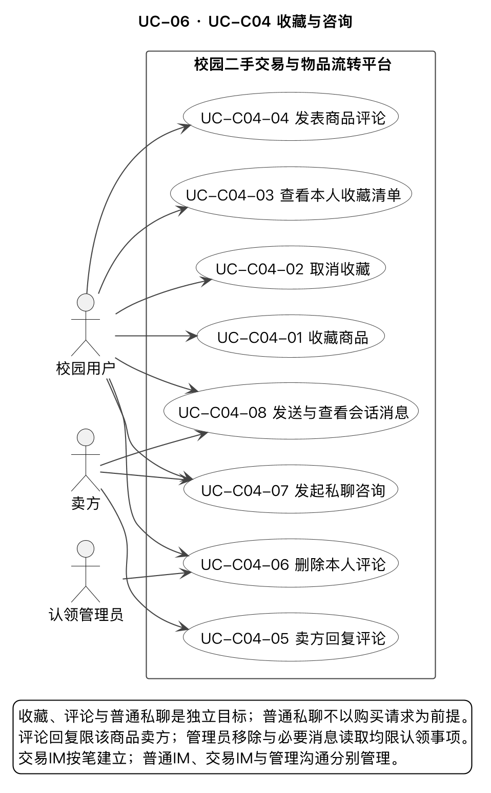

<!--
Version: 0.1.4
Version-Datetime: 2026-10-26T12:37:57+08:00
-->

# UC-C04 收藏与咨询

## 用例图

[UC-06-收藏与咨询用例图 源文件](../models/UC-06-收藏与咨询用例图.puml)

| 要素 | 内容 |
|---|---|
| 编号／名称 | UC-C04 收藏与咨询 |
| 参与者 | R-01 校园用户（收藏、评论或主动私聊）；R-02 买方与R-03卖方（可分别主动发起私聊，该商品卖方可回复买方评论）；R-04 认领管理员（移除违规评论或按事项查看必要消息） |
| 触发 | 用户收藏或取消收藏；登录用户在商品页发表评论或卖方回复；用户从卖方个人页发起私聊咨询，或在购买请求成功后进入该笔交易聊天分支 |
| 前置条件 | ① 已登录（BR-22）；② 商品状态仅按相应收藏、评论操作检查，普通私聊不以商品状态或购买请求为前提；交易分支须已有成功创建的购买请求；③ 发送操作检查账户及适用的冻结限制（BR-32、BR-33） |
| 正常流程 | 用户按当前目标独立选择：A 收藏路径，校验本人及商品资格后收藏／取消、查看清单；B 商品页评论路径，校验后发表，卖方可回复买方；C 普通私聊路径，任一方从个人页等入口发起，建立或复用双人会话；D 交易咨询路径，有效请求后进入该笔独立分支交流。C／D 分别保存消息与已读，系统引导该笔交易沟通进入对应分支，聊天不代替明确交易操作（BR-16、BR-17、BR-18） |
| 替代流程 | A1 商品交易中：退出在售搜索但登录用户仍可查看详情与状态，交易中可评论、已下架不可评论或回复（BR-14、BR-17）｜A2 商品被撤销公开访问：收藏仅显示失效提示，不泄露内容（BR-16）｜A3 双方普通私聊已存在：复用普通私聊；同一笔交易分支已存在：打开该笔分支，不与另一笔交易合并（BR-18） |
| 异常流程 | E1 非会话成员访问会话或消息：拒绝（BR-18）｜E2 向本人发起私聊：拒绝（BR-02）｜E3 账户封禁：可读原资格公共内容与本人收藏，禁止评论、发送及收藏写操作（BR-32）｜E4 交易被冻结：冻结双方之间的普通私聊及全部交易聊天分支均禁止发送、历史可读，包括未被冻结的另一笔交易分支；双方与第三方的聊天不受该笔冻结影响，处置通知与沟通单不受影响；同一对用户之间仍有有效冻结时持续禁发，全部解除后还须检查账户封禁等限制（BR-33）｜E5 评论长度与发表频率：按长度及发表频率限制处理，阈值尚待设计确定（BR-17） |
| 消息已读 | 普通私聊和各笔交易聊天分支分别计算消息未读；用户打开并查看具体会话／分支时，仅将该会话／分支已展示消息标为已读。仅进入会话列表、查看其他分支或将通知中心提醒标为已读，不自动消除未查看聊天消息的未读标记。消息已读不代替购买请求接受、约定确认或交易完成确认。 |
| 后置结果 | 收藏清单更新；评论与回复按作者及认领管理员权限留存或移除（BR-17）；会话与消息保留，参与者可查看历史（BR-18） |
| 关联规则 | BR-02、BR-14、BR-16—BR-19、BR-22、BR-32、BR-33 |
| 关联需求、故事、场景与类 | FR-04、FR-05、FR-11、FR-12；US-04、US-05、US-11、US-12；SC-03、SC-04、SC-11；C-01、C-02、C-05—C-09 |
| 验收条件 | ① 未登录访客无法访问收藏、评论与会话；② 已下架商品不能新增评论或回复；③ 同一对用户复用普通私聊，每笔购买请求具有独立交易分支；系统引导该笔交易沟通进入对应分支，不自动识别或禁止普通私聊中的交易文字，不迁移既有消息，聊天不代替正式交易操作；④ 非会话成员无法读取消息；⑤ 封禁期间可读原资格内容但写操作被拒绝；⑥ 冻结双方之间的普通私聊及全部交易聊天分支均禁止发送、历史可读，包括未被冻结的另一笔交易分支；双方与第三方的聊天不受该笔冻结影响而处置沟通单可用；⑦ 删除评论仅限作者或该事项认领管理员 |

## 子用例的具体条件与结果

| 编号与目标 | 触发及前置 | 业务动作与结果 | 主要参与类 | 依据 |
|---|---|---|---|---|
| UC-C04-01 收藏商品 | 已登录、未封禁且商品可收藏 | 保存本人收藏关系，保持他人不可见 | C-01、C-02、C-05、C-06、C-07、C-08、C-09 | BR-16；仅公开商品 |
| UC-C04-02 取消收藏 | 已存在本人收藏且未封禁 | 取消该收藏，失效商品仍可取消而不开放其内容 | C-01、C-02、C-05、C-06、C-07、C-08、C-09 | BR-16 |
| UC-C04-03 查看本人收藏清单 | 已登录本人账户 | 展示本人清单，失效项用通用提示且无公开详情入口 | C-01、C-02、C-05、C-06、C-07、C-08、C-09 | BR-16；失效仅提示，不泄露内容 |
| UC-C04-04 发表商品评论 | 商品公开可交易或交易中且账户有资格 | 发表商品页评论，独立于收藏与私聊 | C-01、C-02、C-05、C-06、C-07、C-08、C-09 | BR-17；交易中可评论，已下架禁止 |
| UC-C04-05 卖方回复评论 | 该商品卖方且商品仍允许评论 | 回复买方评论；其他买方不能代卖方回复 | C-01、C-02、C-05、C-06、C-07、C-08、C-09 | BR-17；仅该商品卖方，仅该商品卖方回复买方评论 |
| UC-C04-06 删除本人评论 | 本人已有评论或认领事项需移除违规内容 | 按作者或管理权限逻辑删除／移除并保留相关历史 | C-01、C-02、C-05、C-06、C-07、C-08、C-09 | BR-17；可删不可改 |
| UC-C04-07 发起私聊咨询 | 双方为不同用户、发送资格允许 | 从个人页等入口建立或复用双人普通私聊，不依赖请求 | C-01、C-02、C-05、C-06、C-07、C-08、C-09 | BR-18；个人页独立发起，同一对用户复用普通私聊，不以商品状态或购买请求为前提 |
| UC-C04-08 发送与查看会话消息 | 会话／分支存在且当前资格允许 | 按各自归属保存或展示文字消息，仅已展示消息标读 | C-01、C-02、C-05、C-06、C-07、C-08、C-09 | BR-17、BR-18；普通私聊与逐笔交易分支分别保留；请求成功后该笔交易沟通应在对应分支进行，系统引导但不识别或禁止普通私聊中的交易文字 |

## 参与类、业务属性及必要行为

| 领域类 | 相关业务属性 | 必要行为与协作 |
|---|---|---|
| [C-01 用户账户](../class-analysis/C-01-用户账户.md) | 用户ID、账户状态、管理资格 | 校验登录身份、本人归属、卖方回复资格及相关管理资格 |
| [C-02 商品](../class-analysis/C-02-商品.md) | 发布者、生命周期状态、展示资格 | 读取详情及发布者信息，校验收藏、评论与回复资格 |
| [C-05 收藏记录](../class-analysis/C-05-收藏记录.md) | 收藏者、商品、收藏时间 | 建立或取消本人收藏；返回本人清单及失效提示 |
| [C-06 商品评论](../class-analysis/C-06-商品评论.md) | 商品、作者、正文、回复对象、发表时间、删除或移除标记及理由 | 发表评论或卖方回复；按作者或认领管理员资格删除、移除，保留依据 |
| [C-07 IM会话](../class-analysis/C-07-咨询会话.md) | 会话类别、参与双方、所属请求或交易、归档标记 | 建立或复用双人普通私聊；定位既有逐笔交易分支；按归档及双方限制校验发送 |
| [C-08 消息](../class-analysis/C-08-消息.md) | 所属会话或分支、发送者、内容、发送时间、接收方已读标记 | 发送并保存文字消息；仅将当前会话或分支已展示消息标为已读 |
| [C-09 交易记录](../class-analysis/C-09-交易记录.md) | 买卖双方、所属商品、请求及交易状态、冻结依据 | 定位该笔交易咨询分支并提供当前交互资格；交易操作沿用 UC-C05 |
| [C-13 处置记录](../class-analysis/C-13-处置记录.md) | 事项对象、认领管理员、处置理由及依据 | 校验违规评论移除及私人消息查看的认领权限，留存移除依据 |
| [C-14 账户限制记录](../class-analysis/C-14-账户限制记录.md) | 受限账户、限制类型、生效及解除时间 | 读取封禁限制，校验评论、收藏及发送操作；不在本用例执行封禁解除 |

## 对象行为协作

1. C-01与C-02校验收藏／评论资格；C-05保存本人收藏，C-06保存评论或卖方回复。
2. C-07按双人复用普通私聊，交易分支按C-09分配；C-08保存各自消息及已读范围。
3. 发送检查账户限制及双人范围冻结；C-13处置沟通独立于普通私聊和交易分支。

## 验收与对应用户故事

[US-04 收藏与咨询](../user-stories/US-04-收藏与咨询.md)、[US-05 请求与确认交易](../user-stories/US-05-请求与确认交易.md)、[US-11 接收通知与待办](../user-stories/US-11-接收通知与待办.md)、[US-12 管理本人业务](../user-stories/US-12-管理本人业务.md)。主故事为US-04；相关故事通过上述业务流程协作，验收条件见各故事的AC编号。

[用例索引](index.md) · [子用例清单](子用例分解.md) · [用户故事索引](../user-stories/index.md) · [场景索引](../scenarios/index.md) · [现行规则](../../requirements/04-规则与权限.md)
