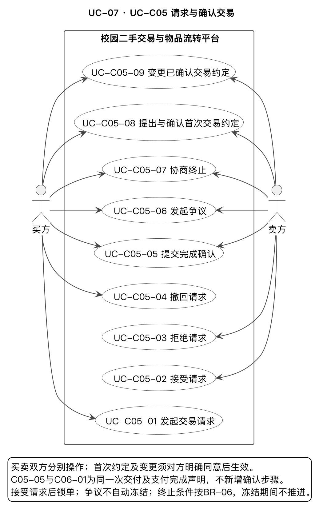

<!--
Version: 0.1.3
Version-Datetime: 2026-10-26T12:37:57+08:00
-->

# UC-C05 请求与确认交易

## 用例图

[UC-07-请求与确认交易用例图 源文件](../models/UC-07-请求与确认交易用例图.puml)

| 要素 | 内容 |
|---|---|
| 参与者 | 买方、卖方；认领管理员仅按管理事项权限介入 |
| 触发／前置 | 新请求：非本人商品公开可交易、无锁单，买方无同商品有效待接受请求，账户及冻结限制允许；后续操作：本人为该请求／交易参与者，按当前状态、约定阶段及限制校验，管理介入须认领事项权限 |
| 正常流程 | ① 买方可先私聊或直接请求；有效请求创建记录、专属交易聊天并通知卖方，同时汇总通知中心，商品尚未锁单。② 卖方明确接受后锁单，其他请求关闭并通知买方。③ 任一方提出交付时间／文字地点／方式及约定金额／支付方式／时点，另一方明确同意，首次约定生效。④ 双方平台外处理交付付款，各自一次确认同时声明两者完成。⑤ 普通双确认后交易完成，分支归档、本笔解冻，商品默认下架或卖方按资格明确继续上架；历史与通知保留。 |
| 约定分支 | 首次提案拒绝只结束提案、保持待约定和锁单。约定变更须对方同意，未同意原约定保留，新旧历史记录；不回到首次约定前，不以约定条件／到期判定实际履约。约定金额可不同于标价，不改商品历史，不要求支付凭证。 |
| 撤回／拒绝 | 卖方接受前买方可撤回、卖方可拒绝；撤回通知卖方，旧入口不可再接受；接受／拒绝／锁单或下架关闭均通知相应买方并说明原因。按规则结束后可发新请求，创建新交易和新分支。 |
| 取消 | 首次约定前买方可直接取消、卖方申请须买方同意；约定后须双方明确同意，单方已确认或未冻结争议中也可协商取消。未同意不自动终止；生效为已终止计失败，通知双方、解锁单及本笔冻结、归档分支，商品默认下架或明确继续上架。保留旧确认和争议，不处理退款退货。 |
| 完成／超时 | 普通完成不得跳过约定；单方确认仅记进度并通知另一方，7天未回应转异常及冻结，由UC-C14处理；不自动完成／取消，不设管理员固定处理时限。 |
| 争议／管理 | 任一方说明发起争议，不自动冻结，保持锁单；解决恢复后清空当前完成确认、保留历史；有有效约定回“约定已确认、待完成”，无有效约定回“首次约定待确认”，恢复不启动计时；此后任一方重新提交完成确认，才重新计算完整 7 天。认领管理员可有依据调整全部状态，不伪造双方确认，通知及全部转移留依据。 |
| 互动与权限 | 交易相关沟通应在该笔分支，普通私聊独立保留，不识别或禁止普通私聊中的交易文字。冻结时双方不得互动／推进操作，仅只读访问及管理沟通；双方间其他有效冻结或账户封禁不因本笔结束消失。 |
| 异常及重复操作 | 拒绝非卖方接受、他人撤回、本人购买；提交按最新资格校验。同一操作重试返回已有结果，不重复记录／通知；断网不撤销已一致性保存结果，恢复刷新可见。 |
| 后置结果 | 请求、约定及变更、双方确认、商品内容、分支及通知归属可追溯，交易结果与上架选择分别记录，不硬删除、不核实线下事实。 |
| 关联 | FR-04、FR-05、FR-06、FR-09、FR-11、FR-12、FR-14；US-04、US-05、US-06、US-09、US-11、US-12、US-14；SC-05／06／09／11；C-01、C-02、C-07—C-10、C-13、C-15；BR-01—BR-09、BR-14、BR-18、BR-27—BR-30、BR-33，第4章4.15、4.17—19 |
| 验收条件 | 并发仅一笔锁单；请求与聊天不混同；首次约定及变更需明确确认；普通完成不能跳过约定；取消权限按阶段；单方确认不完成；结束后默认下架或明确继续，下一笔不复用旧分支；冻双方而不阻管理；状态及转移依据留存，权限与历史隔离。 |

## 子用例的具体条件与结果

| 编号与目标 | 触发及前置 | 业务动作与结果 | 主要参与类 | 依据 |
|---|---|---|---|---|
| UC-C05-01 发起交易请求 | 非本人商品公开可交易、无本人重复有效请求、资格允许 | 创建待接受记录和专属交易分支，通知卖方但暂不锁单 | C-01、C-02、C-07、C-08、C-09、C-10、C-13、C-15 | BR-01、BR-02；可先咨询或直接请求；成功后打开对应交易分支并通知，明确接受后才锁单；同一买方对同一商品最多一条有效待接受请求 |
| UC-C05-02 接受请求 | 本人为卖方且请求仍待接受、资格允许 | 接受一条并锁单，关闭其他待接受请求及通知相应买方 | C-01、C-02、C-07、C-08、C-09、C-10、C-13、C-15 | BR-02、BR-03；其余请求自动关闭，原因“商品已被其他用户锁单” |
| UC-C05-03 拒绝请求 | 本人为卖方且请求待接受 | 拒绝并通知，保留已拒绝历史，归档对应分支 | C-01、C-02、C-07、C-08、C-09、C-10、C-13、C-15 | BR-02、BR-06；记为已拒绝，买方可在同一商品再次请求 |
| UC-C05-04 撤回请求 | 本人为买方且卖方未接受 | 撤回并通知卖方，旧入口不可继续接受 | C-01、C-02、C-07、C-08、C-09、C-10、C-13、C-15 | BR-06；仅卖方接受前 |
| UC-C05-05 提交完成确认 | 交易有生效约定、进行中且资格允许 | 保存本方交付与支付统一确认；单方记进度，双确认后完成 | C-01、C-02、C-07、C-08、C-09、C-10、C-13、C-15 | BR-04、BR-05；各自确认本人一方，单方确认不完成 |
| UC-C05-06 发起争议 | 本人为交易一方且资格允许 | 填写说明进入有争议，保持锁单，结束原等待计时 | C-01、C-02、C-07、C-08、C-09、C-10、C-13、C-15 | BR-07；须填写说明，保持锁单 |
| UC-C05-07 协商终止 | 已接受交易且未冻结、资格允许 | 约定前买方可直接取消、卖方申请须买方同意；约定后双方同意，生效后已终止 | C-01、C-02、C-07、C-08、C-09、C-10、C-13、C-15 | BR-06；计为失败交易 |
| UC-C05-08 提出与确认首次交易约定 | 进行中尚无有效约定且资格允许 | 提出交付时间／文字地点／方式及金额／支付方式／时点，另一方同意后生效，拒绝只结束提案 | C-01、C-02、C-07、C-08、C-09、C-10、C-13、C-15 | BR-04；4.15：交付及支付要素完整，由另一方明确同意后生效，拒绝保持待约定和锁单 |
| UC-C05-09 变更已确认交易约定 | 进行中已有有效约定且资格允许 | 提出新安排，对方同意后替换；未同意沿用原安排，保存变更历史 | C-01、C-02、C-07、C-08、C-09、C-10、C-13、C-15 | 4.15：对方同意后替换有效安排，未同意保留原约定，保留历史，不恢复约定前单方取消权 |

## 参与类、业务属性及必要行为

| 领域类 | 相关业务属性 | 必要行为与协作 |
|---|---|---|
| [C-01 用户账户](../class-analysis/C-01-用户账户.md) | 用户ID、账户状态、管理资格 | 校验买卖双方身份、操作资格及介入管理员资格 |
| [C-02 商品](../class-analysis/C-02-商品.md) | 发布者、交易时内容、生命周期状态、展示资格 | 接受时锁单并退出在售搜索；结束释放锁单，按卖方选择及资格处理上架结果 |
| [C-07 IM会话](../class-analysis/C-07-咨询会话.md) | 参与双方、交易分支所属请求或交易、归档标记 | 为有效请求建立独立分支，结束请求或交易时归档，保留历史 |
| [C-08 消息](../class-analysis/C-08-消息.md) | 所属交易分支、系统来源、内容、发送时间、关联商品及请求 | 保存关联该笔请求的系统消息，不将聊天当作业务确认 |
| [C-09 交易记录](../class-analysis/C-09-交易记录.md) | 商品及交易时内容、买卖双方、请求及交易状态、有效约定和提案历史、当前确认、计时、冻结及转移依据 | 创建和处理请求；确认或变更约定；推进完成、取消、争议及恢复，联动商品与分支 |
| [C-10 交易完成确认记录](../class-analysis/C-10-交易完成确认记录.md) | 所属交易、确认人用户ID、确认时间、可选说明、当前有效标记 | 保存双方统一完成声明；恢复时清空当前标记并保留历史 |
| [C-13 处置记录](../class-analysis/C-13-处置记录.md) | 争议或异常事项、认领管理员、处理结论、理由及依据 | 登记争议或异常处理依据，限定管理调整及恢复权限；管理沟通复用 UC-C08／C14 |
| [C-15 站内通知](../class-analysis/C-15-站内通知.md) | 业务事件、接收人、来源请求或交易、内容 | 发送请求、约定、确认、取消及状态变化通知，入口定位原业务 |

## 对象行为协作

1. C-01买方提出请求，C-09保存待接受阶段并关联C-02；C-07／C-08建立分支及系统请求消息，C-15提醒卖方。
2. 卖方接受时C-09与C-02一致完成锁单及其他请求关闭；C-09保存首次约定、变更提案与有效安排。
3. C-10保存双方分别的完成声明，C-09更新当前进度及计时；结束联动C-02、C-07和C-15。
4. 争议或超时关联C-13；管理调整留据，重置当前确认但保留C-10历史。

## 验收与对应用户故事

[US-04 收藏与咨询](../user-stories/US-04-收藏与咨询.md)、[US-05 请求与确认交易](../user-stories/US-05-请求与确认交易.md)、[US-06 记录线下交付](../user-stories/US-06-记录线下交付.md)、[US-09 了解商品状态](../user-stories/US-09-了解商品状态.md)、[US-11 接收通知与待办](../user-stories/US-11-接收通知与待办.md)、[US-12 管理本人业务](../user-stories/US-12-管理本人业务.md)、[US-14 处理异常交易](../user-stories/US-14-处理异常交易.md)。主故事为US-05；相关故事通过上述业务流程协作，验收条件见各故事的AC编号。

[用例索引](index.md) · [子用例清单](子用例分解.md) · [用户故事索引](../user-stories/index.md) · [场景索引](../scenarios/index.md) · [现行规则](../../requirements/04-规则与权限.md)
