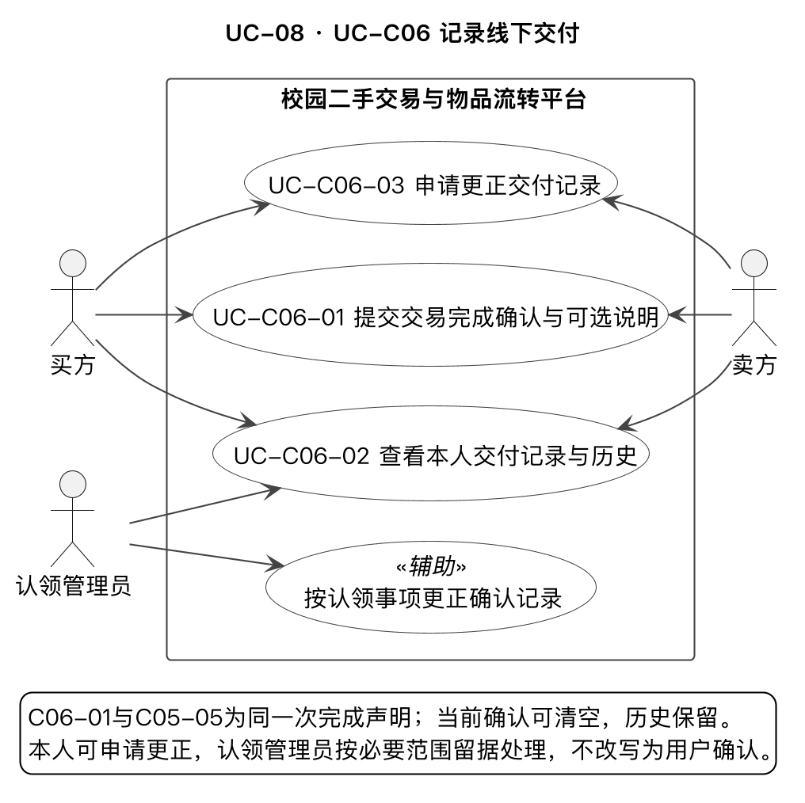

<!--
Version: 0.1.2
Version-Datetime: 2026-10-26T12:37:57+08:00
-->

# UC-C06 记录线下交付

## 用例图

[UC-08-记录线下交付用例图 源文件](../models/UC-08-记录线下交付用例图.puml)

| 要素 | 内容 |
|---|---|
| 参与者 | 交易双方；认领管理员（按必要范围查看或有依据更正确认记录） |
| 目标 | 在约定生效后分别提交交付及支付均已完成的声明并查看历史 |
| 触发规律 | 双方平台外履行后在交易中确认，或查看／申请管理更正已有记录 |
| 前置条件 | 本人为交易双方之一；提交须有有效约定、交易进行中且当前权限允许；历史读取及管理更正分别校验。 |
| 正常流程 | 1. 交付及支付的安排随交易约定保存，与完成声明分开；2. 在US-05的同一完成确认入口，用户一次声明两项均已完成，可填写说明；双方分别留存；3. 争议恢复或管理恢复清空当前确认标记、保留历史，再确认形成新的历史记录；4. 确需更正已提交记录时由认领管理员有依据调整，原记录和处理依据继续保留。 |
| 替代与异常流程 | 1. 约定有效、当前资格允许时，一方提交一次完成确认：记录该用户ID、时间和可选说明，同时声明交付与支付完成，不要求第二个交付确认步骤；2. 已有一方确认时，另一方确认：两方记录互不覆盖，普通流程更新交易完成；3. 争议解决并恢复进行中时，查看当前进度及历史：当前确认清空，原历史保留；恢复不启动计时，重新提交完成确认产生新记录并开始相应计时；4. 完成声明已提交时，用户自行更正或删除：拒绝自行改写；认领管理员处理须留原记录与依据；5. 用户或管理员访问记录时，查看确认历史：双方仅本人参与交易可见，管理员限本人认领事项必要范围；记录表示声明而非平台核实 |
| 后置结果 | 查询返回当前有资格内容；写操作按各分支保存记录及关联结果，失败或拒绝时保留原业务状态。 |
| 关联需求及用户故事 | FR-06；US-06；协作故事见[故事索引](../user-stories/index.md) |
| 关联场景及规则 | SC-05、SC-06；BR-04、BR-07、BR-27、BR-28、BR-29、BR-30 |

## 子用例的具体条件与结果

| 编号与目标 | 触发及前置 | 业务动作与结果 | 主要参与类 | 依据 |
|---|---|---|---|---|
| UC-C06-01 提交交易完成确认与可选说明 | 与UC-C05-05相同的有效约定及资格 | 执行同一次完成声明，保存用户ID、时间及可选说明，不新增第二个确认步骤 | C-01、C-09、C-10、C-13 | BR-28；分别保存，不覆盖对方 |
| UC-C06-02 查看本人交付记录与历史 | 本人为交易参与者或认领管理员有必要访问资格 | 读取当前有效确认及历次确认，区分重置标记与保留历史 | C-01、C-09、C-10、C-13 | BR-27、BR-29；当前确认可清空，历史不删除 |
| UC-C06-03 申请更正交付记录 | 已提交记录确需更正 | 向对应管理事项说明，由认领管理员留据处理，用户不自行改写原记录 | C-01、C-09、C-10、C-13 | BR-29；用户不能自行更正，由管理员按处置记录处理 |

## 参与类、业务属性及必要行为

| 领域类 | 相关业务属性 | 必要行为与协作 |
|---|---|---|
| [C-01 用户账户](../class-analysis/C-01-用户账户.md) | 用户ID、账户状态、管理资格 | 校验完成声明的提交者及历史访问资格，管理更正须具备认领权限 |
| [C-09 交易记录](../class-analysis/C-09-交易记录.md) | 买卖双方、有效约定、交易状态、当前确认、等待计时、状态历史 | 提供声明前置及所属交易；依据双方确认更新进度，恢复时清空当前进度 |
| [C-10 交易完成确认记录](../class-analysis/C-10-交易完成确认记录.md) | 所属交易、确认人用户ID、确认时间、可选说明、当前有效标记 | 保存交付及支付统一声明；双方记录互不覆盖；恢复清标记、保留历史，拒绝用户自行改写 |
| [C-13 处置记录](../class-analysis/C-13-处置记录.md) | 事项对象、认领管理员、调整原因及依据 | 记录认领管理员对已提交声明的有依据更正，保留原记录与处理依据 |

## 对象行为协作

1. C-09提供有效约定、阶段及资格；C-10保存当前用户ID的统一交付／支付声明。
2. C-09聚合双方当前有效确认，普通双确认后完成；争议恢复只让当前标记失效，历史记录仍关联原交易。
3. C-13处理必要更正并保留依据，不替用户伪造C-10。

## 验收与对应用户故事

[US-05 请求与确认交易](../user-stories/US-05-请求与确认交易.md)、[US-06 记录线下交付](../user-stories/US-06-记录线下交付.md)。主故事为US-06；相关故事通过上述业务流程协作，验收条件见各故事的AC编号。

[用例索引](index.md) · [子用例清单](子用例分解.md) · [用户故事索引](../user-stories/index.md) · [场景索引](../scenarios/index.md) · [现行规则](../../requirements/04-规则与权限.md)
