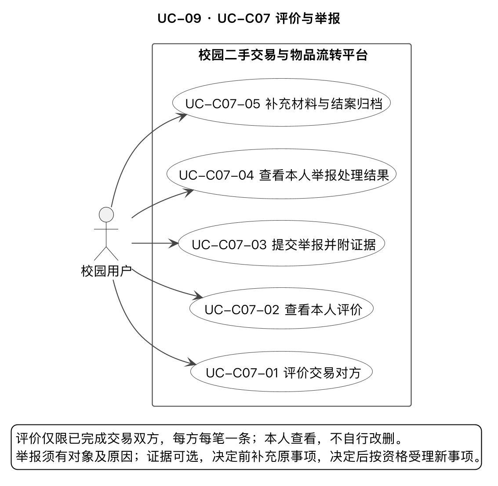

<!--
Version: 0.1.3
Version-Datetime: 2026-11-27T22:59:12+08:00
-->

# UC-C07 评价与举报

## 用例图

[UC-09-评价与举报用例图 源文件](../models/UC-09-评价与举报用例图.puml)

| 要素 | 内容 |
|---|---|
| 参与者 | 已完成交易的参与方，或未被封禁的登录用户；认领管理员通过 UC-C08 处理违规评价及举报 |
| 目标 | 评价交易对方，或独立举报违规对象并查看处理结果 |
| 触发规律 | 交易完成后评价，或发现可举报对象存在问题 |
| 前置条件 | 评价要求交易完成且本人为双方之一；举报要求未被封禁且对象有效；两条路径独立。 |
| 正常流程 | 1. 评价与举报是独立目标，举报不以已经成交或先评价为前提；2. 完成交易每方每笔可提交一条1—5分及文字评价，仅在本人“我的评价”按发表／收到查看；3. 在可见商品、评论、消息、评价或商品卖方处打开举报，页面固定来源对象，用户填写原因，说明和截图等证据可选；4. 同用户同对象的举报在原事项决定前合并补充；决定后符合资格的举报通过新事项受理，已归档事项供查阅；5. 结论经管理员确认匿名公开；举报人收到本人处理结果通知，受影响者的说明／申辩另行授权。 |
| 替代与异常流程 | 1. 评价已提交时，用户修改或删除：拒绝自行修改删除；管理员可有依据处理违规评价；2. 未被封禁的登录用户发现违规对象时，填写对象与原因并选择是否附证据：原因与对象完整即可提交；截图和补充说明可选；3. 同用户同对象已有未结举报时，再次提出相同对象问题：决定前在原事项补充；决定后按资格受理新事项，结案记录归档；4. 举报已结案并由管理员确认时，查看通知及公开结果：举报人收到可公开结论和原因；公开结果隐去用户及管理员信息；5. 举报对象失效时，查看已有举报或尝试新举报：既有事项按资格关联可查；失效后新举报失败；对方申辩不因举报身份开放；6. 账户仅有交易冻结或已封禁时，评价既往完成交易或提交其他举报：仅冻结仍按原资格允许；封禁拒绝新增评价及举报 |
| 后置结果 | 查询返回当前有资格内容；写操作按各分支保存记录及关联结果，失败或拒绝时保留原业务状态。 |
| 关联需求及用户故事 | FR-07；US-07；协作故事见[故事索引](../user-stories/index.md) |
| 关联场景及规则 | SC-07；BR-24—BR-26、BR-27、BR-32；4.17—4.18 |

## 子用例的具体条件与结果

| 编号与目标 | 触发及前置 | 业务动作与结果 | 主要参与类 | 依据 |
|---|---|---|---|---|
| UC-C07-01 评价交易对方 | 交易完成、本人为双方之一且未封禁 | 每方每笔提交唯一1—5分及文字评价，重复或未完成拒绝 | C-01、C-02、C-09、C-11、C-12、C-13、C-14、C-15 | BR-24；每方每笔一条，1—5 分加文字 |
| UC-C07-02 查看本人评价 | 已登录且本人为评价者或被评价者 | 在“我的评价”按发表／收到读取并关联交易；拒绝其他用户越权读取，不提供商品页公开展示 | C-01、C-02、C-09、C-11、C-12、C-13、C-14、C-15 | BR-24、BR-27；本人发表／收到归属及事项必要范围 |
| UC-C07-03 提交举报并附证据 | 未封禁且可定位有效举报对象 | 填写对象及原因，可选证据，创建举报并进入共享池 | C-01、C-02、C-09、C-11、C-12、C-13、C-14、C-15 | BR-25；可举报商品、评论、消息、评价或用户；须明确对象和原因，补充说明／截图等证据可选，不强制上传 |
| UC-C07-04 查看本人举报处理结果 | 本人举报已有处理结果 | 查看本人进度，管理员确认后读取匿名公开结论及本人通知 | C-01、C-02、C-09、C-11、C-12、C-13、C-14、C-15 | BR-25、BR-26；经确认后匿名公开 |
| UC-C07-05 补充材料与结案归档 | 同对象已有本人待认领、处理中或已决定的举报 | 决定前补充原事项；决定后按资格另建事项，结案记录归档供查阅 | C-01、C-02、C-09、C-11、C-12、C-13、C-14、C-15 | 决定前的同用户同对象举报并入原事项；决定后按资格受理新举报，原记录与依据保留 |

## 参与类、业务属性及必要行为

| 领域类 | 相关业务属性 | 必要行为与协作 |
|---|---|---|
| [C-01 用户账户](../class-analysis/C-01-用户账户.md) | 用户ID、账户状态 | 校验评价者、举报者身份及封禁限制 |
| [C-02 商品](../class-analysis/C-02-商品.md) | 关联举报对象、生命周期状态、展示资格 | 提供商品举报对象及其可定位性；商品展示资格不决定本人评价的读取资格 |
| [C-09 交易记录](../class-analysis/C-09-交易记录.md) | 交易标识、买卖双方、交易状态 | 读取完成结果及参与方，判定每方每笔评价资格，不推进交易 |
| [C-11 评价](../class-analysis/C-11-评价.md) | 交易、评价者、被评价者、评分、文字、提交时间、违规处理依据 | 提交每方每笔唯一评价；按本人发表／收到归属读取，拒绝越权读取及用户修改删除；违规处理复用 UC-C08 |
| [C-12 举报记录](../class-analysis/C-12-举报记录.md) | 举报者、对象及类型、原因及证据、处理进度、结论及公开结果 | 提交或在未结事项补充举报；结案归档，按资格读取进度与经确认的匿名结论 |
| [C-13 处置记录](../class-analysis/C-13-处置记录.md) | 关联举报、认领管理员、处理结论及可公开理由 | 关联并读取举报处理结果；对方申辩内容不因举报身份开放，处置沿用 UC-C08 |
| [C-14 账户限制记录](../class-analysis/C-14-账户限制记录.md) | 受限账户、限制类型、生效及解除时间 | 读取封禁限制，校验新增评价与举报资格 |
| [C-15 站内通知](../class-analysis/C-15-站内通知.md) | 举报处理事件、接收人、来源举报、通知内容 | 向举报人发送处理结果通知，关联可公开结论及原因 |

## 对象行为协作

1. C-01和C-09校验互评资格，C-11保存每方每笔唯一评价，按评价者／被评价者归属供“我的评价”读取，不依赖 C-02 当前公开详情资格。
2. C-12保存有效举报对象、原因及可选证据，C-13认领核查，必要时关联C-14限制账户。
3. C-12经确认产生匿名公开结果，C-15向举报人及按规则受处置影响者分别通知，私人申辩保持隔离。

## 验收与对应用户故事

[US-07 评价与举报](../user-stories/US-07-评价与举报.md)、[US-08 审核与处置沟通](../user-stories/US-08-审核与处置沟通.md)、[US-11 接收通知与待办](../user-stories/US-11-接收通知与待办.md)、[US-12 管理本人业务](../user-stories/US-12-管理本人业务.md)。主故事为US-07；相关故事通过上述业务流程协作，验收条件见各故事的AC编号。

[用例索引](index.md) · [子用例清单](子用例分解.md) · [用户故事索引](../user-stories/index.md) · [场景索引](../scenarios/index.md) · [现行规则](../../requirements/04-规则与权限.md)
