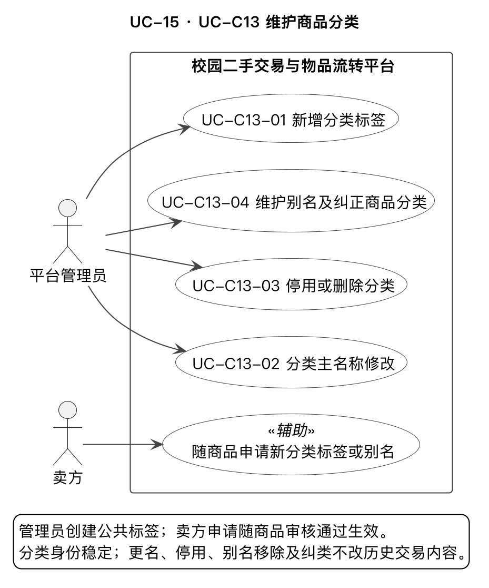

<!--
Version: 0.1.2
Version-Datetime: 2026-10-26T12:37:57+08:00
-->

# UC-C13 维护商品分类

## 用例图

[UC-15-维护商品分类用例图 源文件](../models/UC-15-维护商品分类用例图.puml)

| 要素 | 内容 |
|---|---|
| 参与者 | 有分类管理权限的平台管理员；申请标签的卖方参与关联审核 |
| 目标 | 维护单级多标签及别名，处理随商品提出的标签申请 |
| 触发规律 | 管理员创建或维护分类、卖方发布时缺少合适标签、需要纠正商品归类 |
| 前置条件 | 常设分类维护要求管理员资格；用户标签申请限随本人商品提交，并由认领审核管理员处理。 |
| 正常流程 | 1. 管理员可主动建立公共分类标签，用户可随商品提出申请；2. 申请新名称与已有分类同义时可作别名，批准随商品审核通过生效；3. 主名更改保持分类身份，旧名保留别名，当前显示新名、历史交易留当时名称；4. 已关联商品分类仅停用，从未关联可逻辑删除；有在售商品仍保留其筛选入口；5. 管理员有依据纠正交易中分类并通知卖方，交易约定及历史内容保持。 |
| 替代与异常流程 | 1. 申请标签不合适但商品合规时，管理员审核：有合适已有标签则说明原因后通过；否则按不通过记录并写明退回补充原因，不因标签名当然拒绝商品；2. 分类存在主名及别名时，改名或移除别名：分类身份及商品归属不变；改主名保留旧别名，历史交易保留当时名称；3. 分类曾关联商品时，请求删除或停用：仅停用，旧商品及交易保持；有在售商品时仍可筛选，新的发布不可选；4. 分类从未关联商品时，管理员删除：逻辑删除并保留必要依据；5. 交易中商品需纠正分类时，有权限管理员留据调整：记录前后分类、原因、执行者及时间并通知卖方；不改约定、交易状态及历史内容；6. 商品匹配多个选定标签时，检索：全部所选标签均匹配且同时满足关键词与价格；同义别名不重复计标签 |
| 后置结果 | 查询返回当前有资格内容；写操作按各分支保存记录及关联结果，失败或拒绝时保留原业务状态。 |
| 关联需求及用户故事 | FR-13；US-13；协作故事见[故事索引](../user-stories/index.md) |
| 关联场景及规则 | SC-10、SC-03；FR-13；BR-11、BR-12、BR-15；4.16 |

## 子用例的具体条件与结果

| 编号与目标 | 触发及前置 | 业务动作与结果 | 主要参与类 | 依据 |
|---|---|---|---|---|
| UC-C13-01 新增分类标签 | 管理员有分类管理资格或卖方随商品申请 | 管理员可主动创建，卖方申请随商品通过生效，初始条目由管理员准备 | C-01、C-02、C-03、C-04、C-15 | FR-13；管理员可主动创建公共标签，不依赖商品；初始条目由管理员准备 |
| UC-C13-02 分类主名称修改 | 管理员维护已有分类 | 改主名保留旧别名，分类身份、商品归属及交易历史保持 | C-01、C-02、C-03、C-04、C-15 | 主名称可改，旧名保留为别名；商品分类身份不变，当前展示新名、历史交易内容保留旧名；不设排序 |
| UC-C13-03 停用或删除分类 | 分类曾或未关联商品 | 关联过仅停用，未关联可逻辑删除，有在售时停用标签仍可筛选 | C-01、C-02、C-03、C-04、C-15 | 关联过商品仅停用，旧商品不自动下架且有在售时可筛选；未关联可逻辑删除 |
| UC-C13-04 维护别名及纠正商品分类 | 管理员维护别名或纠正分类有依据 | 主名别名指同一分类，移除别名不改归属；纠类留前后内容并通知卖方，不改交易约定 | C-01、C-02、C-03、C-04、C-15 | 4.16、BR-11：主名别名同一分类、历史名称保留；纠类留据并通知卖方，不改交易约定 |

## 参与类、业务属性及必要行为

| 领域类 | 相关业务属性 | 必要行为与协作 |
|---|---|---|
| [C-01 用户账户](../class-analysis/C-01-用户账户.md) | 用户ID、管理资格、账户状态 | 校验常设分类维护资格及商品标签申请资格，具体审核仍校验认领归属 |
| [C-02 商品](../class-analysis/C-02-商品.md) | 商品分类标签、生命周期状态、编辑历史 | 随商品关联分类申请；管理员纠正分类时保存前后内容，不改变交易约定及历史 |
| [C-03 商品分类](../class-analysis/C-03-商品分类.md) | 分类标识、主名称、别名、启用状态及商品关联 | 创建、改名、维护别名、停用或逻辑删除分类；提供全部标签匹配与停用标签筛选依据 |
| [C-04 审核记录](../class-analysis/C-04-审核记录.md) | 商品及当次内容、审核结论、拒绝原因 | 提供同批商品审核结果，决定申请标签或别名是否生效；保留退回补充原因 |
| [C-15 站内通知](../class-analysis/C-15-站内通知.md) | 分类纠正事件、卖方、来源商品、通知内容 | 纠正商品分类后通知卖方，审核结果通知复用 UC-C02 |

## 对象行为协作

1. C-03由管理资格控制主名、别名、停用及逻辑删除；C-02商品引用稳定分类身份。
2. C-04随商品审核处理新标签／别名申请；商品通过才使申请生效，C-15通知相关用户。
3. 交易中纠类保留C-02前后内容、原因和主体，C-09的既有约定及历史内容保持。

## 验收与对应用户故事

[US-02 发布与维护商品](../user-stories/US-02-发布与维护商品.md)、[US-03 检索商品](../user-stories/US-03-检索商品.md)、[US-13 维护商品分类](../user-stories/US-13-维护商品分类.md)。主故事为US-13；相关故事通过上述业务流程协作，验收条件见各故事的AC编号。

[用例索引](index.md) · [子用例清单](子用例分解.md) · [用户故事索引](../user-stories/index.md) · [场景索引](../scenarios/index.md) · [现行规则](../../requirements/04-规则与权限.md)
