<!--
Version: 0.1.5
Version-Datetime: 2026-10-21T21:20:00+08:00
-->

# 图文件目录

用例图、领域类图、活动图、状态图、上下文图及其他报告图统一存放于本目录，包含可编辑源文件和同名 SVG／PNG 等导出图。当前已有 ACT-01—ACT-11 十一张活动图（`.puml` 源文件与同名 `.svg` 导出图），以及 CL-01、ST-01、ST-02 三个 Mermaid 源文件（按小组安排暂不提供导出图）。

- 命名采用图编号加名称；各源文件及导出图分别记录版本，二进制文件配套 `.version` 记录。
- 报告正文使用 Markdown 图片语法及相对路径直接展示导出图，不能仅列下载链接或模型代码；活动图已在 [05 章 5.3.10](../requirements/draft-05-行为与状态.md) 以图片语法展示；CL-01／ST-01／ST-02 暂不提供导出图，正文引用源文件，不插入指向不存在图片的链接。
- [图索引](draft-index.md) 可后续补充，逐图关联正文及 evidence，关联项目／分析项可选。
- 本项目保留领域类分析，不做传统数据建模，不要求数据字典。

## 活动图展示

以下按编号顺序以图片语法直接展示导出图。

**图 ACT-01 发布与首次审核（SC-02）**

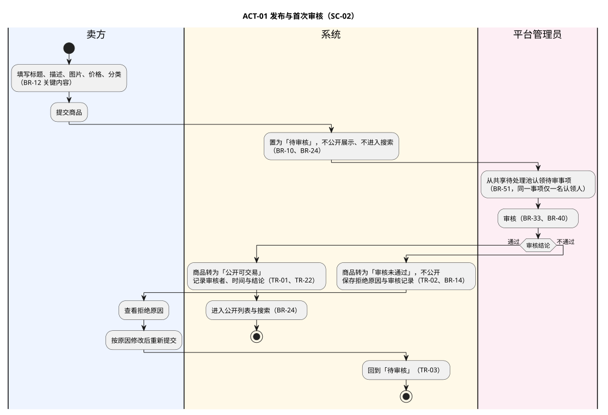

**图 ACT-02 交易请求、锁单与双方确认（SC-05）**

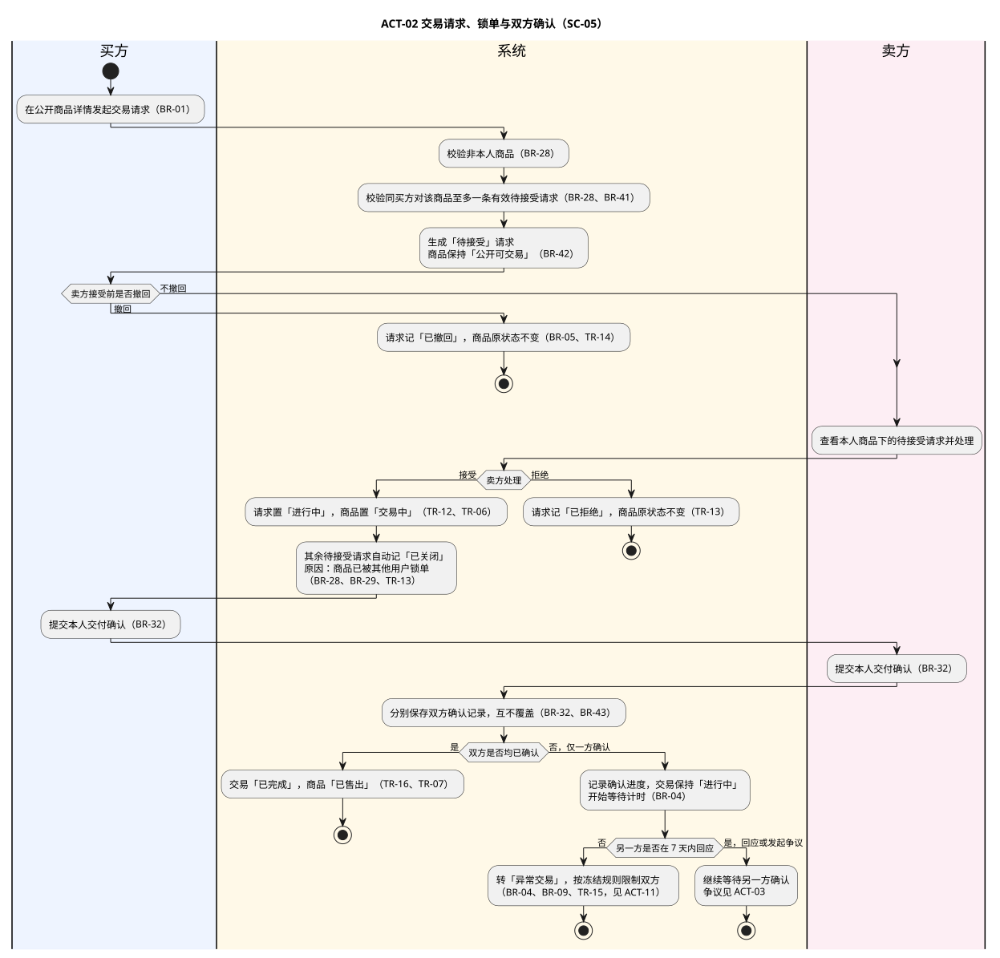

**图 ACT-03 交易争议与恢复（SC-06）**

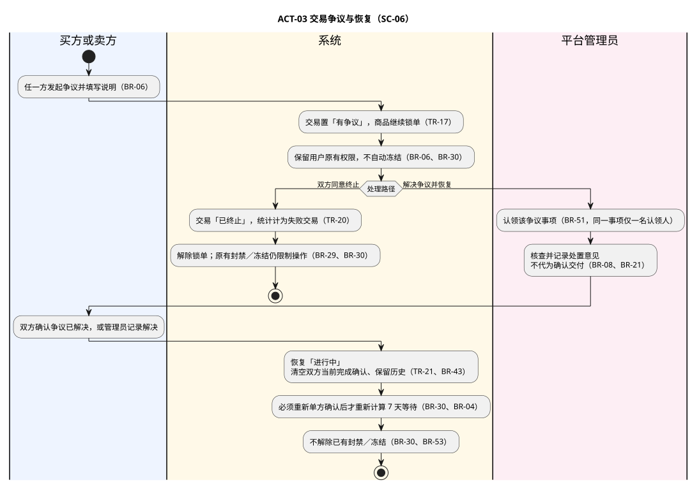

**图 ACT-04 商品信息修改、锁单与下架（SC-02）**

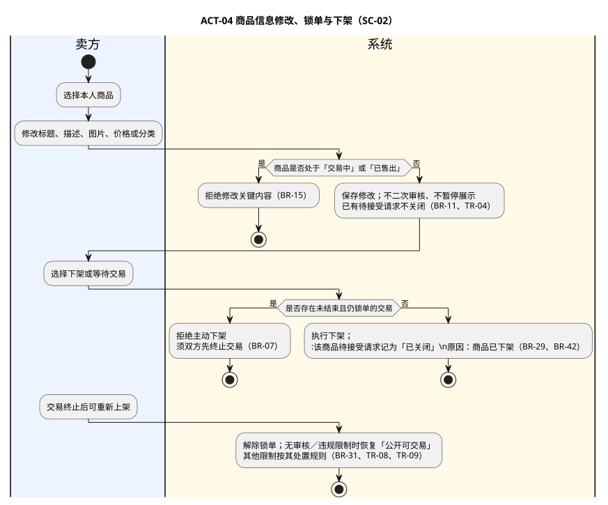

**图 ACT-05 账户与访问控制（SC-01）**

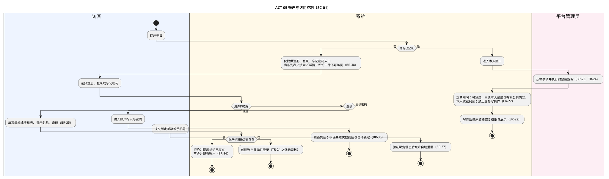

**图 ACT-06 检索、详情可见性与收藏（SC-03）**

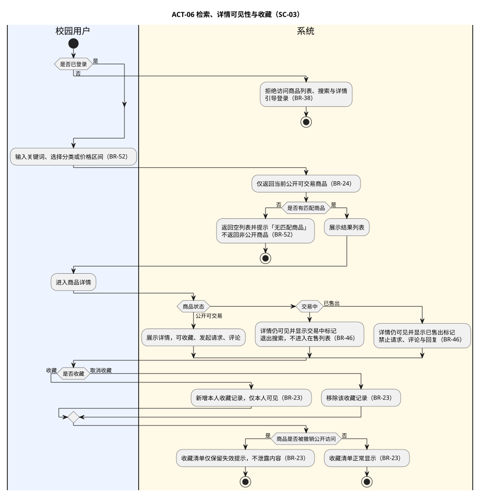

**图 ACT-07 商品评论与买卖 IM（SC-04）**

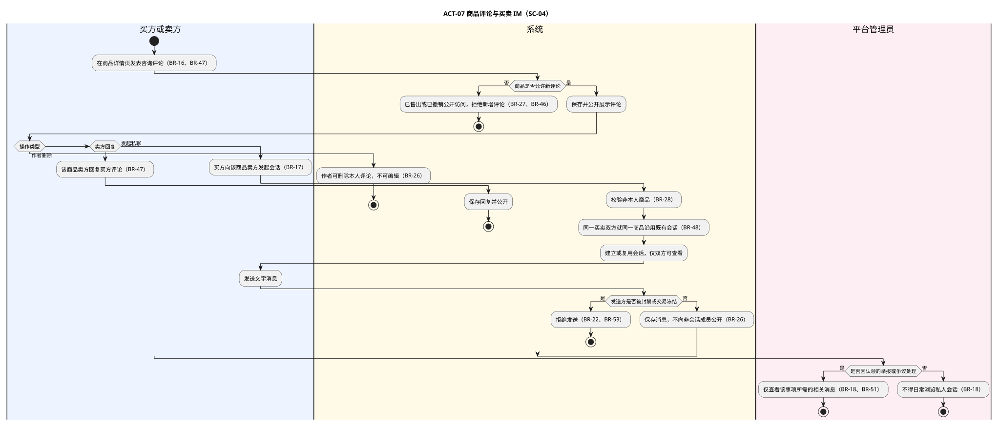

**图 ACT-08 完成交易评价（SC-07）**

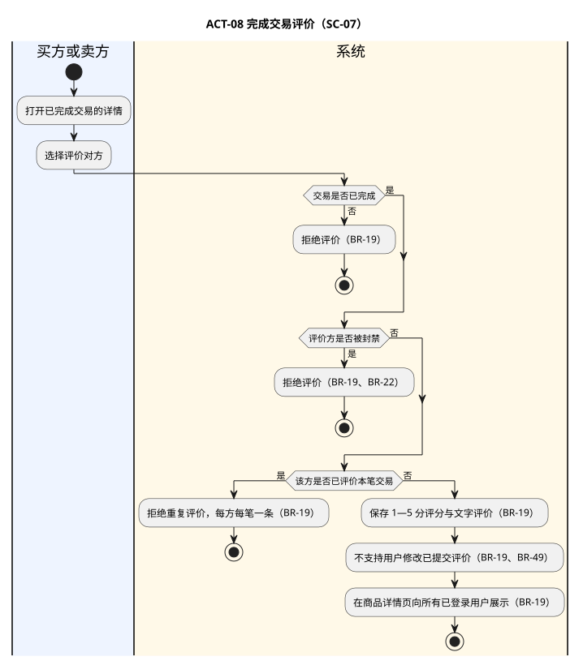

**图 ACT-09 举报、认领处置与封禁（SC-07）**

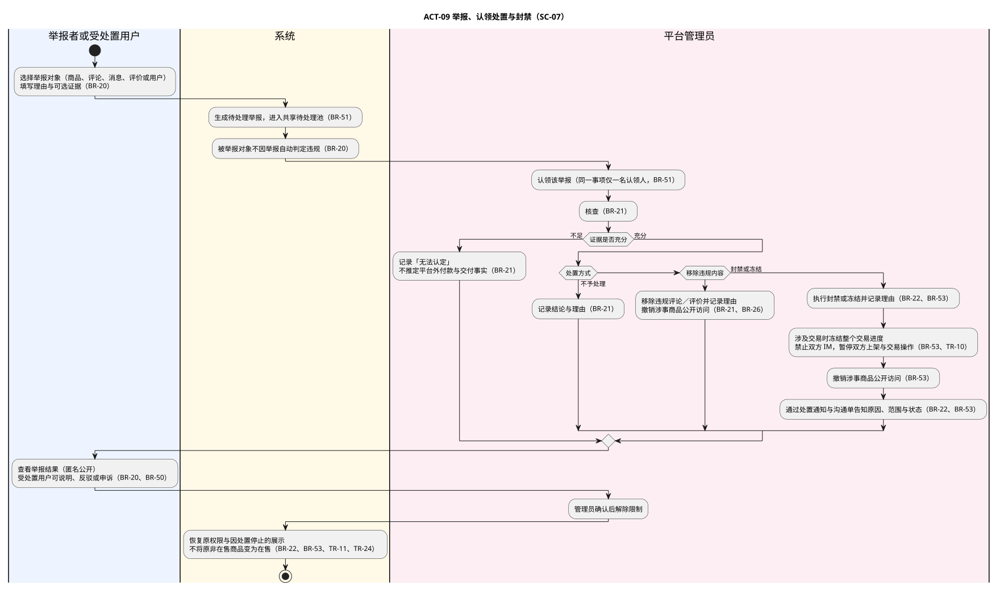

**图 ACT-10 管理员统计（SC-08）**

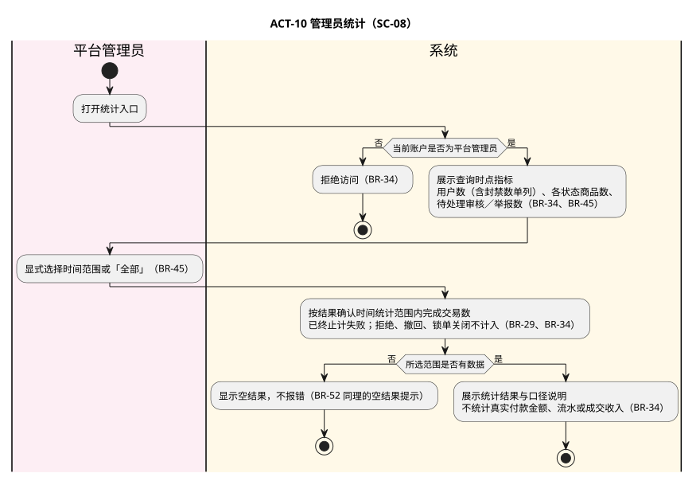

**图 ACT-11 单方确认超时与异常交易处置（SC-09）**

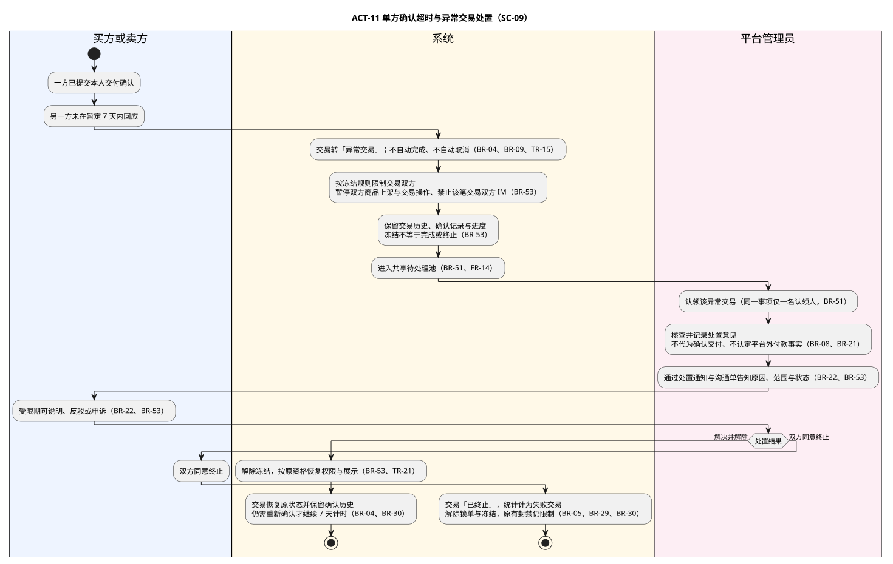
