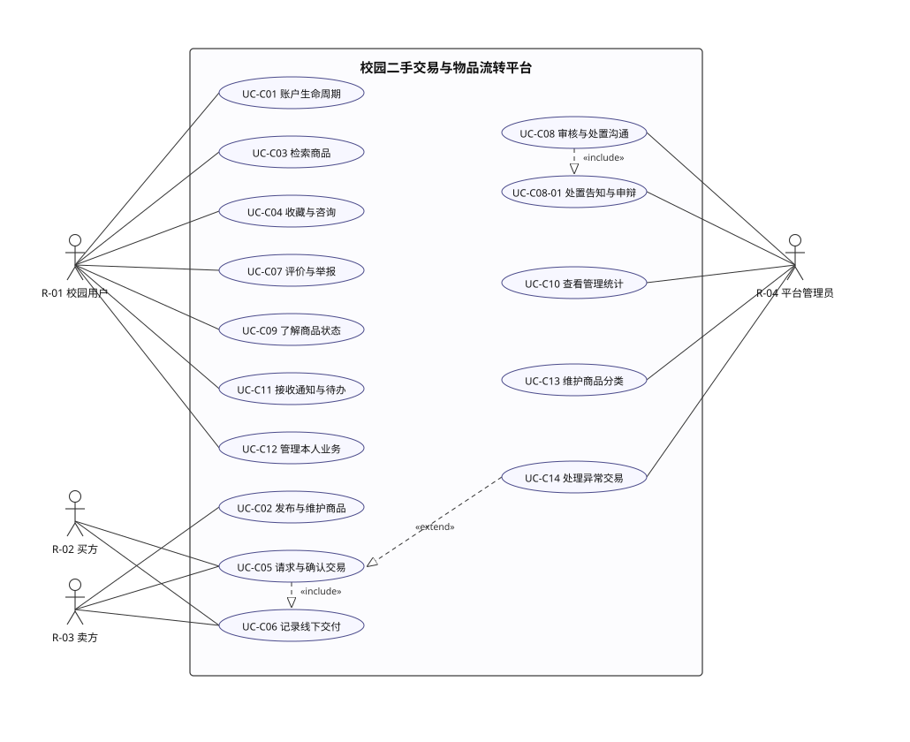
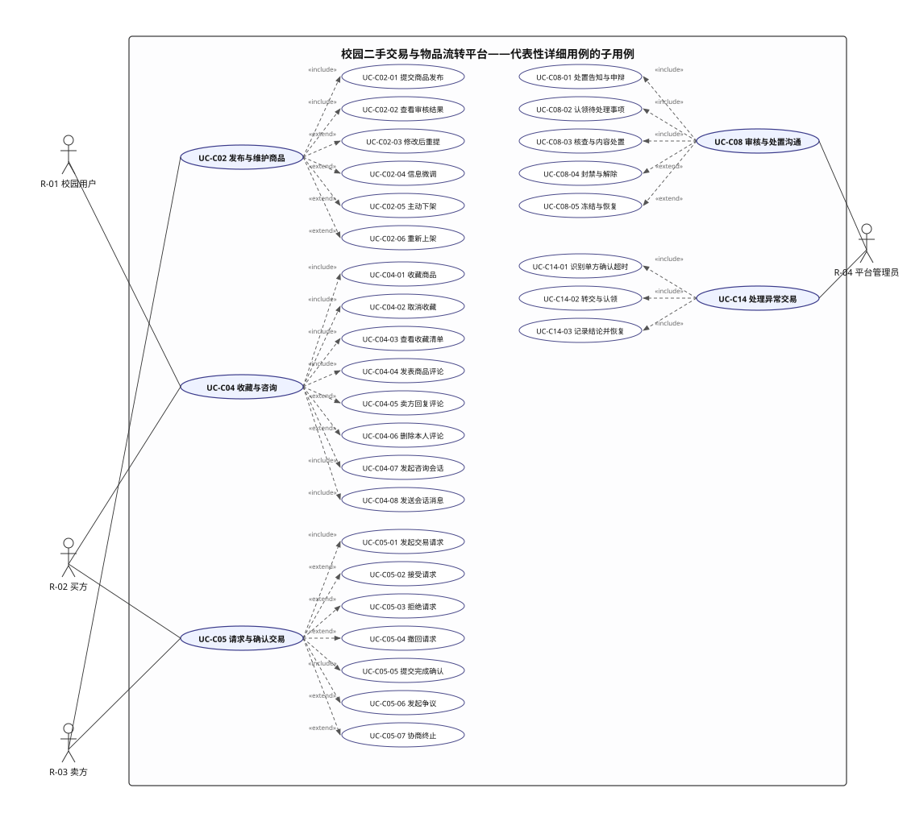

<!--
Version: 0.1.19
Version-Datetime: 2026-10-23T03:47:24+08:00
-->

# 2. 用户需求

状态：需求分析草稿。

## 2.1 需求组织

FR-01—FR-10 对应题目十项覆盖基线，其中 FR-01 包含账户生命周期能力；FR-11—FR-14 为独立业务主需求。

## 2.2 角色基础

| 编号 | 角色 | 边界 |
|---|---|---|
| R-01 | 校园用户 | 学生与教职工普通注册，不核验校园身份；访客仅有注册、登录、忘记密码入口 |
| R-02 | 买方 | 在某商品咨询／交易中的业务身份，不是互斥账户类型 |
| R-03 | 卖方 | 本人商品发布者，可在别的商品中作为买方 |
| R-04 | 平台管理员 | 认领事项并在归属／必要范围内管理；管理身份不自动授予私人记录任意访问权 |

买卖角色随商品／交易变化；封禁、冻结是限制，不是新的业务角色。项目组长和教师是涉众，不自动成为系统角色。

## 2.3 题目十项功能及扩充范围

| 编号 | 功能分组 | 系统应提供的能力 | 规则依据 |
|---|---|---|---|
| FR-01 | 账户生命周期 | 普通注册、登录、退出登录、忘记密码／自助重置、修改密码、绑定或更换邮箱／手机号、修改显示名称；仍覆盖题目第 1 项“用户注册与认证” | BR-35—BR-39；新增细则待 P-19 |
| FR-02 | 商品发布与审核 | 发布、首次审核、拒绝原因展示、修改重提、允许状态下信息微调及上下架；微调不改变商品主要内容和交易内容，下架关闭待接受请求并说明原因；管理员维护／展示禁发范围 | BR-07、BR-10—BR-15、BR-31、BR-33、BR-40 |
| FR-03 | 搜索与筛选 | 关键词／分类／价格组合检索、空结果提示；按资格显示商品详情和状态 | BR-24、BR-38、BR-46、BR-52 |
| FR-04 | 收藏与咨询 | 收藏及个人清单、失效提示；商品页评论、卖方回复买方；买方发起私人文字会话、历史查看及允许时发送；IM 会话列表与未读提示 | BR-16—BR-18、BR-23、BR-26、BR-27、BR-47、BR-48 |
| FR-05 | 下单与交易确认 | 请求、接受／拒绝、撤回、完成确认、协商终止；任一方说明发起争议、解决恢复；单方确认超时识别与异常转交 FR-14 | BR-01—BR-09、BR-28—BR-31、BR-41、BR-42、BR-53 |
| FR-06 | 线下交付记录 | 双方分别提交确认与可选说明、查看本人历史；管理员按处置记录处理更正 | BR-25、BR-32、BR-43、BR-44、BR-49 |
| FR-07 | 评价与举报 | 完成交易互评、在商品详情页展示；提交举报并可附证据、管理员确认后匿名展示结果；评价删除与重复举报限制待 P-23 决定 | BR-19—BR-21、BR-22、BR-50 |
| FR-08 | 管理员审核与封禁 | 共享待办池、主动认领、核查处置、冻结／封禁／解除；处置通知与沟通单供用户说明、反驳／申诉和管理员解决；管理操作留痕，告知与申诉对象范围待 P-22 校对 | BR-08、BR-18、BR-21、BR-22、BR-33、BR-40、BR-51、BR-53 |
| FR-09 | 商品状态流转 | 展示商品状态、按请求及交易结果联动，普通终止解除锁单、按资格恢复；违规停止访问及解除后的恢复 | BR-02、BR-03、BR-07、BR-11、BR-15、BR-30、BR-31、BR-46、BR-53；TR-01—TR-21 |
| FR-10 | 数据统计 | 管理员选时间范围或全部查看账户、商品状态、审核／举报待办及交易结果统计 | BR-29、BR-34、BR-45 |

FR-08 的处置沟通与 FR-04 买卖双方 IM 分别管理，封禁／冻结期间仍保留前者。

## 2.4 新增功能主需求

| 编号 | 主需求 | 系统应提供的能力与边界 | 关联与待确认 |
|---|---|---|---|
| FR-11 | 站内通知与待办 | 提供审核结果、交易请求接受／拒绝／关闭、单方确认与超时、处置告知、评价与举报结果等业务事件的站内通知与待办；区分未读与已读 | 与相关业务引用关联，不隶属 FR-01—FR-10；具体触发范围、是否扩展邮件／短信及已读规则见 P-20 |
| FR-12 | 个人业务管理（我的） | 集中查看和管理本人商品（含待接受请求）、交易、收藏、评价、举报及处置沟通记录；各操作继续遵守对象归属、资格及状态限制 | 聚合本人业务入口，不增加对他人私人记录的访问权；入口范围与优先级待确认，不将所有记录都解释为可编辑或删除 |
| FR-13 | 商品分类维护 | 平台管理员统一维护商品分类，系统提供初始分类，供商品归类与分类筛选使用 | 维护者已定；操作集、初始条目、停用／删除及既有商品与筛选处理见 P-18；与禁发范围维护区分 |
| FR-14 | 异常交易处理 | 单方确认超时形成异常交易，进入管理员共享待处理池，由管理员认领处理；不自动完成或取消，不替双方确认交付 | FR-05 负责识别与转交；沿用既定冻结／沟通边界，处理方式、恢复路径与是否承诺时限见 P-21；不得等同普通争议解决 |

## 2.5 用户故事与用例

用户目标、价值及候选验收条件见[用户故事](../appendices/user-stories/index.md)；用例候选与详细用例入口见[用例清单](../appendices/use-cases/index.md)。

已选 5 个代表性详细用例：UC-C02 发布与维护商品、UC-C04 收藏与咨询、UC-C05 请求与确认交易、UC-C08 审核与处置沟通、UC-C14 处理异常交易，均含参与者、触发、前置条件、正常／替代／异常流程、后置结果、关联规则及可检验验收条件。未入选的 UC-C01、C03、C06、C07、C09—C13 保持候选。

上述 5 个详细用例的子用例分解与关系见[子用例分解](../appendices/use-cases/子用例分解.md)；虚线箭头为主用例对子用例的包含，标注 «extend» 者为条件或替代分支。

## 2.6 需求来源

题目十项来自既有题目材料，历次范围和规则见[证据索引](../appendices/evidence/index.md)，本次业务范围依据见[E-07](../appendices/evidence/E-07-需求结构扩展.md)。待确认细则见[开放清单](../../bits/未决问题与复核清单.md)。
