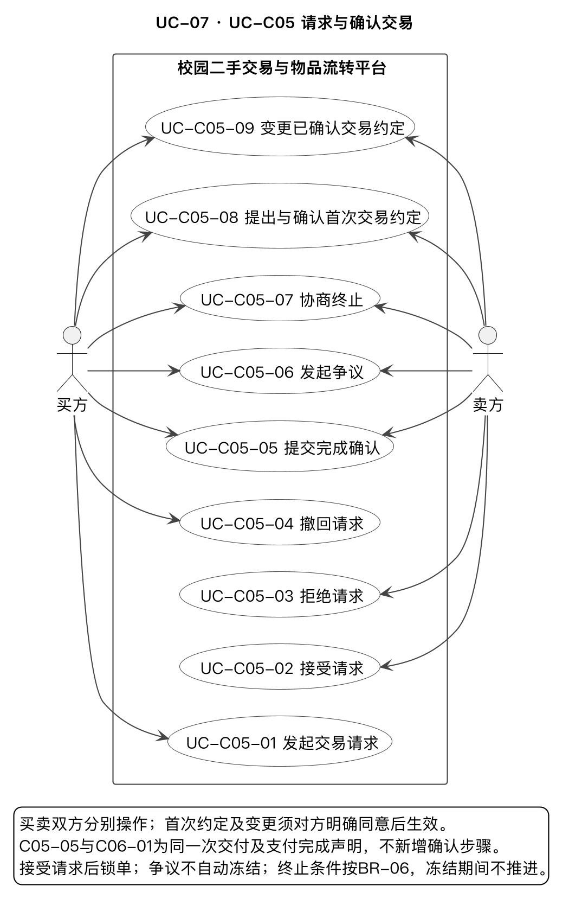
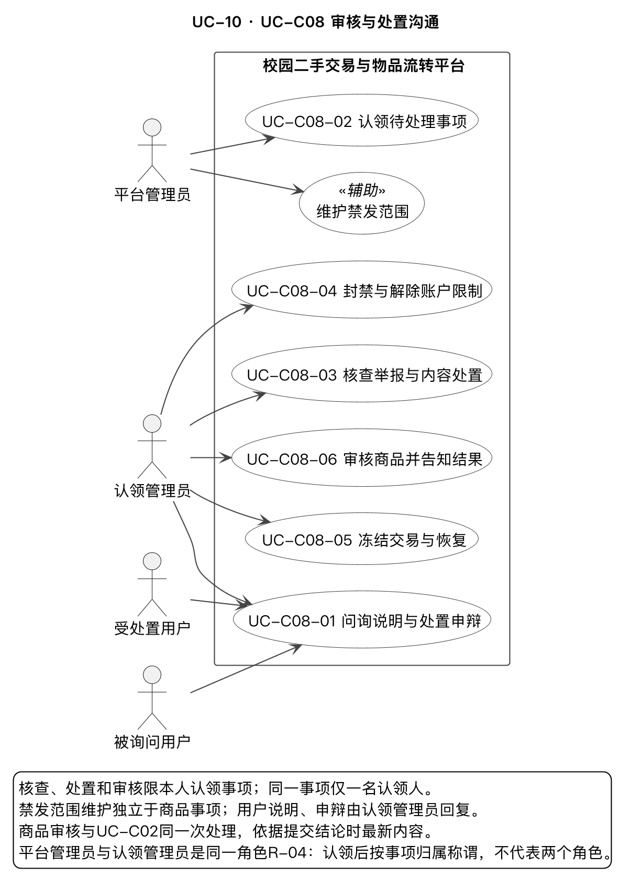
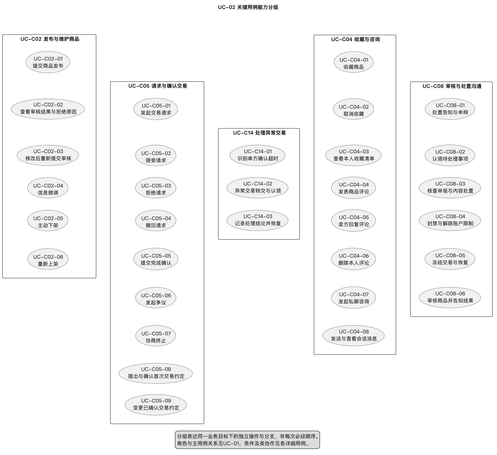

<!--
Version: 0.1.27
Version-Datetime: 2026-10-27T21:54:13+08:00
-->

# 2. 用户需求

## 2.1 需求组织

FR-01—FR-10 对应题目十项覆盖基线，其中 FR-01 包含账户生命周期能力；FR-11—FR-14 为独立业务主需求。

交易进行中须支持双方提出并明确确认交付约定，内容至少包括交付时间、文字地点、交付方式及支付安排（约定金额、支付方式、支付时点）。约定确认与交易完成确认分别表达；双方后续各自的一次完成确认，同时确认交付和支付。

## 2.2 角色基础

| 编号 | 角色 | 边界 |
|---|---|---|
| R-01 | 校园用户 | 学生与教职工普通注册，不核验校园身份；访客仅有注册、登录、忘记密码入口 |
| R-02 | 买方 | 在某商品咨询／交易中的业务身份，同一账户可随商品或交易担任不同身份 |
| R-03 | 卖方 | 本人商品发布者，可在别的商品中作为买方 |
| R-04 | 平台管理员 | 认领事项并在归属／必要范围内管理；管理身份不自动授予私人记录任意访问权 |

买卖角色随商品／交易变化；封禁、冻结是限制，不是新的业务角色。项目组长和教师是涉众，不自动成为系统角色。

### 使用端与职责

校园用户通过移动端处理商品、沟通、交易、通知及本人业务；管理员通过电脑端处理审核、举报与争议、限制处置、分类维护及统计。

## 2.3 题目十项功能及扩充范围

| 编号 | 功能分组 | 系统应提供的能力 | 规则依据 |
|---|---|---|---|
| FR-01 | 账户生命周期 | 验证注册邮箱控制权后普通注册、登录、退出登录、忘记密码／自助重置、修改密码、绑定或更换邮箱、修改显示名称；仍覆盖题目第 1 项“用户注册与认证” | BR-20—BR-23；用户 ID 唯一，用于审计及历史归属；邮箱唯一，用于登录；改密验证当前密码，更换邮箱须验证新旧邮箱，显示名称可自行修改 |
| FR-02 | 商品发布与审核 | 发布、首次审核、拒绝原因展示、修改重提、允许状态下信息微调及上下架；允许编辑遵守真实发布及交易中关键内容限制，下架关闭待接受请求并说明原因；管理员维护／展示禁发范围 | BR-09、BR-10—BR-12、BR-13、BR-14 |
| FR-03 | 搜索与筛选 | 关键词／分类标签／价格组合检索，多标签须全部匹配，各类条件同时满足；空结果提示；按资格显示商品详情和状态 | BR-14、BR-15、BR-22 |
| FR-04 | 收藏与咨询 | 收藏及个人清单、失效提示；商品页评论、卖方回复；卖方个人页提供普通私聊入口，双方可主动发起；普通私聊与按笔组织的交易 IM 分开，可在同一双人入口下展示分支、列表、未读及历史；各会话／分支分别计算已读，仅查看已展示消息才消除对应未读，列表及通知已读不代替消息已读；普通私聊不以商品或购买请求为前提；区分私聊咨询与购买请求后的交易咨询，系统引导该笔交易沟通进入对应分支，不识别或禁止普通私聊中的交易文字 | BR-16—BR-19 |
| FR-05 | 下单与交易确认 | 请求、接受／拒绝、撤回、完成确认、协商终止及争议恢复；有效请求自动打开对应交易 IM 分支、发出请求通知并保留记录，进入或阅读通知不等于接受；请求／交易结束后分支默认归档，可引导转入普通私聊；单方确认超时识别并转交 FR-14 | BR-01—BR-09、BR-14、BR-18、BR-33 |
| FR-06 | 线下交付记录 | 双方分别提交确认与可选说明、查看本人历史；管理员按处置记录处理更正 | BR-27、BR-28、BR-29、BR-30 |
| FR-07 | 评价与举报 | 完成交易互评，仅在本人“我的评价”按发表／收到查看；提交举报须明确对象和原因，补充说明／截图等证据可选；管理员确认后匿名展示结果；不提供用户自行删除评价；同用户同对象未结举报在原事项补充；结案后该举报事项归档，不再接受补充或重新提交 | BR-24—BR-26、BR-32 |
| FR-08 | 管理员审核与封禁 | 共享池认领、核查处置、冻结／封禁／解除；受处置用户从通知及独立事项入口说明申辩；认领管理员可有依据调整交易全部状态、留痕通知，不伪造双方确认 | BR-08、BR-13、BR-19、BR-26、BR-32—BR-34，4.15／4.17—18 |
| FR-09 | 商品状态流转 | 展示商品状态、按请求及交易结果联动，普通终止解除锁单、按资格恢复；违规停止访问及解除后的恢复 | BR-03、BR-04、BR-07、BR-09、BR-11、BR-14、BR-33；TR-01—TR-21 |
| FR-10 | 数据统计 | 管理员选时间范围或全部查看账户、商品状态、审核／举报待办及交易结果统计 | BR-06、BR-31 |

FR-08 的处置沟通与 FR-04 买卖双方 IM 分别管理，封禁／冻结期间仍保留前者。

## 2.4 新增功能主需求

| 编号 | 主需求 | 系统应提供的能力与边界 | 关联规则 |
|---|---|---|---|
| FR-11 | 站内通知与待办 | 按业务事件提醒有资格接收者并关联事项；包含审核、请求、约定变更、确认／取消／完成、商品编辑、举报及管理处理。购买请求同时汇总通知中心；通知与聊天按各自范围已读，均不代业务确认 | 事件及接收方见第 4 章 4.17；提醒通过站内通知中心提供 |
| FR-12 | 个人业务管理（我的） | 我的商品覆盖全部状态及审核原因／关联请求；我的交易覆盖买卖身份全部请求和交易；收藏、发表／收到的评价、我的举报／我收到的举报及管理沟通均有独立可查入口。收到的举报限已实际处置事项，不显示举报人；结束交易只读，不新增编辑或删除权 | 第4章4.18；资格及隐私沿用各业务规则 |
| FR-13 | 商品分类标签维护 | 单级多标签、别名与主名称维护、停用及逻辑删除；管理员主动创建，用户可随商品申请，新标签／别名随商品通过生效；审核通过商品至少一标签，多选筛选全部匹配 | 第4章4.16；分类身份稳定，当前展示与历史名称区分；初始条目由管理员准备 |
| FR-14 | 异常交易处理 | 单方完成确认后有效等待累计满7天仍未回应时转异常并冻结，进入共享池认领；管理沟通及进度可查，不承诺固定处理时限；认领管理员留据调整全部状态，不伪造用户确认 | 第4章4.15；结束解本笔冻结、商品默认下架／明确继续；其他限制保持 |

## 2.5 用户故事与用例

全部用户故事和用例分别见[用户故事索引](../appendices/user-stories/index.md)与[用例索引](../appendices/use-cases/index.md)。以下以交易请求与确认为用户故事示例，并通过商品发布、交易确认和管理处置三个用例说明关键业务闭环。

[UC-01-系统用例图 源文件](../appendices/models/UC-01-系统用例图.puml)

### 2.5.1 关键用户故事

<!-- spec-include: path="../appendices/user-stories/US-05-请求与确认交易.md" level="4" -->
#### US-05 请求与确认交易

##### 用户目标与价值

作为交易买方或卖方，我希望发起并处理请求、确认交易约定及结果，并按阶段取消或解决争议，以便让平台外交易在系统中有明确、可追溯的过程与结果。

| 项目 | 内容 |
|---|---|
| 关联功能 | FR-05 |
| 主用例 | UC-C05，详见[完整用例索引](../appendices/use-cases/index.md) |
| 协作用例 | UC-C06、UC-C04、UC-C09、UC-C11、UC-C14 |
| 场景 | SC-05、SC-06、SC-09、SC-11 |
| 优先级／批次 | 高／1 |
| 触发规律 | 买方购买某件商品，或双方继续处理已经发起的请求／交易 |
| 规则依据 | BR-01—BR-09、BR-14、BR-18、BR-28—BR-30、BR-33；4.15 |

##### 业务内容与操作资格

- 购买请求独立创建，自动打开专属交易分支并通知卖方；卖方明确接受前商品不锁单。
- 卖方接受一条请求后锁单，其他待接受请求关闭并通知原因。
- 任一方提出交付时间、文字地点、方式及支付安排，对方明确同意后生效；变更同样须对方确认。
- 有效约定后，双方分别提交一次同时涵盖交付与支付的完成声明；双确认后交易完成。
- 撤回、拒绝、分阶段取消、争议及单方确认超时分别按对应路径处理，结束时归档分支并联动商品。

各操作按当前账户、对象归属、商品／交易状态及事项权限校验；封禁、冻结与管理沟通例外分别按对应业务规则处理。

##### 验收条件

| 编号 | 前置情境 | 用户操作或事件 | 预期结果 | 依据 |
|---|---|---|---|---|
| US-05-AC-01 | 商品公开可交易、非本人、无本人重复有效请求且资格允许 | 提交购买请求 | 产生独立待接受记录及交易分支、通知卖方，不提前锁单 | BR-01、BR-02 |
| US-05-AC-02 | 同商品有多个待接受请求 | 卖方接受一条 | 仅一笔锁单，其余请求已关闭并注明其他用户锁单，分别通知买方 | BR-02、BR-03 |
| US-05-AC-03 | 卖方尚未接受 | 买方撤回或卖方拒绝 | 分别记已撤回／已拒绝，归档该分支，后续有资格可另发新请求 | BR-02、BR-06 |
| US-05-AC-04 | 交易进行中、尚无有效约定 | 提出首次约定并由另一方同意 | 交付及支付要素完整后生效；拒绝提案保持锁单和待约定 | BR-04；4.15 |
| US-05-AC-05 | 已有有效约定 | 提出变更但对方未同意 | 原约定继续有效，变更历史保留，首次约定前取消权不恢复 | 4.15 |
| US-05-AC-06 | 首次约定前或后且未冻结、资格允许 | 发起取消 | 约定前买方可直接取消、卖方须买方同意；约定后双方同意才终止，计失败 | BR-06 |
| US-05-AC-07 | 已有有效约定 | 双方分别完成确认 | 单方只记进度，双方均确认才普通完成；确认是US-06同一操作 | BR-04、BR-28 |
| US-05-AC-08 | 交易存在争议并已解决 | 恢复进行中并继续确认 | 清当前确认、保留历史；有有效约定回待完成，无有效约定回待约定；恢复不启动计时，任一方重新提交完成确认后才重新计算完整 7 天等待 | BR-07 |
| US-05-AC-09 | 单方确认7天未回应 | 触发超时处理 | 转异常并冻结，进入UC-C14，不自动成交或取消 | BR-05 |
| US-05-AC-10 | 交易完成或有效终止 | 查看商品及会话 | 默认下架，卖方明确继续且有资格才上架；分支归档、解除本笔冻结，其他限制保持 | BR-14、BR-33 |
| US-05-AC-11 | 进行中已有有效约定及单方完成确认 | 双方同意约定变更 | 生效时清当前确认、结束旧计时并保留历史；未同意不清空；生效后不自动计时，重新单方完成确认后才开始完整7天等待 | 4.15；D-49 |

##### 领域类、属性及行为协作

| 领域类 | 相关业务属性 | 必要行为与协作 |
|---|---|---|
| [C-01 用户账户](../appendices/class-analysis/C-01-用户账户.md) | 用户ID、账户状态、管理资格 | 校验买卖双方身份、操作资格及介入管理员资格 |
| [C-02 商品](../appendices/class-analysis/C-02-商品.md) | 发布者、交易时内容、生命周期状态、展示资格 | 接受时锁单并退出在售搜索；结束释放锁单，按卖方选择及资格处理上架结果 |
| [C-07 IM会话](../appendices/class-analysis/C-07-咨询会话.md) | 参与双方、交易分支所属请求或交易、归档标记 | 为有效请求建立独立分支，结束请求或交易时归档，保留历史 |
| [C-08 消息](../appendices/class-analysis/C-08-消息.md) | 所属交易分支、系统来源、内容、发送时间、关联商品及请求 | 保存关联该笔请求的系统消息，不将聊天当作业务确认 |
| [C-09 交易记录](../appendices/class-analysis/C-09-交易记录.md) | 商品及交易时内容、买卖双方、请求及交易状态、有效约定和提案历史、当前确认、计时、冻结及转移依据 | 创建和处理请求；确认或变更约定；推进完成、取消、争议及恢复，联动商品与分支 |
| [C-10 交易完成确认记录](../appendices/class-analysis/C-10-交易完成确认记录.md) | 所属交易、确认人用户ID、确认时间、可选说明、当前有效标记 | 保存双方统一完成声明；恢复时清空当前标记并保留历史 |
| [C-13 处置记录](../appendices/class-analysis/C-13-处置记录.md) | 争议或异常事项、认领管理员、处理结论、理由及依据 | 登记争议或异常处理依据，限定管理调整及恢复权限；管理沟通复用 UC-C08／C14 |
| [C-15 站内通知](../appendices/class-analysis/C-15-站内通知.md) | 业务事件、接收人、来源请求或交易、内容 | 发送请求、约定、确认、取消及状态变化通知，入口定位原业务 |

[完整材料](../appendices/user-stories/US-05-请求与确认交易.md)。
<!-- /spec-include -->

### 2.5.2 关键用例

<!-- spec-include: path="../appendices/use-cases/UC-C02-发布与维护商品.md" level="4" -->
#### UC-C02 发布与维护商品

##### 用例图

[UC-04-发布与维护商品用例图 源文件](../appendices/models/UC-04-发布与维护商品用例图.puml)

| 要素 | 内容 |
|---|---|
| 编号／名称 | UC-C02 发布与维护商品 |
| 参与者 | R-01 已登录校园用户（查看禁发范围）；R-03 卖方；R-04 平台管理员（认领审核事项或有资格纠正分类） |
| 触发规律 | 已登录用户查看禁发范围；卖方提交发布、修改信息或上架／下架；管理员处理本人认领的待审事项 |
| 前置条件 | 查看禁发范围须已登录，不以已有商品或有发布资格为前提；卖方发布／上架须登录且资格允许；编辑／下架对象须为本人商品，编辑关键内容时商品不处于交易中。仅交易冻结允许无关商品合规编辑；管理员审核须为该事项认领人，分类纠正须有相应管理资格（BR-11、BR-32、BR-33、BR-34） |
| 正常流程 | 发布审核、编辑及上下架为按触发分别执行的路径。发布审核：卖方可先查看当前禁发范围，认领管理员依据该范围及 BR-13 审核。① 卖方填写标题、描述、图片、价格、分类并提交（BR-12）；② 商品进入待审核，进入共享待处理池并由一名管理员认领（BR-34）；③ 认领管理员按 BR-13 审核，记录结论、时间与拒绝理由（TR-01）；④ 审核通过后商品公开可交易，进入在售搜索与详情（BR-10、BR-15）；⑤ 卖方修改信息按微调处理，不触发二次审核、不暂停公开、不关闭已有待接受请求（BR-11、TR-04）；⑥ 无锁单交易时卖方可主动下架（BR-09） |
| 替代流程 | A1 审核不通过（含退回补充）：向卖方显示原因，商品不公开，修改后可重新提交（BR-10、TR-02、TR-03）｜A2 商品处于交易中：禁止修改关键内容（BR-11）｜A3 存在未结束且仍锁单的交易：禁止卖方主动下架，须先按发起方及约定阶段取消，或由认领管理员按依据结束交易（BR-09、BR-08）｜A4 下架时存在待接受请求：请求记为已关闭，说明原因为商品已下架（BR-02、BR-14） |
| 待审核期维护 | 认领前后卖方均可修改本人商品内容、更换分类标签或撤回标签申请，不因修改重新排队；管理员提交审核结论时须依据当时最新内容。撤回商品仅限认领前，撤回后置为已下架；认领后撤回商品请求被拒绝，状态保持。撤回后修改重提须再次进入待审核，不得直接公开（BR-10、D-46）。 |
| 商品编辑历史 | 商品编辑须保留修改前后内容、修改人及时间，历史不得被后续编辑覆盖。卖方须遵守不得替换交易对象或误导商品实质情况的发布规则；平台不自动识别修改是否属于微调或实质变更，不新增二次审核，主要通过用户责任、举报和争议处理约束，管理员在事项必要范围内结合编辑历史核查。交易中商品的关键内容修改限制继续适用。卖方可查看本人商品完整编辑历史；买方可查看本人购买请求对应的商品内容及之后的变更；管理员仅按本人认领事项的必要范围查看，其他用户不因此获得完整历史访问权。从买方提交有效购买请求起，只要对应请求或交易尚未结束，商品内容发生变更时，须向相关买方发送关联商品及本人请求／交易的站内变更通知，并提供查看变更的入口。通知不表示买方同意变更，不重新创建请求，不自动关闭请求或改变交易状态。已结束请求／交易不因后续编辑继续收到该类通知。交易中禁止卖方修改关键内容的限制不因新增通知而放宽。 |
| 禁发范围查看 | 已登录用户可独立查看管理员维护的当前禁发细目，不必先提交商品；范围维护见 UC-C08。普通用户仅可查看，不具有修改权限（BR-13、BR-22）。 |
| 管理员分类纠正 | 管理员可有依据纠正交易中商品的分类标签，须记录调整原因、操作人、时间及调整前后内容，并通知卖方。此纠正不改变交易状态、约定金额或交付支付安排，不覆盖已保存的历史交易内容；卖方在交易中修改关键内容的限制保持。分类主名称更名与商品分类归属调整分别记录，不将两者混同。 |
| 同义名称申请 | 用户随商品申请的新标签名称若与已有分类同义，管理员可将该名称作为已有分类的别名，商品关联原分类；该别名随本次商品审核通过时一并生效，商品未通过时不单独公开。通过主名称或别名选择、筛选均指向同一分类，不重复计作多个标签。 |
| 分类标签最低要求 | 提交商品审核时，须至少选择一个已有可选分类标签，或提出一个新增分类标签申请；商品审核通过时，须关联至少一个获认可的分类标签。标签数量上限暂不规定。 |
| 新分类标签申请 | 用户可随商品审核提交新分类标签申请；新增分类标签申请随商品关联审批，只有商品审核通过时才可一并批准申请标签并加入公共可选标签；审核不通过（含退回补充原因）时，不单独批准或公开该申请标签。若申请标签不合适，可选用已有合适标签并说明原因后通过商品审核；没有合适标签则按不通过记录，拒绝原因写明“退回补充：请更换或补充标签”，卖方修改后可重新提交；不得仅因申请标签不合适就直接拒绝合规商品发布。 |
| 异常流程 | E1 未登录访客：仅可使用注册、登录、忘记密码入口（BR-22）｜E2 账户封禁：禁止上架与修改；仅交易冻结：暂停上架与交易操作，不禁止对无关商品的合规微调，交易中商品仍禁止修改关键内容，处置通知与沟通单仍可用（BR-32、BR-33）｜E3 操作他人商品：拒绝｜E4 待审事项已被其他管理员认领：不重复处理（BR-34） |
| 审核结果通知 | 商品首次审核通过或未通过时，均向发布者发送关联该商品的站内通知；未通过通知附审核原因，并可进入商品查看、修改后重新提交。通过通知仅说明审核结果，不代表成交。 |
| 冻结期操作资格 | 禁止发布新商品、主动下架及上架；无关商品仍可合规编辑（BR-33、D-50）。 |
| 后置结果 | 商品按分支处于待审核、公开可交易、审核未通过或已下架；交易中管理员纠正分类时保留交易中状态；审核记录保留审核者、时间、结论与拒绝理由（BR-13）；已有待接受请求按保留或关闭原因记录 |
| 关联规则 | BR-02、BR-09—BR-15、BR-32—BR-34；TR-01—TR-04、TR-07 |
| 关联需求、故事、场景与类 | FR-02、FR-08、FR-09、FR-11、FR-12、FR-13；US-02、US-08、US-09、US-11、US-12、US-13；SC-02、SC-10；C-01—C-04、C-07、C-09、C-13、C-15、C-16 |
| 验收条件 | ① 未通过审核的商品不出现在在售搜索；② 审核不通过时卖方可见拒绝原因并可修改重提；③ 信息修改不触发二次审核、不暂停公开、不关闭已有待接受请求；④ 存在锁单交易时无法主动下架；⑤ 下架后原待接受请求记为已关闭并注明原因；⑥ 封禁期间上架与修改被拒绝；仅交易冻结时上架被拒绝，无关商品可合规微调，交易中商品仍不得修改关键内容；⑦ 审核记录含审核者、时间与结论；⑧ 已登录用户可在发布前独立查看当前禁发范围，审核依据该范围及 BR-13 执行；⑨ 待审核期认领前后均可修改，提交结论依据当时最新内容；撤回商品仅限认领前，撤回后已下架，修改重提重新审核，认领后撤回被拒绝且状态保持 |

##### 子用例的具体条件与结果

| 编号与目标 | 触发及前置 | 业务动作与结果 | 主要参与类 | 依据 |
|---|---|---|---|---|
| UC-C02-01 提交商品发布 | 查看禁发范围须已登录；提交须本人有发布资格 | 可先独立查看当前禁发范围；选择发布时填写商品及标签／申请，校验后进入待审核，等待认领 | C-01、C-02、C-03、C-04、C-09、C-13、C-15、C-16 | BR-10、BR-12、BR-13、BR-22；必填为标题、描述、图片、价格、分类；禁发范围由管理员维护并向登录用户展示 |
| UC-C02-02 查看审核结果与拒绝原因 | 本人商品已有审核结论 | 读取当次结果、拒绝原因及关联通知 | C-01、C-02、C-03、C-04、C-09、C-13、C-15 | BR-10、BR-13 |
| UC-C02-03 修改后重新提交审核 | 本人商品审核未通过，或待审核时撤回后处于已下架且尚未经审核通过 | 修改后重提，进入待审核及共享待处理池，形成新的审核记录，旧记录保留 | C-01、C-02、C-03、C-04、C-09、C-13、C-15 | BR-10、D-46；仅本人商品；撤回后重提不等于审核有效的重新上架 |
| UC-C02-04 信息微调 | 本人商品允许编辑 | 保存前后内容，保持展示和有效请求，并通知未结束请求的相关买方 | C-01、C-02、C-03、C-04、C-09、C-13、C-15 | BR-11；遵守真实发布要求，交易中禁止修改关键内容；允许编辑不触发二审 |
| UC-C02-05 主动下架 | 本人商品无未结束锁单交易 | 置已下架，关闭待接受请求、注明原因并归档分支 | C-01、C-02、C-03、C-04、C-09、C-13、C-15 | BR-02、BR-09；锁单交易未结束禁止下架，下架关闭待接受请求并说明原因 |
| UC-C02-06 重新上架 | 本人商品处于已下架状态、审核有效且当前账户及商品限制允许 | 恢复公开可交易，后续交易记录及分支独立 | C-01、C-02、C-03、C-04、C-09、C-13、C-15 | BR-14；原审核有效且当前账户及商品限制允许时恢复 |

##### 参与类、业务属性及必要行为

| 领域类 | 相关业务属性 | 必要行为与协作 |
|---|---|---|
| [C-01 用户账户](../appendices/class-analysis/C-01-用户账户.md) | 用户ID、账户状态、管理资格 | 校验查看、发布、编辑及上下架资格；审核时校验管理资格及认领归属 |
| [C-02 商品](../appendices/class-analysis/C-02-商品.md) | 发布者、标题、描述、图片、标价、分类、生命周期状态、展示资格、编辑历史 | 提交或修改本人发布内容；按审核及当前资格上下架；保存编辑历史 |
| [C-03 商品分类](../appendices/class-analysis/C-03-商品分类.md) | 分类标识、主名称、别名、启用状态 | 提供可选标签及同义名称解析；随商品提交新标签或别名申请，批准随本次审核生效 |
| [C-04 审核记录](../appendices/class-analysis/C-04-审核记录.md) | 商品及当次内容、认领管理员、审核时间、结论及拒绝原因 | 保存当次审核与重提记录；返回审核结果及拒绝原因 |
| [C-07 IM会话](../appendices/class-analysis/C-07-咨询会话.md) | 交易分支所属请求、归档标记 | 商品下架关闭待接受请求时归档对应分支，保留历史 |
| [C-09 交易记录](../appendices/class-analysis/C-09-交易记录.md) | 关联商品、请求状态、买方、锁单情况 | 检查交易中编辑及下架限制；下架关闭待接受请求；定位编辑通知的相关买方 |
| [C-13 处置记录](../appendices/class-analysis/C-13-处置记录.md) | 审核事项对象、认领管理员、处理进度 | 登记待审事项，提供共享池及唯一认领归属；审核处理复用 UC-C08 |
| [C-15 站内通知](../appendices/class-analysis/C-15-站内通知.md) | 业务事件、接收人、来源商品或请求、内容 | 发送审核及编辑、请求关闭通知，关联同一业务事项 |
| [C-16 禁发范围](../appendices/class-analysis/C-16-禁发范围.md) | 禁发细目 | 读取当前禁发范围，供发布前查看及审核使用；维护沿用 UC-C08 |

##### 对象行为协作

1. C-01校验禁发范围查看者的登录身份及发布者资格；C-16提供当前禁发范围供用户独立查看；选择发布时提交C-02，C-03提供已有标签或关联申请；C-13记录待审事项认领，认领管理员读取C-16当前禁发范围审核，C-04保存当次审核内容及结论。
2. C-02依据审核及限制更新展示；编辑保留前后内容，C-09定位未结束请求的相关买方，C-15发送变更提醒。
3. 下架联动C-09关闭待接受请求及C-07归档相应分支；重新上架按当前资格判断。

[完整材料](../appendices/use-cases/UC-C02-发布与维护商品.md)。
<!-- /spec-include -->

<!-- spec-include: path="../appendices/use-cases/UC-C05-请求与确认交易.md" level="4" -->
#### UC-C05 请求与确认交易

##### 用例图

[UC-07-请求与确认交易用例图 源文件](../appendices/models/UC-07-请求与确认交易用例图.puml)

| 要素 | 内容 |
|---|---|
| 参与者 | 买方、卖方；认领管理员仅按管理事项权限介入 |
| 触发规律 | 买方有购买意向时发起请求；卖方处理收到的请求，双方随后按交易进展提出或确认约定、提交完成确认、协商取消或发起争议；异常管理按UC-C14触发 |
| 前置条件 | 新请求：非本人商品公开可交易、无锁单，买方无同商品有效待接受请求，账户及冻结限制允许；后续操作：本人为该请求／交易参与者，按当前状态、约定阶段及限制校验，管理介入须认领事项权限 |
| 正常流程 | ① 买方可先私聊或直接请求；有效请求创建记录、专属交易聊天并通知卖方，同时汇总通知中心，商品尚未锁单。② 卖方明确接受后锁单，其他请求关闭并通知买方。③ 任一方提出交付时间／文字地点／方式及约定金额／支付方式／时点，另一方明确同意，首次约定生效。④ 双方平台外处理交付付款，各自一次确认同时声明两者完成。⑤ 普通双确认后交易完成，分支归档、本笔解冻，商品默认下架或卖方按资格明确继续上架；历史与通知保留。 |
| 约定分支 | 首次提案拒绝只结束提案、保持待约定和锁单。约定变更须对方同意，未同意原约定保留，新旧历史记录；不回到首次约定前，不以约定条件／到期判定实际履约。约定金额可不同于标价，不改商品历史，不要求支付凭证。 |
| 撤回／拒绝 | 卖方接受前买方可撤回、卖方可拒绝；撤回通知卖方，旧入口不可再接受；接受／拒绝／锁单或下架关闭均通知相应买方并说明原因。按规则结束后可发新请求，创建新交易和新分支。 |
| 取消 | 首次约定前买方可直接取消、卖方申请须买方同意；约定后须双方明确同意，单方已确认或未冻结争议中也可协商取消。未同意不自动终止；生效为已终止计失败，通知双方、解锁单及本笔冻结、归档分支，商品默认下架或明确继续上架。保留旧确认和争议，不处理退款退货。 |
| 完成／超时 | 普通完成不得跳过约定；单方确认仅记进度并通知另一方，7天未回应转异常及冻结，由UC-C14处理；不自动完成／取消，不设管理员固定处理时限。 |
| 争议／管理 | 任一方说明发起争议，不自动冻结，保持锁单；解决恢复后清空当前完成确认、保留历史；有有效约定回“约定已确认、待完成”，无有效约定回“首次约定待确认”，恢复不启动计时；此后任一方重新提交完成确认，才重新计算完整 7 天。认领管理员可有依据调整全部状态，不伪造双方确认，通知及全部转移留依据。 |
| 互动与权限 | 交易相关沟通应在该笔分支，普通私聊独立保留，不识别或禁止普通私聊中的交易文字。冻结时双方不得互动／推进操作，仅只读访问及管理沟通；双方间其他有效冻结或账户封禁不因本笔结束消失。 |
| 异常及重复操作 | 拒绝非卖方接受、他人撤回、本人购买；提交按最新资格校验。同一操作重试返回已有结果，不重复记录／通知；断网不撤销已一致性保存结果，恢复刷新可见。 |
| 后置结果 | 请求、约定及变更、双方确认、商品内容、分支及通知归属可追溯，交易结果与上架选择分别记录，不硬删除、不核实线下事实。 |
| 关联 | FR-04、FR-05、FR-06、FR-09、FR-11、FR-12、FR-14；US-04、US-05、US-06、US-09、US-11、US-12、US-14；SC-05／06／09／11；C-01、C-02、C-07—C-10、C-13、C-15；BR-01—BR-09、BR-14、BR-18、BR-27—BR-30、BR-33，第4章4.15、4.17—19 |
| 验收条件 | 并发仅一笔锁单；请求与聊天不混同；首次约定及变更需明确确认；普通完成不能跳过约定；取消权限按阶段；单方确认不完成；结束后默认下架或明确继续，下一笔不复用旧分支；冻结交易双方的相关操作，同时保留管理处理；状态及转移依据留存，权限与历史隔离。 |

##### 子用例的具体条件与结果

| 编号与目标 | 触发及前置 | 业务动作与结果 | 主要参与类 | 依据 |
|---|---|---|---|---|
| UC-C05-01 发起交易请求 | 非本人商品公开可交易、无本人重复有效请求、资格允许 | 创建待接受记录和专属交易分支，通知卖方但暂不锁单 | C-01、C-02、C-07、C-08、C-09、C-10、C-13、C-15 | BR-01、BR-02；可先咨询或直接请求；成功后打开对应交易分支并通知，明确接受后才锁单；同一买方对同一商品最多一条有效待接受请求 |
| UC-C05-02 接受请求 | 本人为卖方且请求仍待接受、资格允许 | 接受一条并锁单，关闭其他待接受请求及通知相应买方 | C-01、C-02、C-07、C-08、C-09、C-10、C-13、C-15 | BR-02、BR-03；其余请求自动关闭，原因“商品已被其他用户锁单” |
| UC-C05-03 拒绝请求 | 本人为卖方且请求待接受 | 拒绝并通知，保留已拒绝历史，归档对应分支 | C-01、C-02、C-07、C-08、C-09、C-10、C-13、C-15 | BR-02、BR-06；记为已拒绝，买方可在同一商品再次请求 |
| UC-C05-04 撤回请求 | 本人为买方且卖方未接受 | 撤回并通知卖方，旧入口不可继续接受 | C-01、C-02、C-07、C-08、C-09、C-10、C-13、C-15 | BR-06；仅卖方接受前 |
| UC-C05-05 提交完成确认 | 交易有生效约定、进行中且资格允许 | 保存本方交付与支付统一确认；单方记进度，双确认后完成 | C-01、C-02、C-07、C-08、C-09、C-10、C-13、C-15 | BR-04、BR-05；各自确认本人一方，单方确认不完成 |
| UC-C05-06 发起争议 | 本人为交易一方且资格允许 | 填写说明进入有争议，保持锁单，结束原等待计时 | C-01、C-02、C-07、C-08、C-09、C-10、C-13、C-15 | BR-07；须填写说明，保持锁单 |
| UC-C05-07 协商终止 | 已接受交易且未冻结、资格允许 | 约定前买方可直接取消、卖方申请须买方同意；约定后双方同意，生效后已终止 | C-01、C-02、C-07、C-08、C-09、C-10、C-13、C-15 | BR-06；计为失败交易 |
| UC-C05-08 提出与确认首次交易约定 | 进行中尚无有效约定且资格允许 | 提出交付时间／文字地点／方式及金额／支付方式／时点，另一方同意后生效，拒绝只结束提案 | C-01、C-02、C-07、C-08、C-09、C-10、C-13、C-15 | BR-04；4.15：交付及支付要素完整，由另一方明确同意后生效，拒绝保持待约定和锁单 |
| UC-C05-09 变更已确认交易约定 | 进行中已有有效约定且资格允许 | 提出新安排，对方同意后替换并清空当前确认、结束旧计时；未同意沿用原安排及确认／计时，保存历史；生效后重新单方完成确认才开始完整7天等待 | C-01、C-02、C-07、C-08、C-09、C-10、C-13、C-15 | 4.15：对方同意后替换有效安排，未同意保留原约定，保留历史，不恢复约定前单方取消权；生效时清空当前完成确认、结束旧计时并保留历史，重新单方完成确认后才开始完整7天等待 |

##### 参与类、业务属性及必要行为

| 领域类 | 相关业务属性 | 必要行为与协作 |
|---|---|---|
| [C-01 用户账户](../appendices/class-analysis/C-01-用户账户.md) | 用户ID、账户状态、管理资格 | 校验买卖双方身份、操作资格及介入管理员资格 |
| [C-02 商品](../appendices/class-analysis/C-02-商品.md) | 发布者、交易时内容、生命周期状态、展示资格 | 接受时锁单并退出在售搜索；结束释放锁单，按卖方选择及资格处理上架结果 |
| [C-07 IM会话](../appendices/class-analysis/C-07-咨询会话.md) | 参与双方、交易分支所属请求或交易、归档标记 | 为有效请求建立独立分支，结束请求或交易时归档，保留历史 |
| [C-08 消息](../appendices/class-analysis/C-08-消息.md) | 所属交易分支、系统来源、内容、发送时间、关联商品及请求 | 保存关联该笔请求的系统消息，不将聊天当作业务确认 |
| [C-09 交易记录](../appendices/class-analysis/C-09-交易记录.md) | 商品及交易时内容、买卖双方、请求及交易状态、有效约定和提案历史、当前确认、计时、冻结及转移依据 | 创建和处理请求；确认或变更约定；推进完成、取消、争议及恢复，联动商品与分支 |
| [C-10 交易完成确认记录](../appendices/class-analysis/C-10-交易完成确认记录.md) | 所属交易、确认人用户ID、确认时间、可选说明、当前有效标记 | 保存双方统一完成声明；恢复时清空当前标记并保留历史 |
| [C-13 处置记录](../appendices/class-analysis/C-13-处置记录.md) | 争议或异常事项、认领管理员、处理结论、理由及依据 | 登记争议或异常处理依据，限定管理调整及恢复权限；管理沟通复用 UC-C08／C14 |
| [C-15 站内通知](../appendices/class-analysis/C-15-站内通知.md) | 业务事件、接收人、来源请求或交易、内容 | 发送请求、约定、确认、取消及状态变化通知，入口定位原业务 |

##### 对象行为协作

1. C-01买方提出请求，C-09保存待接受阶段并关联C-02；C-07／C-08建立分支及系统请求消息，C-15提醒卖方。
2. 卖方接受时C-09与C-02一致完成锁单及其他请求关闭；C-09保存首次约定、变更提案与有效安排。
3. C-10保存双方分别的完成声明，C-09更新当前进度及计时；结束联动C-02、C-07和C-15。
4. 争议或超时关联C-13；管理调整留据；恢复进行中时重置当前确认并保留C-10历史。

[完整材料](../appendices/use-cases/UC-C05-请求与确认交易.md)。
<!-- /spec-include -->

<!-- spec-include: path="../appendices/use-cases/UC-C08-审核与处置沟通.md" level="4" -->
#### UC-C08 审核与处置沟通

##### 用例图

[UC-10-审核与处置沟通用例图 源文件](../appendices/models/UC-10-审核与处置沟通用例图.puml)

| 要素 | 内容 |
|---|---|
| 编号／名称 | UC-C08 审核与处置沟通 |
| 参与者 | R-04 平台管理员；R-01 受处置用户；R-01 举报人 |
| 触发规律 | 管理员维护禁发范围；待处理事项进入共享池并被认领；管理员发起问询或实际处置，用户通过问询通知提交说明、通过处置通知或本人事项入口提交申辩；管理员回复或解除限制 |
| 前置条件 | 维护禁发范围须已登录且具有平台管理资格，该维护独立于具体审核或举报事项；认领时管理员已登录且事项在共享待处理池；核查、处置及回复时操作者须为该事项认领人。用户进入沟通渠道时须具备该事项访问资格（BR-26、BR-34） |
| 正常流程 | ① 管理员在共享待处理池认领事项，同一事项同时仅归属一名管理员（BR-34）；② 仅按事项必要范围查阅非公开记录，私聊消息限于相关举报或争议处理（BR-19、BR-34）；③ 形成结论并记录处置结论与理由（BR-26）；④ 按结论不予处理、移除违规内容或封禁账户；违规涉及交易时冻结整个交易进度并撤销涉事商品公开访问（BR-26、BR-33、TR-09）；⑤ 核查需要本人说明时，先向被询问用户发送问询通知，说明需要回应的范围；发生实际处置时，通过处置通知与沟通单告知受影响者原因、范围与状态；不予处置时通知举报人，不主动告知被举报人（BR-26、BR-32、BR-33）；⑥ 需要解除限制时，管理员依据处理结论解除对应限制，按当前资格恢复权限及因该处置停止的展示，其他有效限制保留（BR-32、TR-10） |
| 禁发范围维护路径 | 管理员可独立查看并修改禁发细目，保存后当前范围向已登录用户展示，供用户发布前查看及管理员审核使用。范围至少覆盖 BR-13 已列类别；普通用户及未登录访问者不得执行维护。该路径不要求先认领某件商品，具体商品审核仍须由认领人执行。 |
| 商品审核路径 | 待审商品认领后，读取当次内容及分类申请，依据当前禁发范围及 BR-13 审核并保存结论；通过联动展示及标签批准；不通过时提供原因，标签不合适且无合适已有标签的，原因记为“退回补充”；两种结果均通知发布者。该审核与UC-C02是同一次业务处理。 |
| 替代流程 | A1 证据不足：记录无法认定，维持原状态，不推定平台外付款或交付事实（BR-26、DT-05）｜A2 举报成立：移除违规内容并记录理由，举报结果经确认后隐去用户与管理员信息向登录用户公开（BR-25、BR-26）｜A3 用户提交说明或申辩：通过同一沟通单，按所处阶段记录说明或申辩，管理员在事项内回复（BR-32、BR-33）｜A4 解除后商品恢复：仅恢复原展示资格，不将非在售商品变为在售（BR-32、TR-10） |
| 异常流程 | E5 已结束旧交易需恢复锁单，但同商品另一笔交易仍锁单：拒绝恢复且不改变现有结果，先按该笔规则处理后再重试（BR-08、D-48）｜E1 非该事项认领人尝试处置：拒绝（BR-34）｜E2 超出必要范围访问私人会话：拒绝（BR-19）｜E3 冻结期间交易双方尝试完成或终止：拒绝；认领管理员可按 BR-08 有依据调整状态，完成／终止后解除本笔冻结，其他有效限制保留（BR-33）｜E4 要求承诺处理时限：规则不设承诺时限（BR-26） |
| 说明／申辩处理结果 | 管理员处理说明／申辩后，无论维持、撤销或调整原处置，均须在原事项沟通记录中回复结论及原因，并向申辩用户发送关联该事项的站内通知。状态或限制发生调整时，保留处理依据及调整记录，说明实际恢复范围和仍有效的其他限制；不因申辩提交自动撤销处置。 |
| 问询说明与处置申辩入口 | 管理员核查需要本人说明的，向被询问用户发送问询通知；被询问用户从该问询通知进入并提交说明。管理员认定举报有效并实际处置后，受处置用户从本人收到的处置通知或本人“我收到的举报”事项入口进入，查看原因并提交申辩。说明与申辩由认领管理员回复和处理，过程及依据留存。问询不改变账户、交易及评论状态，也不表示认定违规。举报人仅凭举报身份不能访问对方申辩内容。入口仅开放给该事项有资格的用户，不因通知链接授予其他人访问权。 |
| 受影响者告知 | 举报未导致实际处置时，不主动向被举报人发送被举报通知；需要本人说明时，由管理员发起问询并发送问询通知，被询问用户从该通知提交说明。发生内容移除、账户封禁或交易冻结等实际处置时，须通知受影响者，说明原因、处置范围及申辩入口，不披露举报人身份。 |
| 举报结果通知 | 举报处理结束并由管理员确认结果后，无论认定违规并处理，还是依据不足不予处理，均向举报人发送关联本人举报的站内通知，说明处理结论及可公开原因；不得披露他人私人消息、申辩内容或管理员个人信息。 |
| 冻结与计时 | 处置／封禁冻结保留当前确认、暂停原等待；仅解冻且原确认有效时续算剩余时间。争议、约定变更或管理恢复清空确认时结束旧计时（D-51）。 |
| 封禁关联结果 | 该账户作为买方或卖方参与的待接受请求自动关闭，通知双方、归档分支并保留历史，解除不重开；已接受未结束交易按冻结规则处理（D-52）。 |
| 后置结果 | 处置记录与账户限制记录保留执行者、结论、理由及解除情况（BR-13、BR-26、BR-32）；处置通知与沟通单留存管理沟通；举报结果确认后公开 |
| 关联规则 | BR-08、BR-13、BR-17、BR-18、BR-19、BR-25、BR-26、BR-32—BR-34；TR-09、TR-10；DT-03、DT-05 |
| 关联需求、故事、场景与类 | FR-01、FR-02、FR-06—FR-09、FR-11—FR-14；US-01、US-02、US-06—US-09、US-11—US-14；SC-02、SC-06、SC-07、SC-09；C-01、C-02、C-04、C-09、C-12—C-15、C-16 |
| 验收条件 | ① 同一事项同时仅一名认领人可处置；② 处置记录含结论与理由；③ 举报结果确认前不可见，确认后隐去用户与管理员信息；④ 冻结期间双方业务操作受限，认领管理员状态调整有依据、有记录并通知双方；⑤ 封禁期间用户可读原资格内容，仅通过沟通单与管理方交互；⑥ 解除后原权限与展示资格恢复，非在售商品不自动上架；⑦ 核查需要本人说明时先发问询通知，被询问用户从该通知提交说明，问询不改变账户、交易及评论状态；⑧ 认定举报有效并实际处置后，受处置用户可从处置通知或本人“我收到的举报”提交申辩，说明与申辩分别记录；⑨ 仅具管理资格者可维护禁发范围，保存后登录用户可查看最新范围，普通用户不得修改 |

##### 子用例的具体条件与结果

| 编号与目标 | 触发及前置 | 业务动作与结果 | 主要参与类 | 依据 |
|---|---|---|---|---|
| UC-C08-01 问询说明与处置申辩 | 管理员发起问询，或认定举报有效并实际处置 | 被询问用户从问询通知提交说明；受处置用户从处置通知或本人事项入口提交申辩；管理员原事项回复并告知；未处置不主动告知被举报人 | C-01、C-02、C-04、C-09、C-12、C-13、C-14、C-15 | BR-26、BR-32、BR-33；需说明时先发问询通知并由被询问用户提交说明；认定举报有效并处置后，受处置用户从处置通知或本人事项入口提交申辩；说明与申辩分别记录，认领管理员回复并留痕；举报人无权读取对方申辩内容 |
| UC-C08-02 认领待处理事项 | 管理员登录、事项待认领 | 校验同一事项唯一认领，保存认领归属 | C-01、C-02、C-04、C-09、C-12、C-13、C-14、C-15 | BR-34；同一事项仅一名认领人 |
| UC-C08-03 核查举报与内容处置 | 本人认领事项 | 在必要范围核查证据，记录不予处理或实际处置结论及理由 | C-01、C-02、C-04、C-09、C-12、C-13、C-14、C-15 | BR-19、BR-26；私聊仅事项必要范围 |
| UC-C08-04 封禁与解除账户限制 | 认领事项有账户限制处置依据 | 记录封禁或有依据解除，通知实际范围并保留其他限制 | C-01、C-02、C-04、C-09、C-12、C-13、C-14、C-15 | BR-32；记录理由，解除后按原资格恢复 |
| UC-C08-05 冻结交易与恢复 | 认领事项涉及交易且有处置依据 | 冻结交易或有依据解除；双方限制与管理员处理资格分别校验 | C-01、C-02、C-04、C-09、C-12、C-13、C-14、C-15 | BR-33；冻结以交易进度暂停标记表达，冻结双方之间的普通私聊及全部交易聊天分支均禁止发送、历史可读，包括未被冻结的另一笔交易分支；双方与第三方的聊天不受该笔冻结影响 |
| UC-C08-06 审核商品并告知结果 | 本人认领待审商品 | 读取当次商品及申请标签，记录通过／拒绝与原因，联动展示并通知发布者 | C-01、C-02、C-04、C-09、C-12、C-13、C-14、C-15、C-16 | BR-10、BR-13；与UC-C02的同一次审核协作，记录当次内容、结论及原因，通知发布者 |

##### 参与类、业务属性及必要行为

| 领域类 | 相关业务属性 | 必要行为与协作 |
|---|---|---|
| [C-01 用户账户](../appendices/class-analysis/C-01-用户账户.md) | 用户ID、账户状态、管理资格 | 校验管理员资格、事项认领归属及用户说明或申辩资格 |
| [C-02 商品](../appendices/class-analysis/C-02-商品.md) | 生命周期状态、展示资格、审核当次内容及分类 | 审核后联动展示；管理处置时撤销公开访问，解除时仅恢复原资格 |
| [C-04 审核记录](../appendices/class-analysis/C-04-审核记录.md) | 商品及当次内容、认领管理员、审核时间、结论及拒绝原因 | 保存审核结论及理由，保留重提历史；审核结果复用 UC-C02 |
| [C-09 交易记录](../appendices/class-analysis/C-09-交易记录.md) | 交易状态、买卖双方、当前确认、有效约定、冻结及状态转移依据 | 按管理依据冻结、解除或调整状态，恢复时保留有效约定及历史，联动商品和请求结果 |
| [C-12 举报记录](../appendices/class-analysis/C-12-举报记录.md) | 举报对象、原因及证据、处理进度、结论及公开结果 | 读取核查材料，记录处理结论；确认后提供匿名公开结果 |
| [C-13 处置记录](../appendices/class-analysis/C-13-处置记录.md) | 事项类型及对象、认领管理员、进度、问询及说明、结论及理由、处置依据、执行时间、申辩及回复 | 认领并核查事项；发起问询、分别记录说明与申辩；留存实际处置或解除依据并回复结果 |
| [C-14 账户限制记录](../appendices/class-analysis/C-14-账户限制记录.md) | 受限账户、限制类型、处置依据、执行者、生效及解除时间 | 记录封禁及有依据解除；提供当前及剩余账户限制 |
| [C-15 站内通知](../appendices/class-analysis/C-15-站内通知.md) | 审核、问询、处置及申辩事件、接收人、来源事项、通知内容 | 发送关联事项的问询、处置、审核及回复通知，不向管理员发送共享池待办通知 |
| [C-16 禁发范围](../appendices/class-analysis/C-16-禁发范围.md) | 禁发细目、最近修改人用户ID、修改时间 | 校验管理资格后修改并保存禁发范围；审核时读取当前范围 |

##### 对象行为协作

1. C-13保存事项与认领人，C-01校验管理资格；读取C-02／C-04或C-12及必要消息形成结论。
2. 审核结论由C-04保存，举报内容及进度由C-12保存，处置与管理沟通由C-13保存，职责分别承接。
3. 禁发范围维护由C-01校验平台管理资格，C-16保存细目、最近修改人用户ID及修改时间；C-16供UC-C02查看及本用例审核读取；不将范围维护等同于某件商品的审核结论。
4. 限制关联C-14，交易调整关联C-09并联动C-02；C-15告知实际处置及申辩结果。

[完整材料](../appendices/use-cases/UC-C08-审核与处置沟通.md)。
<!-- /spec-include -->

### 2.5.3 用例图的阅读范围

UC-01 展示系统总体边界；UC-02保留关键用例分类总览；UC-03—UC-16 每图对应一个主用例，展示其参与者、子用例及必要关系。上文 UC-C02、UC-C05、UC-C08 分别附 UC-04、UC-07、UC-10 图；其余图经[完整用例索引](../appendices/use-cases/index.md)进入。参与者关联不表示执行顺序，条件及异常处理以详细用例和规则为准。

## 2.6 需求来源

题目十项来自既有题目材料，历次范围和规则见[证据索引](../appendices/evidence/index.md)，业务范围依据见[E-07](../appendices/evidence/E-07-需求结构扩展.md)与[普通 IM 及购买请求联动决定](../appendices/evidence/E-08-普通IM与购买请求联动.md)。

[UC-02 分类总览源文件](../appendices/models/UC-02-子用例图.puml)

