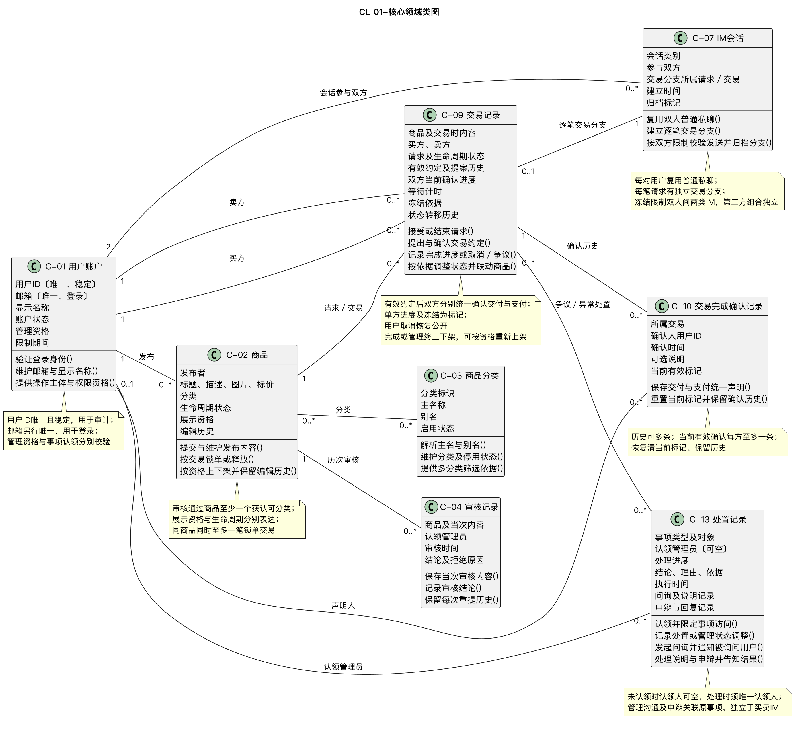
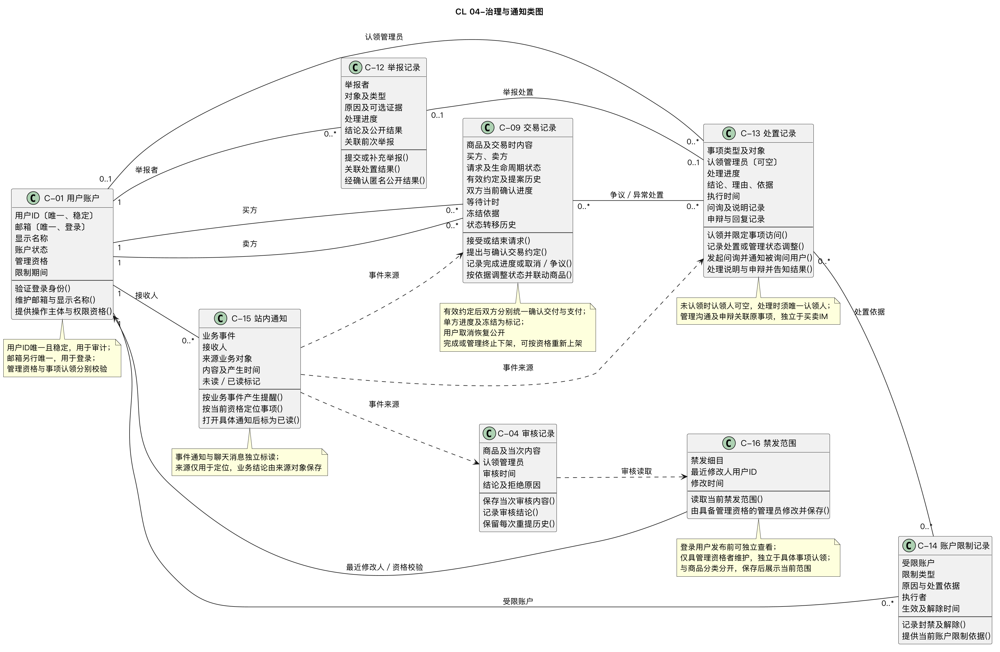

<!--
Version: 0.2.17
Version-Datetime: 2026-11-14T15:40:57+08:00
-->

# 3. 领域与数据

## 3.1 术语基础

本章术语用于统一角色、业务对象与状态含义。

| 术语 | 含义 | 依据 |
|---|---|---|
| 商品分类 | 本期采用一级分类；商品与分类为多对多关系，一件商品可关联多个分类。分类统一承载名称、别名、申请、审核关联及筛选规则 | FR-13；BR-12；第4章4.16 |
| 校园用户 | 学生与教职工的统称；普通注册，不核验校园身份或学籍 | BR-20；[第 1 章](01-项目概述.md) |
| 买方／卖方 | 相对于具体商品或交易而言的业务身份，同一账户可随商品或交易担任不同身份 | [第 2 章](02-用户需求.md) R-02、R-03；第 4 章 4.10 |
| 下单（交易请求） | 买方向该商品卖方发出的购买意向记录，不涉及线上付款 | BR-01 |
| 待接受请求 | 尚未被接受、拒绝、撤回或关闭的请求 | BR-02 |
| 锁单 | 商品因一笔进行中交易而停止接受新请求的状态 | BR-02、BR-03 |
| 完成（交易完成） | 普通流程由双方分别确认，或由认领管理员依据处理结果调整为已完成；不代表平台核验付款或实际交付，管理调整不伪造用户确认 | BR-04、BR-08；第 1 章 |
| 确认进度 | 进行中交易内记录哪一方已提交完成确认及等待期限的标记，不是交易状态 | BR-05；E-05 D-33 |
| 完成确认 | 交易一方提交的完成意思表示，双方分别保存，不覆盖对方 | BR-04、BR-28、BR-29 |
| 交易完成确认记录 | 记载交易双方各自声明交付及支付均已完成的确认人、确认时间及可选说明；历史记录与当前有效确认标记分开 | BR-28、BR-30 |
| 争议 | 任一方说明后交易进入的保持锁单情形，不自动冻结或认定违规 | BR-07 |
| 异常交易 | 单方确认后有效等待累计满7天仍未回应，转交管理员处理的情形，不自动完成或取消 | BR-05；FR-14 |
| 冻结 | 违规处置、账户封禁涉及交易，或单方完成确认超时触发的交易进度暂停标记；不是交易生命周期状态，不等于完成或终止 | BR-05、BR-33；TR-09、TR-14 |
| 封禁 | 账户限制，禁止业务写操作，保留只读访问与管理沟通 | BR-32 |
| 认领 | 管理员从共享待处理池取得某事项处理归属 | BR-34 |
| 处置通知与沟通单 | 受限用户与认领管理员之间的受控沟通，不属于买卖双方 IM | BR-32、BR-33 |
| 商品页评论 | 商品页上的公开咨询及卖方对买方的回复，由 C-06 承担；与交易完成后的评分及文字评价分开 | BR-17 |
| 评价 | 已完成交易双方的评分及文字反馈，每方每笔一条，由 C-11 承担；仅在本人“我的评价”按发表／收到查看 | BR-24 |
| 我的评价 | 本人评价的聚合查看入口，分“我发表的评价”和“我收到的评价”，均关联交易；不新增领域对象或公开访问权 | FR-12；BR-24 |
| 举报 | 对商品、评论、消息、评价或用户提交的违规报告，经管理员确认后匿名公开结果 | BR-25、BR-26 |
| 通知与待办 | 站内业务事件提醒及待处理事项，区分未读与已读；触发范围及通知／消息各自已读口径见第 4 章 4.17 | FR-11 |
| “我的”聚合入口 | 集中查看本人商品、交易、收藏、评价、举报及处置沟通的入口，不增加对他人记录的访问权 | FR-12 |
| 统计 | 由业务记录派生的计数结果 | BR-31 |

## 3.2 关键领域类

系统的16个领域类及完整职责、属性、关系见[类分析索引](../appendices/class-analysis/index.md)。本章以商品和交易记录为例，说明流转对象及交易过程的职责。

### 3.2.1 关键类详细分析

<!-- spec-include: path="../appendices/class-analysis/C-02-商品.md" level="4" -->
#### C-02 商品

##### 职责与边界

维护商品发布内容、审核资格、展示状态、编辑历史及交易锁单关系。商品以独立发布记录管理；同一发布记录可先后多笔交易，同时至多一笔进行中／仍锁单交易。商品不承担支付核实、物流履约或用户完成确认。

状态为待审核、审核未通过、公开可交易、交易中、已下架；交易结束默认下架，卖方可按资格明确继续上架。违规撤销公开、账户封禁等展示限制与生命周期分开。

##### 主要业务属性

发布者、标题、描述、图片、标价、分类、生命周期状态、展示资格、编辑历史。

##### 关联与数量约束

| 关联 | 重数 | 说明 |
|---|---|---|
| 商品—发布者 C-01 | `0..* : 1` | 本人维护及管理纠正分别授权 |
| 商品—分类 C-03 | 商品端 `0..*` 、分类端 `1..*` （审核通过后） | 单级分类，商品可关联多个分类；待审可先提交分类申请 |
| 商品—审核记录 C-04 | `1 : 0..*` | 首审、拒绝重提，历史保留 |
| 商品—交易 C-09 | `1 : 0..*` | 先后新交易独立，接受一笔关闭其他待接受请求 |
| 商品—评论 C-06／收藏 C-05 | 各 `1 : 0..*` | 咨询与收藏按资格 |
| 商品—交易聊天 | 经C-09关联 | 按双方及交易标识区分，不复用旧交易分支 |

##### 待审核维护

待审核期认领前后均可修改本人商品内容或分类，不重新排队；审核结论依据提交时最新内容。仅认领前可撤回商品并置为已下架，认领后撤回被拒绝且状态保持；撤回后修改重提进入待审核，不得按审核有效商品直接上架（BR-10、TR-20、TR-21）。

##### 编辑与历史

允许编辑不二审、不暂停展示、不关闭请求；不自动判断实质变化，卖方负责真实发布，举报／争议结合历史核查。卖方看本人完整历史，买方看本人请求对应内容及之后变更，认领管理员限必要范围。未结束请求／交易的相关买方收到商品变更通知；交易约定的变更另按双方确认规则生效。交易中禁卖方改关键内容，管理员可留据纠类并通知，不改双方约定。仅冻结不禁无关商品合规编辑，封禁禁改。

采用逻辑删除并保留历史记录；已下架或违规撤销内容按访问资格隐藏，本人历史及既有举报的必要访问另行保留，不恢复公共入口。

##### 依据

[规则权限](04-规则与权限.md) BR-10—BR-12、BR-14—BR-16 及 4.16、4.18；[场景](05-行为与状态.md) SC-02／03／05／06／10；UC-C02／03／09。

##### 必要行为与协作

| 行为职责 | 关联业务属性 | 协作对象与结果 |
|---|---|---|
| 提交与维护发布内容 | 发布者、标题、描述、图片、标价、分类、编辑历史 | C-01确定发布者，C-03提供分类，C-04保留审核依据；形成可按资格检索与查看的商品内容（UC-C02／03／13） |
| 按交易锁单或释放 | 生命周期状态、交易锁单关系 | 与C-09联动，接受请求后锁单，交易结束后释放本笔锁单并默认下架（UC-C05／09） |
| 按资格上下架并保留历史 | 生命周期状态、审核资格、展示资格、编辑历史 | 结合C-01账户资格、C-04审核记录与C-09交易情况判断操作资格，保留变更依据及历史访问范围（UC-C02／09） |

业务动作由关联用例的当前主体、对象归属和状态资格触发；协作顺序见[完整用例索引](../appendices/use-cases/index.md)。

[完整材料](../appendices/class-analysis/C-02-商品.md)。
<!-- /spec-include -->

<!-- spec-include: path="../appendices/class-analysis/C-09-交易记录.md" level="4" -->
#### C-09 交易记录

##### 职责与属性

一笔对象承载购买请求与卖方接受后的交易，不拆请求和交易类。保留商品及当时内容、双方、提出／接受／拒绝／撤回／关闭原因与时间、交易约定及变更确认、当前完成进度及历史、取消／争议／管理调整及依据。

约定包括交付时间、文字地点、方式与约定金额、支付方式、支付时点。约定金额可不同于标价，不记录实际支付流水或凭证，不核实支付交付。不按约定到期判断违约或自动结果。每次状态转移保留前后状态、主体、时间、触发、原因及依据。

##### 关联与重数

| 关联 | 重数与约束 |
|---|---|
| 商品 C-02 | 每笔一个商品，商品可先后多笔，同时至多一笔锁单 |
| 买方／卖方 C-01 | 各一人且不是同一账户 |
| 交易聊天 C-07 | 每个有效请求／交易一条专属分支，按双方和交易标识区分 |
| 完成确认 C-10 | 每笔至多双方各一条当前有效确认，历史可多次且不抹除 |
| 评价 C-11 | 已完成后每方每笔至多一条 |
| 处置 C-13 | 关联争议／异常／管理调整，认领人按必要范围访问 |

##### 阶段与操作

- 待接受、已拒绝、已撤回、已关闭、进行中、有争议、异常交易、已终止、已完成为生命周期。进行中区分首次约定待确认与约定已确认待完成；单方确认及冻结为进度／限制标记。
- 约定由任一方提出、对方明确同意；首次拒绝保持待约定和锁单；变更未获同意保留原约定，不回到首次约定前。变更生效时清空双方当前完成确认并结束旧等待计时，保留原约定、确认及计时历史；变更未获同意不清空当前确认或重置计时。变更生效后不自动计时，任一方重新提交完成确认后才开始完整7天等待。（4.15、D-49）
- 普通完成不能跳过生效约定；双方各一次确认同时声明交付和支付完成。仅一方确认开始未回应计时，争议为有效回应、结束原计时。
- 约定前买方直接取消，卖方须买方同意；约定后、单方已确认或未冻结争议中须双方同意。取消是操作、已终止是状态；保留确认和争议历史、不处理退货退款。
- 7天单方确认未回应进入异常并冻结、共享池认领，无固定管理处理时限。冻结期间双方无互动／推进操作，只读和管理沟通保留。
- 已完成／已终止保持终态，管理员也不能恢复或改写终态；恢复仅适用于未结束交易，解除冻结与状态恢复分别校验。（BR-08；2026-11-14 终态决定取代 D-48）
- 认领管理员可对未结束交易有依据地调整状态，已结束交易保持终态，不伪造双方确认；恢复进行中清空当前确认、保留历史及未变更有效约定；恢复不启动计时，一方重新提交完成确认后才重新计算完整 7 天。
- 结束交易释放本笔锁单、自动解除本笔冻结并归档分支；其他冻结／封禁保留。商品默认下架，卖方可按资格明确继续上架形成后续新交易；旧交易不由任何用户或管理员重开。

##### 依据

[规则权限](04-规则与权限.md) BR-01—BR-09、BR-14、BR-18、BR-28—BR-30、BR-33 及 4.15；[状态场景](05-行为与状态.md) SC-05／06／09；UC-C05／06／14。模型与转换表须表达普通流程和管理调整边界，不能将管理结论当作付款或交付证明。

##### 主要业务属性

商品及交易时内容、买方、卖方、请求及生命周期状态、有效约定及提案历史、双方当前确认进度、等待计时、冻结依据、状态转移历史。

##### 必要行为与协作

| 行为职责 | 关联业务属性 | 协作对象与结果 |
|---|---|---|
| 接受或结束请求 | 商品、买方、卖方、请求状态、处理原因与时间 | 与C-02联动锁单或保持商品原状态，C-07保留对应分支，未被接受的请求结束后归档，C-15记录结果通知（UC-C05／09） |
| 提出与确认交易约定 | 有效约定、提案历史、双方确认结果 | 由交易双方明确确认；变更生效时清空C-10当前确认并结束旧计时，保留历史（UC-C05） |
| 记录完成进度或取消／争议 | 当前确认进度、等待计时、生命周期状态、处理依据 | C-10保存双方声明；完成或有效终止后联动C-02和C-07，争议及管理处理依据由C-13承接（UC-C05／06／14） |
| 按依据调整状态并联动商品 | 前后状态、主体、时间、原因与依据 | C-13记录认领管理员的处理依据；C-02校验并联动锁单，C-07按结果处理分支，C-15通知双方（UC-C08／14） |
| 暂停／续算等待，关闭封禁账户参与的待接受请求 | 受限账户、当前确认、已等待与剩余时间、请求状态 | 按D-51保留有效确认并暂停或续算计时；按D-52关闭相关待接受请求，联动C-07归档分支及C-15通知，保留历史（UC-C01／05／08／14） |

业务动作由关联用例的当前主体、对象归属和状态资格触发；协作顺序见[完整用例索引](../appendices/use-cases/index.md)。

[完整材料](../appendices/class-analysis/C-09-交易记录.md)。
<!-- /spec-include -->

## 3.3 领域类关系与约束

### 3.3.1 属性与职责

各类的属性和必要行为由[类分析索引](../appendices/class-analysis/index.md)进入对应定义；业务流程中使用的属性和行为见[用例索引](../appendices/use-cases/index.md)。

### 3.3.2 关键关联约束

| 关联 | 业务约束 | 规则依据 |
|---|---|---|
| 商品—交易记录 | 同一商品同时至多一笔锁单交易，历史请求与交易分别保留 | BR-02、BR-03、BR-14 |
| 交易—完成确认 | 每方每笔至多一条当前有效确认；历次声明及管理依据保留 | BR-28、BR-29 |
| 交易—评价 | 已完成交易每方每笔一条评价；本人按发表／收到读取 | BR-24 |
| 管理事项—认领人 | 未认领时可空，处理时由唯一认领管理员负责 | BR-34 |
| 禁发范围—维护者 | 管理员维护当前范围，修改主体使用稳定用户ID记录 | BR-13、BR-20 |

### 3.3.3 核心领域类图

[CL-01-核心领域类图 源文件](../appendices/models/CL-01-核心领域类图.puml)

### 3.3.4 治理与支撑对象

举报、处置、账户限制、通知及禁发范围的协作见下图。全部类图及模块入口见[图索引](../appendices/models/index.md)。

[CL-04-治理与通知类图 源文件](../appendices/models/CL-04-治理与通知类图.puml)

### 3.3.5 关键业务数据说明索引

业务数据的含义、来源、维护角色及访问约束见[业务数据说明](../appendices/class-analysis/index.md#关键业务数据说明)。

## 3.4 业务依据

领域模型对应[业务规则与权限](04-规则与权限.md)、[行为与状态](05-行为与状态.md)，建模取舍及业务决定见[E-07](../appendices/evidence/E-07-需求结构扩展.md)和[E-08](../appendices/evidence/E-08-普通IM与购买请求联动.md)。

## 3.5 完整类分析

[类分析索引](../appendices/class-analysis/index.md)提供C-01—C-16的完整定义及分领域类图入口。
