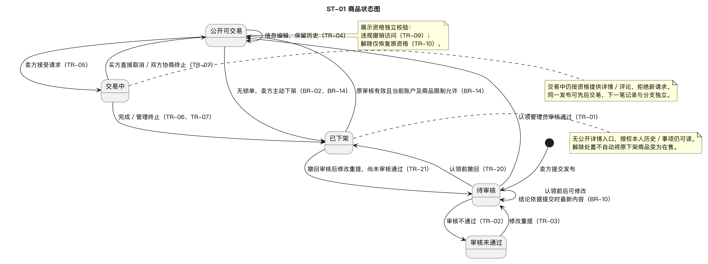
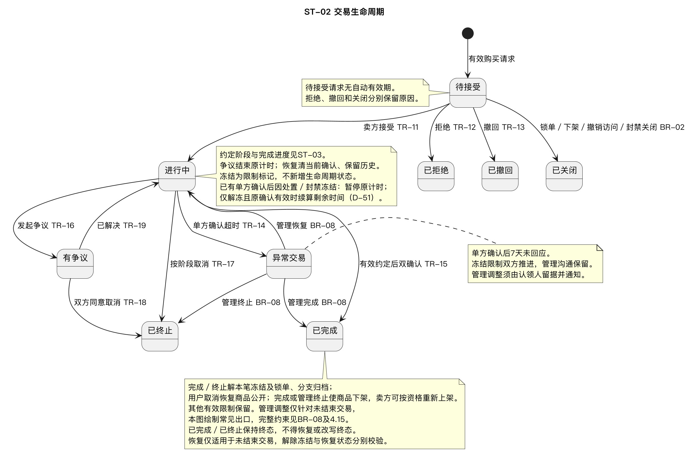
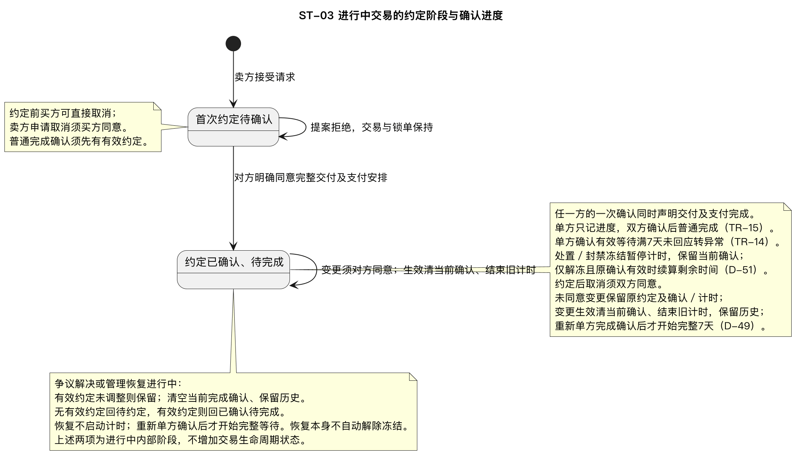
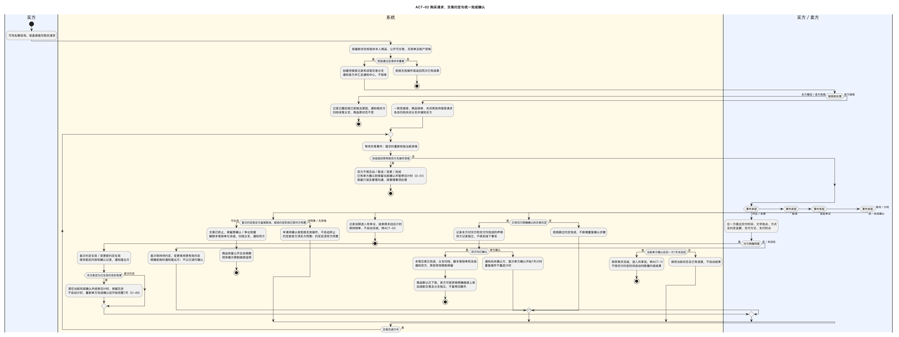

<!--
Version: 0.2.18
Version-Datetime: 2026-11-27T22:59:12+08:00
-->

# 5. 场景分析与基于类的行为、状态分析

## 5.1 场景分析

业务场景完整目录见[场景索引](../appendices/scenarios/index.md)，覆盖账户、商品、咨询、交易、治理及本人业务。5.3以SC-05展示交易请求与完成，举报处置和异常处理见[SC-07](../appendices/scenarios/SC-07-评价、举报、认领与封禁.md)及[SC-09](../appendices/scenarios/SC-09-单方确认超时与异常交易处置.md)。

## 5.2 基于领域类的行为与状态分析

以第 3 章的 C 编号、类职责和 3.3 的关联及数量约束为依据，选择核心类开展动态分析。场景通过参与类的职责协作产生业务结果，并由核心对象记录状态变化。

### 对象协作分析

领域类的行为协作与场景对应见[领域类协作与状态分析](../appendices/scenarios/index.md#对象协作分析)。

### 对象状态分析

商品、交易、审核、举报、账户限制和通知的状态及转换约束见[领域类协作与状态分析](../appendices/scenarios/index.md#对象状态分析)。

### 5.2.1 核心状态图

- [ST-01 商品状态图源文件](../appendices/models/ST-01-商品状态图.puml)

- [ST-02 交易状态图源文件](../appendices/models/ST-02-交易状态图.puml)

- [ST-03 交易约定与确认进度源文件](../appendices/models/ST-03-交易约定与确认进度.puml)

ST-02表达九种交易生命周期；ST-03表达进行中内部约定阶段及确认进度，冻结仍为独立限制标记。

## 5.3 关键场景与活动模型

[场景索引](../appendices/scenarios/index.md)提供12组场景的完整目标、条件、流程及分支。以下以交易请求与完成为例说明业务闭环。

### 5.3.1 关键场景：交易请求与完成

<!-- spec-include: path="../appendices/scenarios/SC-05-请求、锁单、确认与终止.md" level="4" -->
#### SC-05 请求、锁单、确认与终止

**关联需求**：FR-05、FR-06、FR-09；US-05、US-06；UC-C05、UC-C06。
**关联规则**：BR-01—BR-06、BR-28、BR-29；DT-01、DT-04；TR-11—TR-15、TR-17。
**参与类**：C-02、C-09、C-10。
**活动图**：ACT-02。

**业务目标**：买方对公开商品表达购买意向，卖方接受后锁单；交易在平台外完成后由双方独立确认；确认进度与 7 天等待规则如实记录，超时转异常处置而不自动成交。

**初始数据与状态**：商品公开可交易；双方账户正常；无进行中交易；请求方非卖方本人。

**参与角色**：买方、卖方、系统。

**主流程（SC-05-01）**：买方请求后创建该笔分支并通知；卖方明确接受后锁单、关闭其他请求；任一方提出交付及支付安排，对方明确同意后约定生效；双方平台外完成事项，各自确认交付与支付均完成；双确认后本笔交易完成，分支归档、解除本笔冻结，商品默认下架，卖方可按资格明确选择继续上架。后续新请求创建新交易及分支，不复用旧对话。

**分支情境**

| 编号 | 类别 | 情境与前置 | 操作 | 预期响应 | 数据与状态变化 | 依据 |
|---|---|---|---|---|---|---|
| SC-05-01 | 正常 | 商品公开且无锁单 | 请求→卖方接受→双方明确约定→各自确认交付支付完成 | 请求、分支、通知独立；双确认完成，结束分支归档、解本笔冻结；商品下架，卖方可按资格重新上架 | 全过程及约定／确认历史留存 | BR-01、BR-03—BR-06、BR-14、BR-18 |
| SC-05-02 | 权限 | 请求指向他人商品 | 非该商品卖方接受或拒绝 | 拒绝 | 无变化 | BR-01、BR-02 |
| SC-05-03 | 权限 | 请求由他人发起 | 非发起人撤回 | 拒绝 | 无变化 | BR-06 |
| SC-05-04 | 权限／异常 | 请求方即卖方本人 | 对自己商品发起请求或私聊 | 拒绝 | 无变化 | BR-02 |
| SC-05-05 | 状态转换 | 同一商品存在多个待接受请求 | 卖方接受其中一条 | 其余请求自动「已关闭」，原因商品已被其他用户锁单，不计入失败交易 | 被接受请求进行中；其余关闭；商品交易中 | BR-02、BR-03、BR-06、TR-12 |
| SC-05-06 | 异常 | 存在待接受请求 | 卖方主动拒绝 | 请求「已拒绝」，商品原状态不变 | 请求状态变化 | BR-06、TR-12 |
| SC-05-07 | 异常 | 卖方尚未接受 | 买方撤回 | 请求「已撤回」，商品原状态不变 | 请求状态变化 | BR-06、TR-13 |
| SC-05-08 | 状态转换 | 已生效交易约定，双方有操作资格 | 任一方统一确认交付与支付完成 | 仅记录该方确认，不自动完成，通知另一方并开始未回应计时 | 一方进度与历史保存 | BR-04、BR-05、BR-28 |
| SC-05-09 | 异常 | 单方确认后另一方 7 天未回应 | 等待 | 转「异常交易」，按冻结规则限制双方，不自动完成或取消 | 交易转异常，见 SC-09 | BR-05、TR-14 |
| SC-05-10 | 状态转换 | 未冻结且有操作资格 | 约定前买方直接取消／卖方申请买方同意；约定后双方协商取消 | 未同意不生效；有效取消为已终止、计失败，解除锁单和本笔冻结，其他限制继续适用；商品恢复公开状态 | 留依据、归档分支、通知双方 | BR-06、BR-14 |
| SC-05-11 | 权限／异常 | 一方被封禁或交易被冻结 | 推进交易操作 | 暂停双方上架与交易操作、禁止双方 IM；保留历史与进度 | 交易保持原状态 | BR-32、BR-33 |
| SC-05-12 | 状态保持 | 双方均未确认且未超时 | 无操作 | 交易保持进行中；待接受请求无自动有效期 | 无变化 | BR-02、BR-05 |
| SC-05-13 | 状态保持／变更 | 交易进行中，A已按原约定确认完成，B尚未确认 | 提出变更，分别检查未同意与双方同意生效 | 未同意保留原约定及当前确认／计时；生效时清空当前确认、结束旧计时并保留历史，不自动重新计时；任一方重新完成确认后才开始完整7天 | 未同意时原约定及确认／计时保持；生效时更新约定、重置当前确认并保留历史 | 第4章4.15；D-49 |

**约定分支检查**：首次提案拒绝不结束交易；变更未获同意保留原安排；普通完成不得跳过约定；约定前买方直接取消、卖方须买方同意，约定后须双方同意；单方已确认亦可双方取消。所有操作受冻结／封禁限制，通知与状态留痕分别核对。

**状态转换**：待接受 →（TR-11）进行中 →（TR-15）已完成；待接受 →（TR-12）已拒绝／已关闭；待接受 →（TR-13）已撤回；进行中 →（TR-14）异常交易；进行中 →（TR-17）已终止。

[完整材料](../appendices/scenarios/SC-05-请求、锁单、确认与终止.md)。
<!-- /spec-include -->

[ACT-02-交易请求与双方确认 源文件](../appendices/models/ACT-02-交易请求与双方确认.puml)

## 5.4 业务流程与动态模型关联

流程、场景和模型的完整对应见[业务流程与动态模型关联](../appendices/scenarios/index.md#业务流程与动态模型关联)。

依据：[规则与权限](04-规则与权限.md)、[E-05 状态转换](../appendices/evidence/E-05-状态转换复核.md)、[E-06 处置与展示](../appendices/evidence/E-06-处置流程与展示复核.md)、[E-07 业务决定](../appendices/evidence/E-07-需求结构扩展.md)。业务转换及其约束见第4章4.13。
