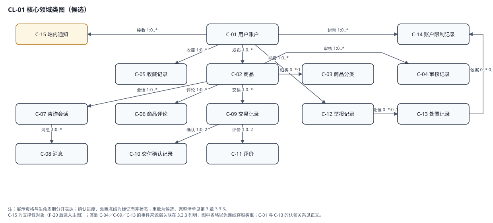

<!--
Version: 0.2.5
Version-Datetime: 2026-10-21T19:40:10+08:00
-->

# 3. 领域与数据

状态：基础草稿，负责人张新悦继续细化。术语表、候选类（含支撑性对象 C-15 站内通知）、业务属性、关联及数量约束为候选分析；C-01—C-15 已有类分析初稿，CL-01 已出图，状态图见第 5 章；未开展人工模型评审。

## 3.1 术语基础

以下术语用于统一第 3、5 章及规则正文的表述，业务含义以所在条目为依据；术语本身不构成新规则。

| 术语 | 本文档中的含义 | 依据 |
|---|---|---|
| 校园用户 | 学生与教职工的统称；普通注册，不核验校园身份或学籍 | BR-35；[第 1 章](draft-01-项目概述.md) |
| 买方／卖方 | 相对于具体商品或交易而言的业务身份，不是互斥账户类型 | [第 2 章](draft-02-用户需求.md) R-02、R-03；第 4 章 4.10 |
| 下单（交易请求） | 买方向该商品卖方发出的购买意向记录，不涉及线上付款 | BR-01 |
| 待接受请求 | 尚未被接受、拒绝、撤回或关闭的请求 | BR-28、BR-42 |
| 锁单 | 商品因一笔进行中交易而停止接受新请求的状态 | BR-02、BR-28 |
| 完成（交易完成） | 双方在平台分别确认后记录的结果，不代表平台核验付款或实际交付 | BR-03；第 1 章 |
| 确认进度 | 进行中交易内记录哪一方已提交完成确认及等待期限的标记，不是交易状态 | BR-04；E-05 D-33 |
| 完成确认 | 交易一方提交的完成意思表示，双方分别保存，不覆盖对方 | BR-03、BR-32、BR-43 |
| 交付确认记录 | 记载确认人、确认时间及可选说明的历史记录 | BR-32、BR-44 |
| 争议 | 任一方说明后交易进入的保持锁单情形，不自动冻结或认定违规 | BR-06、BR-30 |
| 异常交易 | 单方确认后超过暂定 7 天未回应，转交管理员处理的情形，不自动完成或取消 | BR-04、BR-09；FR-14 |
| 冻结 | 管理员处置导致整个交易进度暂停的标记，不等于完成或终止 | BR-53；TR-10 |
| 封禁 | 账户限制，禁止业务写操作，保留只读访问与管理沟通 | BR-22 |
| 认领 | 管理员从共享待处理池取得某事项处理归属 | BR-51 |
| 处置通知与沟通单 | 受限用户与认领管理员之间的受控沟通，不属于买卖双方 IM | BR-22、BR-53 |
| 商品页评论 | 商品页上的公开咨询，与交易完成后的评价区分 | BR-47 |
| 评价 | 已完成交易双方的互评，每方每笔一条，展示于商品详情页 | BR-19 |
| 举报 | 对商品、评论、消息、评价或用户提交的违规报告，经管理员确认后匿名公开结果 | BR-20、BR-50 |
| 通知与待办 | 站内业务事件提醒及待处理事项，区分未读与已读；具体触发范围待 P-20 | FR-11 |
| “我的”聚合入口 | 集中查看本人商品、交易、收藏、评价、举报及处置沟通的入口，不增加对他人记录的访问权 | FR-12 |
| 统计 | 由业务记录派生的计数结果，不预设独立持久化实体 | BR-34、BR-45 |

## 3.2 候选领域类

| 编号 | 候选类 | 基本职责 | 关联分析起点 |
|---|---|---|---|
| C-01 | 用户账户 | 注册登录、身份与账户限制关联 | 本人商品、收藏、评论、会话、交易；买卖角色非两个独立用户类 |
| C-02 | 商品 | 维护闲置物品信息与生命周期 | 属于发布者及分类，关联审核、请求与交易 |
| C-03 | 商品分类 | 组织检索与商品归类 | 关联商品；维护权限待细化 |
| C-04 | 审核记录 | 记录商品审核结论及理由 | 关联商品、管理员及被审核内容版本 |
| C-05 | 收藏记录 | 记录用户与收藏商品关系 | 关联收藏者、商品及失效显示规则 |
| C-06 | 商品评论 | 承载商品页公开交流 | 关联商品、作者及删除／违规处置 |
| C-07 | 咨询会话 | 组织买卖双方针对商品的私聊 | 关联商品、双方与消息；不要求以交易状态代替会话状态 |
| C-08 | 消息 | 保存会话内文字及发送信息 | 归属会话及发送者，访问遵守 BR-18 |
| C-09 | 交易记录 | 请求、接受、结果确认、终止及争议的全过程 | 关联商品、买方和卖方；请求与交易暂采用同一对象阶段建模，是否拆类由负责人论证 |
| C-10 | 交付确认记录 | 分别保存双方确认历史及可选说明，区分可重置的当前确认标记 | 关联交易和确认者，不覆盖对方确认 |
| C-11 | 评价 | 保存已完成交易双方评价 | 关联交易、评价者和被评价者 |
| C-12 | 举报记录 | 描述举报对象、理由、证据和进度 | 关联举报者、目标对象与处置记录 |
| C-13 | 处置记录 | 保留管理事项认领、处置结论、理由及执行者，支撑处置通知与沟通单 | 关联举报或违规对象、管理员 |
| C-14 | 账户限制记录 | 描述封禁及解除的原因和记录 | 关联受限账户、管理员与处置依据 |
| C-15 | 站内通知 | 记录业务事件提醒、待办及接收人的未读／已读 | 支撑性对象；关联接收人，来源业务对象为弱关联；不承载处置沟通内容 |

### 3.2.1 新增业务需求的候选类补充（待论证）

以下为 FR-01 扩展及 FR-11—FR-14 涉及的建模范畴，均为候选，需负责人评估后确认，不表示已采纳。

| 涉及对象 | 候选处理方式 | 理由与边界 | 关联需求 | 状态 |
|---|---|---|---|---|
| 站内通知 | 建类 C-15 站内通知（支撑性对象） | 记录业务事件提醒与待办、接收人及未读／已读；与处置通知及沟通单（C-13）职责不同，后者是受控沟通 | FR-11 | 已确认建类；触发范围、渠道及已读规则仍待 P-20，P-20 后进 CL-01 主图 |
| 商品分类 | 扩展 C-03 维护职责，不新建类 | 现有 C-03 仅“组织检索与商品归类”；新增／改名／停用／删除、初始分类及停用删除后的既有商品与筛选处理未定 | FR-13 | 已定：设启用状态、不设排序；操作集与初始分类待 P-18 |
| 异常交易 | 以 C-09 的阶段／状态加 C-13 处置事项关联表达，暂不新建类 | 超时是交易进度问题，处理由管理员认领；恢复路径未定，不宜先设独立对象 | FR-14 | 候选；恢复方式待 P-21 |
| 处置通知与沟通单 | 由 C-13 处置记录承担并关联沟通消息，不另立对象 | 沟通含多轮说明、反驳／申诉与管理员回复，与举报／审核处置结论不同；不预设独立工单系统 | FR-08 | 已定：由 C-13 承担；告知与申诉对象范围仍待 P-22 |
| 举报记录 | 扩展 C-12 的证据要素与进度 | 举报可附证据；证据要素及重复举报限制未定 | FR-07 | 待 P-23 |
| “我的”业务 | 不新建领域类，作为本人对象的聚合视图 | 聚合本人商品、交易、收藏、评价、举报及处置沟通，不增加对他人记录的访问权 | FR-12 | 候选结论 |
| 账户生命周期 | 扩展 C-01，不新建类 | 退出、修改密码、更换绑定标识及显示名称修改的验证方式与限制未定 | FR-01 | 待 P-19 |
| C-09 是否拆类 | 已定不拆，请求与交易按同一对象阶段建模 | 请求结果与交易进度共享商品锁单与数量约束，拆分将形成两套需联动的状态；如后续要拆，须另给独立生命周期依据并重编 TR | FR-05、FR-09 | 已定（负责人确认） |

## 3.3 领域类关系与约束（候选）

以下为业务分析口径，不写出字段类型、长度、索引或表结构，不构成数据字典，也不开展数据库设计。

### 3.3.1 主要业务属性

| 类 | 需要说明的业务属性（描述性） | 说明 |
|---|---|---|
| C-01 用户账户 | 账户标识（邮箱或手机号）、显示名称、账户状态、限制期间 | 标识全平台唯一；不核验校园身份；密码只作“登录凭据”表述，不写存储实现 |
| C-02 商品 | 标题、描述、图片、价格、分类、发布者、当前展示状态 | 关键内容集合按 BR-12；展示状态与展示资格分别表达，见 5.2 |
| C-03 商品分类 | 名称、启用状态 | 已定设置启用状态、不设排序；操作集与初始分类待 P-18 |
| C-04 审核记录 | 被审核内容及其范围、审核者、审核时间、结论、拒绝理由 | 记录审核对象而非改写商品状态；重提是否新增记录见 5.2 候选 |
| C-05 收藏记录 | 收藏者、商品、收藏时间 | 失效只在本人清单提示，不泄露不可见内容 |
| C-06 商品评论 | 所属商品、作者、内容、发表时间、是否已删除及处置理由 | 作者删除与管理员移除分开记录 |
| C-07 咨询会话 | 商品、参与双方、建立时间、最近活动时间 | 同一买卖双方对同一商品不重复建立并行会话 |
| C-08 消息 | 所属会话、发送者、内容、发送时间 | 访问限于会话双方及认领事项管理员 |
| C-09 交易记录 | 关联商品及交易时内容、买方、卖方、请求提出与结果、双方确认人与时间、终止或争议结果及处理记录 | 按 BR-44 至少保留项；不记录付款金额、流水及资金凭证 |
| C-10 交付确认记录 | 所属交易、确认者、确认时间、可选说明、当前标记与历史 | 双方记录分别保存；当前标记可清空，历史不删除 |
| C-11 评价 | 所属交易、评价者、被评价者、评分、文字、提交时间 | 仅已完成交易；提交后不修改 |
| C-12 举报记录 | 举报者、举报对象及类型、理由、可选证据、处理结论与理由、公开结果 | 匿名展示在确认后进行 |
| C-13 处置记录 | 事项类型与对象、认领人、处置结论与理由、执行时间、沟通记录 | 支持处置通知与沟通单，不等于买卖双方 IM |
| C-14 账户限制记录 | 受限账户、限制类型、原因、执行者、生效与解除时间、处置依据 | 记录保留；解除后按原资格恢复 |
| C-15 站内通知 | 事件类型、接收人、关联业务对象、未读／已读、产生时间 | 来源对象为弱关联，不复制业务结论；渠道与文案留设计 |

### 3.3.2 关联与数量约束

| 约束 | 内容 | 依据 |
|---|---|---|
| 商品—进行中交易 | 同一商品同时至多一笔进行中交易；卖方接受一条请求时其余待接受请求记为“已关闭” | BR-02、BR-28 |
| 买方—待接受请求 | 同一买方对同一商品至多一条有效待接受请求；拒绝或撤回后可再次发起 | BR-28、BR-41 |
| 商品—审核记录 | 首审通过后商品才具备展示资格；拒绝后修改重提形成新的审核结论，历史结论保留 | BR-10、BR-14、BR-33 |
| 交易—确认记录 | 每方每笔交易保存其确认与说明，双方记录互不覆盖；当前标记可清空而历史不删除 | BR-32、BR-43 |
| 交易—评价 | 每方每笔已完成交易至多一条评价；不得评价未完成交易或代他人评价 | BR-19 |
| 双方—会话 | 同一买卖双方对同一商品至多一条并行会话；由买方发起，卖方不主动发起新会话 | BR-17、BR-48 |
| 举报—处置 | 一份处置记录可关联一项举报或违规事项；同一对象的多条举报是否限制待 P-23 | BR-20、BR-21 |
| 账户—限制记录 | 一次封禁对应一条限制记录，解除后记录保留、不覆盖历史 | BR-22；TR-24 |
| 商品—分类 | 商品在任一时刻归属一个分类（候选）；停用或删除分类后既有商品与筛选的处理待 P-18 | BR-12、FR-13 |
| 处置—沟通 | 处置通知与沟通单仅覆盖相关受处置用户与认领管理员，不进入买卖双方 IM | BR-22、BR-53 |
| 通知—接收人 | 一条通知对应一名接收人；同一业务事件可向多人分别产生通知，已读状态按接收人区分 | FR-11；P-20 待定渠道与已读规则 |

### 3.3.3 CL-01 核心领域类图

建模范围以 C-01—C-15 为基础，其中 C-15 为支撑性对象；类图只表达类、职责分组、关键关联及重数，不表达字段类型或表结构。

| 关联 | 重数（候选） | 依据 |
|---|---|---|
| 用户账户—商品 | 1 : 0..* | 发布者与本人商品 |
| 商品—商品分类 | 0..* : 1 | 归类与筛选，分类维护待 P-18 |
| 商品—审核记录 | 1 : 0..* | 首审、拒绝重提及历史结论 |
| 商品—交易记录 | 1 : 0..* | 多笔历史请求／交易，同时至多一笔进行中 |
| 交易记录—交付确认记录 | 1 : 0..2 | 双方各一条有效记录并保留历史 |
| 交易记录—评价 | 1 : 0..2 | 每方一条 |
| 用户账户—收藏记录 | 1 : 0..* | 本人清单 |
| 商品—商品评论 | 1 : 0..* | 商品页咨询 |
| 咨询会话—消息 | 1 : 0..* | 会话内文字 |
| 商品—咨询会话 | 1 : 0..* | 同一双方不重复并行 |
| 用户账户—举报记录 | 1 : 0..* | 举报者 |
| 举报记录—处置记录 | 0..* : 0..1 | 处置结论与理由 |
| 用户账户—账户限制记录 | 1 : 0..* | 封禁及解除历史 |
| 用户账户—站内通知 | 1 : 0..* | 接收人维度；C-15 为支撑性对象，P-20 后进入主图 |
| 站内通知—来源业务对象 | 0..* : 0..1（弱关联） | 可指向审核、交易、处置等对象；只作定位，不复制结论 |

绘制状态：源文件 `docs/models/CL-01-核心领域类图.mmd` 与同名导出图已建立，导出图由本机按源文件内容生成，未用 mermaid-cli 渲染，评审时需核对与源文件一致；图索引已登记。C-15 为支撑性对象，暂不进入主图，待 P-20 决定触发范围后再纳入 CL-01。

## 3.4 依据与验证状态

依据：[十项基础需求](draft-02-用户需求.md)、[规则与权限](draft-04-规则与权限.md)、[E-05 状态转换复核](../evidence/E-05-状态转换复核.md)。术语表与 3.3 的属性、关联及数量约束为候选分析；CL-01 已出图，但未开展人工模型评审，也未以本文件证明用例覆盖通过。

## 3.5 详细类分析

C-01—C-15 已建逐类分析文件，见[类分析索引](class-analysis/draft-index.md)。各文件写职责边界、业务属性、关联重数、规则／场景映射与待决项，不写字段类型或实现设计。仍待完成：人工模型评审、类职责能否支撑用例与场景的核对（P-09）；C-15 待 P-20 确认触发范围后再评估是否进入 CL-01 主图。
