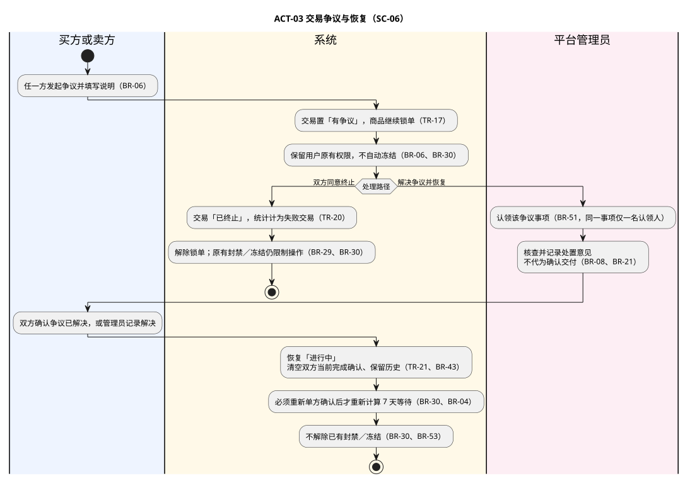
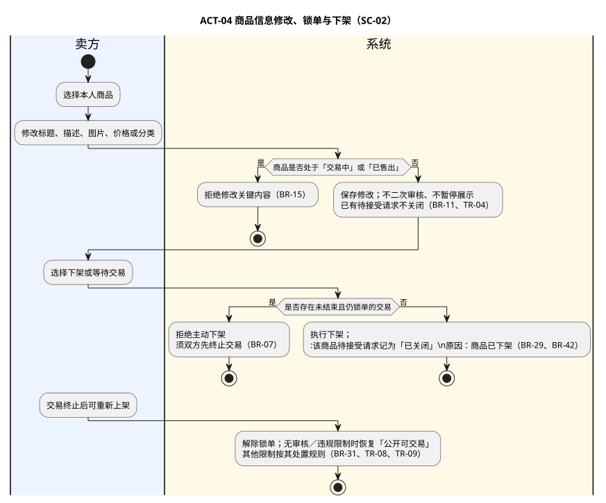
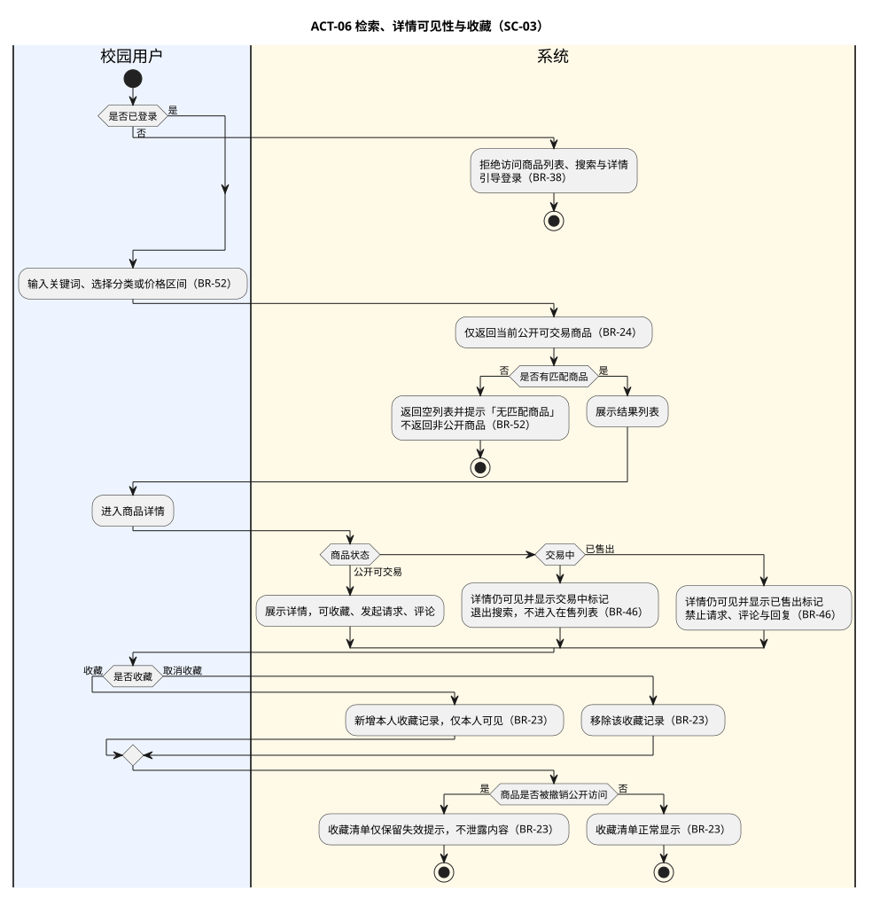
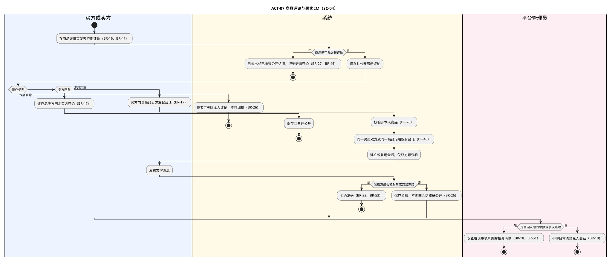
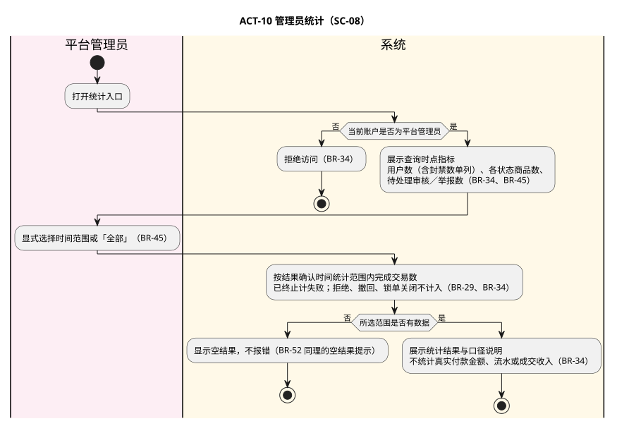
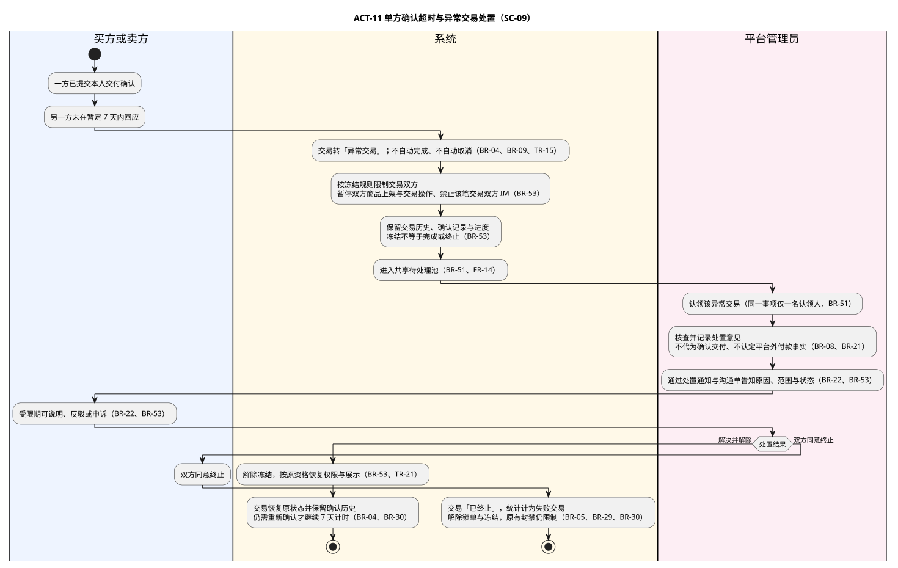

<!--
Version: 0.2.9
Version-Datetime: 2026-10-21T21:50:00+08:00
-->

# 5. 场景分析与基于类的行为、状态分析

状态：基础草稿；场景及活动由孙含佳细化，对象协作与对象状态由张新悦细化。5.2 已形成对象协作及状态转换说明（候选）；5.3 已展开九组场景与活动图（业务推演，未走查）。未开展人工模型评审与场景走查，本文件不构成验证通过记录。

## 5.1 场景分析

### 基础场景目录（候选）

| 编号 | 场景 | 对应需求 | 正常路径起点 | 需覆盖的权限／异常／边界 | 候选类 |
|---|---|---|---|---|---|
| SC-01 | 账户与访问控制 | FR-01 | 注册、登录、忘记密码；未登录仅账户入口 | 重复标识、凭证错误、未登录越权、封禁与解除 | C-01 |
| SC-02 | 商品发布、审核与维护 | FR-02、FR-09 | 卖方提交，管理员首次审核通过后展示；信息修改不二次审核、保留待接受请求 | 审核拒绝重提、非所有者修改、交易中禁改、锁单未结束禁主动下架 | C-01—C-04 |
| SC-03 | 检索、详情可见性与收藏 | FR-03、FR-04 | 已登录用户发现公开商品并收藏 | 未登录越权、空结果、交易中／已售出退出搜索但详情可见、撤销公开访问 | C-02、C-03、C-05 |
| SC-04 | 商品评论与买卖 IM | FR-04 | 登录用户评论，买方向卖方发起文字私聊 | 已售出禁评、非会话成员查看、封禁／冻结禁发、同一会话复用 | C-02、C-06—C-08 |
| SC-05 | 请求、锁单、确认与终止 | FR-05、FR-06、FR-09 | 买方请求，卖方接受，双方平台外交付并分别确认 | 并行请求关闭、单方确认计时、撤回与终止、封禁／冻结 | C-02、C-09、C-10 |
| SC-06 | 交易争议与恢复 | FR-05、FR-08、FR-09 | 任一方说明发起争议，解决后恢复进行中并清空当前确认 | 禁止争议中直接完成、锁单保持、恢复后重新计时 | C-02、C-09、C-10、C-12、C-13 |
| SC-07 | 评价、举报、认领与封禁 | FR-07、FR-08 | 完成交易互评；举报进入共享池并认领处置 | 未完成／重复评价、证据不足、认领边界、冻结与通知沟通单 | C-01、C-09、C-11—C-14 |
| SC-08 | 管理员统计 | FR-10 | 选择时间范围或全部查看既定指标 | 普通用户访问、无数据、资金数据误用 | 相关业务对象及派生统计 |
| SC-09 | 单方确认超时与异常交易处置 | FR-14（关联 FR-05、FR-08） | 单方确认后 7 天未回应转异常交易，进入共享池认领处置 | 冻结范围、不自动完成／取消、解除恢复与历史保留 | C-09、C-13、C-14 |

## 5.2 基于领域类的行为与状态分析

以第 3 章的 C 编号、类职责和 3.3 的关联及数量约束为依据，选择核心类开展动态分析。分析链为“用例目标 → 具体场景 → 参与领域类及职责 → 对象协作行为 → 核心对象状态转换”，可迭代修正，不应脱离类模型单独编造动作和状态。

### 对象协作分析（候选）

| 领域类 | 关联场景 | 行为／协作说明 | 状态分析对象 |
|---|---|---|---|
| C-02 商品 | SC-02、SC-05、SC-06 | 与审核记录、交易记录协作处理展示资格、占用、售出和重新上架 | 商品对象的生命周期及展示条件 |
| C-09 交易记录 | SC-05、SC-06 | 与买卖双方、商品及交付确认记录协作，处理接受、确认、终止、争议 | 单笔交易对象的状态及双方确认进度 |
| C-04 审核记录 | SC-02 | 记录管理员对特定商品内容的审核及原因 | 审核过程／结果，不能与商品状态混同 |
| C-07 咨询会话、C-08 消息 | SC-04 | 说明发送者、会话参与者、商品与访问权限协作 | 仅在确有生命周期规则时分析状态，不强制为每个类画状态图 |
| C-12 举报记录、C-13 处置记录 | SC-07 | 提交、核查、处置与理由记录，关联对象及账户限制 | 举报处理状态，具体名称待细化 |

按协作内容展开如下，均以第 4 章现行规则为行为依据。

**① 商品发布、审核与展示.** 卖方（C-01）提交 C-02，C-02 关联 C-03 归类；认领该事项的管理员（C-01）通过 C-04 记录结论与理由，C-02 的展示资格取决于审核结论。审核拒绝后卖方修改本人商品并重提，形成新的审核结论；信息修改不二次审核、不暂停公开，已有待接受请求不关闭（BR-11、BR-14、BR-33、TR-01—TR-04）。卖方主动下架时，该商品待接受请求记为“已关闭”并说明下架原因（BR-31、BR-42）。C-02 负责任务边界：展示资格与业务生命周期分别记录，处置导致的停止公开不为商品新造一个与“已售出”互斥的状态（见 5.2 商品状态说明）。

**② 交易请求与完成确认.** 买方（C-01）针对 C-02 建立 C-09 的待接受请求；卖方接受后 C-02 进入交易中，其余待接受请求经 C-09 记为已关闭（BR-28、TR-06、TR-12、TR-13）。交付在平台外完成，双方分别经 C-10 提交确认与可选说明，双方记录互不覆盖；仅双方均确认后 C-09 转已完成、C-02 转已售出（BR-03、BR-32、BR-43、TR-07、TR-16）。协商终止经 C-09 记录为已终止并解除锁单（BR-05、TR-18）。待接受请求不设自动有效期（BR-09、BR-42）。

**③ 争议、异常交易与管理处置.** 任一方（C-01）说明后 C-09 转有争议，保持锁单及原权限，不自动冻结（BR-06、TR-17）。管理员认领该事项后经 C-13 记录处置；管理员解决或双方均确认解决后 C-09 恢复进行中，同时清空 C-10 的当前确认标记、保留历史，重新单方确认后才开始完整暂定 7 天计时（BR-30、TR-21）。单方确认后另一方超时未回应，C-09 转异常交易，按冻结规则限制交易双方、禁止该笔交易双方 IM，交管理员处理，不自动完成或取消（BR-04、BR-09、TR-15、FR-14）。冻结是整个交易进度的暂停标记，不等于完成或终止（BR-53）。账户封禁由 C-14 记录，与交易冻结分别表达（BR-22、TR-24）。

**④ 商品页评论、私聊与处置沟通.** 登录用户经 C-06 评论公开可交易或交易中的商品，卖方回复买方评论；已售出禁止新增评论与回复（BR-16、BR-27、BR-47）。咨询会话由买方向卖方发起，C-07 承载会话、C-08 承载消息；同一买卖双方对同一商品不重复建立并行会话（BR-48）。管理访问限于认领事项所需的消息（BR-18、BR-51）。受限期间用户与认领管理员的沟通经 C-13 的处置通知与沟通单进行，不使用 C-07／C-08，也不恢复买卖双方 IM（BR-22、BR-53）。

**⑤ 举报、评价、通知与账户限制.** 未被封禁的登录用户经 C-12 提交举报并可附证据，认领管理员经 C-13 记录结论与理由，确认后隐去用户与管理员信息向登录用户公开（BR-20、BR-21、BR-50、TR-23）。完成交易后双方各经 C-11 提交一条评价，展示于商品详情页（BR-19）。封禁由 C-14 记录，解除后保留记录并按原资格恢复（BR-22、TR-24）。业务事件提醒与待办（FR-11）由 C-15 站内通知承载（支撑性对象），关联上述对象但不复制审核、处置或交易结论；触发范围、渠道与已读规则待 P-20。

### 对象状态分析（候选）

以下状态名称与归属为候选，用于与规则、场景对齐；状态图见 5.3，状态名称需经负责人确认。

#### 商品

业务生命周期状态：待审核、审核未通过、公开可交易、交易中、已售出、已下架。展示资格（是否对登录用户公开可见）作为条件单独表达，不与生命周期合并为同一组互斥状态。

| 转换 | 触发事件 | 依据 | 备注 |
|---|---|---|---|
| 待审核 → 公开可交易 | 认领管理员审核通过 | TR-01、BR-10、BR-33 | 首审通过才具备展示资格 |
| 待审核 → 审核未通过 | 认领管理员审核不通过 | TR-02、BR-14 | 须向卖方显示拒绝原因 |
| 审核未通过 → 待审核 | 卖方按拒绝原因修改后重提 | TR-03、BR-14 | 新结论形成，历史结论保留 |
| 公开可交易 → 公开可交易 | 卖方修改允许修改的信息 | TR-04、BR-11 | 不触发二审、不暂停公开、不关闭已有请求 |
| 公开可交易 → 交易中 | 卖方接受一条待接受请求 | TR-06、BR-02 | 同一商品同时至多一笔进行中交易 |
| 交易中 → 已售出 | 双方均确认完成 | TR-07、BR-03 | 交付在平台外，平台只记录确认 |
| 交易中 → 已下架 | 交易终止后卖方选择下架 | TR-08、BR-07、BR-31 | 解除锁单后由卖方决定去向 |
| 交易中 → 公开可交易 | 普通交易双方终止，解除锁单 | TR-09、BR-31 | 无审核／违规限制时恢复可交易 |
| 公开可交易 → 已下架 | 卖方主动下架 | BR-31 | 已定：以 BR-31 为依据，暂不补 TR |
| 已下架 → 公开可交易 | 卖方重新上架，审核仍有效且无违规限制 | BR-31 | 已定：以 BR-31 为依据，暂不补 TR |
| 已售出、已下架 → 其他 | 本项目不设售后或恢复在售 | 第 1 章范围 | 仅扩展候选，不在本期 |

展示资格条件（不是生命周期状态）：管理员违规处置撤销涉事商品公开访问（TR-10、BR-53）；处置解除后自动恢复原展示资格，且不将原非在售商品变为在售（TR-11）；封禁账户的商品停止公开展示（DT-03）。因此“已售出”或“已下架”的商品可同时处于“不再公开”，状态图需用条件或标注表达，不能增加“违规”这一互斥状态。

#### 交易记录

状态：待接受、已拒绝、已撤回、已关闭、进行中、有争议、已终止、已完成、异常交易。单方确认不作为独立状态，而是进行中交易内的确认进度标记（BR-04、E-05 D-33）。

| 转换 | 触发事件 | 依据 | 备注 |
|---|---|---|---|
| — → 待接受 | 买方发起请求 | BR-01 | 同一买方对同一商品至多一条有效待接受请求 |
| 待接受 → 进行中 | 卖方接受 | TR-12、BR-02 | 商品转交易中，其他请求关闭 |
| 待接受 → 已拒绝 | 卖方主动拒绝 | TR-13、BR-29 | 不改变商品原状态，可再次请求 |
| 待接受 → 已关闭 | 卖方接受其他请求，或卖方主动下架 | TR-13、BR-29、BR-42 | 原因分别记“商品已被其他用户锁单”“商品已下架” |
| 待接受 → 已撤回 | 买方在接受前撤回 | TR-14、BR-05 | 不影响其他待接受请求 |
| 进行中 → 已完成 | 双方均确认完成 | TR-16、BR-03 | 商品随之已售出 |
| 进行中 → 已终止 | 双方同意终止 | TR-18、BR-05 | 统计计为失败交易，解除锁单 |
| 进行中 → 有争议 | 任一方说明后发起争议 | TR-17、BR-06 | 保持锁单及原权限，不自动冻结 |
| 进行中 → 异常交易 | 单方确认后超时未回应（暂定 7 天） | TR-15、BR-04 | 按冻结规则限制双方，交管理员处理 |
| 有争议 → 进行中 | 认领管理员解决，或双方均确认已解决 | TR-21、BR-30 | 清空当前确认、保留历史，不解除已有冻结 |
| 有争议 → 已终止 | 双方共同同意终止 | TR-20、BR-30 | 计为失败交易，已有冻结仍限制操作 |
| 已完成／已终止 → 其他 | 不设重新开启 | BR-03、BR-05 | 争议中不得直接完成（TR-19 已撤销） |

待决定：异常交易的后续路径（恢复进行中、双方终止或其他处理）按 P-21 待定，本节不预填转换；冻结不产生“冻结”状态，只暂停进度（BR-53）。

确认进度：进行中交易记录哪一方已确认及等待截止；争议为有效响应，进入争议即结束原未回应计时；恢复后清空当前标记、历史保留，重新单方确认才重启完整暂定 7 天计时（BR-04、BR-30、BR-43、E-05 D-33）。

#### 审核记录

结果表述：待处理（进入共享待处理池、尚未认领）、通过、不通过（含拒绝理由）。审核记录表达对某次商品内容的审核结论，商品展示状态由其汇总得出，二者不混同（BR-33、TR-22）。同一商品多次重提是否新增审核记录为候选：建议每次重提形成新结论并保留历史，具体以负责人确认为准。

#### 举报记录

进度：待处理（共享池）、处理中（已认领）、无法认定、认定违规并处置（可含移除内容或封禁）。结果在管理员确认后匿名公开，确认前不可见（BR-20、BR-50、DT-05、TR-23）。告知与申诉对象范围待 P-22，证据要素与重复举报限制待 P-23；本节不预设状态名称定稿。

#### 账户限制

状态：未限制、封禁生效、已解除（记录保留）。封禁记录执行者与理由，限制期间按既定权限执行，解除后按原资格恢复（BR-22、TR-24）。交易冻结不属于账户限制，由交易进度的暂停标记表达（BR-53）。

#### 站内通知（支撑性对象）

状态：未读、已读（候选）。通知只表达提醒与已读，不参与商品、交易、举报等业务对象的状态机；已读不改变处理结果，未读不阻塞业务操作。是否设“已失效”及未读与已读的具体规则待 P-20，本节不预设。

以上为候选状态与转换，状态图源文件见 5.3；未开展人工模型评审，未以本节证明状态与场景一致。

## 5.3 详细场景与动态模型

以下九组场景按 5.1 目录与第 4 章现行规则展开。每张场景卡包含业务目标、初始状态、角色、主流程、分支情境与状态转换；分支编号 `SC-xx-yy` 供第 7 章检查单与走查记录引用。活动图为业务推演设计，人工走查尚未开展。

### 5.3.1 SC-01 账户与访问控制

**关联需求**：FR-01；US-01；UC-C01。
**关联规则**：BR-22、BR-35、BR-36、BR-37、BR-38、BR-39；TR-24。
**候选类**：C-01。
**活动图**：ACT-05。

**业务目标**：校园用户能以最小字段自助注册、登录与重置密码；未登录访客只能使用账户入口；封禁期间保留本人记录与有权公共内容的只读访问。

**初始数据与状态**：访问者未登录或已登录；账户可能处于正常或封禁状态。

**参与角色**：访客、校园用户、平台管理员（封禁与解除）。

**主流程（SC-01-01）**：1. 访客打开平台，系统仅展示注册、登录与忘记密码入口；2. 访客以邮箱或手机号、显示名称、密码注册；3. 系统校验标识唯一后创建账户；4. 用户登录进入本人账户。

**分支情境**

| 编号 | 类别 | 情境与前置 | 操作 | 预期响应 | 数据与状态变化 | 依据 |
|---|---|---|---|---|---|---|
| SC-01-01 | 正常 | 未注册访客 | 填写邮箱或手机号、显示名称、密码并提交 | 创建账户并允许登录 | 新增账户记录 | BR-35、BR-36 |
| SC-01-02 | 异常 | 账户标识已存在 | 以相同标识再次注册 | 拒绝并提示标识已存在，不合并既有账户 | 不新增账户 | BR-36 |
| SC-01-03 | 异常 | 凭证错误 | 登录 | 拒绝登录；不设失败次数阈值与自动锁定 | 无变化 | BR-36 |
| SC-01-04 | 正常 | 用户忘记密码 | 提交绑定邮箱或手机号并验证 | 允许自助重置，不以管理员人工重置为必经流程 | 凭证更新 | BR-37 |
| SC-01-05 | 权限 | 未登录访客 | 访问商品列表、搜索、详情或评论 | 拒绝并引导登录 | 无变化 | BR-38 |
| SC-01-06 | 权限／状态转换 | 账户被封禁 | 登录并尝试发布、交易、评论、IM、收藏 | 允许登录，只读本人记录与有权公共内容；业务写操作拒绝 | 账户保持封禁 | BR-22 |
| SC-01-07 | 状态转换 | 账户处于封禁 | 认领管理员确认解除 | 按原资格恢复权限与因处置停止的展示 | 解除限制，保留处置记录 | BR-22、TR-24 |
| SC-01-08 | 待确认 | 用户提出退出、改密、更换绑定或修改显示名称 | 提交相应操作 | 功能目标成立，具体规则与界面待 P-19 明确 | 待确认 | US-01（P-19） |

**状态转换**：账户不存在 → 正常；正常 → 封禁 → 解除恢复（BR-22、TR-24）。

### 5.3.2 SC-02 商品发布、审核与维护

**关联需求**：FR-02、FR-09；US-02；UC-C02。
**关联规则**：BR-07、BR-10—BR-15、BR-24、BR-29、BR-31、BR-33、BR-40、BR-42、BR-51、BR-53；DT-02；TR-01—TR-04、TR-08、TR-09。
**候选类**：C-02、C-03、C-04。
**活动图**：ACT-01（发布与首次审核）、ACT-04（修改、锁单与下架）。

**业务目标**：卖方发布闲置物品并经一次审核后公开展示；后续微调不重复审核、不影响展示与既有请求；交易中的成交事实不被随意改写。

**初始数据与状态**：卖方账户正常；商品不存在或处于待审核／审核未通过／公开可交易／交易中／已售出／下架；分类已维护。

**参与角色**：卖方、平台管理员（认领审核）、校园用户（浏览者）。

**主流程（SC-02-01）**：1. 卖方填写标题、描述、图片、价格、分类（BR-12）；2. 提交后置「待审核」且不公开；3. 认领管理员审核通过并留痕；4. 商品转「公开可交易」进入搜索。

**分支情境**

| 编号 | 类别 | 情境与前置 | 操作 | 预期响应 | 数据与状态变化 | 依据 |
|---|---|---|---|---|---|---|
| SC-02-01 | 正常 | 商品不存在 | 卖方提交，认领管理员通过 | 商品公开展示并可被检索 | 新增商品与审核记录；状态转公开 | BR-10、BR-12、BR-33、TR-01 |
| SC-02-02 | 异常 | 商品待审核 | 管理员按 BR-33、BR-40 判定不通过并记录原因 | 向卖方显示拒绝原因，可修改后重提 | 转「审核未通过」并留痕 | BR-14、BR-33、BR-40、TR-02 |
| SC-02-03 | 权限 | 商品属于其他卖方 | 非所有者修改关键内容 | 拒绝修改 | 无变化 | BR-07；统一权限矩阵 |
| SC-02-04 | 权限 | 待审事项未被该管理员认领 | 非认领管理员执行审核结论 | 拒绝；审核结论限认领人 | 无变化 | BR-51 |
| SC-02-05 | 状态转换 | 商品公开可交易 | 卖方微调标题、描述、图片、价格或分类 | 不触发二次审核、不暂停展示、不关闭待接受请求 | 内容更新，状态与请求不变 | BR-11、BR-12、TR-04 |
| SC-02-06 | 状态转换／异常 | 商品处于交易中或已售出 | 卖方尝试修改关键内容 | 拒绝修改；历史交易内容不被改写 | 无变化 | BR-15、BR-25 |
| SC-02-07 | 异常 | 存在未结束且仍锁单的交易 | 卖方尝试主动下架 | 拒绝；须双方先终止交易 | 商品保持交易中 | BR-07 |
| SC-02-08 | 状态转换 | 商品无锁单交易 | 卖方主动下架 | 待接受请求记「已关闭」并说明原因为商品已下架 | 商品转「已下架」；请求关闭 | BR-29、BR-42 |
| SC-02-09 | 状态转换 | 交易终止后 | 卖方选择重新上架或保持「已下架」 | 无审核／违规限制时恢复公开可交易 | 解除锁单，商品状态按选择变化 | BR-31、TR-08、TR-09 |
| SC-02-10 | 待确认 | 卖方以「微调」为由提交实质内容变更 | 提交修改 | 现行 BR-11 假设仅微调，无客观判定标准，待决定 | 待确认 | BR-11（假设） |

**状态转换（引用 4.13）**：待审核 →（TR-01）公开可交易；待审核 →（TR-02）审核未通过 →（TR-03）待审核；公开可交易 →（TR-04）保持公开；公开可交易 →（TR-06）交易中；交易中 →（TR-07）已售出；交易中 →（TR-08）已下架；交易中 →（TR-09）公开可交易。

### 5.3.3 SC-03 检索、详情可见性与收藏

**关联需求**：FR-03、FR-04；US-03、US-04；UC-C03、UC-C04。
**关联规则**：BR-23、BR-24、BR-38、BR-46、BR-52。
**候选类**：C-02、C-03、C-05。
**活动图**：ACT-06。

**业务目标**：已登录校园用户按关键词、分类与价格区间发现公开商品；交易中／已售出商品退出在售搜索但仍可查看详情；收藏仅本人可见，撤销公开访问后只保留失效提示。

**初始数据与状态**：商品集合含多种状态；部分商品已撤销公开访问；收藏清单可能已有条目。

**参与角色**：校园用户（买方或浏览者）。

**主流程（SC-03-01）**：1. 用户输入关键词、选择分类或价格区间；2. 系统仅返回公开可交易商品；3. 用户进入详情并收藏；4. 系统新增本人收藏记录。

**分支情境**

| 编号 | 类别 | 情境与前置 | 操作 | 预期响应 | 数据与状态变化 | 依据 |
|---|---|---|---|---|---|---|
| SC-03-01 | 正常 | 存在公开商品 | 组合条件检索并收藏 | 返回符合条件商品，新增收藏 | 新增收藏记录 | BR-24、BR-52、BR-23 |
| SC-03-02 | 异常 | 无匹配商品 | 检索 | 返回空列表并提示「无匹配商品」，不暴露非公开商品 | 无变化 | BR-52 |
| SC-03-03 | 权限 | 访问者未登录 | 检索或查看商品详情 | 拒绝并引导登录 | 无变化 | BR-38 |
| SC-03-04 | 状态转换 | 商品处于交易中或已售出 | 检索 | 不进入在售列表与搜索结果，详情仍可见并显示状态标记 | 无变化 | BR-24、BR-46 |
| SC-03-05 | 状态转换 | 商品被撤销公开访问 | 查看搜索结果或收藏清单 | 搜索不可见；收藏仅保留失效提示，不泄露内容 | 收藏记录保留、内容不可见 | BR-23、BR-27 |
| SC-03-06 | 权限 | 收藏清单属于他人 | 查看他人收藏清单 | 拒绝；清单仅本人可见 | 无变化 | BR-23 |
| SC-03-07 | 正常 | 已收藏某商品 | 取消收藏 | 移除该收藏记录 | 收藏记录删除 | BR-23 |
| SC-03-08 | 权限 | 账户被封禁 | 查看或调整收藏 | 允许查看本人收藏；禁止收藏与取消收藏 | 无变化 | BR-22、BR-23 |

**状态转换**：商品不因被检索或收藏改变状态；收藏记录：不存在 → 已收藏 →（撤销公开）失效保留 → 已取消。

### 5.3.4 SC-04 商品评论与买卖 IM

**关联需求**：FR-04；US-04；UC-C04。
**关联规则**：BR-16、BR-17、BR-18、BR-22、BR-26、BR-27、BR-28、BR-47、BR-48、BR-51、BR-53。
**候选类**：C-02、C-06、C-07、C-08。
**活动图**：ACT-07。

**业务目标**：登录用户可在允许阶段发表商品页咨询评论，卖方回复；买卖双方就具体商品进行文字私聊且不重复建会话；非会话成员与日常管理操作不得访问私人会话。

**初始数据与状态**：商品处于公开可交易、交易中、已售出或已撤销公开访问；会话可能已存在；发送方可能被封禁或交易冻结。

**参与角色**：校园用户（评论者）、买方、卖方、平台管理员（限认领事项）。

**主流程（SC-04-01）**：1. 登录用户在公开可交易或交易中商品页发表评论；2. 系统保存并公开展示；3. 买方向卖方发起私聊；4. 系统校验非本人商品并复用既有会话；5. 双方发送文字消息。

**分支情境**

| 编号 | 类别 | 情境与前置 | 操作 | 预期响应 | 数据与状态变化 | 依据 |
|---|---|---|---|---|---|---|
| SC-04-01 | 正常 | 商品公开可交易或交易中 | 登录用户发表评论 | 保存并公开展示 | 新增评论记录 | BR-16、BR-47 |
| SC-04-02 | 正常 | 存在买方评论 | 该商品卖方回复 | 保存回复并公开；不支持买方之间互评 | 新增回复 | BR-47 |
| SC-04-03 | 异常 | 商品已售出或已撤销公开访问 | 发表评论或回复 | 拒绝新增评论与回复 | 无变化 | BR-27、BR-46 |
| SC-04-04 | 权限 | 评论已发布 | 删除评论 | 作者可删除本人评论、不可编辑；他人不可删除；认领管理员可移除违规评论并留痕 | 评论移除或保留 | BR-26、BR-51 |
| SC-04-05 | 异常 | 发起方即该商品卖方 | 向本人发起私聊 | 拒绝 | 无变化 | BR-28 |
| SC-04-06 | 正常 | 同买卖双方就同一商品已有会话 | 再次发起私聊 | 沿用既有会话，不重复创建 | 不新增会话 | BR-48 |
| SC-04-07 | 权限 | 非会话成员或日常管理状态 | 查看该会话 | 拒绝；管理员仅认领举报或争议事项时查看相关消息 | 无变化 | BR-17、BR-18、BR-51 |
| SC-04-08 | 权限／异常 | 发送方被封禁或交易处冻结 | 发送消息 | 拒绝发送；历史会话保留读取 | 无变化 | BR-22、BR-53 |

**状态转换**：评论：不存在 → 已发布 → 已删除；会话：不存在 → 已建立（同商品同双方复用）→ 撤销公开后不再新建，历史保留读取。

### 5.3.5 SC-05 请求、锁单、确认与终止

**关联需求**：FR-05、FR-06、FR-09；US-05、US-06；UC-C05、UC-C06。
**关联规则**：BR-01—BR-05、BR-09、BR-28、BR-29、BR-32、BR-41、BR-42、BR-43；DT-01、DT-04；TR-12—TR-16、TR-18。
**候选类**：C-02、C-09、C-10。
**活动图**：ACT-02。

**业务目标**：买方对公开商品表达购买意向，卖方接受后锁单；交易在平台外完成后由双方独立确认；确认进度与 7 天等待规则如实记录，超时转异常处置而不自动成交。

**初始数据与状态**：商品公开可交易；双方账户正常；无进行中交易；请求方非卖方本人。

**参与角色**：买方、卖方、系统。

**主流程（SC-05-01）**：1. 买方在详情页发起请求；2. 系统校验非本人商品、同买方至多一条有效请求；3. 请求「待接受」，商品保持公开；4. 卖方接受，请求「进行中」、商品「交易中」，其余请求「已关闭」；5. 双方平台外交付后各自提交确认；6. 双方确认后交易「已完成」、商品「已售出」。

**分支情境**

| 编号 | 类别 | 情境与前置 | 操作 | 预期响应 | 数据与状态变化 | 依据 |
|---|---|---|---|---|---|---|
| SC-05-01 | 正常 | 商品公开、无进行中交易 | 请求→接受→双方确认 | 交易完成、商品已售出、开放互评 | 交易与确认记录生成，状态变化 | BR-01—BR-03、BR-28、BR-32 |
| SC-05-02 | 权限 | 请求指向他人商品 | 非该商品卖方接受或拒绝 | 拒绝 | 无变化 | BR-01、BR-28 |
| SC-05-03 | 权限 | 请求由他人发起 | 非发起人撤回 | 拒绝 | 无变化 | BR-05 |
| SC-05-04 | 权限／异常 | 请求方即卖方本人 | 对自己商品发起请求或私聊 | 拒绝 | 无变化 | BR-28 |
| SC-05-05 | 状态转换 | 同一商品存在多个待接受请求 | 卖方接受其中一条 | 其余请求自动「已关闭」，原因商品已被其他用户锁单，不计入失败交易 | 被接受请求进行中；其余关闭；商品交易中 | BR-02、BR-28、BR-29、TR-13 |
| SC-05-06 | 异常 | 存在待接受请求 | 卖方主动拒绝 | 请求「已拒绝」，商品原状态不变 | 请求状态变化 | BR-29、TR-13 |
| SC-05-07 | 异常 | 卖方尚未接受 | 买方撤回 | 请求「已撤回」，商品原状态不变 | 请求状态变化 | BR-05、TR-14 |
| SC-05-08 | 状态转换 | 交易进行中，仅一方确认 | 已确认方等待 | 记录确认进度，交易保持进行中并开始计时 | 新增一方确认记录 | BR-03、BR-04、BR-32 |
| SC-05-09 | 异常 | 单方确认后另一方 7 天未回应 | 等待 | 转「异常交易」，按冻结规则限制双方，不自动完成或取消 | 交易转异常，见 SC-09 | BR-04、BR-09、TR-15 |
| SC-05-10 | 状态转换 | 交易进行中 | 双方同意终止 | 交易「已终止」，统计计失败，解除锁单 | 交易终止；商品可恢复或下架 | BR-05、BR-29、TR-18 |
| SC-05-11 | 权限／异常 | 一方被封禁或交易被冻结 | 推进交易操作 | 暂停双方上架与交易操作、禁止双方 IM；保留历史与进度 | 交易保持原状态 | BR-22、BR-53 |
| SC-05-12 | 待确认 | 双方均未确认且未超时 | 无操作 | 交易保持进行中；待接受请求无自动有效期 | 无变化 | BR-09、BR-42 |

**状态转换**：待接受 →（TR-12）进行中 →（TR-16）已完成；待接受 →（TR-13）已拒绝／已关闭；待接受 →（TR-14）已撤回；进行中 →（TR-15）异常交易；进行中 →（TR-18）已终止。

### 5.3.6 SC-06 交易争议与恢复

**关联需求**：FR-05、FR-08、FR-09；US-05、US-08；UC-C05、UC-C08。
**关联规则**：BR-05、BR-06、BR-08、BR-21、BR-25、BR-30、BR-43、BR-51、BR-53；DT-04；TR-17、TR-19、TR-20、TR-21。
**候选类**：C-02、C-09、C-10、C-12、C-13。
**活动图**：ACT-03。

**业务目标**：双方无法取得一致时，如实保留争议与记录、保持锁单，不替双方认定平台外付款与交付事实；解决后先恢复进行中、清空当前确认，再允许重新确认。

**初始数据与状态**：交易进行中（可能已有单方确认）；商品交易中；双方账户可用或处于封禁／冻结。

**参与角色**：买方、卖方、平台管理员（认领争议）。

**主流程（SC-06-01）**：1. 任一方说明并发起争议；2. 交易「有争议」，商品保持锁单，用户原权限保留；3. 管理员认领并记录处置意见；4. 管理员解决或双方确认已解决；5. 恢复「进行中」并清空当前确认、保留历史；6. 重新单方确认后重新计时。

**分支情境**

| 编号 | 类别 | 情境与前置 | 操作 | 预期响应 | 数据与状态变化 | 依据 |
|---|---|---|---|---|---|---|
| SC-06-01 | 正常 | 交易进行中 | 发起争议→管理员解决或双方确认已解决→恢复进行中 | 清空当前确认、保留历史，重新确认才计时 | 状态与确认标记变化 | BR-06、BR-30、TR-17、TR-21 |
| SC-06-02 | 异常 | 交易已处于有争议 | 双方沟通后仍未达成一致 | 保持有争议与锁单，记录保留 | 无变化 | BR-30 |
| SC-06-03 | 权限 | 争议处理中 | 管理员尝试代为确认交付或认定付款事实 | 拒绝；仅记录处置意见 | 处置意见保留 | BR-08、BR-30 |
| SC-06-04 | 权限 | 存在争议交易 | 非交易方查看争议记录或会话 | 拒绝 | 无变化 | BR-18、BR-25 |
| SC-06-05 | 异常／状态转换 | 交易处于有争议 | 尝试直接确认完成 | 禁止；必须先恢复进行中再确认（原 TR-19 已撤销，不得直接完成） | 无变化 | BR-30、TR-19 |
| SC-06-06 | 状态转换 | 交易处于有争议 | 双方共同同意终止 | 交易「已终止」，计失败，解除锁单 | 状态变化 | BR-29、BR-30、TR-20 |
| SC-06-07 | 状态转换 | 争议解决恢复 | 双方重新确认 | 一方再次确认后才开始完整 7 天计时 | 确认进度重置，历史保留 | BR-04、BR-30、BR-43 |
| SC-06-08 | 异常 | 交易已终止或有争议 | 重复提出异议或重复终止 | 现行规则未明确重复操作的响应，待组长补充 | 待确认 | BR-30（待登记） |

**状态转换**：进行中 →（TR-17）有争议 →（TR-20）已终止／（TR-21）进行中；有争议 →（TR-19 撤销）不得直接完成。

### 5.3.7 SC-07 评价、举报、认领与封禁

**关联需求**：FR-07、FR-08；US-07、US-08；UC-C07、UC-C08。
**关联规则**：BR-18、BR-19、BR-20、BR-21、BR-22、BR-26、BR-33、BR-40、BR-50、BR-51、BR-53；DT-03、DT-05；TR-10、TR-11、TR-23、TR-24。
**候选类**：C-01、C-09、C-11、C-12、C-13、C-14。
**活动图**：ACT-08（评价）、ACT-09（举报与处置）。

**业务目标**：交易完成后双方可互评并按规则展示；登录用户可举报违规，结果经确认后匿名公开；管理员通过认领机制处置，涉及交易时冻结并保留通知与沟通渠道。

**初始数据与状态**：交易可能已完成；评价可能已存在；举报对象存在或已失效；账户正常／封禁／冻结。

**参与角色**：买方、卖方、校园用户（举报者）、平台管理员（认领处置）、受处置用户。

**主流程（SC-07-01 评价）**：1. 交易已完成且评价方未被封禁；2. 提交 1—5 分与文字；3. 每方每笔一条，提交后在商品详情向登录用户展示。

**主流程（SC-07-04 举报）**：1. 未被封禁用户选择对象、填写理由与证据；2. 生成待处理举报进入共享池；3. 管理员认领核查；4. 按结论处置或记录无法认定；5. 结果经确认后匿名公开。

**分支情境**

| 编号 | 类别 | 情境与前置 | 操作 | 预期响应 | 数据与状态变化 | 依据 |
|---|---|---|---|---|---|---|
| SC-07-01 | 正常 | 交易已完成 | 任一方提交评价 | 保存并在商品详情向登录用户展示，每方每笔一条 | 新增评价 | BR-19 |
| SC-07-02 | 异常 | 交易未完成 | 提交评价 | 拒绝 | 无变化 | BR-19 |
| SC-07-03 | 异常 | 该方已评价本笔交易或代他人评价 | 再次提交 | 拒绝；不支持修改已提交评价 | 无变化 | BR-19、BR-49 |
| SC-07-04 | 正常 | 未被封禁的登录用户，举报对象存在 | 提交理由与证据 | 生成待处理举报，进入共享池 | 新增举报记录 | BR-20、BR-51 |
| SC-07-05 | 权限 | 举报已提交 | 期望自动下架或封禁 | 不自动判定违规，须认领管理员核查 | 无变化 | BR-20、BR-21 |
| SC-07-06 | 异常 | 证据不足 | 管理员核查 | 记录「无法认定」，不推定平台外事实 | 新增处置记录 | BR-21 |
| SC-07-07 | 状态转换 | 判定违规且涉及交易 | 执行封禁或冻结 | 冻结整个交易进度、禁双方 IM、暂停上架交易、撤销商品公开访问 | 限制生效，商品停止公开 | BR-22、BR-53、TR-10 |
| SC-07-08 | 正常 | 处置已完成 | 查看举报结果 | 管理员确认后隐去用户与管理员信息，向登录用户公开 | 结果公开 | BR-20、BR-50 |
| SC-07-09 | 状态转换 | 处置已解除 | 管理员确认解除 | 恢复原权限与因处置停止的展示，原非在售商品不自动变为在售 | 限制解除 | BR-22、TR-11、TR-24 |
| SC-07-10 | 权限 | 事项已被他人认领 | 非认领人执行处置 | 拒绝；同一事项仅一名认领人 | 无变化 | BR-51 |
| SC-07-11 | 待确认 | 举报对象已被删除或已失效 | 提交举报 | 受理与留痕规则未明确，待组长补充 | 待确认 | BR-20（待登记） |

**状态转换**：举报：待处理 → 已处理（不予处理／移除内容／封禁或冻结）；账户限制：正常 → 封禁／冻结 → 解除恢复；商品：公开 → 停止公开 →（解除）恢复原展示资格。

### 5.3.8 SC-08 管理员统计

**关联需求**：FR-10；US-10；UC-C10。
**关联规则**：BR-34、BR-45、BR-51。
**候选类**：相关业务对象及派生统计（C-01、C-02、C-04、C-09、C-12 等）。
**活动图**：ACT-10。

**业务目标**：管理员按统一、可解释口径查看用户规模、商品状态分布、待办量与交易结果；不设默认时间范围，不涉及真实资金数据。

**初始数据与状态**：已存在账户、商品、审核与举报记录、交易记录；数据持续变化。

**参与角色**：平台管理员（唯一可查看统计的角色）。

**主流程（SC-08-01）**：1. 管理员打开统计；2. 系统校验管理员身份；3. 展示查询时点指标（用户数含封禁数单列、各状态商品数、待处理审核与举报数）；4. 管理员显式选择范围或全部；5. 按结果确认时间展示范围内完成交易数。

**分支情境**

| 编号 | 类别 | 情境与前置 | 操作 | 预期响应 | 数据与状态变化 | 依据 |
|---|---|---|---|---|---|---|
| SC-08-01 | 正常 | 访问者为平台管理员 | 查看查询时点指标 | 展示用户数、封禁数、各状态商品数、待处理审核与举报数 | 无写入 | BR-34、BR-45 |
| SC-08-02 | 正常 | 访问者为平台管理员 | 选择范围或全部 | 按结果确认时间统计范围内完成交易数 | 无写入 | BR-34、BR-45 |
| SC-08-03 | 权限 | 普通校园用户 | 访问统计入口 | 拒绝 | 无变化 | BR-34 |
| SC-08-04 | 异常 | 所选范围无数据 | 查询 | 显示空结果，不报错、不推测缺失原因 | 无写入 | BR-45 |
| SC-08-05 | 状态转换／正常 | 范围内含已终止、已拒绝、已撤回、已关闭记录 | 查看交易统计 | 已终止计失败交易；拒绝、撤回与锁单关闭不计入已接受失败数 | 派生结果 | BR-29、BR-34 |
| SC-08-06 | 异常 | 期望查看成交金额或流水 | 查询 | 不提供真实付款金额、流水或成交收入 | 无 | BR-34 |

**状态转换**：统计查询不改变业务对象状态；涉及交易状态计数口径见 5.2 候选状态名称。

### 5.3.9 SC-09 单方确认超时与异常交易处置

**关联需求**：FR-14（关联 FR-05、FR-08）；US-14；UC-C14。
**关联规则**：BR-04、BR-08、BR-09、BR-21、BR-22、BR-51、BR-53；DT-04；TR-15、TR-21。
**候选类**：C-09、C-13、C-14。
**活动图**：ACT-11。**对象协作**：沿用 5.2 中 C-09 交易记录、C-13 处置记录、C-14 账户限制记录的说明；异常交易属交易状态，冻结是交易进度的暂停标记，不对应独立状态。

**业务目标**：单方确认后另一方长期不回应时，交易进入有归属的人工处置：冻结但不判定完成或取消，保留历史与进度，解除后按原资格恢复。

**初始数据与状态**：交易进行中且仅一方已确认；另一方未回应已满暂定 7 天；双方账户可能正常或已封禁。

**参与角色**：买方、卖方、平台管理员（认领异常事项）、受处置用户。

**主流程（SC-09-01）**：1. 一方确认后另一方 7 天未回应；2. 交易转「异常交易」，按冻结规则限制双方；3. 进入共享待处理池；4. 管理员认领核查并记录处置意见；5. 通过处置通知与沟通单告知；6. 解决后解除冻结、按原资格恢复，保留确认历史。

**分支情境**

| 编号 | 类别 | 情境与前置 | 操作 | 预期响应 | 数据与状态变化 | 依据 |
|---|---|---|---|---|---|---|
| SC-09-01 | 正常 | 单方确认超 7 天 | 系统转异常并进入共享池，管理员认领处置 | 冻结、处置、解除后恢复 | 交易转异常并留痕 | BR-04、BR-09、BR-51、TR-15 |
| SC-09-02 | 异常 | 已转异常交易 | 期望自动完成或自动取消 | 均不发生；只由管理员或双方终止决定结果 | 无变化 | BR-09 |
| SC-09-03 | 权限 | 事项未被该管理员认领 | 非认领人处置 | 拒绝 | 无变化 | BR-51 |
| SC-09-04 | 权限／异常 | 交易处于冻结 | 双方发起新交易、上架或发送 IM | 暂停相应操作；历史与进度只读保留 | 无变化 | BR-53 |
| SC-09-05 | 异常 | 管理员处置中 | 用户需要说明、反驳或申诉 | 通过处置通知与沟通单进行，不恢复买卖双方 IM | 新增沟通记录 | BR-22、BR-53 |
| SC-09-06 | 状态转换 | 冻结已解除 | 管理员确认解除 | 按原资格恢复权限与展示，交易恢复原状态并保留历史；重新确认才计 7 天 | 解除限制 | BR-53、TR-21 |
| SC-09-07 | 状态转换 | 异常期间双方同意终止 | 双方确认终止 | 交易「已终止」，解除锁单与冻结，原有封禁仍限制 | 状态变化 | BR-05、BR-29、BR-30 |
| SC-09-08 | 待确认 | 解除后的交易后续路径与计时细节 | 恢复后继续推进 | 处理结果与恢复路径待 P-21 明确 | 待确认 | US-14（P-21） |

**状态转换**：进行中 →（TR-15）异常交易 →（解除）进行中／（双方终止）已终止；冻结标记与交易状态分别记录，不混同。

### 5.3.10 活动图（图示）

以下按编号顺序以图片语法直接展示导出图；源文件与导出图均存于 docs/models/，逐图索引见 [图索引](../models/draft-index.md)。图尚未经人工模型评审，不构成验证通过证明。

**图 ACT-01 发布与首次审核（SC-02）**

**图 ACT-02 交易请求、锁单与双方确认（SC-05）**

**图 ACT-03 交易争议与恢复（SC-06）**

**图 ACT-04 商品信息修改、锁单与下架（SC-02）**

**图 ACT-05 账户与访问控制（SC-01）**

**图 ACT-06 检索、详情可见性与收藏（SC-03）**

**图 ACT-07 商品评论与买卖 IM（SC-04）**

**图 ACT-08 完成交易评价（SC-07）**

**图 ACT-09 举报、认领处置与封禁（SC-07）**

**图 ACT-10 管理员统计（SC-08）**

**图 ACT-11 单方确认超时与异常交易处置（SC-09）**

## 5.4 动态分析的业务依据

| 分析对象／流程 | 必须表达的现行行为 | 待完成的分析 |
|---|---|---|
| 商品与请求 | 首审、拒绝重提；修改不二审且请求保留；接受锁单／其他请求关闭；完成已售出；普通终止恢复或卖方下架 | 具体场景与活动图；状态转换说明见 5.2、状态图见 5.3；主动下架关闭待接受请求并说明原因（E-06 D-38） |
| 交易确认及争议 | 确认进度不是独立状态；未回应暂定 7 天转异常；争议视为响应，恢复后清空当前确认保留历史，重新单方确认才计时；不得争议直接完成 | 异常与冻结模型的后续路径按 P-21 待定；状态转换说明见 5.2、状态图见 5.3 |
| 管理处置及沟通 | 认领人处置；冻结不等于终止，保留历史；禁止双方 IM，处置通知与沟通单为受限用户保留管理员通道；确认解除后按原资格恢复 | 关联 C-13／C-14，说明通知／沟通单职责，不擅自预设数据库或独立工单系统 |
| 评价／举报 | 评价商品页展示；举报结果确认后匿名公开，之前不可见；封禁期禁止两种新增提交 | 正常、权限、匿名展示及处置恢复场景 |

依据：[规则](draft-04-规则与权限.md)、[E-05 转换复核](../evidence/E-05-状态转换复核.md)、[E-06 后续决定](../evidence/E-06-处置流程与展示复核.md)。TR-01—TR-24 本轮规则复核已结束，TR-05／TR-19 停用；5.3 场景与活动图已展开，人工走查尚未开展。