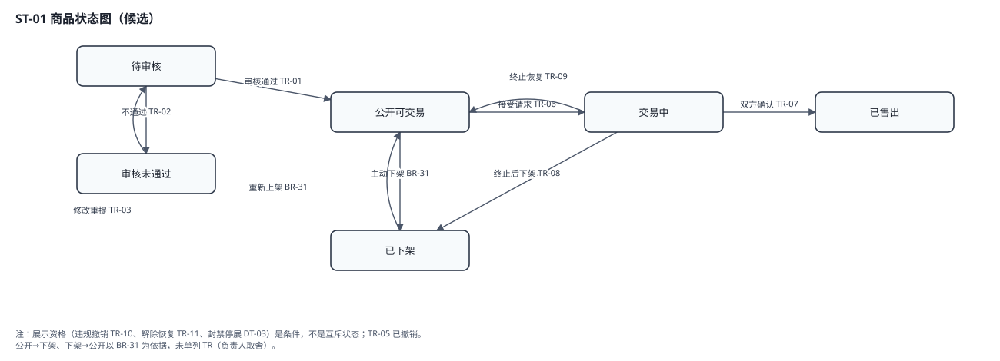
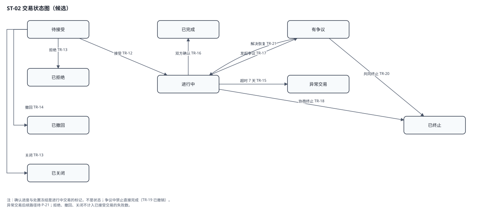

<!--
Version: 0.2.5
Version-Datetime: 2026-10-21T19:40:40+08:00
-->

# 5. 场景分析与基于类的行为、状态分析

状态：基础草稿；场景及活动由孙含佳细化，对象协作与对象状态由张新悦细化。5.1 场景目录与 5.3 详细场景、活动图仍未展开；5.2 已形成对象协作及状态转换说明（候选），商品与交易状态图已出图。未开展人工模型评审与场景走查，本文件不构成验证通过记录。

## 5.1 场景分析

### 基础场景目录（候选）

| 编号 | 场景 | 对应需求 | 正常路径起点 | 需覆盖的权限／异常／边界 | 候选类 |
|---|---|---|---|---|---|
| SC-01 | 注册并访问账户 | FR-01 | 校园用户注册、登录；普通身份信息不等于校园认证 | 重复注册、登录失败与访问拒绝 | C-01 |
| SC-02 | 发布、审核与修改商品 | FR-02、FR-08、FR-09 | 卖方提交，管理员首次审核通过后展示；信息修改不二次审核、保留待接受请求 | 审核拒绝、重提、交易中修改被拒 | C-01—C-04 |
| SC-03 | 搜索、筛选与收藏 | FR-03、FR-04 | 用户发现公开商品并收藏 | 无结果、商品失效、收藏访问越权 | C-02、C-03、C-05 |
| SC-04 | 商品评论与实时咨询 | FR-04 | 登录评论，买方发起与卖方的文字私聊 | 非会话成员查看、商品失效、封禁用户发送 | C-02、C-06—C-08 |
| SC-05 | 交易请求至双方确认完成 | FR-05、FR-06、FR-09 | 买方请求，卖方接受，双方平台外交付并分别确认 | 并行请求、单方确认、撤回及终止 | C-02、C-09、C-10 |
| SC-06 | 交易争议及终止后处置 | FR-05、FR-06、FR-08、FR-09 | 任一方说明发起争议，解决恢复后重置当前确认；双方终止后解除锁单 | 禁止争议直接完成、冻结覆盖、确认清空及历史保留 | C-02、C-09、C-10、C-12、C-13 |
| SC-07 | 评价、举报与封禁 | FR-07、FR-08 | 完成交易互评，举报提交、管理员核查并记录处置 | 未完成评价、重复评价、证据不足、封禁后已有交易 | C-01、C-09、C-11—C-14 |
| SC-08 | 管理员统计 | FR-10 | 按查询时点或选定时间范围展示指定指标 | 普通用户访问、统计口径误用、无数据 | 相关业务对象及派生统计 |

## 5.2 基于领域类的行为与状态分析

以第 3 章的 C 编号、类职责和 3.3 的关联及数量约束为依据，选择核心类开展动态分析。分析链为“用例目标 → 具体场景 → 参与领域类及职责 → 对象协作行为 → 核心对象状态转换”，可迭代修正，不应脱离类模型单独编造动作和状态。

### 对象协作分析（候选）

| 领域类 | 关联场景 | 行为／协作说明 | 状态分析对象 |
|---|---|---|---|
| C-02 商品 | SC-02、SC-05、SC-06 | 与审核记录、交易记录协作处理展示资格、占用、售出和重新上架 | 商品对象的生命周期及展示条件 |
| C-09 交易记录 | SC-05、SC-06 | 与买卖双方、商品及交付确认记录协作，处理接受、确认、终止、争议 | 单笔交易对象的状态及双方确认进度 |
| C-04 审核记录 | SC-02 | 记录管理员对特定商品内容的审核及原因 | 审核过程／结果，不能与商品状态混同 |
| C-07 咨询会话、C-08 消息 | SC-04 | 说明发送者、会话参与者、商品与访问权限协作 | 仅在确有生命周期规则时分析状态，不强制为每个类画状态图 |
| C-12 举报记录、C-13 处置记录 | SC-07 | 提交、核查、处置与理由记录，关联对象及账户限制 | 举报处理状态，具体名称待细化 |

按协作内容展开如下，均以第 4 章现行规则为行为依据。

**① 商品发布、审核与展示.** 卖方（C-01）提交 C-02，C-02 关联 C-03 归类；认领该事项的管理员（C-01）通过 C-04 记录结论与理由，C-02 的展示资格取决于审核结论。审核拒绝后卖方修改本人商品并重提，形成新的审核结论；信息修改不二次审核、不暂停公开，已有待接受请求不关闭（BR-11、BR-14、BR-33、TR-01—TR-04）。卖方主动下架时，该商品待接受请求记为“已关闭”并说明下架原因（BR-31、BR-42）。C-02 负责任务边界：展示资格与业务生命周期分别记录，处置导致的停止公开不为商品新造一个与“已售出”互斥的状态（见 5.2 商品状态说明）。

**② 交易请求与完成确认.** 买方（C-01）针对 C-02 建立 C-09 的待接受请求；卖方接受后 C-02 进入交易中，其余待接受请求经 C-09 记为已关闭（BR-28、TR-06、TR-12、TR-13）。交付在平台外完成，双方分别经 C-10 提交确认与可选说明，双方记录互不覆盖；仅双方均确认后 C-09 转已完成、C-02 转已售出（BR-03、BR-32、BR-43、TR-07、TR-16）。协商终止经 C-09 记录为已终止并解除锁单（BR-05、TR-18）。待接受请求不设自动有效期（BR-09、BR-42）。

**③ 争议、异常交易与管理处置.** 任一方（C-01）说明后 C-09 转有争议，保持锁单及原权限，不自动冻结（BR-06、TR-17）。管理员认领该事项后经 C-13 记录处置；管理员解决或双方均确认解决后 C-09 恢复进行中，同时清空 C-10 的当前确认标记、保留历史，重新单方确认后才开始完整暂定 7 天计时（BR-30、TR-21）。单方确认后另一方超时未回应，C-09 转异常交易，按冻结规则限制交易双方、禁止该笔交易双方 IM，交管理员处理，不自动完成或取消（BR-04、BR-09、TR-15、FR-14）。冻结是整个交易进度的暂停标记，不等于完成或终止（BR-53）。账户封禁由 C-14 记录，与交易冻结分别表达（BR-22、TR-24）。

**④ 商品页评论、私聊与处置沟通.** 登录用户经 C-06 评论公开可交易或交易中的商品，卖方回复买方评论；已售出禁止新增评论与回复（BR-16、BR-27、BR-47）。咨询会话由买方向卖方发起，C-07 承载会话、C-08 承载消息；同一买卖双方对同一商品不重复建立并行会话（BR-48）。管理访问限于认领事项所需的消息（BR-18、BR-51）。受限期间用户与认领管理员的沟通经 C-13 的处置通知与沟通单进行，不使用 C-07／C-08，也不恢复买卖双方 IM（BR-22、BR-53）。

**⑤ 举报、评价、通知与账户限制.** 未被封禁的登录用户经 C-12 提交举报并可附证据，认领管理员经 C-13 记录结论与理由，确认后隐去用户与管理员信息向登录用户公开（BR-20、BR-21、BR-50、TR-23）。完成交易后双方各经 C-11 提交一条评价，展示于商品详情页（BR-19）。封禁由 C-14 记录，解除后保留记录并按原资格恢复（BR-22、TR-24）。业务事件提醒与待办（FR-11）由 C-15 站内通知承载（支撑性对象），关联上述对象但不复制审核、处置或交易结论；触发范围、渠道与已读规则待 P-20。

### 对象状态分析（候选）

以下状态名称与归属为候选，用于与规则、场景对齐；状态图见 5.3，状态名称需经负责人确认。

#### 商品

业务生命周期状态：待审核、审核未通过、公开可交易、交易中、已售出、已下架。展示资格（是否对登录用户公开可见）作为条件单独表达，不与生命周期合并为同一组互斥状态。

| 转换 | 触发事件 | 依据 | 备注 |
|---|---|---|---|
| 待审核 → 公开可交易 | 认领管理员审核通过 | TR-01、BR-10、BR-33 | 首审通过才具备展示资格 |
| 待审核 → 审核未通过 | 认领管理员审核不通过 | TR-02、BR-14 | 须向卖方显示拒绝原因 |
| 审核未通过 → 待审核 | 卖方按拒绝原因修改后重提 | TR-03、BR-14 | 新结论形成，历史结论保留 |
| 公开可交易 → 公开可交易 | 卖方修改允许修改的信息 | TR-04、BR-11 | 不触发二审、不暂停公开、不关闭已有请求 |
| 公开可交易 → 交易中 | 卖方接受一条待接受请求 | TR-06、BR-02 | 同一商品同时至多一笔进行中交易 |
| 交易中 → 已售出 | 双方均确认完成 | TR-07、BR-03 | 交付在平台外，平台只记录确认 |
| 交易中 → 已下架 | 交易终止后卖方选择下架 | TR-08、BR-07、BR-31 | 解除锁单后由卖方决定去向 |
| 交易中 → 公开可交易 | 普通交易双方终止，解除锁单 | TR-09、BR-31 | 无审核／违规限制时恢复可交易 |
| 公开可交易 → 已下架 | 卖方主动下架 | BR-31 | 已定：以 BR-31 为依据，暂不补 TR |
| 已下架 → 公开可交易 | 卖方重新上架，审核仍有效且无违规限制 | BR-31 | 已定：以 BR-31 为依据，暂不补 TR |
| 已售出、已下架 → 其他 | 本项目不设售后或恢复在售 | 第 1 章范围 | 仅扩展候选，不在本期 |

展示资格条件（不是生命周期状态）：管理员违规处置撤销涉事商品公开访问（TR-10、BR-53）；处置解除后自动恢复原展示资格，且不将原非在售商品变为在售（TR-11）；封禁账户的商品停止公开展示（DT-03）。因此“已售出”或“已下架”的商品可同时处于“不再公开”，状态图需用条件或标注表达，不能增加“违规”这一互斥状态。

#### 交易记录

状态：待接受、已拒绝、已撤回、已关闭、进行中、有争议、已终止、已完成、异常交易。单方确认不作为独立状态，而是进行中交易内的确认进度标记（BR-04、E-05 D-33）。

| 转换 | 触发事件 | 依据 | 备注 |
|---|---|---|---|
| — → 待接受 | 买方发起请求 | BR-01 | 同一买方对同一商品至多一条有效待接受请求 |
| 待接受 → 进行中 | 卖方接受 | TR-12、BR-02 | 商品转交易中，其他请求关闭 |
| 待接受 → 已拒绝 | 卖方主动拒绝 | TR-13、BR-29 | 不改变商品原状态，可再次请求 |
| 待接受 → 已关闭 | 卖方接受其他请求，或卖方主动下架 | TR-13、BR-29、BR-42 | 原因分别记“商品已被其他用户锁单”“商品已下架” |
| 待接受 → 已撤回 | 买方在接受前撤回 | TR-14、BR-05 | 不影响其他待接受请求 |
| 进行中 → 已完成 | 双方均确认完成 | TR-16、BR-03 | 商品随之已售出 |
| 进行中 → 已终止 | 双方同意终止 | TR-18、BR-05 | 统计计为失败交易，解除锁单 |
| 进行中 → 有争议 | 任一方说明后发起争议 | TR-17、BR-06 | 保持锁单及原权限，不自动冻结 |
| 进行中 → 异常交易 | 单方确认后超时未回应（暂定 7 天） | TR-15、BR-04 | 按冻结规则限制双方，交管理员处理 |
| 有争议 → 进行中 | 认领管理员解决，或双方均确认已解决 | TR-21、BR-30 | 清空当前确认、保留历史，不解除已有冻结 |
| 有争议 → 已终止 | 双方共同同意终止 | TR-20、BR-30 | 计为失败交易，已有冻结仍限制操作 |
| 已完成／已终止 → 其他 | 不设重新开启 | BR-03、BR-05 | 争议中不得直接完成（TR-19 已撤销） |

待决定：异常交易的后续路径（恢复进行中、双方终止或其他处理）按 P-21 待定，本节不预填转换；冻结不产生“冻结”状态，只暂停进度（BR-53）。

确认进度：进行中交易记录哪一方已确认及等待截止；争议为有效响应，进入争议即结束原未回应计时；恢复后清空当前标记、历史保留，重新单方确认才重启完整暂定 7 天计时（BR-04、BR-30、BR-43、E-05 D-33）。

#### 审核记录

结果表述：待处理（进入共享待处理池、尚未认领）、通过、不通过（含拒绝理由）。审核记录表达对某次商品内容的审核结论，商品展示状态由其汇总得出，二者不混同（BR-33、TR-22）。同一商品多次重提是否新增审核记录为候选：建议每次重提形成新结论并保留历史，具体以负责人确认为准。

#### 举报记录

进度：待处理（共享池）、处理中（已认领）、无法认定、认定违规并处置（可含移除内容或封禁）。结果在管理员确认后匿名公开，确认前不可见（BR-20、BR-50、DT-05、TR-23）。告知与申诉对象范围待 P-22，证据要素与重复举报限制待 P-23；本节不预设状态名称定稿。

#### 账户限制

状态：未限制、封禁生效、已解除（记录保留）。封禁记录执行者与理由，限制期间按既定权限执行，解除后按原资格恢复（BR-22、TR-24）。交易冻结不属于账户限制，由交易进度的暂停标记表达（BR-53）。

#### 站内通知（支撑性对象）

状态：未读、已读（候选）。通知只表达提醒与已读，不参与商品、交易、举报等业务对象的状态机；已读不改变处理结果，未读不阻塞业务操作。是否设“已失效”及未读与已读的具体规则待 P-20，本节不预设。

以上为候选状态与转换，尚未形成正式状态图；未开展人工模型评审，未以本节证明状态与场景一致。

## 5.3 详细场景与动态模型（占位）

尚未完成。需展开正常、权限、状态转换及异常场景，描述初始条件、角色交互与预期结果；活动图由孙含佳细化。商品与交易状态图已出图，源文件与同名导出图见 `docs/models/`（编号 ST-01、ST-02 为候选），导出图由本机按源文件内容生成，未用 mermaid-cli 渲染，评审时需核对一致性。

关联 FR、用例、C 和 BR 的对应关系待场景落稿后补。

## 5.4 动态分析的业务依据

| 分析对象／流程 | 必须表达的现行行为 | 待完成的分析 |
|---|---|---|
| 商品与请求 | 首审、拒绝重提；修改不二审且请求保留；接受锁单／其他请求关闭；完成已售出；普通终止恢复或卖方下架 | 具体场景与活动图；状态转换说明见 5.2、状态图见 5.3；主动下架关闭待接受请求并说明原因（E-06 D-38） |
| 交易确认及争议 | 确认进度不是独立状态；未回应暂定 7 天转异常；争议视为响应，恢复后清空当前确认保留历史，重新单方确认才计时；不得争议直接完成 | 异常与冻结模型的后续路径按 P-21 待定；状态转换说明见 5.2、状态图见 5.3 |
| 管理处置及沟通 | 认领人处置；冻结不等于终止，保留历史；禁止双方 IM，处置通知与沟通单为受限用户保留管理员通道；确认解除后按原资格恢复 | 关联 C-13／C-14，说明通知／沟通单职责，不擅自预设数据库或独立工单系统 |
| 评价／举报 | 评价商品页展示；举报结果确认后匿名公开，之前不可见；封禁期禁止两种新增提交 | 正常、权限、匿名展示及处置恢复场景 |

依据：[规则](draft-04-规则与权限.md)、[E-05 转换复核](../evidence/E-05-状态转换复核.md)、[E-06 后续决定](../evidence/E-06-处置流程与展示复核.md)。TR-01—TR-24 本轮规则复核已结束，TR-05／TR-19 停用；本章 5.1、5.3 场景及活动图仍未开展，未执行走查。
