<!--
Version: 0.2.26
Version-Datetime: 2026-10-23T03:47:31+08:00
-->

# 校园二手交易与物品流转平台需求规格说明书

本说明书由第1—8章整合生成，纳入材料及源文件版本见第8章。

## 目录

- [1. 项目概述](#chapter-01)
- [2. 用户需求](#chapter-02)
- [3. 领域与数据](#chapter-03)
- [4. 规则与权限](#chapter-04)
- [5. 场景分析与基于类的行为、状态分析](#chapter-05)
- [6. 质量要求](#chapter-06)
- [7. 验收与验证](#chapter-07)
- [8. 基线与人机协作](#chapter-08)

## 1. 项目概述

状态：草稿，待负责人补充与复核。

### 问题与业务目标

本项目面向单一学校的校园二手交易场景，允许学生和教职工直接注册，统称“校园用户”，不开展校园身份或学籍核验。买方、卖方是校园用户在不同交易中的业务角色。

平台提供闲置商品发布、浏览搜索、收藏、商品页评论及买卖双方实时 IM。实际付款与物品交付均在平台外完成，平台记录交易相关信息及完成、失败等结果，并提供评价、举报、商品审核、用户封禁和数据统计功能。

项目旨在使商品信息、沟通过程、交易结果及违规处理得到有组织的记录，支持校园闲置物品流转。当前尚未开展用户调研，不将信息分散、沟通低效等潜在问题表述为已经证实的本校现状。

### 涉众与确认责任

| 涉众或角色 | 关注内容 | 确认责任与状态 |
|---|---|---|
| 校园用户（学生、教职工） | 发布与发现商品、评论、即时沟通、平台外交易结果记录、评价与举报 | 用户范围由袁尚峰确认，现行规则已复核，详细用例及场景验证待完成；未开展真实用户访谈 |
| 平台管理员 | 商品审核、违规处理、封禁、统计 | 按项目内平台角色设定，不预设真实学校部门承担管理责任；按认领事项处理，权限规则已复核，剩余范围见开放清单 |
| 项目小组 | 需求范围、规则、模型与验证记录 | 组长组织范围与规则确认，各负责人核对本人内容并参与交叉复核 |
| 课程指导人员 | 课程要求与提交范围 | 以课程资料及实际反馈为依据，不将组长确认写为教师确认 |

范围依据及确认来源见 [分类决策依据](appendices/evidence/index.md)。

### 系统范围与非目标

#### 纳入范围

- 服务单一学校场景，学生和教职工均可普通注册，不进行校园身份核验；单校定位不代表技术上已限制校外人员注册。
- 禁止未登录访客访问业务内容，仅开放注册、登录和忘记密码入口；支持通过绑定邮箱或手机号验证后自助重置密码。
- 当前按一件逻辑商品建模，一次交易完成即退出在售；多件逻辑商品及售后保持在售仅为扩展候选。
- 保留原题十项核心功能的需求覆盖：用户注册与认证、商品发布与审核、搜索与筛选、收藏与咨询、下单与交易确认、线下交付记录、评价与举报、管理员审核与封禁、商品状态流转、数据统计。
- 商品页评论与买卖双方实时 IM 均为必做需求。
- 实际交易发生在平台外，系统负责交易相关记录与结果确认。

- 支持账户注册、登录、退出、自助密码重置、修改密码、绑定或更换邮箱／手机号及修改显示名称。
- 提供站内通知与待办、本人业务集中管理、管理员商品分类维护及异常交易认领处理。

#### 非目标

- 不接入校园统一身份认证或核验学籍、教职工身份。
- 不在平台内处理付款、资金托管、退款或实际物品交付。
- 暂不纳入赠送、交换与租赁。

原型及原型走查按小组安排为选做；商品评论和实时 IM 是系统需求，其必做性质不受原型是否开展影响。

### 成功判据（建议，待复核）

以下为本次需求分析成果的建议判据，不代表已开展检查或已达到业务效果。

| 业务目标 | 本阶段成功判据 | 检验方法 |
|---|---|---|
| 支持商品发布与发现 | 发布审核、搜索筛选、收藏等需求齐全，角色和操作结果明确 | 对照题目检查需求覆盖，人工走查代表性场景 |
| 支持买卖双方沟通 | 评论与实时 IM 均有需求说明，权限和边界明确 | 复核用例、权限与沟通场景 |
| 支持平台外交易结果记录 | 结果确认主体、冲突处理及商品状态变化有明确规则 | 核对规则、状态模型并开展场景推演 |
| 支持平台管理 | 审核、举报、封禁流程有明确权限、处理结果和异常说明 | 权限检查及正常、异常场景走查 |
| 形成可供后续开发的需求基线 | 十项功能有覆盖，用例、场景、模型相互对应，未决问题可追踪 | 覆盖追踪与人工一致性检查 |

实际成交量、满意度、响应时间等量化指标尚无依据，不预设数值。

### 范围依据

范围依据见[分类证据索引](appendices/evidence/index.md)，功能需求见[第 2 章](#chapter-02)。

## 2. 用户需求

状态：需求分析草稿。

### 2.1 需求组织

FR-01—FR-10 对应题目十项覆盖基线，其中 FR-01 包含账户生命周期能力；FR-11—FR-14 为独立业务主需求。

### 2.2 角色基础

| 编号 | 角色 | 边界 |
|---|---|---|
| R-01 | 校园用户 | 学生与教职工普通注册，不核验校园身份；访客仅有注册、登录、忘记密码入口 |
| R-02 | 买方 | 在某商品咨询／交易中的业务身份，不是互斥账户类型 |
| R-03 | 卖方 | 本人商品发布者，可在别的商品中作为买方 |
| R-04 | 平台管理员 | 认领事项并在归属／必要范围内管理；管理身份不自动授予私人记录任意访问权 |

买卖角色随商品／交易变化；封禁、冻结是限制，不是新的业务角色。项目组长和教师是涉众，不自动成为系统角色。

### 2.3 题目十项功能及扩充范围

| 编号 | 功能分组 | 系统应提供的能力 | 规则依据 |
|---|---|---|---|
| FR-01 | 账户生命周期 | 普通注册、登录、退出登录、忘记密码／自助重置、修改密码、绑定或更换邮箱／手机号、修改显示名称；仍覆盖题目第 1 项“用户注册与认证” | BR-35—BR-39；新增细则待 P-19 |
| FR-02 | 商品发布与审核 | 发布、首次审核、拒绝原因展示、修改重提、允许状态下信息微调及上下架；微调不改变商品主要内容和交易内容，下架关闭待接受请求并说明原因；管理员维护／展示禁发范围 | BR-07、BR-10—BR-15、BR-31、BR-33、BR-40 |
| FR-03 | 搜索与筛选 | 关键词／分类／价格组合检索、空结果提示；按资格显示商品详情和状态 | BR-24、BR-38、BR-46、BR-52 |
| FR-04 | 收藏与咨询 | 收藏及个人清单、失效提示；商品页评论、卖方回复买方；买方发起私人文字会话、历史查看及允许时发送；IM 会话列表与未读提示 | BR-16—BR-18、BR-23、BR-26、BR-27、BR-47、BR-48 |
| FR-05 | 下单与交易确认 | 请求、接受／拒绝、撤回、完成确认、协商终止；任一方说明发起争议、解决恢复；单方确认超时识别与异常转交 FR-14 | BR-01—BR-09、BR-28—BR-31、BR-41、BR-42、BR-53 |
| FR-06 | 线下交付记录 | 双方分别提交确认与可选说明、查看本人历史；管理员按处置记录处理更正 | BR-25、BR-32、BR-43、BR-44、BR-49 |
| FR-07 | 评价与举报 | 完成交易互评、在商品详情页展示；提交举报并可附证据、管理员确认后匿名展示结果；评价删除与重复举报限制待 P-23 决定 | BR-19—BR-21、BR-22、BR-50 |
| FR-08 | 管理员审核与封禁 | 共享待办池、主动认领、核查处置、冻结／封禁／解除；处置通知与沟通单供用户说明、反驳／申诉和管理员解决；管理操作留痕，告知与申诉对象范围待 P-22 校对 | BR-08、BR-18、BR-21、BR-22、BR-33、BR-40、BR-51、BR-53 |
| FR-09 | 商品状态流转 | 展示商品状态、按请求及交易结果联动，普通终止解除锁单、按资格恢复；违规停止访问及解除后的恢复 | BR-02、BR-03、BR-07、BR-11、BR-15、BR-30、BR-31、BR-46、BR-53；TR-01—TR-21 |
| FR-10 | 数据统计 | 管理员选时间范围或全部查看账户、商品状态、审核／举报待办及交易结果统计 | BR-29、BR-34、BR-45 |

FR-08 的处置沟通与 FR-04 买卖双方 IM 分别管理，封禁／冻结期间仍保留前者。

### 2.4 新增功能主需求

| 编号 | 主需求 | 系统应提供的能力与边界 | 关联与待确认 |
|---|---|---|---|
| FR-11 | 站内通知与待办 | 提供审核结果、交易请求接受／拒绝／关闭、单方确认与超时、处置告知、评价与举报结果等业务事件的站内通知与待办；区分未读与已读 | 与相关业务引用关联，不隶属 FR-01—FR-10；具体触发范围、是否扩展邮件／短信及已读规则见 P-20 |
| FR-12 | 个人业务管理（我的） | 集中查看和管理本人商品（含待接受请求）、交易、收藏、评价、举报及处置沟通记录；各操作继续遵守对象归属、资格及状态限制 | 聚合本人业务入口，不增加对他人私人记录的访问权；入口范围与优先级待确认，不将所有记录都解释为可编辑或删除 |
| FR-13 | 商品分类维护 | 平台管理员统一维护商品分类，系统提供初始分类，供商品归类与分类筛选使用 | 维护者已定；操作集、初始条目、停用／删除及既有商品与筛选处理见 P-18；与禁发范围维护区分 |
| FR-14 | 异常交易处理 | 单方确认超时形成异常交易，进入管理员共享待处理池，由管理员认领处理；不自动完成或取消，不替双方确认交付 | FR-05 负责识别与转交；沿用既定冻结／沟通边界，处理方式、恢复路径与是否承诺时限见 P-21；不得等同普通争议解决 |

### 2.5 用户故事与用例

用户目标、价值及候选验收条件见[用户故事](appendices/user-stories/index.md)；用例候选与详细用例入口见[用例清单](appendices/use-cases/index.md)。

已选 5 个代表性详细用例：UC-C02 发布与维护商品、UC-C04 收藏与咨询、UC-C05 请求与确认交易、UC-C08 审核与处置沟通、UC-C14 处理异常交易，均含参与者、触发、前置条件、正常／替代／异常流程、后置结果、关联规则及可检验验收条件。未入选的 UC-C01、C03、C06、C07、C09—C13 保持候选。

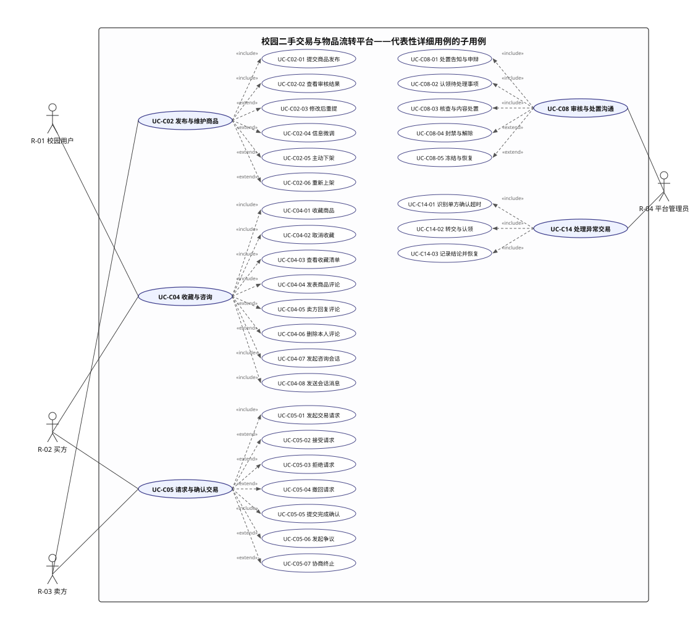

上述 5 个详细用例的子用例分解与关系见[子用例分解](appendices/use-cases/子用例分解.md)；虚线箭头为主用例对子用例的包含，标注 «extend» 者为条件或替代分支。

### 2.6 需求来源

题目十项来自既有题目材料，历次范围和规则见[证据索引](appendices/evidence/index.md)，本次业务范围依据见[E-07](appendices/evidence/E-07-需求结构扩展.md)。待确认细则见[开放清单](../bits/未决问题与复核清单.md)。

## 3. 领域与数据

状态：基础草稿，负责人张新悦继续细化。术语表、候选类（含支撑性对象 C-15 站内通知）、业务属性、关联及数量约束为候选分析；C-01—C-15 已有类分析初稿，CL-01 与状态图仅保留源文件、不提供导出图；未开展人工模型评审。

### 3.1 术语基础

以下术语用于统一第 3、5 章及规则正文的表述，业务含义以所在条目为依据；术语本身不构成新规则。

| 术语 | 本文档中的含义 | 依据 |
|---|---|---|
| 校园用户 | 学生与教职工的统称；普通注册，不核验校园身份或学籍 | BR-35；[第 1 章](#chapter-01) |
| 买方／卖方 | 相对于具体商品或交易而言的业务身份，不是互斥账户类型 | [第 2 章](#chapter-02) R-02、R-03；第 4 章 4.10 |
| 下单（交易请求） | 买方向该商品卖方发出的购买意向记录，不涉及线上付款 | BR-01 |
| 待接受请求 | 尚未被接受、拒绝、撤回或关闭的请求 | BR-28、BR-42 |
| 锁单 | 商品因一笔进行中交易而停止接受新请求的状态 | BR-02、BR-28 |
| 完成（交易完成） | 双方在平台分别确认后记录的结果，不代表平台核验付款或实际交付 | BR-03；第 1 章 |
| 确认进度 | 进行中交易内记录哪一方已提交完成确认及等待期限的标记，不是交易状态 | BR-04；E-05 D-33 |
| 完成确认 | 交易一方提交的完成意思表示，双方分别保存，不覆盖对方 | BR-03、BR-32、BR-43 |
| 交付确认记录 | 记载确认人、确认时间及可选说明的历史记录 | BR-32、BR-44 |
| 争议 | 任一方说明后交易进入的保持锁单情形，不自动冻结或认定违规 | BR-06、BR-30 |
| 异常交易 | 单方确认后超过暂定 7 天未回应，转交管理员处理的情形，不自动完成或取消 | BR-04、BR-09；FR-14 |
| 冻结 | 管理员处置导致整个交易进度暂停的标记，不等于完成或终止 | BR-53；TR-10 |
| 封禁 | 账户限制，禁止业务写操作，保留只读访问与管理沟通 | BR-22 |
| 认领 | 管理员从共享待处理池取得某事项处理归属 | BR-51 |
| 处置通知与沟通单 | 受限用户与认领管理员之间的受控沟通，不属于买卖双方 IM | BR-22、BR-53 |
| 商品页评论 | 商品页上的公开咨询，与交易完成后的评价区分 | BR-47 |
| 评价 | 已完成交易双方的互评，每方每笔一条，展示于商品详情页 | BR-19 |
| 举报 | 对商品、评论、消息、评价或用户提交的违规报告，经管理员确认后匿名公开结果 | BR-20、BR-50 |
| 通知与待办 | 站内业务事件提醒及待处理事项，区分未读与已读；具体触发范围待 P-20 | FR-11 |
| “我的”聚合入口 | 集中查看本人商品、交易、收藏、评价、举报及处置沟通的入口，不增加对他人记录的访问权 | FR-12 |
| 统计 | 由业务记录派生的计数结果，不预设独立持久化实体 | BR-34、BR-45 |

### 3.2 候选领域类

| 编号 | 候选类 | 基本职责 | 关联分析起点 |
|---|---|---|---|
| C-01 | 用户账户 | 注册登录、身份与账户限制关联 | 本人商品、收藏、评论、会话、交易；买卖角色非两个独立用户类 |
| C-02 | 商品 | 维护闲置物品信息与生命周期 | 属于发布者及分类，关联审核、请求与交易 |
| C-03 | 商品分类 | 组织检索与商品归类 | 关联商品；维护权限待细化 |
| C-04 | 审核记录 | 记录商品审核结论及理由 | 关联商品、管理员及被审核内容版本 |
| C-05 | 收藏记录 | 记录用户与收藏商品关系 | 关联收藏者、商品及失效显示规则 |
| C-06 | 商品评论 | 承载商品页公开交流 | 关联商品、作者及删除／违规处置 |
| C-07 | 咨询会话 | 组织买卖双方针对商品的私聊 | 关联商品、双方与消息；不要求以交易状态代替会话状态 |
| C-08 | 消息 | 保存会话内文字及发送信息 | 归属会话及发送者，访问遵守 BR-18 |
| C-09 | 交易记录 | 请求、接受、结果确认、终止及争议的全过程 | 关联商品、买方和卖方；请求与交易暂采用同一对象阶段建模，是否拆类由负责人论证 |
| C-10 | 交付确认记录 | 分别保存双方确认历史及可选说明，区分可重置的当前确认标记 | 关联交易和确认者，不覆盖对方确认 |
| C-11 | 评价 | 保存已完成交易双方评价 | 关联交易、评价者和被评价者 |
| C-12 | 举报记录 | 描述举报对象、理由、证据和进度 | 关联举报者、目标对象与处置记录 |
| C-13 | 处置记录 | 保留管理事项认领、处置结论、理由及执行者，支撑处置通知与沟通单 | 关联举报或违规对象、管理员 |
| C-14 | 账户限制记录 | 描述封禁及解除的原因和记录 | 关联受限账户、管理员与处置依据 |
| C-15 | 站内通知 | 记录业务事件提醒、待办及接收人的未读／已读 | 支撑性对象；关联接收人，来源业务对象为弱关联；不承载处置沟通内容 |

#### 3.2.1 新增业务需求的候选类补充（待论证）

以下为 FR-01 扩展及 FR-11—FR-14 涉及的建模范畴，均为候选，需负责人评估后确认，不表示已采纳。

| 涉及对象 | 候选处理方式 | 理由与边界 | 关联需求 | 状态 |
|---|---|---|---|---|
| 站内通知 | 建类 C-15 站内通知（支撑性对象） | 记录业务事件提醒与待办、接收人及未读／已读；与处置通知及沟通单（C-13）职责不同，后者是受控沟通 | FR-11 | 已确认建类；触发范围、渠道及已读规则仍待 P-20，P-20 后进 CL-01 主图 |
| 商品分类 | 扩展 C-03 维护职责，不新建类 | 现有 C-03 仅“组织检索与商品归类”；新增／改名／停用／删除、初始分类及停用删除后的既有商品与筛选处理未定 | FR-13 | 已定：设启用状态、不设排序；操作集与初始分类待 P-18 |
| 异常交易 | 以 C-09 的阶段／状态加 C-13 处置事项关联表达，暂不新建类 | 超时是交易进度问题，处理由管理员认领；恢复路径未定，不宜先设独立对象 | FR-14 | 候选；恢复方式待 P-21 |
| 处置通知与沟通单 | 由 C-13 处置记录承担并关联沟通消息，不另立对象 | 沟通含多轮说明、反驳／申诉与管理员回复，与举报／审核处置结论不同；不预设独立工单系统 | FR-08 | 已定：由 C-13 承担；告知与申诉对象范围仍待 P-22 |
| 举报记录 | 扩展 C-12 的证据要素与进度 | 举报可附证据；证据要素及重复举报限制未定 | FR-07 | 待 P-23 |
| “我的”业务 | 不新建领域类，作为本人对象的聚合视图 | 聚合本人商品、交易、收藏、评价、举报及处置沟通，不增加对他人记录的访问权 | FR-12 | 候选结论 |
| 账户生命周期 | 扩展 C-01，不新建类 | 退出、修改密码、更换绑定标识及显示名称修改的验证方式与限制未定 | FR-01 | 待 P-19 |
| C-09 是否拆类 | 已定不拆，请求与交易按同一对象阶段建模 | 请求结果与交易进度共享商品锁单与数量约束，拆分将形成两套需联动的状态；如后续要拆，须另给独立生命周期依据并重编 TR | FR-05、FR-09 | 已定（负责人确认） |

### 3.3 领域类关系与约束（候选）

以下为业务分析口径，不写出字段类型、长度、索引或表结构，不构成数据字典，也不开展数据库设计。

#### 3.3.1 主要业务属性

| 类 | 需要说明的业务属性（描述性） | 说明 |
|---|---|---|
| C-01 用户账户 | 账户标识（邮箱或手机号）、显示名称、账户状态、限制期间 | 标识全平台唯一；不核验校园身份；密码只作“登录凭据”表述，不写存储实现 |
| C-02 商品 | 标题、描述、图片、价格、分类、发布者、当前展示状态 | 关键内容集合按 BR-12；展示状态与展示资格分别表达，见 5.2 |
| C-03 商品分类 | 名称、启用状态 | 已定设置启用状态、不设排序；操作集与初始分类待 P-18 |
| C-04 审核记录 | 被审核内容及其范围、审核者、审核时间、结论、拒绝理由 | 记录审核对象而非改写商品状态；重提是否新增记录见 5.2 候选 |
| C-05 收藏记录 | 收藏者、商品、收藏时间 | 失效只在本人清单提示，不泄露不可见内容 |
| C-06 商品评论 | 所属商品、作者、内容、发表时间、是否已删除及处置理由 | 作者删除与管理员移除分开记录 |
| C-07 咨询会话 | 商品、参与双方、建立时间、最近活动时间 | 同一买卖双方对同一商品不重复建立并行会话 |
| C-08 消息 | 所属会话、发送者、内容、发送时间 | 访问限于会话双方及认领事项管理员 |
| C-09 交易记录 | 关联商品及交易时内容、买方、卖方、请求提出与结果、双方确认人与时间、终止或争议结果及处理记录 | 按 BR-44 至少保留项；不记录付款金额、流水及资金凭证 |
| C-10 交付确认记录 | 所属交易、确认者、确认时间、可选说明、当前标记与历史 | 双方记录分别保存；当前标记可清空，历史不删除 |
| C-11 评价 | 所属交易、评价者、被评价者、评分、文字、提交时间 | 仅已完成交易；提交后不修改 |
| C-12 举报记录 | 举报者、举报对象及类型、理由、可选证据、处理结论与理由、公开结果 | 匿名展示在确认后进行 |
| C-13 处置记录 | 事项类型与对象、认领人、处置结论与理由、执行时间、沟通记录 | 支持处置通知与沟通单，不等于买卖双方 IM |
| C-14 账户限制记录 | 受限账户、限制类型、原因、执行者、生效与解除时间、处置依据 | 记录保留；解除后按原资格恢复 |
| C-15 站内通知 | 事件类型、接收人、关联业务对象、未读／已读、产生时间 | 来源对象为弱关联，不复制业务结论；渠道与文案留设计 |

#### 3.3.2 关联与数量约束

| 约束 | 内容 | 依据 |
|---|---|---|
| 商品—进行中交易 | 同一商品同时至多一笔进行中交易；卖方接受一条请求时其余待接受请求记为“已关闭” | BR-02、BR-28 |
| 买方—待接受请求 | 同一买方对同一商品至多一条有效待接受请求；拒绝或撤回后可再次发起 | BR-28、BR-41 |
| 商品—审核记录 | 首审通过后商品才具备展示资格；拒绝后修改重提形成新的审核结论，历史结论保留 | BR-10、BR-14、BR-33 |
| 交易—确认记录 | 每方每笔交易保存其确认与说明，双方记录互不覆盖；当前标记可清空而历史不删除 | BR-32、BR-43 |
| 交易—评价 | 每方每笔已完成交易至多一条评价；不得评价未完成交易或代他人评价 | BR-19 |
| 双方—会话 | 同一买卖双方对同一商品至多一条并行会话；由买方发起，卖方不主动发起新会话 | BR-17、BR-48 |
| 举报—处置 | 一份处置记录可关联一项举报或违规事项；同一对象的多条举报是否限制待 P-23 | BR-20、BR-21 |
| 账户—限制记录 | 一次封禁对应一条限制记录，解除后记录保留、不覆盖历史 | BR-22；TR-24 |
| 商品—分类 | 商品在任一时刻归属一个分类（候选）；停用或删除分类后既有商品与筛选的处理待 P-18 | BR-12、FR-13 |
| 处置—沟通 | 处置通知与沟通单仅覆盖相关受处置用户与认领管理员，不进入买卖双方 IM | BR-22、BR-53 |
| 通知—接收人 | 一条通知对应一名接收人；同一业务事件可向多人分别产生通知，已读状态按接收人区分 | FR-11；P-20 待定渠道与已读规则 |

#### 3.3.3 CL-01 核心领域类图

建模范围以 C-01—C-15 为基础，其中 C-15 为支撑性对象；类图只表达类、职责分组、关键关联及重数，不表达字段类型或表结构。可编辑源文件见 [CL-01-核心领域类图.mmd](appendices/models/CL-01-核心领域类图.mmd)；当前按小组安排只保留源文件、不提供导出图，查看需用 Mermaid 预览打开源文件。

| 关联 | 重数（候选） | 依据 |
|---|---|---|
| 用户账户—商品 | 1 : 0..* | 发布者与本人商品 |
| 商品—商品分类 | 0..* : 1 | 归类与筛选，分类维护待 P-18 |
| 商品—审核记录 | 1 : 0..* | 首审、拒绝重提及历史结论 |
| 商品—交易记录 | 1 : 0..* | 多笔历史请求／交易，同时至多一笔进行中 |
| 交易记录—交付确认记录 | 1 : 0..2 | 双方各一条有效记录并保留历史 |
| 交易记录—评价 | 1 : 0..2 | 每方一条 |
| 用户账户—收藏记录 | 1 : 0..* | 本人清单 |
| 商品—商品评论 | 1 : 0..* | 商品页咨询 |
| 咨询会话—消息 | 1 : 0..* | 会话内文字 |
| 商品—咨询会话 | 1 : 0..* | 同一双方不重复并行 |
| 用户账户—举报记录 | 1 : 0..* | 举报者 |
| 举报记录—处置记录 | 0..* : 0..1 | 处置结论与理由 |
| 用户账户—账户限制记录 | 1 : 0..* | 封禁及解除历史 |
| 用户账户—站内通知 | 1 : 0..* | 接收人维度；C-15 为支撑性对象，P-20 后进入主图 |
| 站内通知—来源业务对象 | 0..* : 0..1（弱关联） | 可指向审核、交易、处置等对象；只作定位，不复制结论 |

绘制状态：已建立可编辑源文件 `docs/models/CL-01-核心领域类图.mmd`，当前只保留源文件、不提供导出图，查看需用 Mermaid 预览打开；图索引已登记。C-15 为支撑性对象，暂不进入主图，待 P-20 决定触发范围后再纳入 CL-01。

### 3.4 依据与验证状态

依据：[十项基础需求](#chapter-02)、[规则与权限](#chapter-04)、[E-05 状态转换复核](appendices/evidence/E-05-状态转换复核.md)。术语表与 3.3 的属性、关联及数量约束为候选分析；CL-01 已有源文件但未提供导出图，且未开展人工模型评审，也未以本文件证明用例覆盖通过。

### 3.5 详细类分析

C-01—C-15 已建逐类分析文件，见[类分析索引](appendices/class-analysis/index.md)。各文件写职责边界、业务属性、关联重数、规则／场景映射与待决项，不写字段类型或实现设计。仍待完成：人工模型评审、类职责能否支撑用例与场景的核对（P-09）；C-15 待 P-20 确认触发范围后再评估是否进入 CL-01 主图。

## 4. 规则与权限

### 4.1 规则类型与依据

BR 表达业务约束，权限、DT 和 TR 分别表达访问资格、条件组合及事件转换。现行规则均以本表编号为准；停用、撤销内容及历次编号映射见[E-09 规则合并与编号重排](appendices/evidence/E-09-规则合并与编号重排.md)。

依据：[E-01 初始规则](appendices/evidence/E-01-范围讨论结果.md)、[E-02 张新悦补充](appendices/evidence/E-02-规则补充采纳记录.md)、[E-03 新增规则复核](appendices/evidence/E-03-新增规则复核.md)、[E-04 复杂决策](appendices/evidence/E-04-复杂决策复核.md)、[E-05 转换复核](appendices/evidence/E-05-状态转换复核.md)、[E-06 后续流程／展示](appendices/evidence/E-06-处置流程与展示复核.md)。后续账户、分类、交易、通知及范围决定见 [E-07](appendices/evidence/E-07-需求结构扩展.md)；两类 IM、卖方个人页及请求通知的现行决定见[E-08 D-42](appendices/evidence/E-08-普通IM与购买请求联动.md)。

### 4.2 交易、请求与争议

| 编号 | 现行规则 |
|---|---|
| BR-01 | 买方在商品页提交独立购买请求，由卖方接受或拒绝，不涉及线上付款。有效请求成功后，系统按该请求／交易记录建立并自动打开对应交易 IM 分支，发送关联商品、请求、发起人及时间的系统通知，保留请求与通知历史；提醒同时汇总至站内通知中心，入口关联同一请求及交易分支并展示当前状态，不重复创建请求；已有该笔分支则打开原分支，不为同一笔记录重复创建。交易 IM 可在双方普通 IM 入口下分支组织，但不与普通私聊混用消息。进入或接受请求须由卖方明确操作，单纯聊天也不生成购买请求。用户可先私聊咨询或直接提交请求；请求待接受不锁单，卖方明确接受后才锁单。 |
| BR-02 | 同一商品允许多个不同买方的待接受请求，同一买方对同一商品至多一条有效待接受请求；卖方接受一条时，其余待接受请求自动记为“已关闭”，原因统一为“商品已被其他用户锁单”，不产生多笔进行中交易。请求因接受、拒绝、撤回、其他用户锁单或商品下架（含卖方主动下架及管理员违规处置下架）而结束时，按对应结果记录（接受即进入进行中），分别记为已接受、已拒绝、已撤回、已关闭，并分别记录原因；其中因商品下架关闭的，说明原因为“商品已下架”。拒绝或撤回后买方可对该商品再次发起新请求。待接受请求不设自动有效期、不自动过期；商品修改不关闭已有请求。结果通知见 4.17。用户不得购买本人商品或向本人发起私聊。 |
| BR-03 | 卖方接受后，商品进入“交易中”，停止接受新交易；同一商品只能有一笔进行中的交易。 |
| BR-04 | 普通流程须先有双方明确确认的交易约定，再由双方各作一次完成确认，同时确认交付及支付均完成；双方均确认后本笔交易已完成。认领管理员有依据调整状态的例外见 BR-08。交易结束后的商品上架选择见 BR-14；通知见 4.17。 |
| BR-05 | 单方确认采用进行中交易的确认进度，不单设状态；一方确认后另一方未回应，等待阈值7 天。进入争议即有效响应，原未回应计时结束。争议解决恢复进行中后按 BR-07 清空当前确认；恢复不启动计时，待一方重新提交完成确认后才开始完整 7 天计时。超时转异常交易，按冻结规则限制交易双方（停止上架和交易操作、禁止该笔交易双方 IM），交管理员处理，保留处置通知与沟通单；不自动完成或取消。首版不自动确认完成或超时取消交易。 |
| BR-06 | 卖方接受前买方可撤回；接受后、首次交易约定确认前，买方可直接取消，卖方申请取消须买方明确同意。约定确认后须双方明确同意取消，未同意不自动终止；未冻结且有操作资格时，即使单方已确认完成或进入争议，也可双方同意取消。取消生效状态为已终止，不另设已取消；普通双确认或管理调整完成为已完成；已终止计失败交易，拒绝／撤回／请求关闭不计失败。结果通知见 4.17。冻结及封禁限制优先；详细阶段见 4.15。 |
| BR-07 | 交易买方或卖方均可主动发起争议并填写说明，统一进入“有争议”状态，不以哪方发起或是否已有单方确认为区别。争议期间商品保持锁单，争议本身不新增用户权限限制，保留原有各项权限；不解除已存在的封禁／冻结限制。认领管理员解决或双方均确认解决可恢复进行中，清空当前完成确认、保留历史及未变更约定；恢复不启动计时，经一方重新提交完成确认后才开始完整7 天计时。普通用户须恢复进行中后才可完成；未冻结且有资格时可在争议中双方同意取消。管理员可按 BR-08 有依据直接调整，恢复进行中不自动解除冻结。 |
| BR-08 | 认领管理员可依据事项处理结果调整交易全部状态，包括无需双方完成确认而调整为已完成；不得伪造双方确认，不代表核实线下付款／交付，不承担退款或赔付。所有转移记录前后状态、主体、时间、触发事件、原因及关联依据，通知双方；缺少依据不任意调整。冻结不阻止管理员处理；关联结果见 4.15。 |
| BR-09 | 存在未结束且锁单的交易时，卖方不得主动下架，须先按 BR-06／BR-08 结束交易。卖方须遵守不替换交易对象、不误导商品实质情况的规则；平台不自动识别实质变更，保留编辑历史并通过举报／争议处理。 |

### 4.3 商品发布、审核与浏览

| 编号 | 现行规则 |
|---|---|
| BR-10 | 商品发布后由平台管理员审核，通过审核后才对其他用户公开展示。审核不通过时，向卖方显示拒绝原因；卖方修改后可重新提交审核。商品首次审核通过或未通过时，均向发布者发送关联该商品的站内通知；未通过通知附审核原因，并可进入商品查看、修改后重新提交。通过通知仅说明审核结果，不代表成交。退回补充作为不通过原因记录，不新增审核结论状态。 |
| BR-11 | 审核通过后的允许编辑不二次审核、不暂停展示、不关闭待接受请求；保留前后内容、修改人和时间，不自动判断微调或实质变化。卖方负责真实发布，举报／争议按历史核查。交易中禁止卖方修改标题、描述、图片、价格及分类等关键内容；仅冻结不禁无关商品合规编辑，封禁另行适用。认领／有管理权限的管理员可有依据纠正分类，记录前后内容、原因、操作人和时间并通知卖方；不改变交易状态、约定或历史交易内容。历史权限及变更通知见 4.18。 |
| BR-12 | 商品关键内容包括标题、描述、图片、价格、分类。分类采用单级标签，商品可关联多个。提交商品审核时，须至少选择一个已有可选分类标签，或提出一个新增分类标签申请；商品审核通过时，须关联至少一个获认可的分类标签。标签数量上限暂不规定。分类标签细则见 4.16；不得仅因申请标签不合适就直接拒绝合规商品发布。 |
| BR-13 | 商品审核检查描述与图片是否清晰、分类及价格是否合理完整、是否含明显违规或与二手物品交易无关内容；审核结论记录审核者、时间及结论理由（不通过须记录拒绝理由）。禁止发布物品细目由管理员维护并向用户展示，至少覆盖：法律法规禁止流通的物品、危险品与管制物品、活体动物、药品与医疗器械、账号与虚拟财产、明显与二手闲置物品交易无关的服务或推广内容；细目条目由管理员补充维护。本条为教学项目工作设定，不宣称覆盖全部现实监管要求。 |
| BR-14 | 商品以独立发布记录管理，不建库存数量；每笔已接受交易结束后默认将商品置已下架，卖方明确选择继续保留上架时可恢复公开可交易，须符合审核、账户及其他限制。本人商品处于已下架状态、审核有效且当前账户及商品限制允许时，可重新上架。同一发布记录可先后多次交易，旧交易与消息不复用；默认下架不关闭后续继续销售能力。交易中不收新请求，登录用户可看详情并按资格评论／回复；已下架无公开详情资格，仅有资格的本人历史／事项访问保留；违规撤销公开优先。 |
| BR-15 | 搜索只返回公开可交易商品；交易中、已下架、待审核及审核未通过不进入在售结果。商品筛选支持关键词、分类标签与价格区间，三者可组合使用；同时选择多个分类标签时，商品须包含全部所选标签才匹配，关键词、标签及价格区间须同时满足；价格区间含端点；无匹配结果时返回空列表并给出“无匹配商品”提示，不返回非公开商品。详情访问按 BR-14；不将交易结束等同永久售罄。 |
| BR-16 | 用户可收藏／取消收藏公开商品，清单仅本人可见；交易中商品退出搜索但详情按 BR-14 可见。商品已下架或撤销公开访问时收藏仅给失效提示、不泄露不可见内容。封禁时收藏只读；仅交易冻结不限制无关收藏操作。 |

### 4.4 商品页评论、普通私聊与交易 IM

| 编号 | 现行规则 |
|---|---|
| BR-17 | 商品页评论用于咨询，与交易完成后的评价分开。登录用户可评论公开可交易或交易中的商品，该商品卖方可回复买方，首版不支持买方互相回复；已下架或撤销公开访问时禁止新增评论／回复，旧评论按作者及管理权限处理。交易完成本身不决定商品永久停止评论，按交易结束后的商品当前状态判断是否可新增评论／回复。删除采用逻辑删除并保留历史记录（见 4.18）。评论内容受长度及发表频率限制，阈值尚待设计确定。作者可删除本人评论，不能编辑已发布评论；违规评论可由管理员移除并记录理由。首版 IM 支持双方文字消息，不提供撤回、编辑、附件及群聊；消息不向非会话成员公开，管理员访问遵守 BR-19。 |
| BR-18 | IM 分普通私聊与交易 IM 两类。提供卖方个人页及普通私聊入口；已登录用户可向其他用户发起普通一对一私聊，双方均可主动发起，普通私聊独立于商品及购买请求；同一对用户的普通私聊复用；普通私聊独立于商品及交易生命周期，不因购买请求或交易结束而自动归档；会话双方按各自资格查看，未登录及账户限制仍适用。交易 IM 随具体购买请求／交易建立，每笔请求／交易分别对应自己的分支，不同交易不复用同一分支；两类可在同一双人入口组织，但消息归属、请求通知及历史可区分。购买请求成功后，围绕该笔请求的接受、交易条件、付款与交付安排及后续问题，双方应在对应交易聊天分支沟通；普通私聊用于请求前咨询及其他交流；系统提供入口引导与提示，不自动识别或禁止普通私聊中的交易文字，不自动迁移既有消息。聊天位置及聊天表述不代替请求接受、终止或完成确认等明确操作。请求拒绝、撤回、关闭或交易终止、完成后，对应交易分支默认归档并保留历史，可由用户选择引导进入普通私聊；不自动迁移交易消息，也不自动建立新的普通私聊；交易冻结不等于交易结束，不因此归档分支。普通私聊和各笔交易聊天分支分别计算消息未读；用户打开并查看具体会话／分支时，仅将该会话／分支已展示消息标为已读；仅进入会话列表、查看其他分支或将通知中心提醒标为已读，不自动消除未查看聊天消息的未读标记。消息已读不代替购买请求接受、约定确认或交易完成确认；阅读通知同样不代替请求接受或完成确认。双方均不得向本人发起私聊。卖方仍是校园用户的业务身份，不新增独立商家角色。发送权限按 BR-32、BR-33，商品详情按 BR-14。 |
| BR-19 | 管理员仅在本人认领的举报或争议事项中查看相关必要消息，不具有日常浏览私人会话的权限；不能因认领某笔交易就读取双方普通私聊或其他交易 IM 分支的全部消息。 |

### 4.5 账户与业务访问

| 编号 | 现行规则 |
|---|---|
| BR-20 | 仅以邮箱及密码注册／登录；注册必填邮箱、显示名称、密码，邮箱全平台唯一并作为登录标识；注册成功时系统分配全平台唯一的用户 ID，用户 ID 作为稳定身份用于审计和历史业务归属。不收集／绑定手机号，不核验校园身份、学籍或教职工身份。忘记密码功能归 FR-01；重置须验证账户绑定邮箱，用户通过绑定邮箱验证后自助设置新密码。更换邮箱、改密与名称规则见 4.19。 |
| BR-21 | 用户 ID 与邮箱分别在同一平台内唯一；以已被占用的邮箱注册应被拒绝并提示邮箱已被使用，不自动合并或接管既有账户。首版不设置登录失败次数阈值与自动锁定；如需引入另行登记开放问题。 |
| BR-22 | 禁止未登录访客访问业务内容，包括商品列表、搜索结果、商品详情与评论；未登录仅可使用注册、登录和忘记密码等账户入口。此项按 2026-10-17 袁尚峰重申的组内初步讨论结论修正，见 E-03 D-18。 |
| BR-23 | 首版不提供“仅本人可见”的私密发布或分组可见设置；商品审核通过后即对所有校园用户公开，未公开即不可浏览，与 BR-15 一致。 |

### 4.6 完成交易评价与举报

| 编号 | 现行规则 |
|---|---|
| BR-24 | 交易完成后未被封禁的双方可互评，每方每笔交易一条评价，包含 1—5 分评分及文字；不得评价未完成交易或代他人评价。首版不支持用户修改或自行删除已提交评价，管理员可处理违规评价并记录理由。评分范围为项目设定。评价仅在本人“我的评价”中按“我发表／我收到”查看，不在商品页或公开评价列表展示；评价者及被评价者可按本人归属读取，认领管理员仅按事项必要范围访问。 |
| BR-25 | 未被封禁的登录用户可举报商品、评论、消息、评价或用户，明确被举报对象并填写原因，补充说明及截图等证据可选；举报结果须由管理员确认后隐去用户和管理员信息，向所有已登录用户公开，确认前不可见；被举报对象不因举报自动判定违规。举报处理结束并由管理员确认结果后，无论认定违规并处理，还是依据不足不予处理，均向举报人发送关联本人举报的站内通知，说明处理结论及可公开原因；不得披露他人私人消息、申辩内容或管理员个人信息。同一用户对同一对象已有未处理完的举报时，不重复新建举报，允许在原事项补充说明或证据；处理结束后该举报事项归档，不再接受补充、新事实或重新提交，原记录及处理依据保留。 |
| BR-26 | 管理员按举报核查，记录处理结论及理由；核查需要被举报人说明时，先发起问询并向其发送关联该事项的问询通知，说明需要回应的范围，不披露举报人身份；问询不改变账户、交易及评论状态，也不表示认定违规。管理员按核查结果可不予处理、移除违规内容或封禁违规账户；证据不足记录无法认定，不推定平台外付款、交付事实。举报未导致实际处置时，不主动向被举报人发送处置通知。发生内容移除、账户封禁或交易冻结等实际处置时，须通知受影响者，说明原因、处置范围及说明／申辩入口，不披露举报人身份。被询问用户从本人收到的问询通知进入该事项的处置沟通渠道，查看需要说明的内容并提交说明；受处置影响的用户从本人收到的处置通知或本人“我收到的举报”事项入口进入，查看原因并提交申辩；说明与申辩均由认领管理员回复和处理，过程及依据留存。举报人仅凭举报身份不能访问对方申辩内容。入口仅开放给该事项有资格的用户，不因通知链接授予其他人访问权。举报由认领管理员核查并记录结论，处理进度按实际进展展示，处理时限保持开放；举报结果按 BR-25 经管理员确认后匿名公开。举报认定违规且涉及交易的，按 BR-33 冻结对应交易并限制双方权限。 |

### 4.7 私人交易历史与交付记录

| 编号 | 现行规则 |
|---|---|
| BR-27 | 本人交易记录、约定、确认及聊天历史仅向有资格的参与方开放，认领管理员按事项必要范围访问；公共商品详情另按展示资格。历史交易内容不因商品后续编辑或分类改名改写。商品编辑历史的有限买方访问及既有举报内容访问见 4.18，不扩大为日常任意私人记录浏览。 |
| BR-28 | 双方各自的一次交易完成确认同时声明交付及支付均已完成，保留确认人、时间和可选说明，互不覆盖；该记录表示提交方对线下结果的声明。约定确认与完成确认是不同节点。 |
| BR-29 | 双方当前完成确认与历史记录分开：各自确认人、时间及可选说明独立保存，不覆盖对方记录，用户不得删除已提交历史。争议解决可按 BR-07 清空当前确认标记，但不删除历史，不等同用户自行更正。线下交付确认与说明提交后不支持用户自行更正；确有更正需求时，由认领管理员按管理调整权限处理并留存原记录与依据。 |
| BR-30 | 交易记录至少保留：关联商品及其交易时内容、买卖双方、请求提出与结果（接受／拒绝／撤回／锁单关闭／商品下架关闭）、双方各自确认人与确认时间、终止或有争议的结果及处理记录；不记录实际支付流水或资金凭证；双方事先约定的支付安排随交易约定保留。支付约定记录约定金额、支付方式和支付时点，上述要素记录双方的事先约定，实际付款由双方在平台外完成。上述内容属于双方事先约定，不作为已实际支付的证明，不纳入真实资金流水或成交收入统计。 |

### 4.8 统计口径

| 编号 | 现行规则 |
|---|---|
| BR-31 | 首版统计仅供管理员查看，包含用户数、当前各状态商品数、待处理审核／举报数、交易完成／终止／争议数量，以及所选时间范围内的完成交易数。交易时间统计按结果确认时间，当前状态数量按查询时点；不统计真实付款金额、流水或成交收入。统计不设置默认时间范围，由管理员显式选择范围或“全部”；账户总数包含被封禁账户并在统计中单列封禁数；待处理审核数与待处理举报数按查询时点的未处理记录数计。该口径于 2026-10-16 经张新悦确认（E-02 D-15）。 |

### 4.9 管理事项、封禁与冻结

| 编号 | 现行规则 |
|---|---|
| BR-32 | 账户封禁后禁止发布／修改商品、交易操作、评论、IM、新增举报及评价既往已完成交易；本人相关记录保留只读。涉及交易的双方上架／交易限制按 BR-33。允许使用本人处置通知与沟通单与认领管理员沟通、反驳／申诉；这不属于买卖双方 IM。管理员解决问题并确认解除后自动恢复原权限及因处置停止的展示，不将原非在售商品变为在售。封禁账户可浏览原本有权查看的公共商品、评论及已公开匿名举报结果，并查看本人收藏和本人发表／收到的评价；禁止收藏／取消收藏等业务写操作，处置沟通单是例外。封禁生效与解除须记录执行者、理由及时间，限制期间按既定权限执行。 |
| BR-33 | 违规处置或账户封禁涉及交易时，冻结对应进度，暂停双方上架及交易操作；违规涉及交易同时撤销涉事商品公开访问。冻结期间双方不得发起／确认取消、变更约定、完成确认或其他互动，允许只读及与管理员沟通。IM 禁发覆盖冻结双方之间普通私聊及所有交易分支，不影响与第三方聊天；账户封禁另适用。交易进入已完成／已终止自动解除该笔冻结并通知，其他有效冻结或封禁继续生效；非结束状态可由认领管理员有依据解除。仅冻结不限制无关收藏、既往评价、其他举报及无关商品合规编辑。违规处置撤销涉事商品公开访问时，该商品待接受请求按 BR-02 关闭并记录原因。 |
| BR-34 | 首版保留统一平台管理员角色。审核、举报与争议等待处理事项进入共享待处理池，由管理员主动认领后处理；同一事项同时仅归属一名管理员，避免重复处理。审核决定、举报结论及相关违规处置等处理权限限该事项认领人；与事项相关的非公开记录访问同样受事项归属及必要范围限制。统计权限沿用既有规则，不因认领机制新增主管角色、派单或转派功能。 |

### 4.10 统一权限解释

- 商品锁单对应未结束的交易中状态；普通已下架商品不保留交易锁单。管理处置撤销公开访问属于展示限制，可与交易中及锁单并存，不等同于生命周期已下架；重新上架只适用于已下架状态，不解除交易锁单或管理限制。
- 公开指对符合资格的已登录用户展示，不等于允许访客访问。“退出在售搜索”和“撤销详情访问”不同；交易中的普通详情仍可见，违规撤销访问则不可见。
- 同一账户可随具体商品／交易分别担任买方或卖方，权限按执行主体、对象归属及当前限制判定。
- 封禁／冻结限制优先于一般操作资格；本人处置通知与沟通单是受限期的管理员沟通例外，不恢复买卖双方 IM。封禁允许有权访问的公共读取及本人收藏只读，禁止业务写操作；仅交易冻结保留既往交易评价、其他问题举报及收藏等无关权限（E-06 D-39）。
- 争议本身不增加权限限制，但商品继续锁单；普通用户禁止争议中直接完成；管理员有依据调整按 BR-08。普通恢复按 BR-07 清空当前确认再恢复正常确认流程。

### 4.11 统一权限矩阵

本表按执行主体、对象范围及条件汇总权限，规则依据见 BR。

| 操作 | 执行主体及对象范围 | 关键条件／限制 | 依据 |
|---|---|---|---|
| 注册、登录、忘记密码 | 访客／注册账户 | 仅账户入口不要求已登录；封禁不等于不能登录读取本人记录 | BR-20—BR-22、BR-32 |
| 浏览、搜索及公开商品详情 | 已登录用户 | 搜索仅公开可交易；交易中详情可见；封禁允许原资格公共读取及本人收藏只读 | BR-14、BR-15、BR-22 |
| 发布／修改／上下架 | 本人商品卖方 | 首发审核、修改不二审；交易中禁改关键内容，锁单交易未结束禁主动下架；封禁禁止修改；仅交易冻结不禁止无关商品合规微调，上架及交易限制仍适用 | BR-09、BR-10—BR-12、BR-14、BR-32、BR-33 |
| 收藏及清单 | 已登录用户，仅本人清单 | 不暴露撤销公开访问的商品；封禁只读；仅交易冻结允许收藏／取消收藏 | BR-14、BR-16 |
| 商品评论／卖方回复 | 已登录用户；回复仅该商品卖方对买方 | 公开可交易／交易中允许，已下架禁止；封禁禁止；内容及输入限制按设计阶段确定 | BR-17、BR-32 |
| 删除本人评论／移除违规内容 | 作者／认领事项管理员 | 作者仅本人评论；管理员限认领处置必要范围；封禁作者操作按只读限制 | BR-17、BR-26、BR-32、BR-34 |
| 建立／查看／发送两类 IM | 普通私聊双方可发起，交易分支由有效请求联动 | 不向本人发起；普通私聊按双人复用，交易 IM 按笔分支并随交易结束归档；冻结 p、q 时仅 p、q 的两类 IM 全部禁发，不扩散到 p–s／q–t；账户封禁另行适用 | BR-02、BR-17、BR-18、BR-19、BR-33 |
| 请求、撤回、接受／拒绝 | 请求买方／本人商品卖方 | 非本人商品，同买方最多一条有效待接受请求；同商品仅一笔锁单；封禁／冻结禁交易操作 | BR-01、BR-02、BR-03、BR-06、BR-32、BR-33 |
| 完成／交付确认、协商终止 | 本笔交易双方各自操作 | 双方独立；争议中不能完成，冻结期间不得推进；单方等待7 天 | BR-04—BR-06、BR-07、BR-28、BR-29、BR-33 |
| 发起争议／确认已解决 | 本笔交易双方；管理员解决限认领事项 | 发起须说明；保持锁单及原权限，不自动解除另有冻结；恢复清空当前完成确认 | BR-07、BR-34 |
| 查看本人私人交易／交付及历史 | 交易双方；管理员限认领事项所需 | 公共商品详情不等于私人交易历史；受限期保留本人只读，确认历史不删除 | BR-19、BR-27、BR-29、BR-32 |
| 查看我的评价 | 评价者或被评价者；认领管理员限相关事项 | 本人按发表／收到查看，关联交易；不提供商品页或公开评价列表，商品下架不取消本人读取资格 | BR-24、BR-27；4.18 |
| 评价／新增举报 | 未被封禁且符合资格的登录用户 | 评价仅已完成交易每方一次；封禁两者均禁止；仅交易冻结不禁止既往已完成交易评价或其他问题举报 | BR-24、BR-25、BR-32、BR-33 |
| 查看公开举报结果 | 已登录用户 | 管理员确认后隐去用户与管理员信息；确认前不可见 | BR-25、BR-26 |
| 管理认领、审核、处置及解除 | 平台管理员，限本人认领事项 | 同事项一名认领人；非公开记录必要范围；确认后解除并恢复原资格 | BR-13、BR-19、BR-26、BR-32、BR-33、BR-34 |
| 处置通知与沟通单 | 相关受处置用户及认领管理员 | 受限期保留说明、反驳／申诉及管理员回复；本笔完成／终止自动解冻；非结束状态解除须认领管理员有依据确认 | BR-32、BR-33；E-06 D-36—D-37 |
| 查看统计 | 平台管理员 | 选择范围或全部，不含真实支付信息 | BR-31 |

### 4.12 决策表（DT-01—DT-05）

#### DT-01 卖方接受后的并行请求处置

| 情形 | 处理结果 | 状态保持 | 关联规则 |
|---|---|---|---|
| 同一商品存在多条待接受请求，卖方接受其中一条 | 被接受请求进入“进行中”，其余待接受请求自动关闭，原因“商品已被其他用户锁单” | 其余请求记为“已关闭”，区别于卖方主动拒绝；不计入已接受交易的失败数 | BR-01、BR-02、BR-03、BR-06 |
| 其余请求尚未被处理，卖方已接受另一条 | 由系统在卖方接受时将其余待接受请求统一记为“已关闭”，原因“商品已被其他用户锁单” | 商品进入“交易中”，不再接受新请求 | BR-02、BR-03 |
| 买方在卖方接受前撤回 | 该请求记为“已撤回”，不影响其他待接受请求 | 商品维持原公开状态 | BR-06、BR-14 |
| 请求长期未被处理 | 不自动过期、不自动取消 | 请求持续有效，等待卖方处理 | BR-02、BR-05 |

#### DT-02 商品展示状态与交易请求的交叉

| 商品情况 | 是否可收到或保留请求 | 处理结果 | 关联规则 |
|---|---|---|---|
| 待审核、审核未通过 | 不接受新请求（未公开） | 请求入口不对该商品开放 | BR-10、BR-15 |
| 公开可交易 | 可存在多条待接受请求 | 由卖方接受其中一条，见 DT-01 | BR-01、BR-02 |
| 交易中 | 不接受新请求；已登录用户可查看、评论及卖方回复买方，显示交易中标记（BR-14、BR-17） | 已有进行中交易继续；其他待接受请求已按 DT-01 关闭 | BR-02、BR-03、BR-14 |
| 已下架 | 不接受新请求、评论或回复；仅按本人历史／事项资格访问 | 本人商品可在审核有效且当前账户及商品限制允许时重新上架；非永久售罄 | BR-14、BR-15 |
| 进行中时卖方主动下架 | 禁止 | 须先按发起方及约定阶段取消交易，再决定商品去向 | BR-09 |
| 管理员违规处置涉及交易（不论是否已有单方确认） | 冻结整个交易进度，禁止新交易 | 禁用双方 IM，撤销涉事商品公开访问，双方商品上架及交易权限暂停、只读访问；通过处置通知与沟通单处理，管理员确认后解除 | BR-32、BR-33 |
| 本笔交易结束后 | 解除本笔锁单，默认已下架；卖方明确选择继续保留上架且有资格时才恢复公开 | 卖方也可下架；审核有效且无违规限制可重新上架；信息修改不二次审核；审核／违规限制按其处置流程处理 | BR-09、BR-14 |

#### DT-03 账户封禁与已有业务

| 情形 | 系统处理 | 关联规则 |
|---|---|---|
| 封禁任一交易方 | 冻结整个交易进度，不因单方已确认而例外；禁止该交易双方 IM，暂停双方商品上架及交易权限，只读访问直到管理员解决问题 | BR-32、BR-33 |
| 封禁账户的商品 | 停止公开展示；已存在会话与进行中交易记录保留 | BR-18、BR-32 |
| 封禁账户参与会话 | 会话保留查看；封禁期间不得发送新消息 | BR-17、BR-32 |
| 封禁解除 | 管理员解决问题并解除限制后自动恢复权限与因处置停止的商品展示；处置通知与沟通单处理、管理员确认解除 | BR-14、BR-32 |
| 封禁账户提交举报或评价 | 封禁期间均不允许新增举报或评价此前已完成交易，已有记录保留只读；解除限制后按原资格恢复 | BR-24、BR-25、BR-32 |

#### DT-04 单方确认超时与统一争议处理

| 情形 | 处理结果 | 商品状态 | 关联规则 |
|---|---|---|---|
| 一方确认完成，另一方尚未回应 | 记录单方确认并计时；超过 7 天转异常交易，按冻结规则限制交易双方，由管理员解决；不自动完成或取消 | 未超时保持交易中；进入争议视为响应、结束原计时，争议解决并恢复进行中时，清空双方当前完成确认标记；恢复不启动计时，任一方重新提交完成确认后才开始完整的7 天等待计时，原确认历史记录保留；超时不释放锁单 | BR-05 |
| 一方提出取消 | 按首次约定确认前后及发起方资格处理，不自动视为争议，争议须说明 | 待同意不解除锁单；买方约定前有效取消／双方同意后才结束 | BR-06、BR-07 |
| 任一交易方发起争议并说明 | 转为有争议，用户原权限保留，可继续 IM；不自动冻结 | 保持锁单 | BR-07 |
| 正常进行中双方均确认完成（有过争议须先解决恢复） | 交易“已完成”，商品按结束后的上架选择处理 | 默认已下架，卖方可按资格明确继续上架 | BR-04 |
| 双方同意终止 | 交易“已终止”，统计中计为失败交易 | 解除锁单，默认已下架；卖方可按资格明确选择继续上架，信息修改不二审 | BR-06、BR-14 |
| 争议尚未解决 | 保持有争议及用户原权限；允许管理员介入，不自动认定某方违规 | 保持锁单 | BR-07 |
| 管理员解决争议，或买卖双方均确认已解决 | 恢复进行中并清空双方当前完成确认，保留历史；恢复不启动计时，重新单方提交完成确认后开始 7 天计时，不解除其他冻结／封禁 | 继续锁单 | BR-07、BR-34 |

#### DT-05 举报处置与内容、商品公开状态

| 情形 | 处理结果 | 关联规则 |
|---|---|---|
| 举报提交但无证据或证据不足 | 记录“无法认定”，商品维持原公开状态；不推定平台外付款或交付事实 | BR-26 |
| 举报成立且内容违规 | 记录理由并处置违规内容；涉及交易时按 BR-33 冻结、撤销涉事商品公开访问并限制权限 | BR-13、BR-18、BR-26、BR-33 |
| 举报涉及私聊消息 | 仅认领管理员查看该事项处理所需的相关消息 | BR-19、BR-34 |
| 被举报对象未被认定违规 | 不因举报自动判定违规、不自动封禁 | BR-25、BR-26 |
| 举报人对处理结果有异议 | 举报结果经管理员确认后匿名公开，确认前不可见；事项归档后举报人仅接收结果通知并查看结论，不提供异议、反驳或重新提交入口；不承诺处理时限 | BR-25、BR-26 |

DT-01—DT-05 表达现行业务条件组合；来源见 E-04、E-06。

### 4.13 状态与转换的规则约束（TR-01—TR-19）

TR-01—TR-19 记录业务事件、条件及结果；来源见 E-05、E-06。管理留痕要求（审核结论、举报处置、封禁及解除）见 BR-13、BR-26、BR-32；本表只列状态转换。

| 编号 | 对象 | 转换或结论 | 触发事件与执行角色 | 条件与约束 | 关联规则 |
|---|---|---|---|---|---|
| TR-01 | 商品 | 待审核 → 公开可交易 | 管理员审核通过 | 仅本人认领的待审事项；记录审核者、时间与结论 | BR-10、BR-13 |
| TR-02 | 商品 | 待审核 → 审核未通过 | 管理员审核不通过 | 须向卖方显示拒绝原因并留痕 | BR-10、BR-13 |
| TR-03 | 商品 | 审核未通过 → 待审核 | 卖方按拒绝原因修改后重新提交 | 仅本人商品 | BR-10 |
| TR-04 | 商品 | 公开可交易 → 保持公开可交易 | 卖方编辑可修改商品 | 保留编辑历史、不二审、不关闭请求，通知未结束请求／交易的买方；交易中禁改 | BR-11 |
| TR-05 | 商品 | 公开可交易 → 交易中 | 卖方接受一条待接受请求 | 同一商品同时仅一笔进行中交易；其余请求按 BR-02 关闭（明细见 DT-01） | BR-01、BR-02、BR-03 |
| TR-06 | 商品 | 交易中 → 已下架（默认） | 本笔交易完成 | 卖方可按 TR-08 明确选择继续上架；非永久售出状态 | BR-04、BR-14 |
| TR-07 | 商品 | 交易中 → 已下架（默认） | 本笔交易有效取消／管理终止 | 释放本笔锁单，保留历史；继续上架按 TR-08 | BR-06、BR-14 |
| TR-08 | 商品 | 交易结束 → 公开可交易（符合资格时） | 卖方明确选择继续保留上架 | 默认不选为已下架；审核及当前账户、商品限制优先；新交易与分支独立 | BR-09、BR-14 |
| TR-09 | 商品 | 公开 → 停止公开 | 管理员违规处置 | 按 BR-33 冻结整个交易进度、禁用双方 IM，撤销涉事商品公开访问，双方上架及交易权限暂停；无单方确认例外；该商品待接受请求按 BR-02 关闭并记录原因 | BR-26、BR-32、BR-33 |
| TR-10 | 商品 | 因处置停止公开 → 自动恢复原展示资格 | 管理员解决问题并解除限制 | 不一律要求重审；不将处置前非在售商品恢复为在售；通过处置通知与沟通单处理、管理员确认解除 | BR-14、BR-32、BR-33 |
| TR-11 | 交易记录 | 待接受 → 进行中 | 卖方接受请求 | 该商品同时仅一笔进行中交易 | BR-01、BR-03 |
| TR-12 | 交易记录 | 待接受 → 已拒绝（主动拒绝）／已关闭（其他用户锁单） | 卖方主动拒绝，或接受其他请求时系统统一关闭 | 两类结果分别记录；自动关闭原因为“商品已被其他用户锁单”，均不计入已接受交易的失败数 | BR-02、BR-06；DT-01 |
| TR-13 | 交易记录 | 待接受 → 已撤回 | 买方在卖方接受前撤回 | 仅本人请求 | BR-06 |
| TR-14 | 交易记录 | 进行中保持并记录单方确认进度；未回应超时 → 异常交易 | 一方确认完成后另一方未回应 | 7 天；进入争议结束原未回应计时，恢复后清空当前确认；恢复不启动计时，重新单方提交完成确认后才开始完整计时；超时按冻结规则限制交易双方，停止上架／交易操作及双方 IM，保留管理沟通，由管理员处理 | BR-05、BR-07 |
| TR-15 | 交易记录 | 进行中 → 已完成 | 已确认约定后双方均确认交付及支付完成 | 结束本笔分支并归档、解本笔冻结；商品默认下架或按卖方选择继续上架 | BR-04、BR-14、BR-33 |
| TR-16 | 交易记录 | 进行中 → 有争议 | 买方或卖方发起争议并填写说明 | 不区分发起方；保留用户原权限，商品继续锁单，不自动冻结 | BR-07、BR-08；DT-04 |
| TR-17 | 交易记录 | 进行中 → 已终止 | 约定前买方直接取消／卖方申请买方同意；约定后双方同意 | 冻结／封禁时双方不得执行；计失败、解除锁单和本笔冻结，商品按结束选择 | BR-06、BR-14 |
| TR-18 | 交易记录 | 有争议 → 已终止 | 未冻结且有资格的双方明确同意取消 | 不需管理员批准；保留争议历史，解除本笔锁单／冻结，其他限制及违规事项保留 | BR-06、BR-07、BR-33 |
| TR-19 | 交易记录 | 有争议 → 正常进行中；未解决则保持有争议 | 管理员解决本人认领事项，或双方均确认已解决 | 恢复正常不等于完成／终止；清空双方当前完成确认标记、保留历史；恢复不启动计时，重新单方提交完成确认后开始 7 天计时；保持锁单，原有封禁／冻结不自动解除 | BR-07、BR-34 |

商品展示资格、交易进度、当前确认标记及账户限制须分别分析；冻结不能冒充完成／终止，争议恢复清空当前确认不删除历史。

### 4.14 规则与需求对应（BR ↔ FR）

| 功能需求 | 规则范围 | 分析衔接 |
|---|---|---|
| FR-01 | BR-20—BR-23 | 自助恢复列为功能，验证与访问约束在 BR |
| FR-02 | BR-09—BR-14 | 首审、修改、上下架、禁发维护；非二次审核 |
| FR-03 | BR-14、BR-15、BR-22 | 搜索资格与详情资格分开 |
| FR-04 | BR-16—BR-19 | 收藏、评论／回复、卖方个人页、普通私聊及交易 IM 分支与管理沟通分开 |
| FR-05 | BR-01—BR-09、BR-14、BR-33 | 独立购买请求、对应交易 IM 通知及结束归档、确认、终止、争议与超时异常 |
| FR-06 | BR-27—BR-30 | 当前确认可清空，历史记录不可抹除 |
| FR-07 | BR-24—BR-26、BR-32 | 评价及匿名举报结果展示；封禁提交限制 |
| FR-08 | BR-08、BR-13、BR-19、BR-26、BR-32—BR-34 | 认领、处置、通知与沟通单、确认解除 |
| FR-09 | BR-03、BR-04、BR-07、BR-09、BR-11、BR-14、BR-33 | TR 约束、第 5 章状态模型及事件同步 |
| FR-10 | BR-06、BR-31 | 已拒／撤回／关闭与失败交易统计分开 |

### 4.15 交易约定、取消及管理调整

- 接受请求后分为“约定待双方确认”和“约定已确认、待完成”阶段；首次约定由任一方提出、另一方明确同意后生效。拒绝只结束提案，交易与锁单保持，可重新提案。聊天及已读不替代操作。
- 约定包含交付时间、文字地点、交付方式，以及约定金额、支付方式、支付时点；交付地点以文字记录，支付安排以金额、方式及时点记录。金额可不同于标价，不改写商品标价历史。平台不处理资金，也不依据约定条件或到期判定实际履约、违约或自动交易结果。
- 变更约定须另一方明确同意才生效；未同意保留原约定，新旧内容及确认记录都留存。变更不退回首次约定前阶段，不恢复买方直接取消权。
- 首次约定前买方可直接取消，卖方申请须买方同意；约定后或单方完成确认后，须双方同意取消。未冻结且有资格的争议双方可自行取消，不必等管理员批准；取消生效状态为已终止，保留原确认与争议，不处理退款退货。
- 冻结期间双方不得操作或预存取消意愿，仅保留读取及管理沟通。认领管理员可有依据调整全部交易状态；不得伪造用户确认。普通用户不能重开结束交易。
- 恢复进行中时清空当前完成确认、保留历史及未调整的有效约定，回到对应约定阶段；恢复不启动计时。有有效约定回“约定已确认、待完成”，无有效约定回“首次约定待确认”；需改约定仍由双方确认。此后任一方重新提交完成确认，才从该次确认起重新计算完整7天，无人提交确认则不产生等待计时。
- 交易进入已完成／已终止自动解除本笔冻结，其他有效交易冻结及账户封禁仍适用。该笔分支默认归档，不因解冻重新打开。非结束状态的解冻须管理员有依据处理。
- 每笔结束商品默认已下架，卖方明确继续保留上架时才按资格公开；同一商品可先后多次交易，无库存数量模型，仍同时至多一笔锁单；每次新请求创建独立交易及分支，按双方与交易标识区分。

### 4.16 单级分类标签

- 商品可选多个单级分类标签，无父子层级，不设排序。提交审核至少选一已有可选标签或申请一新标签；通过时至少关联一个获认可标签。多选筛选为全部匹配，与关键词和价格条件同时满足。
- 管理员可主动创建公共标签；用户可随商品审核提交新标签申请，商品审核通过时一并批准并加入公共可选标签；审核不通过或退回补充时不单独批准、不公开。标签不合适可选已有合适标签并说明原因后通过商品；无合适标签按不通过记录，拒绝原因写明“退回补充：请更换或补充标签”，卖方修改后可重新提交。
- 同义名称不新建重复分类；经管理员确认后商品关联原分类，该名称作为原分类别名，随本次商品审核通过时一并生效，商品未通过时不单独公开。主名／别名都指向同一分类，不重复计标签。管理员可改主名，旧名保留为别名，当前展示新名、历史交易保留当时名称；可移除别名且不改变归属及历史。
- 停用后新发布不能选该标签；已有商品保留，不自动下架或影响交易，仍有公开在售商品时保留筛选入口。关联过商品仅停用，从未关联商品可逻辑删除，保留历史记录及关联依据。
- 管理员可有依据纠正交易中分类，记录原因、前后内容、执行者和时间并通知卖方，不改变交易状态或双方约定；不强制所有卖方立即改类。初始标签具体条目由管理员准备，按校园物品类别配置。

### 4.17 通知、未读及管理沟通

业务提醒通过站内通知中心及未读提示提供。通知不替代业务操作；通知列表只作入口，已结束事项入口须展示当前状态。

| 事件 | 接收方与内容 |
|---|---|
| 商品审核通过／未过 | 发布者；关联商品，未过附原因并可查看修改重提 |
| 成功购买请求 | 卖方；交易分支内请求消息及通知中心共同定位同一请求，不重复建业务 |
| 接受／拒绝／关闭请求 | 买方；关闭注明其他买方锁单或商品下架原因 |
| 撤回待接受请求 | 卖方；旧通知显示已撤回不可再接受，买方获即时反馈、不另发给本人 |
| 提出约定／变更 | 对方；关联具体安排，明确同意／拒绝后通知提出方；未同意变更保留原约定 |
| 单方完成确认 | 尚未确认的一方；操作方获即时反馈，不通知为已完成 |
| 交易完成 | 双方；关联记录及有资格的评价入口、分支归档及商品上架结果，不证明线下事实 |
| 取消申请／结果 | 待对方同意时通知待确认；生效后通知双方已终止、原因和剩余限制，操作方获即时反馈 |
| 商品编辑 | 尚有未结束请求／交易的相关买方；关联本人事项和变更入口，不意味同意或重建请求 |
| 冻结／解冻及管理员状态调整 | 双方；原因、实际限制／恢复、剩余其他冻结或封禁、处置沟通入口；全部转移留依据 |
| 举报处理确认 | 举报人；关联本人举报，无论处理或依据不足不处理均通知可公开结论与原因，不泄露其他私人内容 |
| 问询（要求说明） | 被询问用户；关联事项、需要说明的内容范围及提交说明入口，不披露举报人身份；问询不表示认定违规 |
| 实际处置／申辩结果 | 受影响者；处置原因范围和入口。申辩处理无论维持／撤销／调整，在原事项回复并通知本人、留存依据 |

管理员待办通过共享处理池提供，不另行发送站内通知。仅打开具体站内通知才已读，进入列表不算。普通私聊与各交易分支分别计算已展示消息的已读，访问列表／其他分支／通知已读不自动清除消息未读。

### 4.18 本人业务、编辑历史及举报

- 我的商品覆盖全部状态及关联请求／审核原因；我的交易覆盖买卖双方身份全部请求和交易；结束交易只读，不由用户删除或重开，评价及管理沟通等独立后续操作按资格提供。
- 我的评价分我发表／我收到，关联交易，用户不能修改或删除；违规评价由管理员有依据处理。我的举报和我收到的举报为独立入口；收到的举报只列已实际处置的事项，问询阶段仅通过问询通知告知，处置后进入该列表，不披露举报人身份。
- 商品编辑保留前后内容、修改人及时间。卖方可看本人完整历史；买方可看本人请求对应内容及之后变更；管理员仅限认领事项必要范围。不对普通第三方开放完整编辑历史，不新增旧版本选择成交功能。
- 对象删除采用逻辑删除并保留历史记录。对象已删除／失效前的既有举报保留关联，举报人可查看被举报的关联内容；不因此开放对方申辩及其他私有信息。失效后才提交举报则告知失败，不新增。
- 举报须明确对象和原因，补充说明／截图等证据可选；同用户同对象有未结举报时在原事项补充；结案后该举报事项归档，不再接受补充或重新提交。
- 未实际处置不主动告知被举报人；需要本人说明时，由管理员发起问询并发送问询通知，被询问用户从该通知进入说明。实际处置通知受影响者，不披露举报人；受处置用户从本人处置通知或独立列表进入事项申辩，认领管理员回复处理；举报人不因身份获得对方申辩内容。
- 本期不按时间自动清理交易、聊天、举报、处置及状态历史，不承诺永久保存，不设具体年限；违规内容隐藏／逻辑删除不抹掉处理依据。

### 4.19 账户及必要业务保障

更换邮箱须同时验证旧邮箱和新邮箱，并确认新邮箱未被其他账户占用后才生效。生效后使用新邮箱登录；用户 ID 保持不变，既有业务记录及审计记录继续归属于原用户 ID。审计记录以用户 ID 标识实际操作者；主动改密须验证当前密码，忘记密码走绑定邮箱验证重置。显示名称可自行修改，不设次数、间隔或审批，遵守内容规则；当前展示新名，操作时旧名及用户归属保留，不因改名改变历史责任。

关联业务结果须一致生效，不得超卖锁单或错误报告成功。重复提交只生效一次，不重复请求、分支及通知；新发起业务与重试区分。断网提示断网，已一致性保存的结果不因响应丢失撤销，恢复刷新显示实际状态；提交按最新状态和权限校验。关联结果一致、重试及网络异常处理按第 6 章可靠性要求检查。

| 扩充需求 | 现行规则入口 |
|---|---|
| FR-11 通知与待办 | 4.17、BR-01、BR-04、BR-10、BR-18、BR-25、BR-33；具体已读及事件范围已定 |
| FR-12 本人业务管理 | 4.18、BR-16、BR-24、BR-25、BR-27、BR-32；不新增编辑或删除权限 |
| FR-13 分类标签维护 | 4.16、BR-11、BR-12、BR-15；申请与商品关联审批 |
| FR-14 异常交易处理 | 4.15、BR-05、BR-07、BR-08、BR-33；认领管理员可有依据调整，无固定处理时限 |

## 5. 场景分析与基于类的行为、状态分析

状态：基础草稿；场景及活动由孙含佳细化，对象协作与对象状态由张新悦细化。5.2 已形成对象协作及状态转换说明（候选）；5.3 已展开九组场景与活动图（业务推演，未走查）。未开展人工模型评审与场景走查，本文件不构成验证通过记录。

### 5.1 场景分析

#### 基础场景目录（候选）

| 编号 | 场景 | 对应需求 | 正常路径起点 | 需覆盖的权限／异常／边界 | 候选类 |
|---|---|---|---|---|---|
| SC-01 | 账户与访问控制 | FR-01 | 注册、登录、忘记密码；未登录仅账户入口 | 重复标识、凭证错误、未登录越权、封禁与解除 | C-01 |
| SC-02 | 商品发布、审核与维护 | FR-02、FR-09 | 卖方提交，管理员首次审核通过后展示；信息修改不二次审核、保留待接受请求 | 审核拒绝重提、非所有者修改、交易中禁改、锁单未结束禁主动下架 | C-01—C-04 |
| SC-03 | 检索、详情可见性与收藏 | FR-03、FR-04 | 已登录用户发现公开商品并收藏 | 未登录越权、空结果、交易中／已售出退出搜索但详情可见、撤销公开访问 | C-02、C-03、C-05 |
| SC-04 | 商品评论与买卖 IM | FR-04 | 登录用户评论，买方向卖方发起文字私聊 | 已售出禁评、非会话成员查看、封禁／冻结禁发、同一会话复用 | C-02、C-06—C-08 |
| SC-05 | 请求、锁单、确认与终止 | FR-05、FR-06、FR-09 | 买方请求，卖方接受，双方平台外交付并分别确认 | 并行请求关闭、单方确认计时、撤回与终止、封禁／冻结 | C-02、C-09、C-10 |
| SC-06 | 交易争议与恢复 | FR-05、FR-08、FR-09 | 任一方说明发起争议，解决后恢复进行中并清空当前确认 | 禁止争议中直接完成、锁单保持、恢复后重新计时 | C-02、C-09、C-10、C-12、C-13 |
| SC-07 | 评价、举报、认领与封禁 | FR-07、FR-08 | 完成交易互评；举报进入共享池并认领处置 | 未完成／重复评价、证据不足、认领边界、冻结与通知沟通单 | C-01、C-09、C-11—C-14 |
| SC-08 | 管理员统计 | FR-10 | 选择时间范围或全部查看既定指标 | 普通用户访问、无数据、资金数据误用 | 相关业务对象及派生统计 |
| SC-09 | 单方确认超时与异常交易处置 | FR-14（关联 FR-05、FR-08） | 单方确认后 7 天未回应转异常交易，进入共享池认领处置 | 冻结范围、不自动完成／取消、解除恢复与历史保留 | C-09、C-13、C-14 |

### 5.2 基于领域类的行为与状态分析

以第 3 章的 C 编号、类职责和 3.3 的关联及数量约束为依据，选择核心类开展动态分析。分析链为“用例目标 → 具体场景 → 参与领域类及职责 → 对象协作行为 → 核心对象状态转换”，可迭代修正，不应脱离类模型单独编造动作和状态。

#### 对象协作分析（候选）

| 领域类 | 关联场景 | 行为／协作说明 | 状态分析对象 |
|---|---|---|---|
| C-02 商品 | SC-02、SC-05、SC-06 | 与审核记录、交易记录协作处理展示资格、占用、售出和重新上架 | 商品对象的生命周期及展示条件 |
| C-09 交易记录 | SC-05、SC-06 | 与买卖双方、商品及交付确认记录协作，处理接受、确认、终止、争议 | 单笔交易对象的状态及双方确认进度 |
| C-04 审核记录 | SC-02 | 记录管理员对特定商品内容的审核及原因 | 审核过程／结果，不能与商品状态混同 |
| C-07 咨询会话、C-08 消息 | SC-04 | 说明发送者、会话参与者、商品与访问权限协作 | 仅在确有生命周期规则时分析状态，不强制为每个类画状态图 |
| C-12 举报记录、C-13 处置记录 | SC-07 | 提交、核查、处置与理由记录，关联对象及账户限制 | 举报处理状态，具体名称待细化 |

按协作内容展开如下，均以第 4 章现行规则为行为依据。

**① 商品发布、审核与展示.** 卖方（C-01）提交 C-02，C-02 关联 C-03 归类；认领该事项的管理员（C-01）通过 C-04 记录结论与理由，C-02 的展示资格取决于审核结论。审核拒绝后卖方修改本人商品并重提，形成新的审核结论；信息修改不二次审核、不暂停公开，已有待接受请求不关闭（BR-11、BR-14、BR-33、TR-01—TR-04）。卖方主动下架时，该商品待接受请求记为“已关闭”并说明下架原因（BR-31、BR-42）。C-02 负责任务边界：展示资格与业务生命周期分别记录，处置导致的停止公开不为商品新造一个与“已售出”互斥的状态（见 5.2 商品状态说明）。

**② 交易请求与完成确认.** 买方（C-01）针对 C-02 建立 C-09 的待接受请求；卖方接受后 C-02 进入交易中，其余待接受请求经 C-09 记为已关闭（BR-28、TR-06、TR-12、TR-13）。交付在平台外完成，双方分别经 C-10 提交确认与可选说明，双方记录互不覆盖；仅双方均确认后 C-09 转已完成、C-02 转已售出（BR-03、BR-32、BR-43、TR-07、TR-16）。协商终止经 C-09 记录为已终止并解除锁单（BR-05、TR-18）。待接受请求不设自动有效期（BR-09、BR-42）。

**③ 争议、异常交易与管理处置.** 任一方（C-01）说明后 C-09 转有争议，保持锁单及原权限，不自动冻结（BR-06、TR-17）。管理员认领该事项后经 C-13 记录处置；管理员解决或双方均确认解决后 C-09 恢复进行中，同时清空 C-10 的当前确认标记、保留历史，重新单方确认后才开始完整暂定 7 天计时（BR-30、TR-21）。单方确认后另一方超时未回应，C-09 转异常交易，按冻结规则限制交易双方、禁止该笔交易双方 IM，交管理员处理，不自动完成或取消（BR-04、BR-09、TR-15、FR-14）。冻结是整个交易进度的暂停标记，不等于完成或终止（BR-53）。账户封禁由 C-14 记录，与交易冻结分别表达（BR-22、TR-24）。

**④ 商品页评论、私聊与处置沟通.** 登录用户经 C-06 评论公开可交易或交易中的商品，卖方回复买方评论；已售出禁止新增评论与回复（BR-16、BR-27、BR-47）。咨询会话由买方向卖方发起，C-07 承载会话、C-08 承载消息；同一买卖双方对同一商品不重复建立并行会话（BR-48）。管理访问限于认领事项所需的消息（BR-18、BR-51）。受限期间用户与认领管理员的沟通经 C-13 的处置通知与沟通单进行，不使用 C-07／C-08，也不恢复买卖双方 IM（BR-22、BR-53）。

**⑤ 举报、评价、通知与账户限制.** 未被封禁的登录用户经 C-12 提交举报并可附证据，认领管理员经 C-13 记录结论与理由，确认后隐去用户与管理员信息向登录用户公开（BR-20、BR-21、BR-50、TR-23）。完成交易后双方各经 C-11 提交一条评价，展示于商品详情页（BR-19）。封禁由 C-14 记录，解除后保留记录并按原资格恢复（BR-22、TR-24）。业务事件提醒与待办（FR-11）由 C-15 站内通知承载（支撑性对象），关联上述对象但不复制审核、处置或交易结论；触发范围、渠道与已读规则待 P-20。

#### 对象状态分析（候选）

以下状态名称与归属为候选，用于与规则、场景对齐；状态图见 5.3，状态名称需经负责人确认。

##### 商品

业务生命周期状态：待审核、审核未通过、公开可交易、交易中、已售出、已下架。展示资格（是否对登录用户公开可见）作为条件单独表达，不与生命周期合并为同一组互斥状态。

| 转换 | 触发事件 | 依据 | 备注 |
|---|---|---|---|
| 待审核 → 公开可交易 | 认领管理员审核通过 | TR-01、BR-10、BR-33 | 首审通过才具备展示资格 |
| 待审核 → 审核未通过 | 认领管理员审核不通过 | TR-02、BR-14 | 须向卖方显示拒绝原因 |
| 审核未通过 → 待审核 | 卖方按拒绝原因修改后重提 | TR-03、BR-14 | 新结论形成，历史结论保留 |
| 公开可交易 → 公开可交易 | 卖方修改允许修改的信息 | TR-04、BR-11 | 不触发二审、不暂停公开、不关闭已有请求 |
| 公开可交易 → 交易中 | 卖方接受一条待接受请求 | TR-06、BR-02 | 同一商品同时至多一笔进行中交易 |
| 交易中 → 已售出 | 双方均确认完成 | TR-07、BR-03 | 交付在平台外，平台只记录确认 |
| 交易中 → 已下架 | 交易终止后卖方选择下架 | TR-08、BR-07、BR-31 | 解除锁单后由卖方决定去向 |
| 交易中 → 公开可交易 | 普通交易双方终止，解除锁单 | TR-09、BR-31 | 无审核／违规限制时恢复可交易 |
| 公开可交易 → 已下架 | 卖方主动下架 | BR-31 | 已定：以 BR-31 为依据，暂不补 TR |
| 已下架 → 公开可交易 | 卖方重新上架，审核仍有效且无违规限制 | BR-31 | 已定：以 BR-31 为依据，暂不补 TR |
| 已售出、已下架 → 其他 | 本项目不设售后或恢复在售 | 第 1 章范围 | 仅扩展候选，不在本期 |

展示资格条件（不是生命周期状态）：管理员违规处置撤销涉事商品公开访问（TR-10、BR-53）；处置解除后自动恢复原展示资格，且不将原非在售商品变为在售（TR-11）；封禁账户的商品停止公开展示（DT-03）。因此“已售出”或“已下架”的商品可同时处于“不再公开”，状态图需用条件或标注表达，不能增加“违规”这一互斥状态。

##### 交易记录

状态：待接受、已拒绝、已撤回、已关闭、进行中、有争议、已终止、已完成、异常交易。单方确认不作为独立状态，而是进行中交易内的确认进度标记（BR-04、E-05 D-33）。

| 转换 | 触发事件 | 依据 | 备注 |
|---|---|---|---|
| — → 待接受 | 买方发起请求 | BR-01 | 同一买方对同一商品至多一条有效待接受请求 |
| 待接受 → 进行中 | 卖方接受 | TR-12、BR-02 | 商品转交易中，其他请求关闭 |
| 待接受 → 已拒绝 | 卖方主动拒绝 | TR-13、BR-29 | 不改变商品原状态，可再次请求 |
| 待接受 → 已关闭 | 卖方接受其他请求，或卖方主动下架 | TR-13、BR-29、BR-42 | 原因分别记“商品已被其他用户锁单”“商品已下架” |
| 待接受 → 已撤回 | 买方在接受前撤回 | TR-14、BR-05 | 不影响其他待接受请求 |
| 进行中 → 已完成 | 双方均确认完成 | TR-16、BR-03 | 商品随之已售出 |
| 进行中 → 已终止 | 双方同意终止 | TR-18、BR-05 | 统计计为失败交易，解除锁单 |
| 进行中 → 有争议 | 任一方说明后发起争议 | TR-17、BR-06 | 保持锁单及原权限，不自动冻结 |
| 进行中 → 异常交易 | 单方确认后超时未回应（暂定 7 天） | TR-15、BR-04 | 按冻结规则限制双方，交管理员处理 |
| 有争议 → 进行中 | 认领管理员解决，或双方均确认已解决 | TR-21、BR-30 | 清空当前确认、保留历史，不解除已有冻结 |
| 有争议 → 已终止 | 双方共同同意终止 | TR-20、BR-30 | 计为失败交易，已有冻结仍限制操作 |
| 已完成／已终止 → 其他 | 不设重新开启 | BR-03、BR-05 | 争议中不得直接完成（TR-19 已撤销） |

待决定：异常交易的后续路径（恢复进行中、双方终止或其他处理）按 P-21 待定，本节不预填转换；冻结不产生“冻结”状态，只暂停进度（BR-53）。

确认进度：进行中交易记录哪一方已确认及等待截止；争议为有效响应，进入争议即结束原未回应计时；恢复后清空当前标记、历史保留，重新单方确认才重启完整暂定 7 天计时（BR-04、BR-30、BR-43、E-05 D-33）。

##### 审核记录

结果表述：待处理（进入共享待处理池、尚未认领）、通过、不通过（含拒绝理由）。审核记录表达对某次商品内容的审核结论，商品展示状态由其汇总得出，二者不混同（BR-33、TR-22）。同一商品多次重提是否新增审核记录为候选：建议每次重提形成新结论并保留历史，具体以负责人确认为准。

##### 举报记录

进度：待处理（共享池）、处理中（已认领）、无法认定、认定违规并处置（可含移除内容或封禁）。结果在管理员确认后匿名公开，确认前不可见（BR-20、BR-50、DT-05、TR-23）。告知与申诉对象范围待 P-22，证据要素与重复举报限制待 P-23；本节不预设状态名称定稿。

##### 账户限制

状态：未限制、封禁生效、已解除（记录保留）。封禁记录执行者与理由，限制期间按既定权限执行，解除后按原资格恢复（BR-22、TR-24）。交易冻结不属于账户限制，由交易进度的暂停标记表达（BR-53）。

##### 站内通知（支撑性对象）

状态：未读、已读（候选）。通知只表达提醒与已读，不参与商品、交易、举报等业务对象的状态机；已读不改变处理结果，未读不阻塞业务操作。是否设“已失效”及未读与已读的具体规则待 P-20，本节不预设。

以上为候选状态与转换，状态图源文件见 5.3；未开展人工模型评审，未以本节证明状态与场景一致。

### 5.3 详细场景与动态模型

以下九组场景按 5.1 目录与第 4 章现行规则展开。每张场景卡包含业务目标、初始状态、角色、主流程、分支情境与状态转换；分支编号 `SC-xx-yy` 供第 7 章检查单与走查记录引用。活动图为业务推演设计，人工走查尚未开展。

#### 5.3.1 SC-01 账户与访问控制

**关联需求**：FR-01；US-01；UC-C01。
**关联规则**：BR-22、BR-35、BR-36、BR-37、BR-38、BR-39；TR-24。
**候选类**：C-01。
**活动图**：ACT-05。

**业务目标**：校园用户能以最小字段自助注册、登录与重置密码；未登录访客只能使用账户入口；封禁期间保留本人记录与有权公共内容的只读访问。

**初始数据与状态**：访问者未登录或已登录；账户可能处于正常或封禁状态。

**参与角色**：访客、校园用户、平台管理员（封禁与解除）。

**主流程（SC-01-01）**：1. 访客打开平台，系统仅展示注册、登录与忘记密码入口；2. 访客以邮箱或手机号、显示名称、密码注册；3. 系统校验标识唯一后创建账户；4. 用户登录进入本人账户。

**分支情境**

| 编号 | 类别 | 情境与前置 | 操作 | 预期响应 | 数据与状态变化 | 依据 |
|---|---|---|---|---|---|---|
| SC-01-01 | 正常 | 未注册访客 | 填写邮箱或手机号、显示名称、密码并提交 | 创建账户并允许登录 | 新增账户记录 | BR-35、BR-36 |
| SC-01-02 | 异常 | 账户标识已存在 | 以相同标识再次注册 | 拒绝并提示标识已存在，不合并既有账户 | 不新增账户 | BR-36 |
| SC-01-03 | 异常 | 凭证错误 | 登录 | 拒绝登录；不设失败次数阈值与自动锁定 | 无变化 | BR-36 |
| SC-01-04 | 正常 | 用户忘记密码 | 提交绑定邮箱或手机号并验证 | 允许自助重置，不以管理员人工重置为必经流程 | 凭证更新 | BR-37 |
| SC-01-05 | 权限 | 未登录访客 | 访问商品列表、搜索、详情或评论 | 拒绝并引导登录 | 无变化 | BR-38 |
| SC-01-06 | 权限／状态转换 | 账户被封禁 | 登录并尝试发布、交易、评论、IM、收藏 | 允许登录，只读本人记录与有权公共内容；业务写操作拒绝 | 账户保持封禁 | BR-22 |
| SC-01-07 | 状态转换 | 账户处于封禁 | 认领管理员确认解除 | 按原资格恢复权限与因处置停止的展示 | 解除限制，保留处置记录 | BR-22、TR-24 |
| SC-01-08 | 待确认 | 用户提出退出、改密、更换绑定或修改显示名称 | 提交相应操作 | 功能目标成立，具体规则与界面待 P-19 明确 | 待确认 | US-01（P-19） |

**状态转换**：账户不存在 → 正常；正常 → 封禁 → 解除恢复（BR-22、TR-24）。

#### 5.3.2 SC-02 商品发布、审核与维护

**关联需求**：FR-02、FR-09；US-02；UC-C02。
**关联规则**：BR-07、BR-10—BR-15、BR-24、BR-29、BR-31、BR-33、BR-40、BR-42、BR-51、BR-53；DT-02；TR-01—TR-04、TR-08、TR-09。
**候选类**：C-02、C-03、C-04。
**活动图**：ACT-01（发布与首次审核）、ACT-04（修改、锁单与下架）。

**业务目标**：卖方发布闲置物品并经一次审核后公开展示；后续微调不重复审核、不影响展示与既有请求；交易中的成交事实不被随意改写。

**初始数据与状态**：卖方账户正常；商品不存在或处于待审核／审核未通过／公开可交易／交易中／已售出／下架；分类已维护。

**参与角色**：卖方、平台管理员（认领审核）、校园用户（浏览者）。

**主流程（SC-02-01）**：1. 卖方填写标题、描述、图片、价格、分类（BR-12）；2. 提交后置「待审核」且不公开；3. 认领管理员审核通过并留痕；4. 商品转「公开可交易」进入搜索。

**分支情境**

| 编号 | 类别 | 情境与前置 | 操作 | 预期响应 | 数据与状态变化 | 依据 |
|---|---|---|---|---|---|---|
| SC-02-01 | 正常 | 商品不存在 | 卖方提交，认领管理员通过 | 商品公开展示并可被检索 | 新增商品与审核记录；状态转公开 | BR-10、BR-12、BR-33、TR-01 |
| SC-02-02 | 异常 | 商品待审核 | 管理员按 BR-33、BR-40 判定不通过并记录原因 | 向卖方显示拒绝原因，可修改后重提 | 转「审核未通过」并留痕 | BR-14、BR-33、BR-40、TR-02 |
| SC-02-03 | 权限 | 商品属于其他卖方 | 非所有者修改关键内容 | 拒绝修改 | 无变化 | BR-07；统一权限矩阵 |
| SC-02-04 | 权限 | 待审事项未被该管理员认领 | 非认领管理员执行审核结论 | 拒绝；审核结论限认领人 | 无变化 | BR-51 |
| SC-02-05 | 状态转换 | 商品公开可交易 | 卖方微调标题、描述、图片、价格或分类 | 不触发二次审核、不暂停展示、不关闭待接受请求 | 内容更新，状态与请求不变 | BR-11、BR-12、TR-04 |
| SC-02-06 | 状态转换／异常 | 商品处于交易中或已售出 | 卖方尝试修改关键内容 | 拒绝修改；历史交易内容不被改写 | 无变化 | BR-15、BR-25 |
| SC-02-07 | 异常 | 存在未结束且仍锁单的交易 | 卖方尝试主动下架 | 拒绝；须双方先终止交易 | 商品保持交易中 | BR-07 |
| SC-02-08 | 状态转换 | 商品无锁单交易 | 卖方主动下架 | 待接受请求记「已关闭」并说明原因为商品已下架 | 商品转「已下架」；请求关闭 | BR-29、BR-42 |
| SC-02-09 | 状态转换 | 交易终止后 | 卖方选择重新上架或保持「已下架」 | 无审核／违规限制时恢复公开可交易 | 解除锁单，商品状态按选择变化 | BR-31、TR-08、TR-09 |
| SC-02-10 | 待确认 | 卖方以「微调」为由提交实质内容变更 | 提交修改 | 现行 BR-11 假设仅微调，无客观判定标准，待决定 | 待确认 | BR-11（假设） |

**状态转换（引用 4.13）**：待审核 →（TR-01）公开可交易；待审核 →（TR-02）审核未通过 →（TR-03）待审核；公开可交易 →（TR-04）保持公开；公开可交易 →（TR-06）交易中；交易中 →（TR-07）已售出；交易中 →（TR-08）已下架；交易中 →（TR-09）公开可交易。

#### 5.3.3 SC-03 检索、详情可见性与收藏

**关联需求**：FR-03、FR-04；US-03、US-04；UC-C03、UC-C04。
**关联规则**：BR-23、BR-24、BR-38、BR-46、BR-52。
**候选类**：C-02、C-03、C-05。
**活动图**：ACT-06。

**业务目标**：已登录校园用户按关键词、分类与价格区间发现公开商品；交易中／已售出商品退出在售搜索但仍可查看详情；收藏仅本人可见，撤销公开访问后只保留失效提示。

**初始数据与状态**：商品集合含多种状态；部分商品已撤销公开访问；收藏清单可能已有条目。

**参与角色**：校园用户（买方或浏览者）。

**主流程（SC-03-01）**：1. 用户输入关键词、选择分类或价格区间；2. 系统仅返回公开可交易商品；3. 用户进入详情并收藏；4. 系统新增本人收藏记录。

**分支情境**

| 编号 | 类别 | 情境与前置 | 操作 | 预期响应 | 数据与状态变化 | 依据 |
|---|---|---|---|---|---|---|
| SC-03-01 | 正常 | 存在公开商品 | 组合条件检索并收藏 | 返回符合条件商品，新增收藏 | 新增收藏记录 | BR-24、BR-52、BR-23 |
| SC-03-02 | 异常 | 无匹配商品 | 检索 | 返回空列表并提示「无匹配商品」，不暴露非公开商品 | 无变化 | BR-52 |
| SC-03-03 | 权限 | 访问者未登录 | 检索或查看商品详情 | 拒绝并引导登录 | 无变化 | BR-38 |
| SC-03-04 | 状态转换 | 商品处于交易中或已售出 | 检索 | 不进入在售列表与搜索结果，详情仍可见并显示状态标记 | 无变化 | BR-24、BR-46 |
| SC-03-05 | 状态转换 | 商品被撤销公开访问 | 查看搜索结果或收藏清单 | 搜索不可见；收藏仅保留失效提示，不泄露内容 | 收藏记录保留、内容不可见 | BR-23、BR-27 |
| SC-03-06 | 权限 | 收藏清单属于他人 | 查看他人收藏清单 | 拒绝；清单仅本人可见 | 无变化 | BR-23 |
| SC-03-07 | 正常 | 已收藏某商品 | 取消收藏 | 移除该收藏记录 | 收藏记录删除 | BR-23 |
| SC-03-08 | 权限 | 账户被封禁 | 查看或调整收藏 | 允许查看本人收藏；禁止收藏与取消收藏 | 无变化 | BR-22、BR-23 |

**状态转换**：商品不因被检索或收藏改变状态；收藏记录：不存在 → 已收藏 →（撤销公开）失效保留 → 已取消。

#### 5.3.4 SC-04 商品评论与买卖 IM

**关联需求**：FR-04；US-04；UC-C04。
**关联规则**：BR-16、BR-17、BR-18、BR-22、BR-26、BR-27、BR-28、BR-47、BR-48、BR-51、BR-53。
**候选类**：C-02、C-06、C-07、C-08。
**活动图**：ACT-07。

**业务目标**：登录用户可在允许阶段发表商品页咨询评论，卖方回复；买卖双方就具体商品进行文字私聊且不重复建会话；非会话成员与日常管理操作不得访问私人会话。

**初始数据与状态**：商品处于公开可交易、交易中、已售出或已撤销公开访问；会话可能已存在；发送方可能被封禁或交易冻结。

**参与角色**：校园用户（评论者）、买方、卖方、平台管理员（限认领事项）。

**主流程（SC-04-01）**：1. 登录用户在公开可交易或交易中商品页发表评论；2. 系统保存并公开展示；3. 买方向卖方发起私聊；4. 系统校验非本人商品并复用既有会话；5. 双方发送文字消息。

**分支情境**

| 编号 | 类别 | 情境与前置 | 操作 | 预期响应 | 数据与状态变化 | 依据 |
|---|---|---|---|---|---|---|
| SC-04-01 | 正常 | 商品公开可交易或交易中 | 登录用户发表评论 | 保存并公开展示 | 新增评论记录 | BR-16、BR-47 |
| SC-04-02 | 正常 | 存在买方评论 | 该商品卖方回复 | 保存回复并公开；不支持买方之间互评 | 新增回复 | BR-47 |
| SC-04-03 | 异常 | 商品已售出或已撤销公开访问 | 发表评论或回复 | 拒绝新增评论与回复 | 无变化 | BR-27、BR-46 |
| SC-04-04 | 权限 | 评论已发布 | 删除评论 | 作者可删除本人评论、不可编辑；他人不可删除；认领管理员可移除违规评论并留痕 | 评论移除或保留 | BR-26、BR-51 |
| SC-04-05 | 异常 | 发起方即该商品卖方 | 向本人发起私聊 | 拒绝 | 无变化 | BR-28 |
| SC-04-06 | 正常 | 同买卖双方就同一商品已有会话 | 再次发起私聊 | 沿用既有会话，不重复创建 | 不新增会话 | BR-48 |
| SC-04-07 | 权限 | 非会话成员或日常管理状态 | 查看该会话 | 拒绝；管理员仅认领举报或争议事项时查看相关消息 | 无变化 | BR-17、BR-18、BR-51 |
| SC-04-08 | 权限／异常 | 发送方被封禁或交易处冻结 | 发送消息 | 拒绝发送；历史会话保留读取 | 无变化 | BR-22、BR-53 |

**状态转换**：评论：不存在 → 已发布 → 已删除；会话：不存在 → 已建立（同商品同双方复用）→ 撤销公开后不再新建，历史保留读取。

#### 5.3.5 SC-05 请求、锁单、确认与终止

**关联需求**：FR-05、FR-06、FR-09；US-05、US-06；UC-C05、UC-C06。
**关联规则**：BR-01—BR-05、BR-09、BR-28、BR-29、BR-32、BR-41、BR-42、BR-43；DT-01、DT-04；TR-12—TR-16、TR-18。
**候选类**：C-02、C-09、C-10。
**活动图**：ACT-02。

**业务目标**：买方对公开商品表达购买意向，卖方接受后锁单；交易在平台外完成后由双方独立确认；确认进度与 7 天等待规则如实记录，超时转异常处置而不自动成交。

**初始数据与状态**：商品公开可交易；双方账户正常；无进行中交易；请求方非卖方本人。

**参与角色**：买方、卖方、系统。

**主流程（SC-05-01）**：1. 买方在详情页发起请求；2. 系统校验非本人商品、同买方至多一条有效请求；3. 请求「待接受」，商品保持公开；4. 卖方接受，请求「进行中」、商品「交易中」，其余请求「已关闭」；5. 双方平台外交付后各自提交确认；6. 双方确认后交易「已完成」、商品「已售出」。

**分支情境**

| 编号 | 类别 | 情境与前置 | 操作 | 预期响应 | 数据与状态变化 | 依据 |
|---|---|---|---|---|---|---|
| SC-05-01 | 正常 | 商品公开、无进行中交易 | 请求→接受→双方确认 | 交易完成、商品已售出、开放互评 | 交易与确认记录生成，状态变化 | BR-01—BR-03、BR-28、BR-32 |
| SC-05-02 | 权限 | 请求指向他人商品 | 非该商品卖方接受或拒绝 | 拒绝 | 无变化 | BR-01、BR-28 |
| SC-05-03 | 权限 | 请求由他人发起 | 非发起人撤回 | 拒绝 | 无变化 | BR-05 |
| SC-05-04 | 权限／异常 | 请求方即卖方本人 | 对自己商品发起请求或私聊 | 拒绝 | 无变化 | BR-28 |
| SC-05-05 | 状态转换 | 同一商品存在多个待接受请求 | 卖方接受其中一条 | 其余请求自动「已关闭」，原因商品已被其他用户锁单，不计入失败交易 | 被接受请求进行中；其余关闭；商品交易中 | BR-02、BR-28、BR-29、TR-13 |
| SC-05-06 | 异常 | 存在待接受请求 | 卖方主动拒绝 | 请求「已拒绝」，商品原状态不变 | 请求状态变化 | BR-29、TR-13 |
| SC-05-07 | 异常 | 卖方尚未接受 | 买方撤回 | 请求「已撤回」，商品原状态不变 | 请求状态变化 | BR-05、TR-14 |
| SC-05-08 | 状态转换 | 交易进行中，仅一方确认 | 已确认方等待 | 记录确认进度，交易保持进行中并开始计时 | 新增一方确认记录 | BR-03、BR-04、BR-32 |
| SC-05-09 | 异常 | 单方确认后另一方 7 天未回应 | 等待 | 转「异常交易」，按冻结规则限制双方，不自动完成或取消 | 交易转异常，见 SC-09 | BR-04、BR-09、TR-15 |
| SC-05-10 | 状态转换 | 交易进行中 | 双方同意终止 | 交易「已终止」，统计计失败，解除锁单 | 交易终止；商品可恢复或下架 | BR-05、BR-29、TR-18 |
| SC-05-11 | 权限／异常 | 一方被封禁或交易被冻结 | 推进交易操作 | 暂停双方上架与交易操作、禁止双方 IM；保留历史与进度 | 交易保持原状态 | BR-22、BR-53 |
| SC-05-12 | 待确认 | 双方均未确认且未超时 | 无操作 | 交易保持进行中；待接受请求无自动有效期 | 无变化 | BR-09、BR-42 |

**状态转换**：待接受 →（TR-12）进行中 →（TR-16）已完成；待接受 →（TR-13）已拒绝／已关闭；待接受 →（TR-14）已撤回；进行中 →（TR-15）异常交易；进行中 →（TR-18）已终止。

#### 5.3.6 SC-06 交易争议与恢复

**关联需求**：FR-05、FR-08、FR-09；US-05、US-08；UC-C05、UC-C08。
**关联规则**：BR-05、BR-06、BR-08、BR-21、BR-25、BR-30、BR-43、BR-51、BR-53；DT-04；TR-17、TR-19、TR-20、TR-21。
**候选类**：C-02、C-09、C-10、C-12、C-13。
**活动图**：ACT-03。

**业务目标**：双方无法取得一致时，如实保留争议与记录、保持锁单，不替双方认定平台外付款与交付事实；解决后先恢复进行中、清空当前确认，再允许重新确认。

**初始数据与状态**：交易进行中（可能已有单方确认）；商品交易中；双方账户可用或处于封禁／冻结。

**参与角色**：买方、卖方、平台管理员（认领争议）。

**主流程（SC-06-01）**：1. 任一方说明并发起争议；2. 交易「有争议」，商品保持锁单，用户原权限保留；3. 管理员认领并记录处置意见；4. 管理员解决或双方确认已解决；5. 恢复「进行中」并清空当前确认、保留历史；6. 重新单方确认后重新计时。

**分支情境**

| 编号 | 类别 | 情境与前置 | 操作 | 预期响应 | 数据与状态变化 | 依据 |
|---|---|---|---|---|---|---|
| SC-06-01 | 正常 | 交易进行中 | 发起争议→管理员解决或双方确认已解决→恢复进行中 | 清空当前确认、保留历史，重新确认才计时 | 状态与确认标记变化 | BR-06、BR-30、TR-17、TR-21 |
| SC-06-02 | 异常 | 交易已处于有争议 | 双方沟通后仍未达成一致 | 保持有争议与锁单，记录保留 | 无变化 | BR-30 |
| SC-06-03 | 权限 | 争议处理中 | 管理员尝试代为确认交付或认定付款事实 | 拒绝；仅记录处置意见 | 处置意见保留 | BR-08、BR-30 |
| SC-06-04 | 权限 | 存在争议交易 | 非交易方查看争议记录或会话 | 拒绝 | 无变化 | BR-18、BR-25 |
| SC-06-05 | 异常／状态转换 | 交易处于有争议 | 尝试直接确认完成 | 禁止；必须先恢复进行中再确认（原 TR-19 已撤销，不得直接完成） | 无变化 | BR-30、TR-19 |
| SC-06-06 | 状态转换 | 交易处于有争议 | 双方共同同意终止 | 交易「已终止」，计失败，解除锁单 | 状态变化 | BR-29、BR-30、TR-20 |
| SC-06-07 | 状态转换 | 争议解决恢复 | 双方重新确认 | 一方再次确认后才开始完整 7 天计时 | 确认进度重置，历史保留 | BR-04、BR-30、BR-43 |
| SC-06-08 | 异常 | 交易已终止或有争议 | 重复提出异议或重复终止 | 现行规则未明确重复操作的响应，待组长补充 | 待确认 | BR-30（待登记） |

**状态转换**：进行中 →（TR-17）有争议 →（TR-20）已终止／（TR-21）进行中；有争议 →（TR-19 撤销）不得直接完成。

#### 5.3.7 SC-07 评价、举报、认领与封禁

**关联需求**：FR-07、FR-08；US-07、US-08；UC-C07、UC-C08。
**关联规则**：BR-18、BR-19、BR-20、BR-21、BR-22、BR-26、BR-33、BR-40、BR-50、BR-51、BR-53；DT-03、DT-05；TR-10、TR-11、TR-23、TR-24。
**候选类**：C-01、C-09、C-11、C-12、C-13、C-14。
**活动图**：ACT-08（评价）、ACT-09（举报与处置）。

**业务目标**：交易完成后双方可互评并按规则展示；登录用户可举报违规，结果经确认后匿名公开；管理员通过认领机制处置，涉及交易时冻结并保留通知与沟通渠道。

**初始数据与状态**：交易可能已完成；评价可能已存在；举报对象存在或已失效；账户正常／封禁／冻结。

**参与角色**：买方、卖方、校园用户（举报者）、平台管理员（认领处置）、受处置用户。

**主流程（SC-07-01 评价）**：1. 交易已完成且评价方未被封禁；2. 提交 1—5 分与文字；3. 每方每笔一条，提交后在商品详情向登录用户展示。

**主流程（SC-07-04 举报）**：1. 未被封禁用户选择对象、填写理由与证据；2. 生成待处理举报进入共享池；3. 管理员认领核查；4. 按结论处置或记录无法认定；5. 结果经确认后匿名公开。

**分支情境**

| 编号 | 类别 | 情境与前置 | 操作 | 预期响应 | 数据与状态变化 | 依据 |
|---|---|---|---|---|---|---|
| SC-07-01 | 正常 | 交易已完成 | 任一方提交评价 | 保存并在商品详情向登录用户展示，每方每笔一条 | 新增评价 | BR-19 |
| SC-07-02 | 异常 | 交易未完成 | 提交评价 | 拒绝 | 无变化 | BR-19 |
| SC-07-03 | 异常 | 该方已评价本笔交易或代他人评价 | 再次提交 | 拒绝；不支持修改已提交评价 | 无变化 | BR-19、BR-49 |
| SC-07-04 | 正常 | 未被封禁的登录用户，举报对象存在 | 提交理由与证据 | 生成待处理举报，进入共享池 | 新增举报记录 | BR-20、BR-51 |
| SC-07-05 | 权限 | 举报已提交 | 期望自动下架或封禁 | 不自动判定违规，须认领管理员核查 | 无变化 | BR-20、BR-21 |
| SC-07-06 | 异常 | 证据不足 | 管理员核查 | 记录「无法认定」，不推定平台外事实 | 新增处置记录 | BR-21 |
| SC-07-07 | 状态转换 | 判定违规且涉及交易 | 执行封禁或冻结 | 冻结整个交易进度、禁双方 IM、暂停上架交易、撤销商品公开访问 | 限制生效，商品停止公开 | BR-22、BR-53、TR-10 |
| SC-07-08 | 正常 | 处置已完成 | 查看举报结果 | 管理员确认后隐去用户与管理员信息，向登录用户公开 | 结果公开 | BR-20、BR-50 |
| SC-07-09 | 状态转换 | 处置已解除 | 管理员确认解除 | 恢复原权限与因处置停止的展示，原非在售商品不自动变为在售 | 限制解除 | BR-22、TR-11、TR-24 |
| SC-07-10 | 权限 | 事项已被他人认领 | 非认领人执行处置 | 拒绝；同一事项仅一名认领人 | 无变化 | BR-51 |
| SC-07-11 | 待确认 | 举报对象已被删除或已失效 | 提交举报 | 受理与留痕规则未明确，待组长补充 | 待确认 | BR-20（待登记） |

**状态转换**：举报：待处理 → 已处理（不予处理／移除内容／封禁或冻结）；账户限制：正常 → 封禁／冻结 → 解除恢复；商品：公开 → 停止公开 →（解除）恢复原展示资格。

#### 5.3.8 SC-08 管理员统计

**关联需求**：FR-10；US-10；UC-C10。
**关联规则**：BR-34、BR-45、BR-51。
**候选类**：相关业务对象及派生统计（C-01、C-02、C-04、C-09、C-12 等）。
**活动图**：ACT-10。

**业务目标**：管理员按统一、可解释口径查看用户规模、商品状态分布、待办量与交易结果；不设默认时间范围，不涉及真实资金数据。

**初始数据与状态**：已存在账户、商品、审核与举报记录、交易记录；数据持续变化。

**参与角色**：平台管理员（唯一可查看统计的角色）。

**主流程（SC-08-01）**：1. 管理员打开统计；2. 系统校验管理员身份；3. 展示查询时点指标（用户数含封禁数单列、各状态商品数、待处理审核与举报数）；4. 管理员显式选择范围或全部；5. 按结果确认时间展示范围内完成交易数。

**分支情境**

| 编号 | 类别 | 情境与前置 | 操作 | 预期响应 | 数据与状态变化 | 依据 |
|---|---|---|---|---|---|---|
| SC-08-01 | 正常 | 访问者为平台管理员 | 查看查询时点指标 | 展示用户数、封禁数、各状态商品数、待处理审核与举报数 | 无写入 | BR-34、BR-45 |
| SC-08-02 | 正常 | 访问者为平台管理员 | 选择范围或全部 | 按结果确认时间统计范围内完成交易数 | 无写入 | BR-34、BR-45 |
| SC-08-03 | 权限 | 普通校园用户 | 访问统计入口 | 拒绝 | 无变化 | BR-34 |
| SC-08-04 | 异常 | 所选范围无数据 | 查询 | 显示空结果，不报错、不推测缺失原因 | 无写入 | BR-45 |
| SC-08-05 | 状态转换／正常 | 范围内含已终止、已拒绝、已撤回、已关闭记录 | 查看交易统计 | 已终止计失败交易；拒绝、撤回与锁单关闭不计入已接受失败数 | 派生结果 | BR-29、BR-34 |
| SC-08-06 | 异常 | 期望查看成交金额或流水 | 查询 | 不提供真实付款金额、流水或成交收入 | 无 | BR-34 |

**状态转换**：统计查询不改变业务对象状态；涉及交易状态计数口径见 5.2 候选状态名称。

#### 5.3.9 SC-09 单方确认超时与异常交易处置

**关联需求**：FR-14（关联 FR-05、FR-08）；US-14；UC-C14。
**关联规则**：BR-04、BR-08、BR-09、BR-21、BR-22、BR-51、BR-53；DT-04；TR-15、TR-21。
**候选类**：C-09、C-13、C-14。
**活动图**：ACT-11。**对象协作**：沿用 5.2 中 C-09 交易记录、C-13 处置记录、C-14 账户限制记录的说明；异常交易属交易状态，冻结是交易进度的暂停标记，不对应独立状态。

**业务目标**：单方确认后另一方长期不回应时，交易进入有归属的人工处置：冻结但不判定完成或取消，保留历史与进度，解除后按原资格恢复。

**初始数据与状态**：交易进行中且仅一方已确认；另一方未回应已满暂定 7 天；双方账户可能正常或已封禁。

**参与角色**：买方、卖方、平台管理员（认领异常事项）、受处置用户。

**主流程（SC-09-01）**：1. 一方确认后另一方 7 天未回应；2. 交易转「异常交易」，按冻结规则限制双方；3. 进入共享待处理池；4. 管理员认领核查并记录处置意见；5. 通过处置通知与沟通单告知；6. 解决后解除冻结、按原资格恢复，保留确认历史。

**分支情境**

| 编号 | 类别 | 情境与前置 | 操作 | 预期响应 | 数据与状态变化 | 依据 |
|---|---|---|---|---|---|---|
| SC-09-01 | 正常 | 单方确认超 7 天 | 系统转异常并进入共享池，管理员认领处置 | 冻结、处置、解除后恢复 | 交易转异常并留痕 | BR-04、BR-09、BR-51、TR-15 |
| SC-09-02 | 异常 | 已转异常交易 | 期望自动完成或自动取消 | 均不发生；只由管理员或双方终止决定结果 | 无变化 | BR-09 |
| SC-09-03 | 权限 | 事项未被该管理员认领 | 非认领人处置 | 拒绝 | 无变化 | BR-51 |
| SC-09-04 | 权限／异常 | 交易处于冻结 | 双方发起新交易、上架或发送 IM | 暂停相应操作；历史与进度只读保留 | 无变化 | BR-53 |
| SC-09-05 | 异常 | 管理员处置中 | 用户需要说明、反驳或申诉 | 通过处置通知与沟通单进行，不恢复买卖双方 IM | 新增沟通记录 | BR-22、BR-53 |
| SC-09-06 | 状态转换 | 冻结已解除 | 管理员确认解除 | 按原资格恢复权限与展示，交易恢复原状态并保留历史；重新确认才计 7 天 | 解除限制 | BR-53、TR-21 |
| SC-09-07 | 状态转换 | 异常期间双方同意终止 | 双方确认终止 | 交易「已终止」，解除锁单与冻结，原有封禁仍限制 | 状态变化 | BR-05、BR-29、BR-30 |
| SC-09-08 | 待确认 | 解除后的交易后续路径与计时细节 | 恢复后继续推进 | 处理结果与恢复路径待 P-21 明确 | 待确认 | US-14（P-21） |

**状态转换**：进行中 →（TR-15）异常交易 →（解除）进行中／（双方终止）已终止；冻结标记与交易状态分别记录，不混同。

#### 5.3.10 活动图（图示）

以下按编号顺序以图片语法直接展示导出图；源文件与导出图均存于 docs/models/，逐图索引见 [图索引](appendices/models/index.md)。图尚未经人工模型评审，不构成验证通过证明。

**图 ACT-01 发布与首次审核（SC-02）**

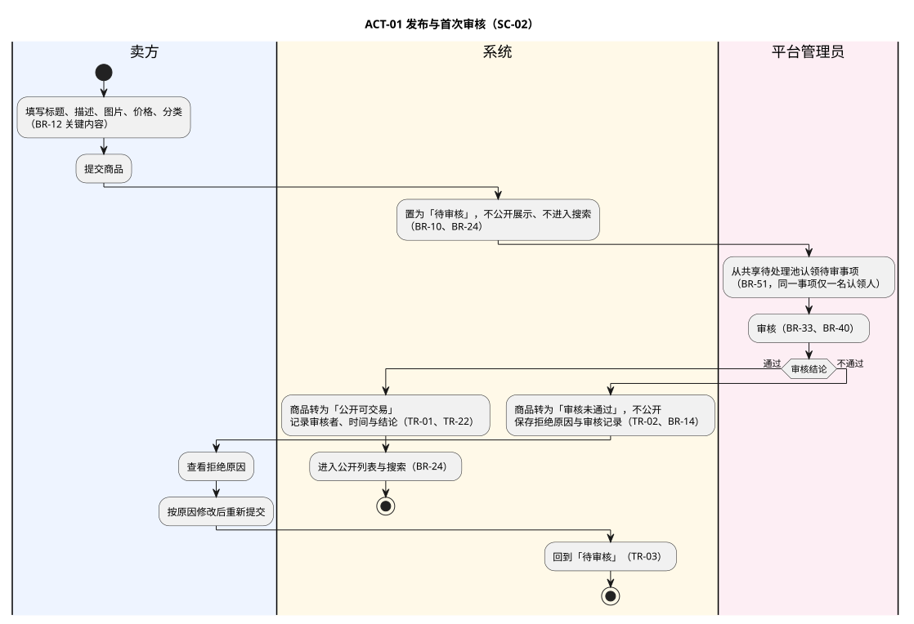

**图 ACT-02 交易请求、锁单与双方确认（SC-05）**

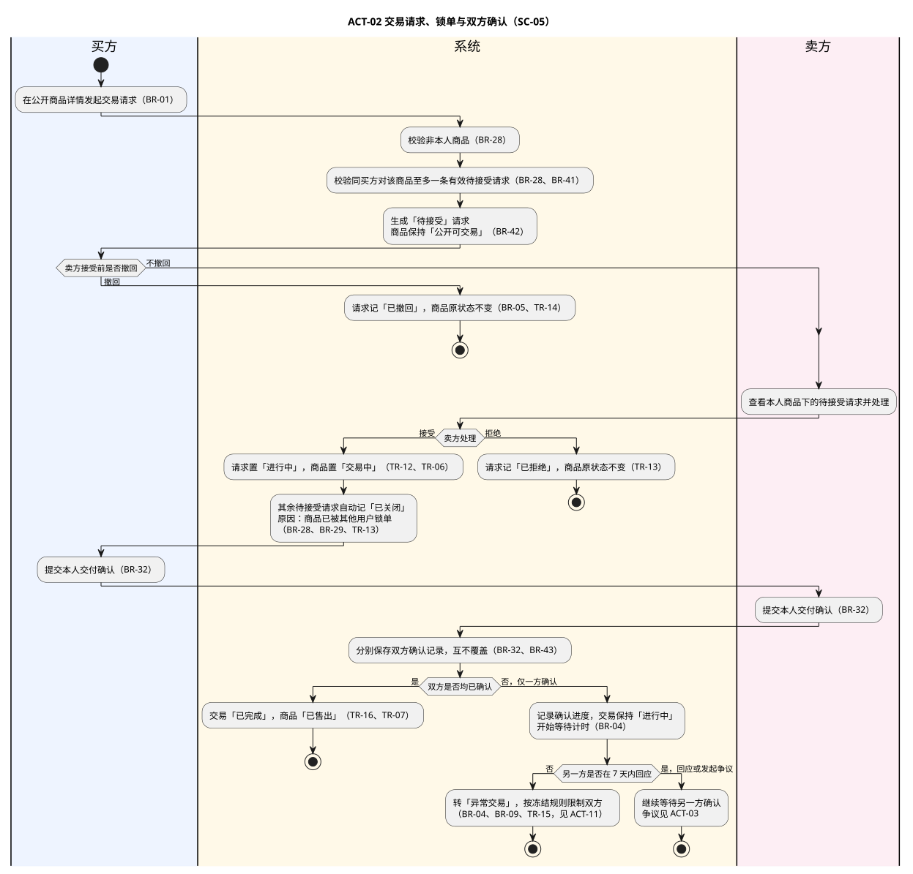

**图 ACT-03 交易争议与恢复（SC-06）**

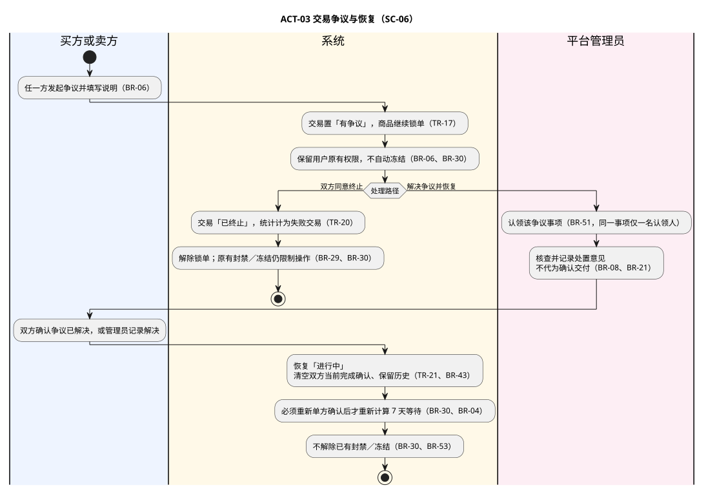

**图 ACT-04 商品信息修改、锁单与下架（SC-02）**

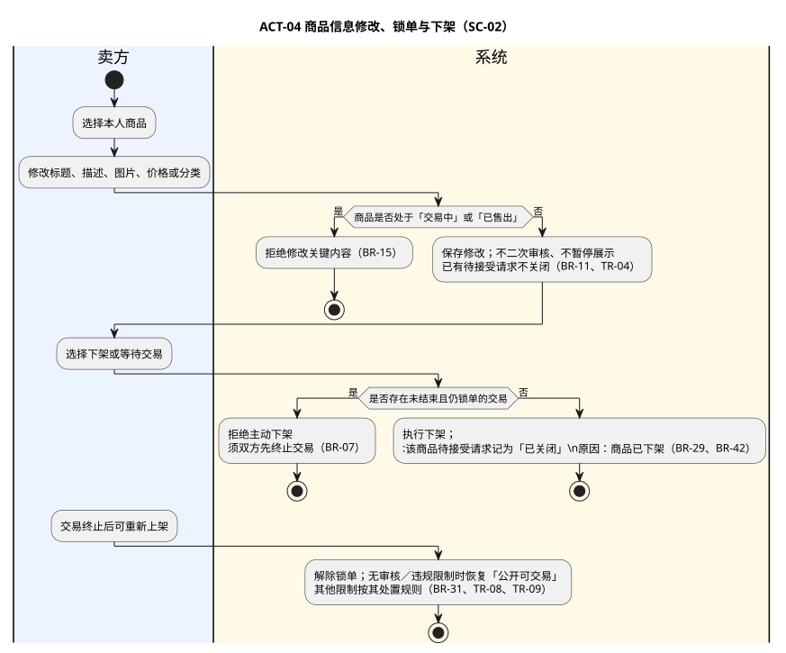

**图 ACT-05 账户与访问控制（SC-01）**

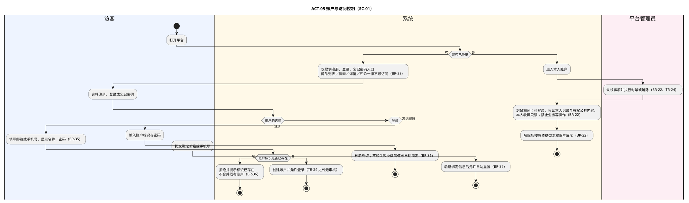

**图 ACT-06 检索、详情可见性与收藏（SC-03）**

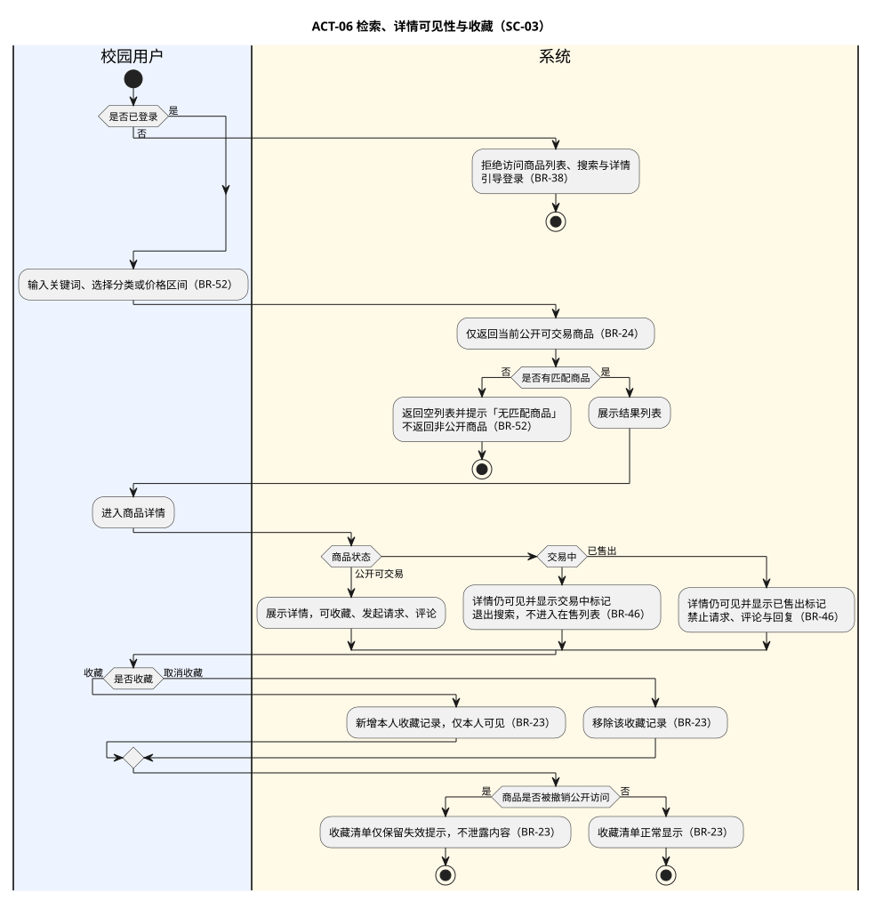

**图 ACT-07 商品评论与买卖 IM（SC-04）**

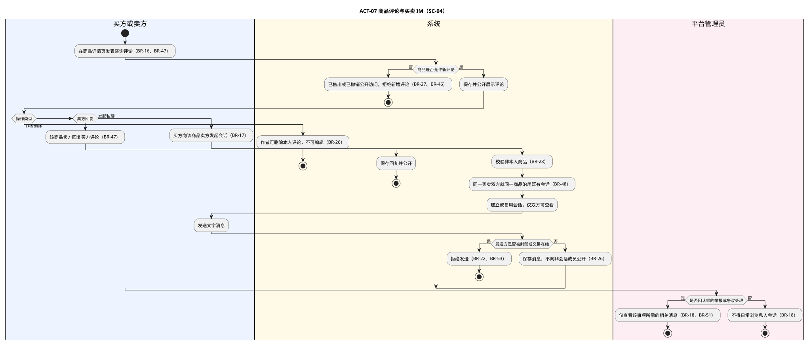

**图 ACT-08 完成交易评价（SC-07）**

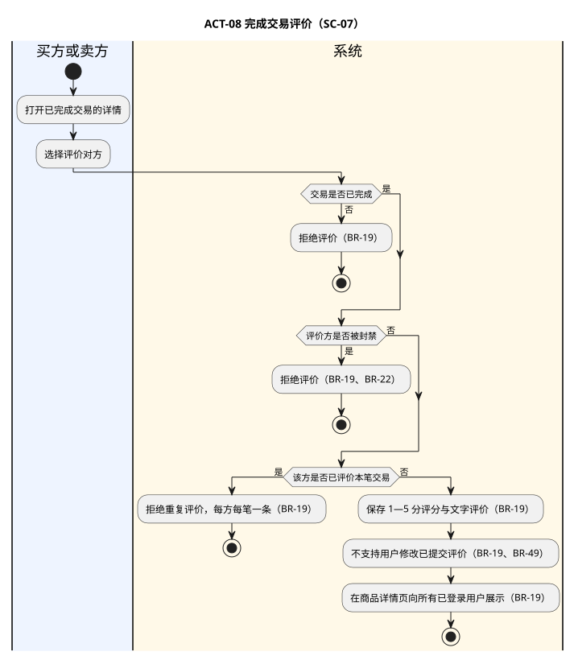

**图 ACT-09 举报、认领处置与封禁（SC-07）**

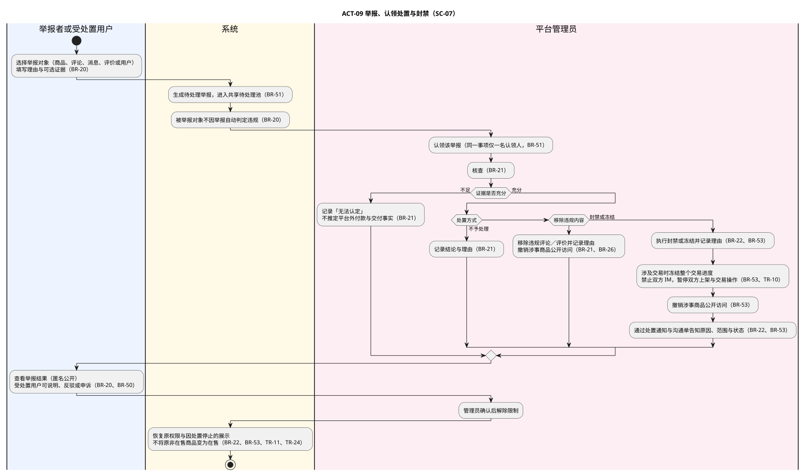

**图 ACT-10 管理员统计（SC-08）**

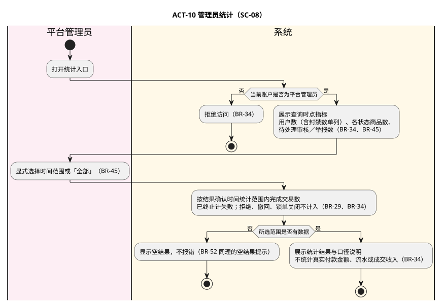

**图 ACT-11 单方确认超时与异常交易处置（SC-09）**

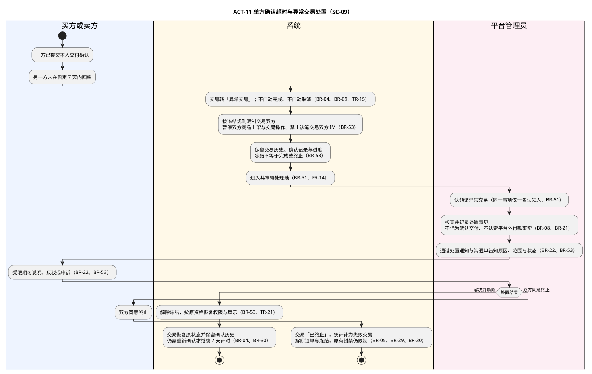

### 5.4 动态分析的业务依据

| 分析对象／流程 | 必须表达的现行行为 | 待完成的分析 |
|---|---|---|
| 商品与请求 | 首审、拒绝重提；修改不二审且请求保留；接受锁单／其他请求关闭；完成已售出；普通终止恢复或卖方下架 | 具体场景与活动图；状态转换说明见 5.2、状态图见 5.3；主动下架关闭待接受请求并说明原因（E-06 D-38） |
| 交易确认及争议 | 确认进度不是独立状态；未回应暂定 7 天转异常；争议视为响应，恢复后清空当前确认保留历史，重新单方确认才计时；不得争议直接完成 | 异常与冻结模型的后续路径按 P-21 待定；状态转换说明见 5.2、状态图见 5.3 |
| 管理处置及沟通 | 认领人处置；冻结不等于终止，保留历史；禁止双方 IM，处置通知与沟通单为受限用户保留管理员通道；确认解除后按原资格恢复 | 关联 C-13／C-14，说明通知／沟通单职责，不擅自预设数据库或独立工单系统 |
| 评价／举报 | 评价商品页展示；举报结果确认后匿名公开，之前不可见；封禁期禁止两种新增提交 | 正常、权限、匿名展示及处置恢复场景 |

依据：[规则](#chapter-04)、[E-05 转换复核](appendices/evidence/E-05-状态转换复核.md)、[E-06 后续决定](appendices/evidence/E-06-处置流程与展示复核.md)。TR-01—TR-24 本轮规则复核已结束，TR-05／TR-19 停用；5.3 场景与活动图已展开，人工走查尚未开展。

## 6. 质量要求

### 6.1 质量范围

系统质量要求覆盖常用交互性能、关联业务结果一致性、重复及网络异常处理、历史可追溯、身份权限校验、隐私及内容安全。

### 6.2 质量目标

| 类别 | 目标 | 适用范围 |
|---|---|---|
| 性能 | 常用操作及时返回，在线文本消息及时送达 | 第 6.4 节规定的代表性负载与网络条件 |
| 可靠性 | 关联结果一致，重试结果稳定，异常状态可查询 | 商品、请求、约定、确认、通知及管理操作 |
| 安全 | 身份、对象归属及状态资格有效，敏感信息访问受控 | 公开业务、本人记录、会话及管理事项 |

### 6.3 业务保障

- 访问及操作按当前身份、对象归属、状态与管理事项资格校验，具体权限见第 4 章。
- 同一商品同时至多一笔交易锁单；操作关联结果一致，重复提交返回已有结果，网络恢复后可查询实际状态。
- 商品编辑、审核、约定、完成确认及管理调整保留历史和依据；对象采用逻辑删除，既有举报保留关联及授权访问。

### 6.4 系统总体性能

系统应在下述单校代表性负载和网络条件下满足性能指标。上述目标为项目设定的验收目标，经项目负责人确认。

| 范围 | 质量要求 | 验证口径 |
|---|---|---|
| 总体负载基准 | 在 100 名同时活跃用户、10,000 条商品记录的代表性条件下评价常用操作 | 100名活跃用户按代表性读写与聊天操作执行；记录操作配比与实际请求速率 |
| 常用交互 | 浏览、搜索、打开详情及常规提交，95% 的操作在 3 秒内返回结果 | 正常网络及上述负载下，从用户发起到可用结果；记录网络条件与样本，按95%分位判定 |
| 关键消息场景 | 双方在线且网络正常时，95% 的文本消息在发送后 2 秒内显示给接收方 | 以接收方实际可见时间计算送达；交易确认由独立业务操作完成 |
| 文件与外部条件 | 图片上传按文件大小及网络条件另行验证，不套用普通操作的 3 秒指标；断网按既有业务规则反馈 | 记录文件大小、网络条件及实际上传结果 |

### 6.5 系统总体可靠性

可靠性以用户可观察的关联业务结果、重试、网络异常及历史记录为检查依据。

| 方面 | 质量要求 | 检查场景 |
|---|---|---|
| 业务结果一致 | 同一次操作涉及的关联结果一致，成功反馈以全部关联结果一致保存为条件 | 接受购买请求时，请求状态、商品锁单及其他待接受请求关闭保持一致 |
| 重复操作可控 | 同次操作的重复点击、刷新或重试返回已有结果；按规则另发的新请求作为独立业务处理 | 同次操作重试不重复生成请求、交易分支或通知 |
| 已提交结果稳定 | 成功保存的结果在客户端断网、响应丢失或重新进入后保持稳定；刷新展示实际状态 | 保存已成功但响应未送达，恢复网络后查看实际结果 |
| 异常结果明确 | 操作失败时明确提示；结果暂不能确定时支持重新查询当前状态 | 网络中断明确提示，未收到响应不等同操作失败 |
| 历史可追溯 | 商品编辑、审核、交易确认及状态调整保留关联，后续变化保留原依据 | 重提审核保留每次内容及结论；交易调整保留前后状态、主体、时间和依据 |

### 6.6 系统总体安全

安全要求适用于系统各入口，访问范围遵循第 4 章角色、对象资格及隐私规则。

| 方面 | 质量要求 | 检查场景 |
|---|---|---|
| 身份与账户保护 | 涉及本人身份的操作须经过有效验证，不能通过修改请求中的用户标识冒充他人 | 尝试将操作归属改为另一用户，应拒绝且不改变其记录 |
| 全系统权限校验 | 所有访问和操作均校验当前身份、对象归属及状态；复制链接、修改参数或使用旧页面不能绕过限制 | 访问他人交易／会话、非本人认领事项，或在状态变化后提交旧页面操作，均按现行资格处理 |
| 隐私与敏感信息保护 | 密码不可被直接读取；邮箱、私人聊天、交易记录及举报身份不得向无权者披露，传输过程也应受到保护 | 公开页面、通知、历史入口及管理访问不得暴露超出当前资格的信息 |
| 内容与数据保护 | 用户提交的文字、图片等不得被利用来执行未授权行为、读取或修改其他数据 | 提交含有恶意内容的输入或文件，不得影响其他用户的数据和操作资格 |
| 关键操作可追溯 | 审核、处置和交易状态调整以用户 ID 标识真实主体，保留时间及依据，用户不能篡改他人的操作记录 | 操作归属与实际执行者一致，历史依据不能通过其他用户的编辑被改写 |

### 6.7 验收依据

性能、可靠性及安全要求的验证条件与通过判据见第7章。

依据：[项目概述](#chapter-01)、[用户需求](#chapter-02)、[规则与权限](#chapter-04)、[行为与状态](#chapter-05)、[E-07 最新范围决定](appendices/evidence/E-07-需求结构扩展.md)。

## 7. 验收与验证

状态：草稿。本章由孙含佳负责“验收与验证的执行部分”。四类场景走查与原型走查的覆盖分配、逐场景检查单、批次与记录要求已就绪；**所有走查均未开展**，不填写任何通过结论、观察结果或缺陷认定。

### 7.1 验收与验证的组织方式

验收条件由用例与用户故事的负责人给出（金婉怡维护的 [用户故事索引](appendices/user-stories/index.md) 与 [用例索引](appendices/use-cases/index.md) 中“候选验收条件”）；本章不另立一套验收标准，只说明这些条件如何被验证、结果如何留痕。

每条验收条目应能回答下列问题，任一项缺失时标记“待补充”，不默认通过：

| 需回答的问题 | 对应编号体系 | 当前是否可用 |
|---|---|---|
| 服务于哪项需求 | FR-01—FR-14 | 可用（见 [2 章](#chapter-02)） |
| 由哪个故事／用例承载 | US-01—US-14、UC-C01—UC-C14 | 可用（候选，待负责人复核） |
| 对应哪个场景情境 | SC-01—SC-09 及其子编号 | 可用（见 [5.3](#chapter-05)） |
| 依据哪条规则 | BR-01—BR-53、DT-01—DT-05、TR-01—TR-24 | 可用（见 [4 章](#chapter-04)；BR-13、TR-05、TR-19 停用） |
| 涉及哪个模型 | ACT-01—ACT-11；CL-01、ST-01、ST-02 | 活动图有源文件与导出图；类图、状态图仅有源文件（暂不提供导出图） |
| 由谁、何时、以何方法验证 | 走查记录（E-08） | 待产生，见 7.3 |
| 验证结论 | 走查结论与复核意见 | 待产生 |

追踪链条：FR → US／UC → SC → BR／DT／TR → ACT → 验收。用例仍为候选编号，详细用例流程未定稿，因此追踪关系尚未闭环；不得用 5.3 的场景展开替代详细用例，也不得用活动图替代状态模型。

### 7.2 验证方法

| 方法 | 内容 | 适用对象 | 执行者 | 局限 |
|---|---|---|---|---|
| 来源核对 | 对照题目十项功能与 E-01—E-07 的现行决定，检查需求、规则与场景各有依据 | FR 覆盖、BR／DT／TR 依据 | 各负责人 | 只能证明有来源，不能证明业务正确 |
| 需求覆盖检查 | 逐项检查 FR-01—FR-14 是否有需求说明、故事／用例与场景追踪 | FR-01—FR-14 | 金婉怡（主）、孙含佳（复核场景覆盖） | 依赖详细用例定稿；FR-11—FR-13 场景尚未展开 |
| 模型一致性检查 | 检查活动图、对象状态、类职责、权限矩阵之间是否互相冲突 | ACT 图、ST-01／ST-02 状态图源文件、候选类、权限矩阵 | 孙含佳、张新悦 | 图与文字一致不等于需求正确 |
| 质量指标可检验性核对 | 核对 6 章各项质量要求的指标是否有依据或标「待确认」，检验方式是否可执行 | [6 章](#chapter-06) 质量要求 | 张新悦（主）、孙含佳（复核可检验性） | 无依据数值不得填入，核对不等于已测 |
| 人工场景走查 | 按 5.3 场景卡逐步推演，记录参与者、日期、依据版本、问题与复核结论 | SC-01—SC-09 | 全组 | 属业务推演，不是功能测试，不能证明后台功能已实现 |
| 原型走查（选做） | 仅在选做原型时开展，区分页面走查、模拟交互与实际功能验证 | 纸面原型 P-01—P-07（0.1.1） | 孙含佳 | 纸面原型无后台，实际功能验证不适用 |

说明：AI 执行的文件链接、编号一致性与文本格式检查属于静态检查，不计入上表的人工验证；AI 自检不能替代人工独立核验（依据 [AGENTS.md](../AGENTS.md)）。

### 7.3 四类场景走查安排

要求：至少覆盖正常主流程、权限流程、状态转换流程和异常流程（依据 [README 范围与验证约束](../README.md)）。本节给出覆盖分配、逐场景检查单、批次与原型走查安排；**所有“结论”栏留空，待实际走查后填写**，不预填通过。

#### 7.3.1 四类走查的覆盖分配

九个场景共 79 个子场景，按类别分配如下（编号省略 `SC-` 前缀）。凡标“暂缓”者，因规则或开放项未明确（见 7.5）暂不进入走查，补齐后加入。

| 场景 | 正常主流程 | 权限流程 | 状态转换流程 | 异常流程 | 暂缓（未明确） |
|---|---|---|---|---|---|
| SC-01 | 01-01、01-04 | 01-05、01-06 | 01-07 | 01-02、01-03 | 01-08（P-19） |
| SC-02 | 02-01 | 02-03、02-04 | 02-05、02-06、02-08、02-09 | 02-02、02-07 | 02-10（T-01） |
| SC-03 | 03-01、03-07 | 03-03、03-06、03-08 | 03-04、03-05 | 03-02 | — |
| SC-04 | 04-01、04-02、04-06 | 04-04、04-07、04-08 | — | 04-03、04-05 | — |
| SC-05 | 05-01 | 05-02、05-03、05-04、05-11 | 05-05、05-08、05-10、05-12 | 05-06、05-07、05-09 | — |
| SC-06 | 06-01 | 06-03、06-04 | 06-05、06-06、06-07 | 06-02 | 06-08（T-02） |
| SC-07 | 07-01、07-04、07-08 | 07-05、07-10 | 07-07、07-09 | 07-02、07-03、07-06 | 07-11（T-03） |
| SC-08 | 08-01、08-02、08-05 | 08-03 | — | 08-04、08-06 | — |
| SC-09 | 09-01 | 09-03、09-04 | 09-06、09-07 | 09-02、09-05 | 09-08（P-21） |
| **合计** | **17** | **21** | **18** | **18** | **5** |

分配说明：

- SC-04 没有独立的状态转换情境：评论与会话的可见性变化分别在 SC-03-05（撤销公开）与 SC-04-03／04-08 中核验，避免重复。
- SC-08 的状态转换列为空：统计查询不改变对象状态，08-05 只核对被统计交易状态的计数口径，不强行归入状态转换。
- SC-02-05 虽属状态转换类，但核对重点是“修改不二审、请求保留”，与 BR-11、TR-04 直接对应。
- 暂缓项在规则或开放项明确前不填结论；补齐后并入对应批次。

#### 7.3.2 逐场景检查单

走查时按场景逐条确认。每项结论填“通过／不通过／待确认／不适用”之一；“不通过”须登记 `V` 编号并写明现象；“待确认”须写明缺失依据与对应 `P`／`T` 编号。**本表结论目前全部为空。** 本表共 78 条，其中 5 条为暂缓项，规则明确前只登记挂靠编号、不填结论。

**SC-01 账户与访问控制**（依据 ACT-05）

| # | 检查项 | 期望结果 | 对应子场景 | 结论 |
|---|---|---|---|---|
| 1 | 未登录访客是否只能使用账户入口 | 商品列表、搜索、详情、评论均拒绝并引导登录 | 01-05 | |
| 2 | 注册字段是否满足最小集且标识唯一 | 邮箱或手机号＋显示名称＋密码；重复标识拒绝且不合并 | 01-01、01-02 | |
| 3 | 登录失败是否不设阈值与自动锁定 | 无失败次数锁定，提示不泄露账户是否存在 | 01-03 | |
| 4 | 忘记密码是否可自助恢复 | 验证绑定邮箱或手机号后重置，不以人工重置为必经 | 01-04 | |
| 5 | 封禁账户的只读边界是否与 BR-22 一致 | 可读本人记录与有权公共内容、收藏只读；写操作拒绝 | 01-06 | |
| 6 | 解除封禁后是否恢复原资格 | 恢复权限与因处置停止的展示，保留处置记录 | 01-07 | |
| 7 | 退出、改密、换绑与显示名称规则是否明确 | 有明确规则；当前记“待确认”并挂 P-19 | 01-08（暂缓） | |

**SC-02 商品发布、审核与维护**（依据 ACT-01、ACT-04）

| # | 检查项 | 期望结果 | 对应子场景 | 结论 |
|---|---|---|---|---|
| 1 | 首审通过前是否不公开、不进入搜索 | 待审核不可见；通过后进入公开列表 | 02-01 | |
| 2 | 审核不通过是否显示原因并可重提 | 显示拒绝原因，修改后可重新提交 | 02-02 | |
| 3 | 非所有者修改是否被拒 | 拒绝修改，内容不变 | 02-03 | |
| 4 | 非认领管理员能否产生审核结论 | 拒绝；仅认领人可处理该事项 | 02-04 | |
| 5 | 修改是否不二审、不断展示、不关请求 | 与 BR-11、TR-04 一致 | 02-05 | |
| 6 | 交易中／已售出修改关键内容是否被拒 | 拒绝；历史交易内容不被改写 | 02-06 | |
| 7 | 锁单未结束时能否主动下架 | 拒绝；须双方先终止 | 02-07 | |
| 8 | 主动下架是否关闭待接受请求并说明原因 | 请求记“已关闭”，原因商品已下架 | 02-08 | |
| 9 | 终止后能否恢复或下架 | 无限制时恢复公开可交易，或卖方选择下架 | 02-09 | |
| 10 | “微调”是否有客观判定标准 | 有明确标准；当前只有假设，记“待确认”并挂 T-01 | 02-10（暂缓） | |

**SC-03 检索、详情可见性与收藏**（依据 ACT-06）

| # | 检查项 | 期望结果 | 对应子场景 | 结论 |
|---|---|---|---|---|
| 1 | 搜索结果是否只含公开可交易商品 | 待审核、未通过、交易中、已售出、下架均不出现 | 03-01 | |
| 2 | 无匹配时是否稳定返回空提示 | 提示“无匹配商品”，不暴露非公开商品 | 03-02 | |
| 3 | 未登录检索与详情是否被拒 | 拒绝并引导登录 | 03-03 | |
| 4 | 交易中／已售出是否退出搜索但详情可见 | 搜索不出现，详情显示状态标记 | 03-04 | |
| 5 | 撤销公开访问后搜索与收藏是否正确 | 搜索不可见；收藏仅失效提示，不泄露内容 | 03-05 | |
| 6 | 他人收藏清单是否不可见 | 拒绝；仅本人可见 | 03-06 | |
| 7 | 取消收藏是否生效 | 记录移除 | 03-07 | |
| 8 | 封禁期收藏是否只读 | 可查看，禁止收藏与取消收藏 | 03-08 | |

**SC-04 商品评论与买卖 IM**（依据 ACT-07）

| # | 检查项 | 期望结果 | 对应子场景 | 结论 |
|---|---|---|---|---|
| 1 | 公开可交易／交易中是否允许评论 | 保存并公开展示 | 04-01 | |
| 2 | 卖方能否回复买方评论 | 允许回复并公开；不支持买方互评 | 04-02 | |
| 3 | 已售出或撤销公开后能否新增评论／回复 | 均拒绝 | 04-03 | |
| 4 | 评论删除权限是否正确 | 作者可删不可改；他人不可删；认领管理员可移除违规内容并留痕 | 04-04 | |
| 5 | 能否向本人发起私聊 | 拒绝 | 04-05 | |
| 6 | 同商品同双方是否复用会话 | 沿用既有会话，不重复创建 | 04-06 | |
| 7 | 非会话成员与日常管理能否查看 | 拒绝；管理员仅认领事项相关消息可查 | 04-07 | |
| 8 | 封禁或冻结期间能否发送消息 | 拒绝发送，历史保留读取 | 04-08 | |

**SC-05 请求、锁单、确认与终止**（依据 ACT-02）

| # | 检查项 | 期望结果 | 对应子场景 | 结论 |
|---|---|---|---|---|
| 1 | 请求→接受→双方确认是否闭环 | 交易完成、商品已售出、开放互评 | 05-01 | |
| 2 | 非该商品卖方能否处理请求 | 拒绝 | 05-02 | |
| 3 | 非发起人能否撤回 | 拒绝 | 05-03 | |
| 4 | 能否购买本人商品 | 拒绝 | 05-04 | |
| 5 | 多请求竞争是否只产生一笔进行中交易 | 接受一条，其余“已关闭”并说明锁单原因 | 05-05 | |
| 6 | 拒绝是否保留商品原状态 | 请求“已拒绝”，商品不变 | 05-06 | |
| 7 | 撤回是否保留商品原状态 | 请求“已撤回”，商品不变 | 05-07 | |
| 8 | 单方确认是否不等于完成 | 记录确认进度，交易保持进行中并计时 | 05-08 | |
| 9 | 7 天未回应是否转异常 | 转异常交易并按冻结规则限制双方，不自动完成／取消 | 05-09 | |
| 10 | 双方终止是否解除锁单并计失败 | 已终止，统计计失败，商品可恢复或下架 | 05-10 | |
| 11 | 封禁／冻结期间能否推进交易 | 暂停上架与交易、禁止双方 IM；历史保留 | 05-11 | |
| 12 | 双方均未确认时是否有自动机制 | 无自动完成或取消，待接受请求无自动有效期 | 05-12 | |

**SC-06 交易争议与恢复**（依据 ACT-03）

| # | 检查项 | 期望结果 | 对应子场景 | 结论 |
|---|---|---|---|---|
| 1 | 任一方发起争议后是否保持锁单与原权限 | 有争议，商品锁单，不自动冻结 | 06-01 | |
| 2 | 未达成一致时争议是否保留 | 保持有争议，记录不丢失 | 06-02 | |
| 3 | 管理员能否代为确认交付或认定付款 | 拒绝；仅记录处置意见 | 06-03 | |
| 4 | 非交易方能否查看争议记录 | 拒绝 | 06-04 | |
| 5 | 争议中能否直接确认完成 | 禁止；须先恢复进行中 | 06-05 | |
| 6 | 双方同意终止是否正确 | 已终止，计失败 | 06-06 | |
| 7 | 恢复后是否清空当前确认并重新计时 | 清空标记、保留历史，重新确认才计 7 天 | 06-07 | |
| 8 | 重复异议或重复终止如何响应 | 有明确规则；当前无依据，记“待确认”并挂 T-02 | 06-08（暂缓） | |

**SC-07 评价、举报、认领与封禁**（依据 ACT-08、ACT-09）

| # | 检查项 | 期望结果 | 对应子场景 | 结论 |
|---|---|---|---|---|
| 1 | 已完成交易能否互评并展示 | 每方每笔一条，详情页向登录用户展示 | 07-01 | |
| 2 | 未完成交易能否评价 | 拒绝 | 07-02 | |
| 3 | 重复或代评能否提交 | 拒绝；已提交评价不可修改 | 07-03 | |
| 4 | 举报是否可提交并进入共享池 | 生成待处理记录，进入共享池 | 07-04 | |
| 5 | 举报是否会自动判定违规 | 不会，须认领管理员核查 | 07-05 | |
| 6 | 证据不足如何处理 | 记录“无法认定”，不推定平台外事实 | 07-06 | |
| 7 | 违规涉及交易时冻结范围是否正确 | 冻结整个交易、禁双方 IM、暂停上架交易、撤销商品公开 | 07-07 | |
| 8 | 举报结果是否确认后匿名公开 | 隐去用户与管理员信息，确认前不可见 | 07-08 | |
| 9 | 解除限制后是否恢复原资格 | 恢复权限与展示，原非在售商品不自动变为在售 | 07-09 | |
| 10 | 非认领人能否处置该事项 | 拒绝 | 07-10 | |
| 11 | 举报对象已失效时能否受理 | 有明确规则；当前无依据，记“待确认”并挂 T-03 | 07-11（暂缓） | |

**SC-08 管理员统计**（依据 ACT-10）

| # | 检查项 | 期望结果 | 对应子场景 | 结论 |
|---|---|---|---|---|
| 1 | 查询时点指标是否完整 | 用户数含封禁数、各状态商品数、待处理审核与举报数 | 08-01 | |
| 2 | 时间范围是否需显式选择 | 可选范围或全部，无默认范围 | 08-02 | |
| 3 | 普通用户能否查看统计 | 拒绝 | 08-03 | |
| 4 | 无数据时是否稳定 | 空结果，不报错、不推测原因 | 08-04 | |
| 5 | 失败交易与拒绝／撤回／关闭计数是否正确 | 终止计失败；拒绝、撤回、锁单关闭不计入 | 08-05 | |
| 6 | 是否误含真实资金数据 | 不出现付款金额、流水或成交收入 | 08-06 | |

**SC-09 单方确认超时与异常交易处置**（依据 ACT-11）

| # | 检查项 | 期望结果 | 对应子场景 | 结论 |
|---|---|---|---|---|
| 1 | 超时是否转异常并进入共享池 | 转“异常交易”，按冻结规则限制双方，进入待处理池 | 09-01 | |
| 2 | 是否会自动完成或自动取消 | 均不自动 | 09-02 | |
| 3 | 非认领人能否处置 | 拒绝 | 09-03 | |
| 4 | 冻结期间双方操作是否受限 | 暂停上架与交易、禁止双方 IM；历史只读 | 09-04 | |
| 5 | 处置告知是否有渠道 | 通过处置通知与沟通单说明、反驳或申诉 | 09-05 | |
| 6 | 解除后是否按原资格恢复 | 恢复权限与展示；交易恢复原状态、重新确认才计时 | 09-06 | |
| 7 | 异常期间双方能否终止 | 可以，已终止并计失败，解除锁单与冻结 | 09-07 | |
| 8 | 解除后的后续路径是否明确 | 有明确规则；当前待 P-21 明确 | 09-08（暂缓） | |

#### 7.3.3 走查记录要求

实际走查须另行留痕（依据 5.3 场景卡与 7.3.2 检查单），使用 [E-08 走查记录模板](appendices/evidence/E-08-走查记录模板.md)，完成后以 `E-08-场景走查记录.md` 存入 [证据目录](appendices/evidence)。记录至少包含：

| 必填项 | 要求 |
|---|---|
| 走查批次与类别 | 对应 7.3.1 分配与 7.3.4 批次 |
| 参与人 | 姓名与角色；不代签、不补写未参加者 |
| 日期与依据版本 | 05 章、04 章、07 章及原型版本；版本不一致时说明是否影响结论 |
| 逐条检查结果 | 按 7.3.2 填写，编号可追溯 |
| 发现问题 | 用 `V` 编号记录现象、位置、影响；与 `P`／`T` 互相引用 |
| 结论与限制 | 明确本次覆盖范围，不做超范围结论 |
| 复核 | 复核人、结论；修改由作者完成、复核由另一成员完成 |
| 未开展事项 | 列出未覆盖的子场景与原因 |

注意事项：走查是业务推演，不是功能测试；不得用“界面可点击”证明后台功能已实现；不得把未通过项留在记录之外；规则未明确的分支不得临时裁定，应记“待确认”并引用 7.5。

#### 7.3.4 批次、分工与原型走查

按“先核心闭环、再扩展”的顺序分五批开展人工场景走查，原型走查单列 W-06。**参与人、日期、记录人与复核人由组长在组内确认后填写；本章不代填姓名、不预填结论、不承诺截止日期。**

| 批次 | 类别 | 覆盖子场景 | 前置条件 |
|---|---|---|---|
| W-01 | 正常主流程（17） | 01-01、01-04、02-01、03-01、03-07、04-01、04-02、04-06、05-01、06-01、07-01、07-04、07-08、08-01、08-02、08-05、09-01 | 05 章与 04 章版本一致；ACT-01—ACT-11 已出 |
| W-02 | 权限流程（21） | 01-05、01-06、02-03、02-04、03-03、03-06、03-08、04-04、04-07、04-08、05-02、05-03、05-04、05-11、06-03、06-04、07-05、07-10、08-03、09-03、09-04 | 统一权限矩阵可用；认领机制口径已定 |
| W-03 | 状态转换流程（18） | 01-07、02-05、02-06、02-08、02-09、03-04、03-05、05-05、05-08、05-10、05-12、06-05、06-06、06-07、07-07、07-09、09-06、09-07 | 张新悦对象状态模型定稿，或以 5.2 候选状态名称核对 |
| W-04 | 异常流程（18） | 01-02、01-03、02-02、02-07、03-02、04-03、04-05、05-06、05-07、05-09、06-02、07-02、07-03、07-06、08-04、08-06、09-02、09-05 | 无额外前置，不依赖详细用例定稿 |
| W-05 | 暂缓补齐（5） | 01-08（P-19）、02-10（T-01）、06-08（T-02）、07-11（T-03）、09-08（P-21） | 对应 P／T 项明确后加入 |
| W-06 | 原型走查（选做） | 纸面原型 P-01—P-07，检查项见下 | 原型 0.1.1 已出；页面清单见 [原型说明](appendices/prototype/README.md) |

批次执行规则：

1. W-01 先做，至少完成 05-01、06-01、07-04 三个核心闭环子场景后再进入 W-02。
2. W-02 与 W-03 可并行，但同一子场景不得由同一人既修改又复核。
3. 每批建议至少两人参加（一人推演、一人记录）；修改由作者完成，复核由另一成员完成。
4. 一批记录只对应一组版本号；版本不一致时记录差异并说明是否影响结论。

**原型走查（W-06，选做）**：纸面原型 P-01—P-07 已产出（0.1.1），页面清单见 [原型说明](appendices/prototype/README.md)。按三层区分执行，不得混用：

| 层次 | 做法 | 能证明什么 | 不能证明什么 |
|---|---|---|---|
| 页面走查 | 逐页核对元素、文案与可见信息是否体现规则 | 页面是否完整表达需求与权限边界 | 不能证明交互可用或后台已实现 |
| 模拟交互 | 按场景卡在纸面上推演路径与页面跳转 | 流程是否连贯、入口是否可达 | 不产生真实数据，不等于功能测试 |
| 实际功能验证 | 仅在可点击原型或已实现系统上开展 | 功能行为与结果 | 本次不适用：纸面原型无后台 |

逐页检查项如下，结论栏留空，待实际走查填写；走查记录使用 [E-08 模板](appendices/evidence/E-08-走查记录模板.md)，「走查层次」栏注明页面走查或模拟交互。

| 批次 | 页面 | 检查项 | 期望结果 | 对应场景 | 结论 |
|---|---|---|---|---|---|
| W-06 | P-01 | 未登录仅账户入口、注册最小字段、忘记密码自助、封禁只读边界是否可见 | 与 BR-35—BR-38、BR-22 一致 | 01-01—01-06 | |
| W-06 | P-02 | 仅公开商品进入检索、交易中／已售出详情例外、收藏失效提示、未登录拒绝是否体现 | 与 BR-24、BR-46、BR-23、BR-38 一致 | 03-01—03-08 | |
| W-06 | P-03 | 评论可评阶段、卖方回复、作者删除、会话复用与仅双方可见是否体现 | 与 BR-16、BR-47、BR-26、BR-48、BR-17 一致 | 04-01—04-08、05-01、07-04 | |
| W-06 | P-04 | 首审与拒绝重提、修改不二审、交易中禁改、锁单禁下架、下架关闭请求是否体现 | 与 BR-10、BR-14、BR-11、BR-15、BR-07、BR-42 一致 | 02-01、02-02、02-05—02-10 | |
| W-06 | P-05 | 待接受／已关闭／进行中／有争议／异常／已完成、确认进度与 7 天提示是否可见 | 与 BR-28、BR-29、BR-04、BR-09、BR-53 一致 | 05-05—05-12、06-01—06-07、07-01 | |
| W-06 | P-06 | 认领池、处置与理由、冻结范围、通知沟通单、匿名结果、解除恢复是否体现 | 与 BR-51、BR-53、BR-21、BR-20、BR-50、BR-22 一致 | 02-04、06-03、07-05—07-11、09-03—09-05、01-07 | |
| W-06 | P-07 | 范围或全部、封禁数单列、失败交易口径、无资金数据、无数据空结果是否体现 | 与 BR-45、BR-34、BR-29、BR-52 一致 | 08-01—08-06 | |

### 7.4 当前状态与限制

**尚未开展的内容（如实记录，不预填结果）：**

- 四类人工场景走查：**均未开展**。7.3.1 的分配与 7.3.4 的批次只是安排，7.3.2 的结论栏全部为空。
- 原型走查：**未开展**；纸面原型 P-01—P-07 已产出（0.1.1），7.3.4 的逐页检查项结论栏全部为空。
- 真实用户访谈、可用性测试、功能测试与性能测试：均未开展。
- 模型一致性检查的正式执行：未开展；当前仅有 AI 静态检查（链接与编号），不属于人工独立核验。
- 需求覆盖检查：未开展，依赖详细用例定稿；FR-11—FR-13 的场景尚未展开（见 7.5）。

**当前可用作走查输入的材料：**

- 九个场景的场景卡与 79 个子场景：[5.3](#chapter-05)。
- 活动图 ACT-01—ACT-11：[图索引](appendices/models/index.md)。
- 规则与权限：[4 章](#chapter-04)（BR-01—BR-53、DT-01—DT-05、TR-01—TR-24）。
- 用户故事与候选用例：[user-stories](appendices/user-stories/index.md)、[use-cases](appendices/use-cases/index.md)。
- 走查检查单与记录模板：本章 7.3.2、[E-08 模板](appendices/evidence/E-08-走查记录模板.md)。

**依赖与阻塞：**

- 详细用例未定稿，7.1 的追踪链与验收条件尚不能闭环。
- 5.2 已形成对象协作与对象状态说明（候选，张新悦负责），5.3 的场景状态名称以 5.2 候选集为准；对象状态与类职责的一致性检查尚未开展，商品「已下架」与场景动作「下架」的用词待统一。
- FR-11 通知与待办、FR-12 本人业务聚合、FR-13 商品分类维护尚未展开场景，属分析缺口（关联 P-18、P-20）。
- P-18—P-23 中与本章直接相关的：P-19（01-08）、P-21（09-08）、P-22（处置告知对象范围）、P-23（评价删除与重复举报）。

**限制声明：** 5.3 的场景展开、本节所列方法、7.3 的安排与 7.3.4 的批次都是**分析设计**，不构成验证结果。不得因 7 章已编写而认为验收已通过，也不得据此移除其他草稿前缀（依据 [8 章](#chapter-08) 与 [AGENTS.md](../AGENTS.md)）。

### 7.5 待登记项与依据

**场景展开时发现的规则未覆盖之处**（本节只登记，不裁定；建议由组长确认后纳入 [未决问题与复核清单](../bits/未决问题与复核清单.md)）：

| 序号 | 事项 | 发现在哪 | 影响 | 建议处理 |
|---|---|---|---|---|
| T-01 | “修改仅微调”缺少客观判定标准，实质内容变更仍按修改处理 | SC-02-10 | 走查无法判定商品修改是否越界 | 明确判定口径或限定可修改范围 |
| T-02 | 对已处于有争议的交易重复提出异议、或对已终止交易重复终止的响应 | SC-06-08 | 重复操作的幂等性无规则 | 在 4 章补充 |
| T-03 | 举报对象已被删除或已失效时的受理与留痕 | SC-07-11 | BR-20 只规定对象类别，未说明失效情形 | 在 4 章补充 |
| T-04 | 交易已完成、商品已售出后能否重新上架同一商品 | SC-02-09 延伸 | BR-31 只覆盖普通终止后的恢复与下架后重上架 | 明确已完成商品的处置口径 |

**与开放项的对应关系：**

| 开放项 | 与本轮工作的关系 |
|---|---|
| P-03 信息修改与封禁／冻结 | 对应 SC-02-05、02-06、05-11、09-04，按已决口径核对，不重开 |
| P-04 争议锁单与恢复 | 对应 SC-06 全部，属“已决待验证” |
| P-05 私人交易历史与公共详情 | 对应 SC-03-04、SC-04-07、SC-06-04 |
| P-06 统计与评价、匿名举报展示 | 对应 SC-07-08、SC-08 全部 |
| P-09 覆盖与模型一致性 | FR-11—FR-13 场景缺口与 5.2 候选模型即其输入 |
| P-11 交易中／已售出边界 | 对应 SC-03-04、SC-04-03、SC-04-08 |
| P-12 认领机制 | 对应 SC-02-04、SC-07-10、SC-09-03 |
| P-13 处置通知与沟通单 | 对应 SC-09-05、SC-07-07 |
| P-14 争议恢复与重新计时 | 对应 SC-06-07、SC-09-06 |
| P-15 商品变化与请求保留 | 对应 SC-02-05、02-08 |
| P-16 超时冻结范围 | 对应 SC-05-09、SC-09-04 |
| P-17 封禁与仅冻结的权限区别 | 对应 SC-07-07、07-09、SC-05-11 |
| P-18 分类维护 | FR-13 场景未展开，登记为缺口 |
| P-19 退出／改密／换绑 | 对应 SC-01-08（暂缓） |
| P-20 通知与未读规则 | FR-11 场景未展开，登记为缺口 |
| P-21 异常交易处理与恢复路径 | 对应 SC-09-08（暂缓） |
| P-22 处置告知对象范围 | 对应 SC-07-07、07-09、SC-09-05 |
| P-23 评价删除与重复举报 | 对应 SC-07-03、07-11 |

上述开放项均未关闭；本轮不新增或重排 `P` 编号。

### 7.6 依据与后续

- 依据：README 范围与验证约束、[AGENTS.md](../AGENTS.md)、[成员职责表](../bits/成员职责表.md)（场景分析负责“验收与验证”的执行部分）、[5.3](#chapter-05)、[4 章](#chapter-04)。
- 已具备的分析输入：九个场景 79 个子场景、活动图 ACT-01—ACT-11、纸面原型 P-01—P-07、四类走查覆盖分配、78 条逐场景检查单、W-01—W-06 批次与原型走查安排、E-08 记录模板。
- 后续顺序：① 组长补明确 T-01—T-04 与 P-19／P-21／P-22 口径；② 金婉怡详细用例定稿后回填验收条件并闭环追踪；③ 张新悦的 5.2 候选模型经人工评审后统一状态名称（商品「已下架」等）与转换编号；④ 按 7.3.4 分五批开展人工走查，用 E-08 记录；⑤ 原型走查按 W-06 单独记录；⑥ 首轮联合复核后更新 A 报告 A.5／A.6 与本章状态。

## 8. 基线与人机协作

### 8.1 阶段工作基线

WB-01 为需求分析工作基线草案，不是正式评审通过的发布基线。范围来自袁尚峰前期决定，张新悦三次提交原稿及采纳见 E-02，后续修订和复核见 E-03—E-06。原稿贡献、修订提出者与审核采纳者分别保留。

前轮新增规则、DT、TR 已复核；现行功能／规则见第 2／4 章，历史证据不作并列现行口径。用例与故事已形成草稿，5 个代表性详细用例、子用例分解及 UC-01／UC-02 用例图已出，覆盖检查未完成；领域与数据、行为与状态、质量要求已形成候选正文，类图与状态图仅保留源文件，模型评审及人工走查未完成；P-15—P-17 已按 E-06 D-38—D-39 确认，该轮业务口径已收束；E-07 新增需求结构与范围已采纳，P-18—P-23 细则待决定，分析及验证待完成。

### 8.2 纳入版本与依据

本表为当前登记快照，不代表全部文档已验证。历史决定按 evidence 追溯。

| 文件 | 纳入版本 | 用途与状态 |
|---|---|---|
| [项目概述](#chapter-01) | 0.1.12 | 纳入新增需求范围，待复核 |
| [用户需求](#chapter-02) | 0.1.19 | 十项覆盖基线、FR-11—14，含 5 个详细用例、子用例分解与 UC-01／UC-02 图 |
| [规则与权限](#chapter-04) | 0.4.2 | 现行 BR、统一权限、DT、TR；待人工复核整理更改 |
| [E-01 决策依据](appendices/evidence/E-01-范围讨论结果.md) | 0.3.18 | 历史来源与替代关系 |
| [E-02 决策依据](appendices/evidence/E-02-规则补充采纳记录.md) | 0.1.2 | 历史来源与替代关系 |
| [E-03 决策依据](appendices/evidence/E-03-新增规则复核.md) | 0.1.4 | 历史来源与替代关系 |
| [E-04 决策依据](appendices/evidence/E-04-复杂决策复核.md) | 0.1.5 | 历史来源与替代关系 |
| [E-05 决策依据](appendices/evidence/E-05-状态转换复核.md) | 0.1.9 | 历史来源与替代关系 |
| [E-06 决策依据](appendices/evidence/E-06-处置流程与展示复核.md) | 0.1.4 | 历史来源与替代关系 |
| [成员职责表](../bits/成员职责表.md) | 0.1.3 | 计划分工，不替代实际贡献 |
| [仓库说明](../README.md) | 0.1.15 | 实际目录及入口同步 |
| [智能体规范](../AGENTS.md) | 0.1.13 | 提交前审核及人工确认 hooks |
| [E-07 需求结构扩展](appendices/evidence/E-07-需求结构扩展.md) | 0.1.4 | D-40—D-41；讨论摘要已确认 |
| [用户故事](appendices/user-stories/index.md) | 0.1.6 | US-01—US-14 草稿、优先级候选与候选验收条件 |
| [用例清单](appendices/use-cases/index.md) | 0.1.7 | 候选清单、5 个代表性详细用例与子用例分解 |
| [图索引](appendices/models/index.md) | 0.4.2 | UC-01、UC-02 用例图；CL-01／ST-01／ST-02 仅源文件；ACT-01—ACT-11 源文件与导出图 |
| [开放清单](../bits/未决问题与复核清单.md) | 0.4.23 | 新增 P-18—P-23，P-10 保留 |
| [AI-10](appendices/ai-usage/AI-05-2026-10-17-需求结构讨论.md) | 0.1.3 | DeepSeek 讨论贡献摘要已确认 |
| [AI-11](appendices/ai-usage/AI-06-2026-10-21-领域模型与质量要求.md) | 0.1.5 | 草稿；模型、状态与质量要求的 AI 起草，建模取舍已确认，模型仍未评审 |
| [AI-14](appendices/ai-usage/AI-09-2026-10-21-用例优先级与详细用例.md) | 0.1.2 | 用例优先级候选、5 个详细用例与 UC-01 图 |
| [领域与数据](#chapter-03) | 0.2.7 | 术语表、候选类（含 C-15）、属性与数量约束、详细类分析；CL-01 仅源文件 |
| [行为与状态](#chapter-05) | 0.2.10 | 对象协作与状态转换说明；ST-01／ST-02 仅源文件 |
| [质量要求](#chapter-06) | 0.2.3 | 情境与定性约束；量化指标已定维持待确认（P-10） |
| [类分析索引](appendices/class-analysis/index.md) | 0.2.4 | 逐类索引，C-01—C-15 初稿（C-15 支撑性对象） |
| [验收与验证](#chapter-07) | 0.2.4 | 场景展开与验收安排，具体状态见正文 |
| [待完成分析](../bits/需求正文整理与后续分析.md) | 0.2.11 | 待完成分析与关联缺口 |
| [模型评审清单](../bits/模型评审清单.md) | 0.1.1 | 人工核对用清单，按源文件核对，结果待填 |
| [提交前核对清单](../bits/提交前核对清单.md) | 0.2.0 | 本次 14 文件提交集、检查项与提交说明模板 |
| [主报告](需求规格说明书.md) | 0.2.26 | 领域与状态模型以文字与源文件链接呈现，含 UC-01／UC-02 用例图；场景展示待补 |

### 8.3 当前范围与非目标

- 单校场景，学生及教职工统称校园用户，普通注册，不进行校园身份核验。
- 原题十项功能均需追踪覆盖；新增 FR-11—FR-14 独立追踪，不要求回挂十项，FR-01 扩充为账户生命周期；评论与买卖双方实时 IM 均必做。
- 付款及实际交付在平台外，平台建立交易请求、记录双方结果确认及交付说明，不处理资金托管、退款或实际配送。
- 交易完成须双方确认；同一商品同时仅一笔进行中交易；争议保留记录，不自动裁定平台外事实。
- 商品首次审核后展示，信息修改不二次审核、不暂停公开、已有待接受请求保留，交易中与已售出禁止修改关键内容；交易中允许登录用户查看详情并标记状态，禁止新交易请求；允许评论及卖方回复买方；已售出允许登录用户查看详情，标记已售出，禁止请求、评论及回复。
- 赠送、交换、租赁暂不纳入；原型及原型走查选做，四类人工场景走查仍需完成。
- 详细规则只维护在第 4 章，本章为范围摘要；发现冲突时登记问题并请组长决定，不自行选择不同口径。

### 8.4 未决问题与变更管理

统一维护 [未决问题与复核清单](../bits/未决问题与复核清单.md)，本章不复制完整问题表。

变更流程：提出问题及依据 → 说明影响的规则、用例、模型和验证记录 → 负责人提出修改建议 → 组长确认重要范围或规则变更 → 修改并递增版本与版本时间 → 其他成员复核 → 同步基线版本表、引用及必要证据；仅涉及实质 AI 贡献时更新 AI 档案。未完成复核注明待复核，不提前关闭问题。

### 8.5 关键决定索引

| 来源 | 内容及归属 |
|---|---|
| E-01 D-01—D-12 | 袁尚峰初始范围与 AI 规则建议采纳 |
| E-02 D-13—D-17 | 张新悦补充规则采纳，保留原稿贡献 |
| E-03 D-18—D-20 | 袁尚峰复核账户、访问、评论、详情与管理员组织 |
| E-04 D-21—D-28 | 复杂决策，包含已撤销口径的替代历史 |
| E-05 D-29—D-35 | TR 规则轮次已收束，TR-05／TR-19 原路径停用 |
| E-06 D-36—D-39 | 处置沟通、展示、争议确认恢复、下架请求及冻结／封禁边界 |
| E-07 D-40—D-41 | 需求数量与层级纠正、账户及四项新增主需求 |

具体位置见 [分类证据索引](appendices/evidence/index.md)。无修改直接采纳仍归原稿负责者，本轮复核不转移原稿贡献。

### 8.6 AI 使用与执行约束

AI 可阅读课程材料、提出候选需求、起草及修订文档，检查文本引用；当前任务不包含架构实现或业务编码。AI 不得擅自扩大已确认范围、伪造访谈或核验、将建议写为真实业务事实。缺失信息登记为开放项；组长集中授权的建议标明性质，不冒充教师确认。

组长对范围及重要规则作最终取舍；各负责人对本人产物作人工核对，复核者记录实际检查范围和结论。AI 自检不能代替人工独立验证。

过程档案见 [AI 使用索引](appendices/ai-usage/index.md)，B 报告引用关键记录；仅有实质项目 AI 贡献时补档，执行约束见 [AGENTS.md](../AGENTS.md)。

### 8.7 后续正式基线条件

1. 需求覆盖十项功能，代表性详细用例、领域数据、业务流程、状态与质量要求完成。
2. 进行四类人工场景走查及覆盖、一致性检查，记录参加人、日期、范围及结果；原型不选做时如实说明。
3. 重要冲突已处理，其他开放项有影响说明、责任人及后续安排。
4. 全组按实际产物记录复核意见，组长确认发布范围，更新版本索引并保留 Git 提交快照。

状态：正式基线条件尚未全部满足。
