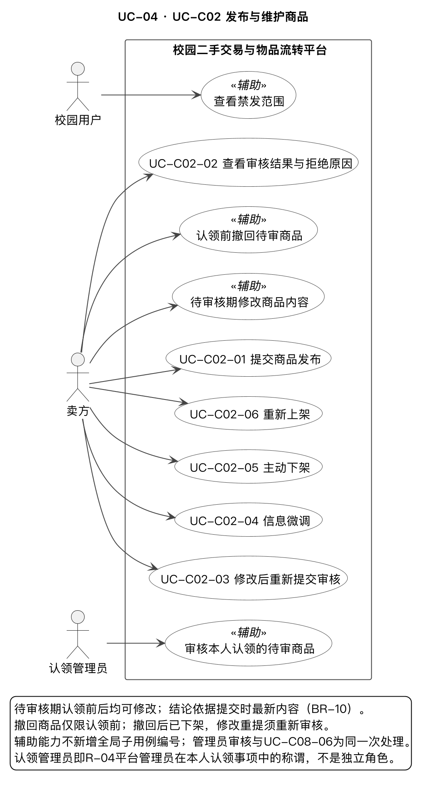
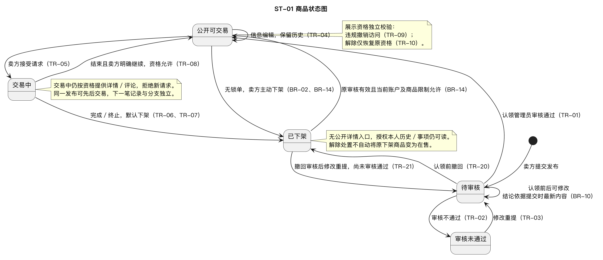
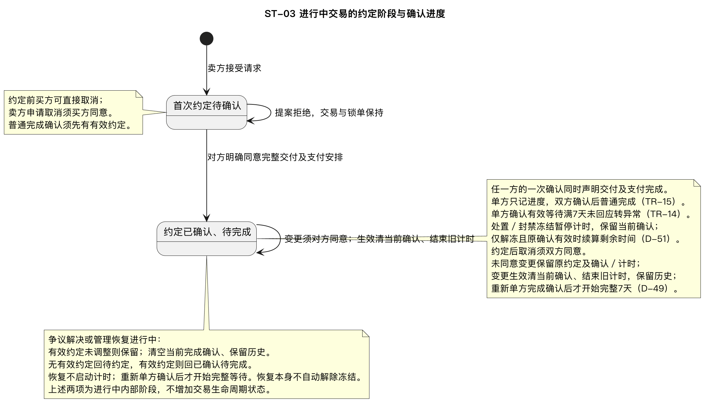

<!--
Version: 0.2.58
Version-Datetime: 2026-11-18T16:57:06+08:00
-->

# 校园二手交易与物品流转平台需求规格说明书

本说明书由第1—8章整合生成，纳入材料及源文件版本见第8章。

## 目录

- [1. 项目概述](#chapter-01)
- [2. 用户需求](#chapter-02)
- [3. 领域与数据](#chapter-03)
- [4. 规则与权限](#chapter-04)
- [5. 场景分析与基于类的行为、状态分析](#chapter-05)
- [6. 质量要求](#chapter-06)
- [7. 验收与验证](#chapter-07)
- [8. 需求基线](#chapter-08)

## 1. 项目概述

### 1.1 项目背景与业务目标

本项目面向单一学校的校园二手交易场景，学生和教职工使用邮箱直接注册，统称“校园用户”。买方、卖方是校园用户在具体商品或交易中的业务身份。

平台提供闲置商品发布、浏览搜索、收藏、商品页评论、卖方个人页面及普通私聊、交易 IM 两类实时沟通。普通私聊独立于商品及交易；有效购买请求自动打开对应交易 IM 分支并发请求通知、保留记录。交易分支随请求／交易结束默认归档，可引导转入普通私聊。实际付款与物品交付均在平台外完成，平台记录交易相关信息及完成、失败等结果，并提供评价、举报、商品审核、用户封禁和数据统计功能。

平台将商品信息、咨询沟通、交易约定、双方完成确认与违规处理关联保存，支持校园用户发现闲置物品、协商交易并追溯处理结果。需求来源为课程题目及项目内规则讨论。

### 1.2 涉众与确认责任

| 涉众或角色 | 关注内容 | 确认责任与状态 |
|---|---|---|
| 校园用户（学生、教职工） | 发布与发现商品、评论、即时沟通、平台外交易结果记录、评价与举报 | 用户范围及项目内规则由项目负责人确认 |
| 平台管理员 | 商品审核、违规处理、封禁、统计 | 项目设定的管理角色，按事项认领及常设管理职责处理业务 |
| 项目小组 | 需求范围、规则、模型与验证记录 | 项目负责人负责范围及重要规则取舍 |
| 课程指导人员 | 课程目标及提交范围 | 课程目标与提交范围以课程材料为准 |

### 1.3 系统范围与业务边界

#### 1.3.1 纳入范围

- 校园用户通过移动端完成商品发布、浏览检索、咨询沟通、购买请求、交易处理、通知及本人业务管理；管理员通过电脑端完成审核、举报与争议处理、限制处置、分类维护及统计。
- 服务单一学校的使用场景，学生和教职工按邮箱普通注册。账户注册资格以邮箱验证为依据。
- 访客可使用注册、登录和忘记密码入口，业务内容按登录身份授权访问；支持通过绑定邮箱验证后自助重置密码。
- 商品以独立发布记录管理；交易结束默认下架，卖方可按资格明确选择继续上架。同一发布记录可先后发生多笔独立交易，同时至多一笔交易锁单，每笔交易及聊天分支分别保留。
- 保留原题十项核心功能的需求覆盖：用户注册与认证、商品发布与审核、搜索与筛选、收藏与咨询、下单与交易确认、线下交付记录、评价与举报、管理员审核与封禁、商品状态流转、数据统计。
- 提供商品页评论、普通私聊与按笔交易 IM。
- 实际交易发生在平台外，系统负责交易相关记录与结果确认。
- 支持账户注册、登录、退出、自助密码重置、修改密码、绑定或更换邮箱及修改显示名称。
- 通过站内通知中心提供业务提醒、未读提示及待办；本人业务集中管理、管理员分类维护及异常交易认领处理均提供对应入口。

#### 1.3.2 业务边界

- 账户采用邮箱注册与验证，用户以普通校园用户身份参与业务。
- 付款、退款及物品交付由双方在平台外处理；平台保存双方约定、完成声明及处理依据，交易结果按明确操作和管理决定记录。
- 本期物品流转方式为闲置二手买卖。

### 1.4 业务目标与成功判据

| 业务目标 | 可检查的业务结果 | 对应需求 |
|---|---|---|
| 支持商品发布与发现 | 商品经审核后可检索，用户可按关键词、分类和价格组合筛选并收藏 | FR-02、FR-03、FR-04 |
| 支持买卖双方沟通 | 商品页评论、普通私聊与逐笔交易聊天有明确入口和记录归属 | FR-04、FR-11 |
| 支持平台外交易结果记录 | 请求、有效约定、双方完成确认及争议处理可按交易关联查询 | FR-05、FR-06、FR-09、FR-14 |
| 支持平台管理 | 审核、举报和限制处置可由认领管理员处理，原因及结果可追溯 | FR-07、FR-08、FR-10、FR-13 |
| 保护业务记录与用户隐私 | 访问符合当前角色、对象归属及状态资格，重复操作和网络异常下结果一致 | FR-01、FR-12；第 6 章 |

系统性能采用第 6 章规定的负载、响应时间和文本消息送达目标；实际成交量、流转率及满意度作为实施后的观察指标。

### 1.5 范围依据

范围决定与确认依据见[证据索引](appendices/evidence/index.md)，功能需求见[第 2 章](#chapter-02)。

## 2. 用户需求

### 2.1 需求组织

FR-01—FR-10 对应题目十项覆盖基线，其中 FR-01 包含账户生命周期能力；FR-11—FR-14 为独立业务主需求。

交易进行中须支持双方提出并明确确认交付约定，内容至少包括交付时间、文字地点、交付方式及支付安排（约定金额、支付方式、支付时点）。约定确认与交易完成确认分别表达；双方后续各自的一次完成确认，同时确认交付和支付。

### 2.2 角色基础

| 编号 | 角色 | 边界 |
|---|---|---|
| R-01 | 校园用户 | 学生与教职工普通注册，不核验校园身份；访客仅有注册、登录、忘记密码入口 |
| R-02 | 买方 | 在某商品咨询／交易中的业务身份，同一账户可随商品或交易担任不同身份 |
| R-03 | 卖方 | 本人商品发布者，可在别的商品中作为买方 |
| R-04 | 平台管理员 | 认领事项并在归属／必要范围内管理；管理身份不自动授予私人记录任意访问权 |

买卖角色随商品／交易变化；封禁、冻结是限制，不是新的业务角色。项目组长和教师是涉众，不自动成为系统角色。

#### 使用端与职责

校园用户通过移动端处理商品、沟通、交易、通知及本人业务；管理员通过电脑端处理审核、举报与争议、限制处置、分类维护及统计。

### 2.3 题目十项功能及扩充范围

| 编号 | 功能分组 | 系统应提供的能力 | 规则依据 |
|---|---|---|---|
| FR-01 | 账户生命周期 | 验证注册邮箱控制权后普通注册、登录、退出登录、忘记密码／自助重置、修改密码、绑定或更换邮箱、修改显示名称；仍覆盖题目第 1 项“用户注册与认证” | BR-20—BR-23；用户 ID 唯一，用于审计及历史归属；邮箱唯一，用于登录；改密验证当前密码，更换邮箱须验证新旧邮箱，显示名称可自行修改 |
| FR-02 | 商品发布与审核 | 发布、首次审核、拒绝原因展示、修改重提、允许状态下信息微调及上下架；允许编辑遵守真实发布及交易中关键内容限制，下架关闭待接受请求并说明原因；管理员维护／展示禁发范围 | BR-09、BR-10—BR-12、BR-13、BR-14 |
| FR-03 | 搜索与筛选 | 关键词／分类／价格组合检索，多分类须全部匹配，各类条件同时满足；空结果提示；按资格显示商品详情和状态 | BR-14、BR-15、BR-22 |
| FR-04 | 收藏与咨询 | 收藏及个人清单、失效提示；商品页评论、卖方回复；卖方个人页提供普通私聊入口，双方可主动发起；普通私聊与按笔组织的交易 IM 分开，可在同一双人入口下展示分支、列表、未读及历史；各会话／分支分别计算已读，展示消息时推进；本人发送成功同时推进至本消息序号并清除较早未读，列表及通知已读不代替消息已读；普通私聊不以商品或购买请求为前提；区分私聊咨询与购买请求后的交易咨询，系统引导该笔交易沟通进入对应分支，不识别或禁止普通私聊中的交易文字 | BR-16—BR-19 |
| FR-05 | 下单与交易确认 | 请求、接受／拒绝、撤回、完成确认、协商终止及争议恢复；有效请求自动打开对应交易 IM 分支、发出请求通知并保留记录，进入或阅读通知不等于接受；请求／交易结束后分支默认归档，可引导转入普通私聊；单方确认超时识别并转交 FR-14 | BR-01—BR-09、BR-14、BR-18、BR-33 |
| FR-06 | 线下交付记录 | 双方分别提交确认与可选说明、查看本人历史；管理员按处置记录处理更正 | BR-27、BR-28、BR-29、BR-30 |
| FR-07 | 评价与举报 | 完成交易互评，仅在本人“我的评价”按发表／收到查看；提交举报须明确对象和原因，补充说明／截图等证据可选；管理员确认后匿名展示结果；不提供用户自行删除评价；同用户同对象未结举报在原事项补充；结案后该举报事项归档，不再接受补充或重新提交 | BR-24—BR-26、BR-32 |
| FR-08 | 管理员审核与封禁 | 共享池认领、核查处置、冻结／封禁／解除；受处置用户从通知及独立事项入口说明申辩；认领管理员可有依据对未结束交易有依据地调整状态，已结束交易保持终态、留痕通知，不伪造双方确认 | BR-08、BR-13、BR-19、BR-26、BR-32—BR-34，4.15／4.17—18 |
| FR-09 | 商品状态流转 | 展示商品状态、按请求及交易结果联动，普通终止解除锁单、按资格恢复；违规停止访问及解除后的恢复 | BR-03、BR-04、BR-07、BR-09、BR-11、BR-14、BR-33；TR-01—TR-21 |
| FR-10 | 数据统计 | 管理员选时间范围或全部查看账户、商品状态、审核／举报待办及交易结果统计 | BR-06、BR-31 |

FR-08 的处置沟通与 FR-04 买卖双方 IM 分别管理，封禁／冻结期间仍保留前者。

### 2.4 新增功能主需求

| 编号 | 主需求 | 系统应提供的能力与边界 | 关联规则 |
|---|---|---|---|
| FR-11 | 站内通知与待办 | 按业务事件提醒有资格接收者并关联事项；包含审核、请求、约定变更、确认／取消／完成、商品编辑、举报及管理处理。购买请求同时汇总通知中心；通知与聊天按各自范围已读，均不代业务确认 | 事件及接收方见第 4 章 4.17；提醒通过站内通知中心提供 |
| FR-12 | 个人业务管理（我的） | 我的商品覆盖全部状态及审核原因／关联请求；我的交易覆盖买卖身份全部请求和交易；收藏、发表／收到的评价、我的举报／我收到的举报及管理沟通均有独立可查入口。收到的举报限已实际处置事项，不显示举报人；结束交易只读，不新增编辑或删除权 | 第4章4.18；资格及隐私沿用各业务规则 |
| FR-13 | 商品分类维护 | 分类采用一级结构，商品可关联多个分类；支持主名称与别名维护、停用及逻辑删除；管理员主动创建，用户可随商品申请，新分类／别名随商品通过生效；审核通过商品至少一个分类，多选筛选全部匹配 | 第4章4.16；分类身份稳定，当前展示与历史名称区分；初始条目由管理员准备 |
| FR-14 | 异常交易处理 | 单方完成确认后有效等待累计满7天仍未回应时转异常并冻结，进入共享池认领；管理沟通及进度可查，不承诺固定处理时限；认领管理员留据调整未结束交易状态，已结束交易保持终态，不伪造用户确认 | 第4章4.15；结束解本笔冻结、商品默认下架／明确继续；其他限制保持 |

### 2.5 用户故事与用例

全部用户故事和用例分别见[用户故事索引](appendices/user-stories/index.md)与[用例索引](appendices/use-cases/index.md)。以下以交易请求与确认为用户故事示例，并通过商品发布、交易确认和管理处置三个用例说明关键业务闭环。

[UC-01-系统用例图 源文件](appendices/models/UC-01-系统用例图.puml)

#### 2.5.1 关键用户故事

##### US-05 请求与确认交易

###### 用户目标与价值

作为交易买方或卖方，我希望发起并处理请求、确认交易约定及结果，并按阶段取消或解决争议，以便让平台外交易在系统中有明确、可追溯的过程与结果。

| 项目 | 内容 |
|---|---|
| 关联功能 | FR-05 |
| 主用例 | UC-C05，详见[完整用例索引](appendices/use-cases/index.md) |
| 协作用例 | UC-C06、UC-C04、UC-C09、UC-C11、UC-C14 |
| 场景 | SC-05、SC-06、SC-09、SC-11 |
| 优先级／批次 | 高／1 |
| 触发规律 | 买方购买某件商品，或双方继续处理已经发起的请求／交易 |
| 规则依据 | BR-01—BR-09、BR-14、BR-18、BR-28—BR-30、BR-33；4.15 |

###### 业务内容与操作资格

- 购买请求独立创建，自动打开专属交易分支并通知卖方；卖方明确接受前商品不锁单。
- 卖方接受一条请求后锁单，其他待接受请求关闭并通知原因。
- 任一方提出交付时间、文字地点、方式及支付安排，对方明确同意后生效；变更同样须对方确认。
- 有效约定后，双方分别提交一次同时涵盖交付与支付的完成声明；双确认后交易完成。
- 撤回、拒绝、分阶段取消、争议及单方确认超时分别按对应路径处理，结束时归档分支并联动商品。

各操作按当前账户、对象归属、商品／交易状态及事项权限校验；封禁、冻结与管理沟通例外分别按对应业务规则处理。

###### 验收条件

| 编号 | 前置情境 | 用户操作或事件 | 预期结果 | 依据 |
|---|---|---|---|---|
| US-05-AC-01 | 商品公开可交易、非本人、无本人重复有效请求且资格允许 | 提交购买请求 | 产生独立待接受记录及交易分支、通知卖方，不提前锁单 | BR-01、BR-02 |
| US-05-AC-02 | 同商品有多个待接受请求 | 卖方接受一条 | 仅一笔锁单，其余请求已关闭并注明其他用户锁单，分别通知买方 | BR-02、BR-03 |
| US-05-AC-03 | 卖方尚未接受 | 买方撤回或卖方拒绝 | 分别记已撤回／已拒绝，归档该分支，后续有资格可另发新请求 | BR-02、BR-06 |
| US-05-AC-04 | 交易进行中、尚无有效约定 | 提出首次约定并由另一方同意 | 交付及支付要素完整后生效；拒绝提案保持锁单和待约定 | BR-04；4.15 |
| US-05-AC-05 | 已有有效约定 | 提出变更但对方未同意 | 原约定继续有效，变更历史保留，首次约定前取消权不恢复 | 4.15 |
| US-05-AC-06 | 首次约定前或后且未冻结、资格允许 | 发起取消 | 约定前买方可直接取消、卖方须买方同意；约定后双方同意才终止，计失败 | BR-06 |
| US-05-AC-07 | 已有有效约定 | 双方分别完成确认 | 单方只记进度，双方均确认才普通完成；确认是US-06同一操作 | BR-04、BR-28 |
| US-05-AC-08 | 交易存在争议并已解决 | 恢复进行中并继续确认 | 清当前确认、保留历史；有有效约定回待完成，无有效约定回待约定；恢复不启动计时，任一方重新提交完成确认后才重新计算完整 7 天等待 | BR-07 |
| US-05-AC-09 | 单方确认7天未回应 | 触发超时处理 | 转异常并冻结，进入UC-C14，不自动成交或取消 | BR-05 |
| US-05-AC-10 | 交易完成或有效终止 | 查看商品及会话 | 默认下架，卖方明确继续且有资格才上架；分支归档、解除本笔冻结，其他限制保持 | BR-14、BR-33 |
| US-05-AC-11 | 进行中已有有效约定及单方完成确认 | 双方同意约定变更 | 生效时清当前确认、结束旧计时并保留历史；未同意不清空；生效后不自动计时，重新单方完成确认后才开始完整7天等待 | 4.15；D-49 |

###### 领域类、属性及行为协作

| 领域类 | 相关业务属性 | 必要行为与协作 |
|---|---|---|
| [C-01 用户账户](appendices/class-analysis/C-01-用户账户.md) | 用户ID、账户状态、管理资格 | 校验买卖双方身份、操作资格及介入管理员资格 |
| [C-02 商品](appendices/class-analysis/C-02-商品.md) | 发布者、交易时内容、生命周期状态、展示资格 | 接受时锁单并退出在售搜索；结束释放锁单，按卖方选择及资格处理上架结果 |
| [C-07 IM会话](appendices/class-analysis/C-07-咨询会话.md) | 参与双方、交易分支所属请求或交易、归档标记 | 为有效请求建立独立分支，结束请求或交易时归档，保留历史 |
| [C-08 消息](appendices/class-analysis/C-08-消息.md) | 所属交易分支、系统来源、内容、发送时间、关联商品及请求 | 保存关联该笔请求的系统消息，不将聊天当作业务确认 |
| [C-09 交易记录](appendices/class-analysis/C-09-交易记录.md) | 商品及交易时内容、买卖双方、请求及交易状态、有效约定和提案历史、当前确认、计时、冻结及转移依据 | 创建和处理请求；确认或变更约定；推进完成、取消、争议及恢复，联动商品与分支 |
| [C-10 交易完成确认记录](appendices/class-analysis/C-10-交易完成确认记录.md) | 所属交易、确认人用户ID、确认时间、可选说明、当前有效标记 | 保存双方统一完成声明；恢复时清空当前标记并保留历史 |
| [C-13 处置记录](appendices/class-analysis/C-13-处置记录.md) | 争议或异常事项、认领管理员、处理结论、理由及依据 | 登记争议或异常处理依据，限定管理调整及恢复权限；管理沟通复用 UC-C08／C14 |
| [C-15 站内通知](appendices/class-analysis/C-15-站内通知.md) | 业务事件、接收人、来源请求或交易、内容 | 发送请求、约定、确认、取消及状态变化通知，入口定位原业务 |

[完整材料](appendices/user-stories/US-05-请求与确认交易.md)。

#### 2.5.2 关键用例

##### UC-C02 发布与维护商品

###### 用例图

[UC-04-发布与维护商品用例图 源文件](appendices/models/UC-04-发布与维护商品用例图.puml)

| 要素 | 内容 |
|---|---|
| 编号／名称 | UC-C02 发布与维护商品 |
| 参与者 | R-01 已登录校园用户（查看禁发范围）；R-03 卖方；R-04 平台管理员（认领审核事项或有资格纠正分类） |
| 触发规律 | 已登录用户查看禁发范围；卖方提交发布、修改信息或上架／下架；管理员处理本人认领的待审事项 |
| 前置条件 | 查看禁发范围须已登录，不以已有商品或有发布资格为前提；卖方发布／上架须登录且资格允许；编辑／下架对象须为本人商品，编辑关键内容时商品不处于交易中。仅交易冻结允许无关商品合规编辑；管理员审核须为该事项认领人，分类纠正须有相应管理资格（BR-11、BR-32、BR-33、BR-34） |
| 正常流程 | 发布审核、编辑及上下架为按触发分别执行的路径。发布审核：卖方可先查看当前禁发范围，认领管理员依据该范围及 BR-13 审核。① 卖方填写标题、描述、图片、价格、分类并提交（BR-12）；② 商品进入待审核，进入共享待处理池并由一名管理员认领（BR-34）；③ 认领管理员按 BR-13 审核，记录结论、时间与拒绝理由（TR-01）；④ 审核通过后商品公开可交易，进入在售搜索与详情（BR-10、BR-15）；⑤ 卖方修改信息按微调处理，不触发二次审核、不暂停公开、不关闭已有待接受请求（BR-11、TR-04）；⑥ 无锁单交易时卖方可主动下架（BR-09） |
| 替代流程 | A1 审核不通过（含退回补充）：向卖方显示原因，商品不公开，修改后可重新提交（BR-10、TR-02、TR-03）｜A2 商品处于交易中：禁止修改关键内容（BR-11）｜A3 存在未结束且仍锁单的交易：禁止卖方主动下架，须先按发起方及约定阶段取消，或由认领管理员按依据结束交易（BR-09、BR-08）｜A4 下架时存在待接受请求：请求记为已关闭，说明原因为商品已下架（BR-02、BR-14） |
| 待审核期维护 | 认领前后卖方均可修改本人商品内容、更换分类或撤回分类申请，不因修改重新排队；管理员提交审核结论时须依据当时最新内容。撤回商品仅限认领前，撤回后置为已下架；认领后撤回商品请求被拒绝，状态保持。撤回后修改重提须再次进入待审核，不得直接公开（BR-10、D-46；TR-20、TR-21）。 |
| 商品编辑历史 | 商品编辑须保留修改前后内容、修改人及时间，历史不得被后续编辑覆盖。卖方须遵守不得替换交易对象或误导商品实质情况的发布规则；平台不自动识别修改是否属于微调或实质变更，不新增二次审核，主要通过用户责任、举报和争议处理约束，管理员在事项必要范围内结合编辑历史核查。交易中商品的关键内容修改限制继续适用。卖方可查看本人商品完整编辑历史；买方可查看本人购买请求对应的商品内容及之后的变更；管理员仅按本人认领事项的必要范围查看，其他用户不因此获得完整历史访问权。从买方提交有效购买请求起，只要对应请求或交易尚未结束，商品内容发生变更时，须向相关买方发送关联商品及本人请求／交易的站内变更通知，并提供查看变更的入口。通知不表示买方同意变更，不重新创建请求，不自动关闭请求或改变交易状态。已结束请求／交易不因后续编辑继续收到该类通知。交易中禁止卖方修改关键内容的限制不因新增通知而放宽。 |
| 禁发范围查看 | 已登录用户可独立查看管理员维护的当前禁发细目，不必先提交商品；范围维护见 UC-C08。普通用户仅可查看，不具有修改权限（BR-13、BR-22）。 |
| 管理员分类纠正 | 管理员可有依据纠正交易中商品的分类，须记录调整原因、操作人、时间及调整前后内容，并通知卖方。此纠正不改变交易状态、约定金额或交付支付安排，不覆盖已保存的历史交易内容；卖方在交易中修改关键内容的限制保持。分类主名称更名与商品分类归属调整分别记录，不将两者混同。 |
| 同义名称申请 | 用户随商品申请的新分类名称若与已有分类同义，管理员可将该名称作为已有分类的别名，商品关联原分类；该别名随本次商品审核通过时一并生效，商品未通过时不单独公开。通过主名称或别名选择、筛选均指向同一分类，不重复计作多个分类。 |
| 分类最低要求 | 提交商品审核时，须至少选择一个已有可选分类，或提出一个新增分类申请；商品审核通过时，须关联至少一个获认可的分类。分类数量上限暂不规定。 |
| 新分类申请 | 用户可随商品审核提交新分类申请；新增分类申请随商品关联审批，只有商品审核通过时才可一并批准申请分类并加入公共可选分类；审核不通过（含退回补充原因）时，不单独批准或公开该申请分类。若申请分类不合适，可选用已有合适分类并说明原因后通过商品审核；没有合适分类则按不通过记录，拒绝原因写明“退回补充：请更换或补充分类”，卖方修改后可重新提交；不得仅因申请分类不合适就直接拒绝合规商品发布。 |
| 异常流程 | E1 未登录访客：仅可使用注册、登录、忘记密码入口（BR-22）｜E2 账户封禁：禁止上架与修改；仅交易冻结：暂停上架与交易操作，不禁止对无关商品的合规微调，交易中商品仍禁止修改关键内容，处置通知与沟通单仍可用（BR-32、BR-33）｜E3 操作他人商品：拒绝｜E4 待审事项已被其他管理员认领：不重复处理（BR-34） |
| 审核结果通知 | 商品首次审核通过或未通过时，均向发布者发送关联该商品的站内通知；未通过通知附审核原因，并可进入商品查看、修改后重新提交。通过通知仅说明审核结果，不代表成交。 |
| 冻结期操作资格 | 禁止发布新商品、主动下架及上架；无关商品仍可合规编辑（BR-33、D-50）。 |
| 后置结果 | 商品按分支处于待审核、审核未通过、公开可交易、交易中或已下架；交易中管理员纠正分类时保留交易中状态；审核记录保留审核者、时间、结论与拒绝理由（BR-13）；已有待接受请求按保留或关闭原因记录 |
| 关联规则 | BR-02、BR-09—BR-15、BR-32—BR-34；TR-01—TR-04、TR-07、TR-20、TR-21 |
| 关联需求、故事、场景与类 | FR-02、FR-08、FR-09、FR-11、FR-12、FR-13；US-02、US-08、US-09、US-11、US-12、US-13；SC-02、SC-10；C-01—C-04、C-07、C-09、C-13、C-15、C-16 |
| 验收条件 | ① 未通过审核的商品不出现在在售搜索；② 审核不通过时卖方可见拒绝原因并可修改重提；③ 信息修改不触发二次审核、不暂停公开、不关闭已有待接受请求；④ 存在锁单交易时无法主动下架；⑤ 下架后原待接受请求记为已关闭并注明原因；⑥ 封禁期间上架与修改被拒绝；仅交易冻结时上架被拒绝，无关商品可合规微调，交易中商品仍不得修改关键内容；⑦ 审核记录含审核者、时间与结论；⑧ 已登录用户可在发布前独立查看当前禁发范围，审核依据该范围及 BR-13 执行；⑨ 待审核期认领前后均可修改，提交结论依据当时最新内容；撤回商品仅限认领前，撤回后已下架，修改重提重新审核，认领后撤回被拒绝且状态保持 |

###### 子用例的具体条件与结果

| 编号与目标 | 触发及前置 | 业务动作与结果 | 主要参与类 | 依据 |
|---|---|---|---|---|
| UC-C02-01 提交商品发布 | 查看禁发范围须已登录；提交须本人有发布资格 | 可先独立查看当前禁发范围；选择发布时填写商品及分类／申请，校验后进入待审核，等待认领 | C-01、C-02、C-03、C-04、C-09、C-13、C-15、C-16 | BR-10、BR-12、BR-13、BR-22；必填为标题、描述、图片、价格、分类；禁发范围由管理员维护并向登录用户展示 |
| UC-C02-02 查看审核结果与拒绝原因 | 本人商品已有审核结论 | 读取当次结果、拒绝原因及关联通知 | C-01、C-02、C-03、C-04、C-09、C-13、C-15 | BR-10、BR-13 |
| UC-C02-03 修改后重新提交审核 | 本人商品审核未通过，或待审核时撤回后处于已下架且尚未经审核通过 | 修改后重提，进入待审核及共享待处理池，形成新的审核记录，旧记录保留 | C-01、C-02、C-03、C-04、C-09、C-13、C-15 | BR-10、D-46、TR-21；仅本人商品；撤回后重提不等于审核有效的重新上架 |
| UC-C02-04 信息微调 | 本人商品允许编辑 | 保存前后内容，保持展示和有效请求，并通知未结束请求的相关买方 | C-01、C-02、C-03、C-04、C-09、C-13、C-15 | BR-11；遵守真实发布要求，交易中禁止修改关键内容；允许编辑不触发二审 |
| UC-C02-05 主动下架 | 本人商品无未结束锁单交易 | 置已下架，关闭待接受请求、注明原因并归档分支 | C-01、C-02、C-03、C-04、C-09、C-13、C-15 | BR-02、BR-09；锁单交易未结束禁止下架，下架关闭待接受请求并说明原因 |
| UC-C02-06 重新上架 | 本人商品处于已下架状态、审核有效且当前账户及商品限制允许 | 恢复公开可交易，后续交易记录及分支独立 | C-01、C-02、C-03、C-04、C-09、C-13、C-15 | BR-14；原审核有效且当前账户及商品限制允许时恢复 |

###### 参与类、业务属性及必要行为

| 领域类 | 相关业务属性 | 必要行为与协作 |
|---|---|---|
| [C-01 用户账户](appendices/class-analysis/C-01-用户账户.md) | 用户ID、账户状态、管理资格 | 校验查看、发布、编辑及上下架资格；审核时校验管理资格及认领归属 |
| [C-02 商品](appendices/class-analysis/C-02-商品.md) | 发布者、标题、描述、图片、标价、分类、生命周期状态、展示资格、编辑历史 | 提交或修改本人发布内容；按审核及当前资格上下架；保存编辑历史 |
| [C-03 商品分类](appendices/class-analysis/C-03-商品分类.md) | 分类标识、主名称、别名、启用状态 | 提供可选分类及同义名称解析；随商品提交新分类或别名申请，批准随本次审核生效 |
| [C-04 审核记录](appendices/class-analysis/C-04-审核记录.md) | 商品及当次内容、认领管理员、审核时间、结论及拒绝原因 | 保存当次审核与重提记录；返回审核结果及拒绝原因 |
| [C-07 IM会话](appendices/class-analysis/C-07-咨询会话.md) | 交易分支所属请求、归档标记 | 商品下架关闭待接受请求时归档对应分支，保留历史 |
| [C-09 交易记录](appendices/class-analysis/C-09-交易记录.md) | 关联商品、请求状态、买方、锁单情况 | 检查交易中编辑及下架限制；下架关闭待接受请求；定位编辑通知的相关买方 |
| [C-13 处置记录](appendices/class-analysis/C-13-处置记录.md) | 审核事项对象、认领管理员、处理进度 | 登记待审事项，提供共享池及唯一认领归属；审核处理复用 UC-C08 |
| [C-15 站内通知](appendices/class-analysis/C-15-站内通知.md) | 业务事件、接收人、来源商品或请求、内容 | 发送审核及编辑、请求关闭通知，关联同一业务事项 |
| [C-16 禁发范围](appendices/class-analysis/C-16-禁发范围.md) | 禁发细目 | 读取当前禁发范围，供发布前查看及审核使用；维护沿用 UC-C08 |

###### 对象行为协作

1. C-01校验禁发范围查看者的登录身份及发布者资格；C-16提供当前禁发范围供用户独立查看；选择发布时提交C-02，C-03提供已有分类或关联申请；C-13记录待审事项认领，认领管理员读取C-16当前禁发范围审核，C-04保存当次审核内容及结论。
2. C-02依据审核及限制更新展示；编辑保留前后内容，C-09定位未结束请求的相关买方，C-15发送变更提醒。
3. 下架联动C-09关闭待接受请求及C-07归档相应分支；重新上架按当前资格判断。

[完整材料](appendices/use-cases/UC-C02-发布与维护商品.md)。

##### UC-C05 请求与确认交易

###### 用例图

[UC-07-请求与确认交易用例图 源文件](appendices/models/UC-07-请求与确认交易用例图.puml)

| 要素 | 内容 |
|---|---|
| 编号／名称 | UC-C05 请求与确认交易 |
| 参与者 | 买方、卖方；认领管理员仅按管理事项权限介入 |
| 触发规律 | 买方有购买意向时发起请求；卖方处理收到的请求，双方随后按交易进展提出或确认约定、提交完成确认、协商取消或发起争议；异常管理按UC-C14触发 |
| 前置条件 | 新请求：非本人商品公开可交易、无锁单，买方无同商品有效待接受请求，账户及冻结限制允许；后续操作：本人为该请求／交易参与者，按当前状态、约定阶段及限制校验，管理介入须认领事项权限 |
| 正常流程 | ① 买方可先私聊或直接请求；有效请求创建记录、专属交易聊天并通知卖方，同时汇总通知中心，商品尚未锁单。② 卖方明确接受后锁单，其他请求关闭并通知买方。③ 任一方提出交付时间／文字地点／方式及约定金额／支付方式／时点，另一方明确同意，首次约定生效。④ 双方平台外处理交付付款，各自一次确认同时声明两者完成。⑤ 普通双确认后交易完成，分支归档、本笔解冻，商品默认下架或卖方按资格明确继续上架；历史与通知保留。 |
| 约定分支 | 首次提案拒绝只结束提案、保持待约定和锁单。约定变更须对方同意，未同意原约定保留，新旧历史记录；不回到首次约定前，不以约定条件／到期判定实际履约。约定金额可不同于标价，不改商品历史，不要求支付凭证。 |
| 撤回／拒绝 | 卖方接受前买方可撤回、卖方可拒绝；撤回通知卖方，旧入口不可再接受；接受／拒绝／锁单或下架关闭均通知相应买方并说明原因。按规则结束后可发新请求，创建新交易和新分支。 |
| 取消 | 首次约定前买方可直接取消、卖方申请须买方同意；约定后须双方明确同意，单方已确认或未冻结争议中也可协商取消。未同意不自动终止；生效为已终止计失败，通知双方、解锁单及本笔冻结、归档分支，商品默认下架或明确继续上架。保留旧确认和争议，不处理退款退货。 |
| 完成／超时 | 普通完成不得跳过约定；单方确认仅记进度并通知另一方，7天未回应转异常及冻结，由UC-C14处理；不自动完成／取消，不设管理员固定处理时限。 |
| 争议／管理 | 任一方说明发起争议，不自动冻结，保持锁单；解决恢复后清空当前完成确认、保留历史；有有效约定回“约定已确认、待完成”，无有效约定回“首次约定待确认”，恢复不启动计时；此后任一方重新提交完成确认，才重新计算完整 7 天。认领管理员可对未结束交易有依据地调整状态，已结束交易保持终态，不伪造双方确认，通知及全部转移留依据。 |
| 互动与权限 | 交易相关沟通应在该笔分支，普通私聊独立保留，不识别或禁止普通私聊中的交易文字。冻结时双方不得互动／推进操作，仅只读访问及管理沟通；双方间其他有效冻结或账户封禁不因本笔结束消失。 |
| 异常及重复操作 | 拒绝非卖方接受、他人撤回、本人购买；提交按最新资格校验。同一操作重试返回已有结果，不重复记录／通知；断网不撤销已一致性保存结果，恢复刷新可见。 |
| 后置结果 | 请求、约定及变更、双方确认、商品内容、分支及通知归属可追溯，交易结果与上架选择分别记录，不硬删除、不核实线下事实。 |
| 关联 | FR-04、FR-05、FR-06、FR-09、FR-11、FR-12、FR-14；US-04、US-05、US-06、US-09、US-11、US-12、US-14；SC-05／06／09／11；C-01、C-02、C-07—C-10、C-13、C-15；BR-01—BR-09、BR-14、BR-18、BR-27—BR-30、BR-33，第4章4.15、4.17—19 |
| 验收条件 | 并发仅一笔锁单；请求与聊天不混同；首次约定及变更需明确确认；普通完成不能跳过约定；取消权限按阶段；单方确认不完成；结束后默认下架或明确继续，下一笔不复用旧分支；冻结交易双方的相关操作，同时保留管理处理；状态及转移依据留存，权限与历史隔离。 |

###### 子用例的具体条件与结果

| 编号与目标 | 触发及前置 | 业务动作与结果 | 主要参与类 | 依据 |
|---|---|---|---|---|
| UC-C05-01 发起交易请求 | 非本人商品公开可交易、无本人重复有效请求、资格允许 | 创建待接受记录和专属交易分支，通知卖方但暂不锁单 | C-01、C-02、C-07、C-08、C-09、C-10、C-13、C-15 | BR-01、BR-02；可先咨询或直接请求；成功后打开对应交易分支并通知，明确接受后才锁单；同一买方对同一商品最多一条有效待接受请求 |
| UC-C05-02 接受请求 | 本人为卖方且请求仍待接受、资格允许 | 接受一条并锁单，关闭其他待接受请求及通知相应买方 | C-01、C-02、C-07、C-08、C-09、C-10、C-13、C-15 | BR-02、BR-03；其余请求自动关闭，原因“商品已被其他用户锁单” |
| UC-C05-03 拒绝请求 | 本人为卖方且请求待接受 | 拒绝并通知，保留已拒绝历史，归档对应分支 | C-01、C-02、C-07、C-08、C-09、C-10、C-13、C-15 | BR-02、BR-06；记为已拒绝，买方可在同一商品再次请求 |
| UC-C05-04 撤回请求 | 本人为买方且卖方未接受 | 撤回并通知卖方，旧入口不可继续接受 | C-01、C-02、C-07、C-08、C-09、C-10、C-13、C-15 | BR-06；仅卖方接受前 |
| UC-C05-05 提交完成确认 | 交易有生效约定、进行中且资格允许 | 保存本方交付与支付统一确认；单方记进度，双确认后完成 | C-01、C-02、C-07、C-08、C-09、C-10、C-13、C-15 | BR-04、BR-05；各自确认本人一方，单方确认不完成 |
| UC-C05-06 发起争议 | 本人为交易一方且资格允许 | 填写说明进入有争议，保持锁单，结束原等待计时 | C-01、C-02、C-07、C-08、C-09、C-10、C-13、C-15 | BR-07；须填写说明，保持锁单 |
| UC-C05-07 协商终止 | 已接受交易且未冻结、资格允许 | 约定前买方可直接取消、卖方申请须买方同意；约定后双方同意，生效后已终止 | C-01、C-02、C-07、C-08、C-09、C-10、C-13、C-15 | BR-06；计为失败交易 |
| UC-C05-08 提出与确认首次交易约定 | 进行中尚无有效约定且资格允许 | 提出交付时间／文字地点／方式及金额／支付方式／时点，另一方同意后生效，拒绝只结束提案 | C-01、C-02、C-07、C-08、C-09、C-10、C-13、C-15 | BR-04；4.15：交付及支付要素完整，由另一方明确同意后生效，拒绝保持待约定和锁单 |
| UC-C05-09 变更已确认交易约定 | 进行中已有有效约定且资格允许 | 提出新安排，对方同意后替换并清空当前确认、结束旧计时；未同意沿用原安排及确认／计时，保存历史；生效后重新单方完成确认才开始完整7天等待 | C-01、C-02、C-07、C-08、C-09、C-10、C-13、C-15 | 4.15：对方同意后替换有效安排，未同意保留原约定，保留历史，不恢复约定前单方取消权；生效时清空当前完成确认、结束旧计时并保留历史，重新单方完成确认后才开始完整7天等待 |

###### 参与类、业务属性及必要行为

| 领域类 | 相关业务属性 | 必要行为与协作 |
|---|---|---|
| [C-01 用户账户](appendices/class-analysis/C-01-用户账户.md) | 用户ID、账户状态、管理资格 | 校验买卖双方身份、操作资格及介入管理员资格 |
| [C-02 商品](appendices/class-analysis/C-02-商品.md) | 发布者、交易时内容、生命周期状态、展示资格 | 接受时锁单并退出在售搜索；结束释放锁单，按卖方选择及资格处理上架结果 |
| [C-07 IM会话](appendices/class-analysis/C-07-咨询会话.md) | 参与双方、交易分支所属请求或交易、归档标记 | 为有效请求建立独立分支，结束请求或交易时归档，保留历史 |
| [C-08 消息](appendices/class-analysis/C-08-消息.md) | 所属交易分支、系统来源、内容、发送时间、关联商品及请求 | 保存关联该笔请求的系统消息，不将聊天当作业务确认 |
| [C-09 交易记录](appendices/class-analysis/C-09-交易记录.md) | 商品及交易时内容、买卖双方、请求及交易状态、有效约定和提案历史、当前确认、计时、冻结及转移依据 | 创建和处理请求；确认或变更约定；推进完成、取消、争议及恢复，联动商品与分支 |
| [C-10 交易完成确认记录](appendices/class-analysis/C-10-交易完成确认记录.md) | 所属交易、确认人用户ID、确认时间、可选说明、当前有效标记 | 保存双方统一完成声明；恢复时清空当前标记并保留历史 |
| [C-13 处置记录](appendices/class-analysis/C-13-处置记录.md) | 争议或异常事项、认领管理员、处理结论、理由及依据 | 登记争议或异常处理依据，限定管理调整及恢复权限；管理沟通复用 UC-C08／C14 |
| [C-15 站内通知](appendices/class-analysis/C-15-站内通知.md) | 业务事件、接收人、来源请求或交易、内容 | 发送请求、约定、确认、取消及状态变化通知，入口定位原业务 |

###### 对象行为协作

1. C-01买方提出请求，C-09保存待接受阶段并关联C-02；C-07／C-08建立分支及系统请求消息，C-15提醒卖方。
2. 卖方接受时C-09与C-02一致完成锁单及其他请求关闭；C-09保存首次约定、变更提案与有效安排。
3. C-10保存双方分别的完成声明，C-09更新当前进度及计时；结束联动C-02、C-07和C-15。
4. 争议或超时关联C-13；管理调整留据；恢复进行中时重置当前确认并保留C-10历史。

[完整材料](appendices/use-cases/UC-C05-请求与确认交易.md)。

##### UC-C08 审核与处置沟通

###### 用例图

[UC-10-审核与处置沟通用例图 源文件](appendices/models/UC-10-审核与处置沟通用例图.puml)

| 要素 | 内容 |
|---|---|
| 编号／名称 | UC-C08 审核与处置沟通 |
| 参与者 | R-04 平台管理员；R-01 被询问用户；R-01 受处置用户；R-01 举报人 |
| 触发规律 | 管理员维护禁发范围；待处理事项进入共享池并被认领；管理员发起问询或实际处置，用户通过问询通知提交说明、通过处置通知或本人事项入口提交申辩；管理员回复或解除限制 |
| 前置条件 | 维护禁发范围须已登录且具有平台管理资格，该维护独立于具体审核或举报事项；认领时管理员已登录且事项在共享待处理池；核查、处置及回复时操作者须为该事项认领人。用户进入沟通渠道时须具备该事项访问资格（BR-26、BR-34） |
| 正常流程 | ① 管理员在共享待处理池认领事项，同一事项同时仅归属一名管理员（BR-34）；② 仅按事项必要范围查阅非公开记录，私聊消息限于相关举报或争议处理（BR-19、BR-34）；③ 形成结论并记录处置结论与理由（BR-26）；④ 按结论不予处理、移除违规内容或封禁账户；违规涉及交易时冻结整个交易进度并撤销涉事商品公开访问（BR-26、BR-33、TR-09）；⑤ 核查需要本人说明时，先向被询问用户发送问询通知，说明需要回应的范围；发生实际处置时，通过处置通知与沟通单告知受影响者原因、范围与状态；不予处置时通知举报人，不主动告知被举报人（BR-26、BR-32、BR-33）；⑥ 需要解除限制时，管理员依据处理结论解除对应限制，按当前资格恢复权限及因该处置停止的展示，其他有效限制保留（BR-32、TR-10） |
| 禁发范围维护路径 | 管理员可独立查看并修改禁发细目，保存后当前范围向已登录用户展示，供用户发布前查看及管理员审核使用。范围至少覆盖 BR-13 已列类别；普通用户及未登录访问者不得执行维护。该路径不要求先认领某件商品，具体商品审核仍须由认领人执行。 |
| 商品审核路径 | 待审商品认领后，读取当次内容及分类申请，依据当前禁发范围及 BR-13 审核并保存结论；通过联动展示及分类批准；不通过时提供原因，分类不合适且无合适已有分类的，原因记为“退回补充”；两种结果均通知发布者。该审核与UC-C02是同一次业务处理。 |
| 替代流程 | A1 证据不足：记录无法认定，维持原状态，不推定平台外付款或交付事实（BR-26、DT-05）｜A2 举报成立：移除违规内容并记录理由，举报结果经确认后隐去用户与管理员信息向登录用户公开（BR-25、BR-26）｜A3 用户提交说明或申辩：通过同一沟通单，按所处阶段记录说明或申辩，管理员在事项内回复（BR-32、BR-33）｜A4 解除后商品恢复：仅恢复原展示资格，不将非在售商品变为在售（BR-32、TR-10） |
| 异常流程 | E1 非该事项认领人尝试处置：拒绝（BR-34）｜E2 超出必要范围访问私人会话：拒绝（BR-19）｜E3 冻结期间交易双方尝试完成或终止：拒绝；认领管理员可按 BR-08 有依据调整状态，完成／终止后解除本笔冻结，其他有效限制保留（BR-33）｜E4 已完成／已终止交易尝试恢复：一律拒绝，交易、商品、会话及限制均不变（BR-08；2026-11-14 终态决定取代 D-48） |
| 处理时限约束 | 不承诺固定管理处理时限（BR-26）。 |
| 说明／申辩处理结果 | 管理员处理说明／申辩后，无论维持、撤销或调整原处置，均须在原事项沟通记录中回复结论及原因，并向申辩用户发送关联该事项的站内通知。状态或限制发生调整时，保留处理依据及调整记录，说明实际恢复范围和仍有效的其他限制；不因申辩提交自动撤销处置。 |
| 问询说明与处置申辩入口 | 管理员核查需要本人说明的，向被询问用户发送问询通知；被询问用户从该问询通知进入并提交说明。管理员认定举报有效并实际处置后，受处置用户从本人收到的处置通知或本人“我收到的举报”事项入口进入，查看原因并提交申辩。说明与申辩由认领管理员回复和处理，过程及依据留存。问询不改变账户、交易及评论状态，也不表示认定违规。举报人仅凭举报身份不能访问对方申辩内容。入口仅开放给该事项有资格的用户，不因通知链接授予其他人访问权。 |
| 受影响者告知 | 举报未导致实际处置时，不主动向被举报人发送被举报通知；需要本人说明时，由管理员发起问询并发送问询通知，被询问用户从该通知提交说明。发生内容移除、账户封禁或交易冻结等实际处置时，须通知受影响者，说明原因、处置范围及申辩入口，不披露举报人身份。 |
| 举报结果通知 | 举报处理结束并由管理员确认结果后，无论认定违规并处理，还是依据不足不予处理，均向举报人发送关联本人举报的站内通知，说明处理结论及可公开原因；不得披露他人私人消息、申辩内容或管理员个人信息。 |
| 冻结与计时 | 处置／封禁冻结保留当前确认、暂停原等待；仅解冻且原确认有效时续算剩余时间。争议、约定变更或管理恢复清空确认时结束旧计时（D-51）。 |
| 封禁关联结果 | 该账户作为买方或卖方参与的待接受请求自动关闭，通知双方、归档分支并保留历史，解除不重开；已接受未结束交易按冻结规则处理（D-52）。 |
| 后置结果 | 处置记录与账户限制记录保留执行者、结论、理由及解除情况（BR-13、BR-26、BR-32）；处置通知与沟通单留存管理沟通；举报结果确认后公开 |
| 关联规则 | BR-08、BR-13、BR-17、BR-18、BR-19、BR-25、BR-26、BR-32—BR-34；TR-09、TR-10；DT-03、DT-05 |
| 关联需求、故事、场景与类 | FR-01、FR-02、FR-06—FR-09、FR-11—FR-14；US-01、US-02、US-06—US-09、US-11—US-14；SC-02、SC-06、SC-07、SC-09；C-01、C-02、C-04、C-09、C-12—C-15、C-16 |
| 验收条件 | ① 同一事项同时仅一名认领人可处置；② 处置记录含结论与理由；③ 举报结果确认前不可见，确认后隐去用户与管理员信息；④ 冻结期间双方业务操作受限，认领管理员状态调整有依据、有记录并通知双方；⑤ 封禁期间用户可读原资格内容，仅通过沟通单与管理方交互；⑥ 解除后原权限与展示资格恢复，非在售商品不自动上架；⑦ 核查需要本人说明时先发问询通知，被询问用户从该通知提交说明，问询不改变账户、交易及评论状态；⑧ 认定举报有效并实际处置后，受处置用户可从处置通知或本人“我收到的举报”提交申辩，说明与申辩分别记录；⑨ 仅具管理资格者可维护禁发范围，保存后登录用户可查看最新范围，普通用户不得修改 |

###### 子用例的具体条件与结果

| 编号与目标 | 触发及前置 | 业务动作与结果 | 主要参与类 | 依据 |
|---|---|---|---|---|
| UC-C08-01 问询说明与处置申辩 | 管理员发起问询，或认定举报有效并实际处置 | 被询问用户从问询通知提交说明；受处置用户从处置通知或本人事项入口提交申辩；管理员原事项回复并告知；未处置不主动告知被举报人 | C-01、C-02、C-04、C-09、C-12、C-13、C-14、C-15 | BR-26、BR-32、BR-33；需说明时先发问询通知并由被询问用户提交说明；认定举报有效并处置后，受处置用户从处置通知或本人事项入口提交申辩；说明与申辩分别记录，认领管理员回复并留痕；举报人无权读取对方申辩内容 |
| UC-C08-02 认领待处理事项 | 管理员登录、事项待认领 | 校验同一事项唯一认领，保存认领归属 | C-01、C-02、C-04、C-09、C-12、C-13、C-14、C-15 | BR-34；同一事项仅一名认领人 |
| UC-C08-03 核查举报与内容处置 | 本人认领事项 | 在必要范围核查证据，记录不予处理或实际处置结论及理由 | C-01、C-02、C-04、C-09、C-12、C-13、C-14、C-15 | BR-19、BR-26；私聊仅事项必要范围 |
| UC-C08-04 封禁与解除账户限制 | 认领事项有账户限制处置依据 | 记录封禁或有依据解除，通知实际范围并保留其他限制 | C-01、C-02、C-04、C-09、C-12、C-13、C-14、C-15 | BR-32；记录理由，解除后按原资格恢复 |
| UC-C08-05 冻结交易与恢复 | 认领事项涉及交易且有处置依据 | 冻结交易或有依据解除；双方限制与管理员处理资格分别校验 | C-01、C-02、C-04、C-09、C-12、C-13、C-14、C-15 | BR-33；冻结以交易进度暂停标记表达，冻结双方之间的普通私聊及全部交易聊天分支均禁止发送、历史可读，包括未被冻结的另一笔交易分支；双方与第三方的聊天不受该笔冻结影响 |
| UC-C08-06 审核商品并告知结果 | 本人认领待审商品 | 读取当次商品及申请分类，记录通过／拒绝与原因，联动展示并通知发布者 | C-01、C-02、C-04、C-09、C-12、C-13、C-14、C-15、C-16 | BR-10、BR-13；与UC-C02的同一次审核协作，记录当次内容、结论及原因，通知发布者 |

###### 参与类、业务属性及必要行为

| 领域类 | 相关业务属性 | 必要行为与协作 |
|---|---|---|
| [C-01 用户账户](appendices/class-analysis/C-01-用户账户.md) | 用户ID、账户状态、管理资格 | 校验管理员资格、事项认领归属及用户说明或申辩资格 |
| [C-02 商品](appendices/class-analysis/C-02-商品.md) | 生命周期状态、展示资格、审核当次内容及分类 | 审核后联动展示；管理处置时撤销公开访问，解除时仅恢复原资格 |
| [C-04 审核记录](appendices/class-analysis/C-04-审核记录.md) | 商品及当次内容、认领管理员、审核时间、结论及拒绝原因 | 保存审核结论及理由，保留重提历史；审核结果复用 UC-C02 |
| [C-09 交易记录](appendices/class-analysis/C-09-交易记录.md) | 交易状态、买卖双方、当前确认、有效约定、冻结及状态转移依据 | 按管理依据冻结、解除或调整状态，恢复时保留有效约定及历史，联动商品和请求结果 |
| [C-12 举报记录](appendices/class-analysis/C-12-举报记录.md) | 举报对象、原因及证据、处理进度、结论及公开结果 | 读取核查材料，记录处理结论；确认后提供匿名公开结果 |
| [C-13 处置记录](appendices/class-analysis/C-13-处置记录.md) | 事项类型及对象、认领管理员、进度、问询及说明、结论及理由、处置依据、执行时间、申辩及回复 | 认领并核查事项；发起问询、分别记录说明与申辩；留存实际处置或解除依据并回复结果 |
| [C-14 账户限制记录](appendices/class-analysis/C-14-账户限制记录.md) | 受限账户、限制类型、处置依据、执行者、生效及解除时间 | 记录封禁及有依据解除；提供当前及剩余账户限制 |
| [C-15 站内通知](appendices/class-analysis/C-15-站内通知.md) | 审核、问询、处置及申辩事件、接收人、来源事项、通知内容 | 发送关联事项的问询、处置、审核及回复通知，不向管理员发送共享池待办通知 |
| [C-16 禁发范围](appendices/class-analysis/C-16-禁发范围.md) | 禁发细目、最近修改人用户ID、修改时间 | 校验管理资格后修改并保存禁发范围；审核时读取当前范围 |

###### 对象行为协作

1. C-13保存事项与认领人，C-01校验管理资格；读取C-02／C-04或C-12及必要消息形成结论。
2. 审核结论由C-04保存，举报内容及进度由C-12保存，处置与管理沟通由C-13保存，职责分别承接。
3. 禁发范围维护由C-01校验平台管理资格，C-16保存细目、最近修改人用户ID及修改时间；C-16供UC-C02查看及本用例审核读取；不将范围维护等同于某件商品的审核结论。
4. 限制关联C-14，交易调整关联C-09并联动C-02；C-15告知实际处置及申辩结果。

[完整材料](appendices/use-cases/UC-C08-审核与处置沟通.md)。

#### 2.5.3 用例图的阅读范围

UC-01 展示系统总体边界；UC-02保留关键用例分类总览；UC-03—UC-16 每图对应一个主用例，展示其参与者、子用例及必要关系。上文 UC-C02、UC-C05、UC-C08 分别附 UC-04、UC-07、UC-10 图；其余图经[完整用例索引](appendices/use-cases/index.md)进入。参与者关联不表示执行顺序，条件及异常处理以详细用例和规则为准。

### 2.6 需求来源

题目十项来自既有题目材料，历次范围和规则见[证据索引](appendices/evidence/index.md)，业务范围依据见[E-07](appendices/evidence/E-07-需求结构扩展.md)与[普通 IM 及购买请求联动决定](appendices/evidence/E-08-普通IM与购买请求联动.md)。

[UC-02 分类总览源文件](appendices/models/UC-02-子用例图.puml)

## 3. 领域与数据

### 3.1 术语基础

本章术语用于统一角色、业务对象与状态含义。

| 术语 | 含义 | 依据 |
|---|---|---|
| 商品分类 | 本期采用一级分类；商品与分类为多对多关系，一件商品可关联多个分类。分类统一承载名称、别名、申请、审核关联及筛选规则 | FR-13；BR-12；第4章4.16 |
| 校园用户 | 学生与教职工的统称；普通注册，不核验校园身份或学籍 | BR-20；[第 1 章](#chapter-01) |
| 买方／卖方 | 相对于具体商品或交易而言的业务身份，同一账户可随商品或交易担任不同身份 | [第 2 章](#chapter-02) R-02、R-03；第 4 章 4.10 |
| 下单（交易请求） | 买方向该商品卖方发出的购买意向记录，不涉及线上付款 | BR-01 |
| 待接受请求 | 尚未被接受、拒绝、撤回或关闭的请求 | BR-02 |
| 锁单 | 商品因一笔进行中交易而停止接受新请求的状态 | BR-02、BR-03 |
| 完成（交易完成） | 普通流程由双方分别确认，或由认领管理员依据处理结果调整为已完成；不代表平台核验付款或实际交付，管理调整不伪造用户确认 | BR-04、BR-08；第 1 章 |
| 确认进度 | 进行中交易内记录哪一方已提交完成确认及等待期限的标记，不是交易状态 | BR-05；E-05 D-33 |
| 完成确认 | 交易一方提交的完成意思表示，双方分别保存，不覆盖对方 | BR-04、BR-28、BR-29 |
| 交易完成确认记录 | 记载交易双方各自声明交付及支付均已完成的确认人、确认时间及可选说明；历史记录与当前有效确认标记分开 | BR-28、BR-30 |
| 争议 | 任一方说明后交易进入的保持锁单情形，不自动冻结或认定违规 | BR-07 |
| 异常交易 | 单方确认后有效等待累计满7天仍未回应，转交管理员处理的情形，不自动完成或取消 | BR-05；FR-14 |
| 冻结 | 违规处置、账户封禁涉及交易，或单方完成确认超时触发的交易进度暂停标记；不是交易生命周期状态，不等于完成或终止 | BR-05、BR-33；TR-09、TR-14 |
| 封禁 | 账户限制，禁止业务写操作，保留只读访问与管理沟通 | BR-32 |
| 认领 | 管理员从共享待处理池取得某事项处理归属 | BR-34 |
| 处置通知与沟通单 | 受限用户与认领管理员之间的受控沟通，不属于买卖双方 IM | BR-32、BR-33 |
| 商品页评论 | 商品页上的公开咨询及卖方对买方的回复，由 C-06 承担；与交易完成后的评分及文字评价分开 | BR-17 |
| 评价 | 已完成交易双方的评分及文字反馈，每方每笔一条，由 C-11 承担；仅在本人“我的评价”按发表／收到查看 | BR-24 |
| 我的评价 | 本人评价的聚合查看入口，分“我发表的评价”和“我收到的评价”，均关联交易；不新增领域对象或公开访问权 | FR-12；BR-24 |
| 举报 | 对商品、评论、消息、评价或用户提交的违规报告，经管理员确认后匿名公开结果 | BR-25、BR-26 |
| 通知与待办 | 站内业务事件提醒及待处理事项，区分未读与已读；触发范围及通知／消息各自已读口径见第 4 章 4.17 | FR-11 |
| “我的”聚合入口 | 集中查看本人商品、交易、收藏、评价、举报及处置沟通的入口，不增加对他人记录的访问权 | FR-12 |
| 统计 | 由业务记录派生的计数结果 | BR-31 |

### 3.2 关键领域类

系统的16个领域类及完整职责、属性、关系见[类分析索引](appendices/class-analysis/index.md)。本章以商品和交易记录为例，说明流转对象及交易过程的职责。

#### 3.2.1 关键类详细分析

##### C-02 商品

###### 职责与边界

维护商品发布内容、审核资格、展示状态、编辑历史及交易锁单关系。商品以独立发布记录管理；同一发布记录可先后多笔交易，同时至多一笔进行中／仍锁单交易。商品不承担支付核实、物流履约或用户完成确认。

状态为待审核、审核未通过、公开可交易、交易中、已下架；交易结束默认下架，卖方可按资格明确继续上架。违规撤销公开、账户封禁等展示限制与生命周期分开。

###### 主要业务属性

发布者、标题、描述、图片、标价、分类、生命周期状态、展示资格、编辑历史。

###### 关联与数量约束

| 关联 | 重数 | 说明 |
|---|---|---|
| 商品—发布者 C-01 | `0..* : 1` | 本人维护及管理纠正分别授权 |
| 商品—分类 C-03 | 商品端 `0..*` 、分类端 `1..*` （审核通过后） | 单级分类，商品可关联多个分类；待审可先提交分类申请 |
| 商品—审核记录 C-04 | `1 : 0..*` | 首审、拒绝重提，历史保留 |
| 商品—交易 C-09 | `1 : 0..*` | 先后新交易独立，接受一笔关闭其他待接受请求 |
| 商品—评论 C-06／收藏 C-05 | 各 `1 : 0..*` | 咨询与收藏按资格 |
| 商品—交易聊天 | 经C-09关联 | 按双方及交易标识区分，不复用旧交易分支 |

###### 待审核维护

待审核期认领前后均可修改本人商品内容或分类，不重新排队；审核结论依据提交时最新内容。仅认领前可撤回商品并置为已下架，认领后撤回被拒绝且状态保持；撤回后修改重提进入待审核，不得按审核有效商品直接上架（BR-10、TR-20、TR-21）。

###### 编辑与历史

允许编辑不二审、不暂停展示、不关闭请求；不自动判断实质变化，卖方负责真实发布，举报／争议结合历史核查。卖方看本人完整历史，买方看本人请求对应内容及之后变更，认领管理员限必要范围。未结束请求／交易的相关买方收到商品变更通知；交易约定的变更另按双方确认规则生效。交易中禁卖方改关键内容，管理员可留据纠类并通知，不改双方约定。仅冻结不禁无关商品合规编辑，封禁禁改。

采用逻辑删除并保留历史记录；已下架或违规撤销内容按访问资格隐藏，本人历史及既有举报的必要访问另行保留，不恢复公共入口。

###### 依据

[规则权限](#chapter-04) BR-10—BR-12、BR-14—BR-16 及 4.16、4.18；[场景](#chapter-05) SC-02／03／05／06／10；UC-C02／03／09。

###### 必要行为与协作

| 行为职责 | 关联业务属性 | 协作对象与结果 |
|---|---|---|
| 提交与维护发布内容 | 发布者、标题、描述、图片、标价、分类、编辑历史 | C-01确定发布者，C-03提供分类，C-04保留审核依据；形成可按资格检索与查看的商品内容（UC-C02／03／13） |
| 按交易锁单或释放 | 生命周期状态、交易锁单关系 | 与C-09联动，接受请求后锁单，交易结束后释放本笔锁单并默认下架（UC-C05／09） |
| 按资格上下架并保留历史 | 生命周期状态、审核资格、展示资格、编辑历史 | 结合C-01账户资格、C-04审核记录与C-09交易情况判断操作资格，保留变更依据及历史访问范围（UC-C02／09） |

业务动作由关联用例的当前主体、对象归属和状态资格触发；协作顺序见[完整用例索引](appendices/use-cases/index.md)。

[完整材料](appendices/class-analysis/C-02-商品.md)。

##### C-09 交易记录

###### 职责与属性

一笔对象承载购买请求与卖方接受后的交易，不拆请求和交易类。保留商品及当时内容、双方、提出／接受／拒绝／撤回／关闭原因与时间、交易约定及变更确认、当前完成进度及历史、取消／争议／管理调整及依据。

约定包括交付时间、文字地点、方式与约定金额、支付方式、支付时点。约定金额可不同于标价，不记录实际支付流水或凭证，不核实支付交付。不按约定到期判断违约或自动结果。每次状态转移保留前后状态、主体、时间、触发、原因及依据。

###### 关联与重数

| 关联 | 重数与约束 |
|---|---|
| 商品 C-02 | 每笔一个商品，商品可先后多笔，同时至多一笔锁单 |
| 买方／卖方 C-01 | 各一人且不是同一账户 |
| 交易聊天 C-07 | 每个有效请求／交易一条专属分支，按双方和交易标识区分 |
| 完成确认 C-10 | 每笔至多双方各一条当前有效确认，历史可多次且不抹除 |
| 评价 C-11 | 已完成后每方每笔至多一条 |
| 处置 C-13 | 关联争议／异常／管理调整，认领人按必要范围访问 |

###### 阶段与操作

- 待接受、已拒绝、已撤回、已关闭、进行中、有争议、异常交易、已终止、已完成为生命周期。进行中区分首次约定待确认与约定已确认待完成；单方确认及冻结为进度／限制标记。
- 约定由任一方提出、对方明确同意；首次拒绝保持待约定和锁单；变更未获同意保留原约定，不回到首次约定前。变更生效时清空双方当前完成确认并结束旧等待计时，保留原约定、确认及计时历史；变更未获同意不清空当前确认或重置计时。变更生效后不自动计时，任一方重新提交完成确认后才开始完整7天等待。（4.15、D-49）
- 普通完成不能跳过生效约定；双方各一次确认同时声明交付和支付完成。仅一方确认开始未回应计时，争议为有效回应、结束原计时。
- 约定前买方直接取消，卖方须买方同意；约定后、单方已确认或未冻结争议中须双方同意。取消是操作、已终止是状态；保留确认和争议历史、不处理退货退款。
- 7天单方确认未回应进入异常并冻结、共享池认领，无固定管理处理时限。冻结期间双方无互动／推进操作，只读和管理沟通保留。
- 已完成／已终止保持终态，管理员也不能恢复或改写终态；恢复仅适用于未结束交易，解除冻结与状态恢复分别校验。（BR-08；2026-11-14 终态决定取代 D-48）
- 认领管理员可对未结束交易有依据地调整状态，已结束交易保持终态，不伪造双方确认；恢复进行中清空当前确认、保留历史及未变更有效约定；恢复不启动计时，一方重新提交完成确认后才重新计算完整 7 天。
- 结束交易释放本笔锁单、自动解除本笔冻结并归档分支；其他冻结／封禁保留。商品默认下架，卖方可按资格明确继续上架形成后续新交易；旧交易不由任何用户或管理员重开。

###### 依据

[规则权限](#chapter-04) BR-01—BR-09、BR-14、BR-18、BR-28—BR-30、BR-33 及 4.15；[状态场景](#chapter-05) SC-05／06／09；UC-C05／06／14。模型与转换表须表达普通流程和管理调整边界，不能将管理结论当作付款或交付证明。

###### 主要业务属性

商品及交易时内容、买方、卖方、请求及生命周期状态、有效约定及提案历史、双方当前确认进度、等待计时、冻结依据、状态转移历史。

###### 必要行为与协作

| 行为职责 | 关联业务属性 | 协作对象与结果 |
|---|---|---|
| 接受或结束请求 | 商品、买方、卖方、请求状态、处理原因与时间 | 与C-02联动锁单或保持商品原状态，C-07保留对应分支，未被接受的请求结束后归档，C-15记录结果通知（UC-C05／09） |
| 提出与确认交易约定 | 有效约定、提案历史、双方确认结果 | 由交易双方明确确认；变更生效时清空C-10当前确认并结束旧计时，保留历史（UC-C05） |
| 记录完成进度或取消／争议 | 当前确认进度、等待计时、生命周期状态、处理依据 | C-10保存双方声明；完成或有效终止后联动C-02和C-07，争议及管理处理依据由C-13承接（UC-C05／06／14） |
| 按依据调整状态并联动商品 | 前后状态、主体、时间、原因与依据 | C-13记录认领管理员的处理依据；C-02校验并联动锁单，C-07按结果处理分支，C-15通知双方（UC-C08／14） |
| 暂停／续算等待，关闭封禁账户参与的待接受请求 | 受限账户、当前确认、已等待与剩余时间、请求状态 | 按D-51保留有效确认并暂停或续算计时；按D-52关闭相关待接受请求，联动C-07归档分支及C-15通知，保留历史（UC-C01／05／08／14） |

业务动作由关联用例的当前主体、对象归属和状态资格触发；协作顺序见[完整用例索引](appendices/use-cases/index.md)。

[完整材料](appendices/class-analysis/C-09-交易记录.md)。

### 3.3 领域类关系与约束

#### 3.3.1 属性与职责

各类的属性和必要行为由[类分析索引](appendices/class-analysis/index.md)进入对应定义；业务流程中使用的属性和行为见[用例索引](appendices/use-cases/index.md)。

#### 3.3.2 关键关联约束

| 关联 | 业务约束 | 规则依据 |
|---|---|---|
| 商品—交易记录 | 同一商品同时至多一笔锁单交易，历史请求与交易分别保留 | BR-02、BR-03、BR-14 |
| 交易—完成确认 | 每方每笔至多一条当前有效确认；历次声明及管理依据保留 | BR-28、BR-29 |
| 交易—评价 | 已完成交易每方每笔一条评价；本人按发表／收到读取 | BR-24 |
| 管理事项—认领人 | 未认领时可空，处理时由唯一认领管理员负责 | BR-34 |
| 禁发范围—维护者 | 管理员维护当前范围，修改主体使用稳定用户ID记录 | BR-13、BR-20 |

#### 3.3.3 核心领域类图

[CL-01-核心领域类图 源文件](appendices/models/CL-01-核心领域类图.puml)

#### 3.3.4 治理与支撑对象

举报、处置、账户限制、通知及禁发范围的协作见下图。全部类图及模块入口见[图索引](appendices/models/index.md)。

[CL-04-治理与通知类图 源文件](appendices/models/CL-04-治理与通知类图.puml)

#### 3.3.5 关键业务数据说明索引

业务数据的含义、来源、维护角色及访问约束见[业务数据说明](appendices/class-analysis/index.md#关键业务数据说明)。

### 3.4 业务依据

领域模型对应[业务规则与权限](#chapter-04)、[行为与状态](#chapter-05)，建模取舍及业务决定见[E-07](appendices/evidence/E-07-需求结构扩展.md)和[E-08](appendices/evidence/E-08-普通IM与购买请求联动.md)。

### 3.5 完整类分析

[类分析索引](appendices/class-analysis/index.md)提供C-01—C-16的完整定义及分领域类图入口。

## 4. 规则与权限

### 4.1 规则类型与依据

BR 表达业务约束，权限、DT 和 TR 分别表达访问资格、条件组合及事件转换。现行规则均以本表编号为准；停用、撤销内容及历次编号映射见[E-09 规则合并与编号重排](appendices/evidence/E-09-规则合并与编号重排.md)。

依据：[E-01 初始规则](appendices/evidence/E-01-范围讨论结果.md)、[E-02 张新悦补充](appendices/evidence/E-02-规则补充采纳记录.md)、[E-03 新增规则复核](appendices/evidence/E-03-新增规则复核.md)、[E-04 复杂决策](appendices/evidence/E-04-复杂决策复核.md)、[E-05 转换复核](appendices/evidence/E-05-状态转换复核.md)、[E-06 后续流程／展示](appendices/evidence/E-06-处置流程与展示复核.md)。账户、分类、交易、通知及范围决定见 [E-07](appendices/evidence/E-07-需求结构扩展.md)；两类 IM、卖方个人页及请求通知的现行决定见[E-08 D-42](appendices/evidence/E-08-普通IM与购买请求联动.md)。

注册邮箱验证、管理恢复锁单冲突及约定变更确认重置的决定依据见[E-15 D-47—D-49](appendices/evidence/E-15-复查边界决定.md)。

### 4.2 交易、请求与争议

| 编号 | 现行规则 |
|---|---|
| BR-01 | 买方在商品页提交独立购买请求，由卖方接受或拒绝，不涉及线上付款。有效请求成功后，系统按该请求／交易记录建立并自动打开对应交易 IM 分支，发送关联商品、请求、发起人及时间的系统通知，保留请求与通知历史；提醒同时汇总至站内通知中心，入口关联同一请求及交易分支并展示当前状态，不重复创建请求；已有该笔分支则打开原分支，不为同一笔记录重复创建。交易 IM 可在双方普通 IM 入口下分支组织，但不与普通私聊混用消息。进入或接受请求须由卖方明确操作，单纯聊天也不生成购买请求。用户可先私聊咨询或直接提交请求；请求待接受不锁单，卖方明确接受后才锁单。 |
| BR-02 | 同一商品允许多个不同买方的待接受请求，同一买方对同一商品至多一条有效待接受请求；卖方接受一条时，其余待接受请求自动记为“已关闭”，原因统一为“商品已被其他用户锁单”，不产生多笔进行中交易。请求因接受、拒绝、撤回、其他用户锁单或商品生命周期下架、管理撤销公开访问或相关账户封禁而结束时，按对应结果记录（接受即进入进行中），分别记为已接受、已拒绝、已撤回、已关闭，并分别记录原因；其中因商品生命周期下架关闭的，原因为“商品已下架”；仅撤销公开访问时记录“商品公开访问已撤销”，不改变生命周期；相关账户封禁时关闭其作为买方或卖方参与的待接受请求，原因为“相关账户被封禁”，通知双方、归档对应分支并保留历史，解除后不重开（D-52）。拒绝或撤回后买方可对该商品再次发起新请求。待接受请求不设自动有效期、不自动过期；商品修改不关闭已有请求。结果通知见 4.17。用户不得购买本人商品或向本人发起私聊。 |
| BR-03 | 卖方接受后，商品进入“交易中”，停止接受新交易；同一商品只能有一笔进行中的交易。 |
| BR-04 | 普通流程须先有双方明确确认的交易约定，再由双方各作一次完成确认，同时确认交付及支付均完成；双方均按同一份生效约定确认后本笔交易已完成。有待确认变更时，双方仍可按当前生效约定提交完成确认；变更先获同意时清空原当前确认并结束旧计时；交易先完成时，待确认变更仅保留原提案历史。认领管理员有依据调整状态的例外见 BR-08。交易结束后的商品上架选择见 BR-14；通知见 4.17。 |
| BR-05 | 单方确认采用进行中交易的确认进度，不单设状态；一方确认后另一方未回应，等待阈值为有效等待累计7天，处置／封禁冻结暂停计时、仅解冻按D-51续算。进入争议即有效响应，原未回应计时结束。争议解决恢复进行中后按 BR-07 清空当前确认；恢复不启动计时，待一方重新提交完成确认后才开始完整 7 天计时。超时转异常交易，按冻结规则限制交易双方（停止上架和交易操作、禁止该笔交易双方 IM），交管理员处理，保留处置通知与沟通单；不自动完成或取消。首版不自动确认完成或超时取消交易。 |
| BR-06 | 卖方接受前买方可撤回；接受后、首次交易约定确认前，买方可直接取消，卖方申请取消须买方明确同意。约定确认后须双方明确同意取消，未同意不自动终止；未冻结且有操作资格时，即使单方已确认完成或进入争议，也可双方同意取消。取消生效状态为已终止，不另设已取消；普通双确认或管理调整完成为已完成；已终止计失败交易，拒绝／撤回／请求关闭不计失败。结果通知见 4.17。冻结及封禁限制优先；详细阶段见 4.15。 |
| BR-07 | 交易买方或卖方均可主动发起争议并填写说明，统一进入“有争议”状态，不以哪方发起或是否已有单方确认为区别。争议期间商品保持锁单，争议本身不新增用户权限限制，保留原有各项权限；不解除已存在的封禁／冻结限制。认领管理员解决或双方均确认解决可恢复进行中，清空当前完成确认、保留历史及未变更约定；恢复不启动计时，经一方重新提交完成确认后才开始完整7 天计时。普通用户须恢复进行中后才可完成；未冻结且有资格时可在争议中双方同意取消。管理员可按 BR-08 有依据直接调整，恢复进行中不自动解除冻结。 |
| BR-08 | 认领管理员可依据事项处理结果调整未结束交易状态，包括无需双方完成确认而调整为已完成；已结束交易保持终态；不得伪造双方确认，不代表核实线下付款／交付，不承担退款或赔付。所有转移记录前后状态、主体、时间、触发事件、原因及关联依据，通知双方；缺少依据不任意调整。已完成／已终止保持终态，管理员也不能恢复或改写终态；恢复仅适用于未结束交易，解除冻结与状态恢复分别校验。（2026-11-14 终态决定取代 D-48）冻结不阻止管理员处理；关联结果见 4.15。 |
| BR-09 | 存在未结束且锁单的交易时，卖方不得主动下架，须先按 BR-06／BR-08 结束交易。卖方须遵守不替换交易对象、不误导商品实质情况的规则；平台不自动识别实质变更，保留编辑历史并通过举报／争议处理。 |

### 4.3 商品发布、审核与浏览

| 编号 | 现行规则 |
|---|---|
| BR-10 | 商品发布后由平台管理员审核，通过审核后才对其他用户公开展示。审核不通过时，向卖方显示拒绝原因；卖方修改后可重新提交审核。商品首次审核通过或未通过时，均向发布者发送关联该商品的站内通知；未通过通知附审核原因，并可进入商品查看、修改后重新提交。通过通知仅说明审核结果，不代表成交。退回补充作为不通过原因记录，不新增审核结论状态。商品处于待审核期间，卖方可修改内容、更换分类或撤回分类申请，认领后仍可修改；审核以提交结论时的最新内容为准，不因修改重新排队；卖方也可在审核认领前撤回商品，撤回后商品置为已下架，修改后可重新提交审核（D-46）。 |
| BR-11 | 审核通过后的允许编辑不二次审核、不暂停展示、不关闭待接受请求；保留前后内容、修改人和时间，不自动判断微调或实质变化。卖方负责真实发布，举报／争议按历史核查。交易中禁止卖方修改标题、描述、图片、价格及分类等关键内容；仅冻结不禁无关商品合规编辑，封禁另行适用。认领／有管理权限的管理员可有依据纠正分类，记录前后内容、原因、操作人和时间并通知卖方；不改变交易状态、约定或历史交易内容。历史权限及变更通知见 4.18。 |
| BR-12 | 商品关键内容包括标题、描述、图片、价格、分类。分类采用一级结构，商品可关联多个分类。提交商品审核时，须至少选择一个已有可选分类，或提出一个新增分类申请；商品审核通过时，须关联至少一个获认可的分类。分类数量上限暂不规定。分类细则见 4.16；不得仅因申请分类不合适就直接拒绝合规商品发布。 |
| BR-13 | 商品审核检查描述与图片是否清晰、分类及价格是否合理完整、是否含明显违规或与二手物品交易无关内容；审核结论记录审核者、时间及结论理由（不通过须记录拒绝理由）。禁止发布物品细目由管理员维护并向用户展示，至少覆盖：法律法规禁止流通的物品、危险品与管制物品、活体动物、药品与医疗器械、账号与虚拟财产、明显与二手闲置物品交易无关的服务或推广内容；细目条目由管理员补充维护。本条为教学项目工作设定，不宣称覆盖全部现实监管要求。 |
| BR-14 | 商品以独立发布记录管理，不建库存数量；每笔已接受交易结束后默认将商品置已下架，卖方明确选择继续保留上架时可恢复公开可交易，须符合审核、账户及其他限制。本人商品处于已下架状态、审核有效且当前账户及商品限制允许时，可重新上架。同一发布记录可先后多次交易，旧交易与消息不复用；默认下架不关闭后续继续销售能力。交易中不收新请求，登录用户可看详情并按资格评论／回复；已下架无公开详情资格，仅有资格的本人历史／事项访问保留；违规撤销公开优先。 |
| BR-15 | 搜索只返回公开可交易商品；交易中、已下架、待审核及审核未通过不进入在售结果。商品筛选支持关键词、分类与价格区间，三者可组合使用；同时选择多个分类时，商品须包含全部所选分类才匹配，关键词、分类及价格区间须同时满足；价格区间含端点；无匹配结果时返回空列表并给出“无匹配商品”提示，不返回非公开商品。详情访问按 BR-14；不将交易结束等同永久售罄。 |
| BR-16 | 用户可收藏／取消收藏公开商品，清单仅本人可见；交易中商品退出搜索但详情按 BR-14 可见。商品已下架或撤销公开访问时收藏仅给失效提示、不泄露不可见内容。封禁时收藏只读；仅交易冻结不限制无关收藏操作。交易中商品的收藏项保持有效；收藏失效统一提示“已失效”，不区分下架、撤销公开等具体原因；管理处置解除且商品恢复公开访问资格后，收藏自动恢复有效（D-44）。 |

### 4.4 商品页评论、普通私聊与交易 IM

| 编号 | 现行规则 |
|---|---|
| BR-17 | 商品页评论用于咨询，与交易完成后的评价分开。登录用户可评论公开可交易或交易中的商品，该商品卖方可回复买方，首版不支持买方互相回复；已下架或撤销公开访问时禁止新增评论／回复，旧评论按作者及管理权限处理。交易完成本身不决定商品永久停止评论，按交易结束后的商品当前状态判断是否可新增评论／回复。删除采用逻辑删除并保留历史记录（见 4.18）。评论内容受长度及发表频率限制，阈值尚待设计确定。作者可删除本人评论，不能编辑已发布评论；违规评论可由管理员移除并记录理由。首版 IM 支持双方文字消息，不提供撤回、编辑、附件及群聊；消息不向非会话成员公开，管理员访问遵守 BR-19。 |
| BR-18 | IM 分普通私聊与交易 IM 两类。提供卖方个人页及普通私聊入口；已登录用户可向其他用户发起普通一对一私聊，双方均可主动发起，普通私聊独立于商品及购买请求；同一对用户的普通私聊复用；普通私聊独立于商品及交易生命周期，不因购买请求或交易结束而自动归档；会话双方按各自资格查看，未登录及账户限制仍适用。交易 IM 随具体购买请求／交易建立，每笔请求／交易分别对应自己的分支，不同交易不复用同一分支；两类可在同一双人入口组织，但消息归属、请求通知及历史可区分。购买请求成功后，围绕该笔请求的接受、交易条件、付款与交付安排及后续问题，双方应在对应交易聊天分支沟通；普通私聊用于请求前咨询及其他交流；系统提供入口引导与提示，不自动识别或禁止普通私聊中的交易文字，不自动迁移既有消息。聊天位置及聊天表述不代替请求接受、终止或完成确认等明确操作。请求拒绝、撤回、关闭或交易终止、完成后，对应交易分支默认归档、仅可读取历史而不得继续发送，可由用户选择引导进入普通私聊；不自动迁移交易消息，也不自动建立新的普通私聊；交易冻结不等于交易结束，不因此归档分支。普通私聊和各笔交易聊天分支分别计算消息未读；用户打开并查看具体会话／分支时，仅将该会话／分支已展示消息标为已读；本人发送成功同时推进至本消息序号并清除较早未读；仅进入会话列表、查看其他分支或将通知中心提醒标为已读，不自动消除未查看聊天消息的未读标记。消息已读不代替购买请求接受、约定确认或交易完成确认；阅读通知同样不代替请求接受或完成确认。双方均不得向本人发起私聊。卖方仍是校园用户的业务身份，不新增独立商家角色。发送权限按 BR-32、BR-33，商品详情按 BR-14。 |
| BR-19 | 管理员仅在本人认领的举报或争议事项中查看相关必要消息，不具有日常浏览私人会话的权限；不能因认领某笔交易就读取双方普通私聊或其他交易 IM 分支的全部消息。 |

### 4.5 账户与业务访问

| 编号 | 现行规则 |
|---|---|
| BR-20 | 仅以邮箱及密码注册／登录；注册必填邮箱、显示名称、密码，邮箱全平台唯一并作为登录标识；注册创建账户前须验证注册邮箱由本人控制；未验证或验证失败不得创建账户，邮箱唯一性及必填资料也须有效。注册时验证并保存的邮箱即初始绑定邮箱，不存在无邮箱注册后的独立首次绑定流程；注册成功时系统分配全平台唯一的用户 ID，用户 ID 作为稳定身份用于审计和历史业务归属。不收集／绑定手机号，不核验校园身份、学籍或教职工身份。忘记密码功能归 FR-01；重置须验证账户绑定邮箱，用户通过绑定邮箱验证后自助设置新密码。更换邮箱、改密与名称规则见 4.19。 |
| BR-21 | 用户 ID 与邮箱分别在同一平台内唯一；以已被占用的邮箱注册应被拒绝并提示邮箱已被使用，不自动合并或接管既有账户。首版不设置登录失败次数阈值与自动锁定；如需引入另行登记开放问题。 |
| BR-22 | 禁止未登录访客访问业务内容，包括商品列表、搜索结果、商品详情与评论；未登录仅可使用注册、登录和忘记密码等账户入口。此项按 2026-10-17 袁尚峰重申的组内初步讨论结论修正，见 E-03 D-18。 |
| BR-23 | 首版不提供“仅本人可见”的私密发布或分组可见设置；商品审核通过后即对所有校园用户公开，未公开即不可浏览，与 BR-15 一致。 |

### 4.6 完成交易评价与举报

| 编号 | 现行规则 |
|---|---|
| BR-24 | 交易完成后未被封禁的双方可互评，每方每笔交易一条评价，包含 1—5 分评分及文字；不得评价未完成交易或代他人评价。首版不支持用户修改或自行删除已提交评价，管理员可处理违规评价并记录理由。评分范围为项目设定。评价仅在本人“我的评价”中按“我发表／我收到”查看，不在商品页或公开评价列表展示；评价者及被评价者可按本人归属读取，认领管理员仅按事项必要范围访问。 |
| BR-25 | 未被封禁的登录用户可举报商品、评论、消息、评价或用户，明确被举报对象并填写原因，补充说明及截图等证据可选；举报结果须由管理员确认后隐去用户和管理员信息，向所有已登录用户公开，确认前不可见；被举报对象不因举报自动判定违规。举报处理结束并由管理员确认结果后，无论认定违规并处理，还是依据不足不予处理，均向举报人发送关联本人举报的站内通知，说明处理结论及可公开原因；不得披露他人私人消息、申辩内容或管理员个人信息。同一用户对同一对象已有未处理完的举报时，不重复新建举报，允许在原事项补充说明或证据；处理结束后该举报事项归档，不再接受补充、新事实或重新提交，原记录及处理依据保留。 |
| BR-26 | 管理员按举报核查，记录处理结论及理由；核查需要被举报人说明时，先发起问询并向其发送关联该事项的问询通知，说明需要回应的范围，不披露举报人身份；问询不改变账户、交易及评论状态，也不表示认定违规。管理员按核查结果可不予处理、移除违规内容或封禁违规账户；证据不足记录无法认定，不推定平台外付款、交付事实。举报未导致实际处置时，不主动向被举报人发送处置通知。发生内容移除、账户封禁或交易冻结等实际处置时，须通知受影响者，说明原因、处置范围及说明／申辩入口，不披露举报人身份。被询问用户从本人收到的问询通知进入该事项的处置沟通渠道，查看需要说明的内容并提交说明；受处置影响的用户从本人收到的处置通知或本人“我收到的举报”事项入口进入，查看原因并提交申辩；说明与申辩均由认领管理员回复和处理，过程及依据留存。举报人仅凭举报身份不能访问对方申辩内容。入口仅开放给该事项有资格的用户，不因通知链接授予其他人访问权。举报由认领管理员核查并记录结论，处理进度按实际进展展示，处理时限保持开放；举报结果按 BR-25 经管理员确认后匿名公开。举报认定违规且涉及交易的，按 BR-33 冻结对应交易并限制双方权限。 |

### 4.7 私人交易历史与交付记录

| 编号 | 现行规则 |
|---|---|
| BR-27 | 本人交易记录、约定、确认及聊天历史仅向有资格的参与方开放，认领管理员按事项必要范围访问；公共商品详情另按展示资格。历史交易内容不因商品后续编辑或分类改名改写。商品编辑历史的有限买方访问及既有举报内容访问见 4.18，不扩大为日常任意私人记录浏览。 |
| BR-28 | 双方各自的一次交易完成确认同时声明交付及支付均已完成，保留确认人、时间和可选说明，互不覆盖；该记录表示提交方对线下结果的声明。约定确认与完成确认是不同节点。 |
| BR-29 | 双方当前完成确认与历史记录分开：各自确认人、时间及可选说明独立保存，不覆盖对方记录，用户不得删除已提交历史。争议解决可按 BR-07 清空当前确认标记，但不删除历史，不等同用户自行更正。线下交付确认与说明提交后不支持用户自行更正；确有更正需求时，由认领管理员按管理调整权限处理并留存原记录与依据。 |
| BR-30 | 交易记录至少保留：关联商品及其交易时内容、买卖双方、请求提出与结果（接受／拒绝／撤回／锁单关闭／商品下架关闭）、双方各自确认人与确认时间、终止或有争议的结果及处理记录；不记录实际支付流水或资金凭证；双方事先约定的支付安排随交易约定保留。支付约定记录约定金额、支付方式和支付时点，上述要素记录双方的事先约定，实际付款由双方在平台外完成。上述内容属于双方事先约定，不作为已实际支付的证明，不纳入真实资金流水或成交收入统计。 |

### 4.8 统计口径

| 编号 | 现行规则 |
|---|---|
| BR-31 | 首版统计仅供管理员查看，包含用户数、当前各状态商品数、待处理审核／举报数、交易完成／终止／争议数量，以及所选时间范围内的完成交易数。交易时间统计按结果确认时间，当前状态数量按查询时点；不统计真实付款金额、流水或成交收入。统计不设置默认时间范围，由管理员显式选择范围或“全部”；账户总数包含被封禁账户并在统计中单列封禁数；待处理审核数与待处理举报数按查询时点的未处理记录数计。该口径于 2026-10-16 经张新悦确认（E-02 D-15）。 |

### 4.9 管理事项、封禁与冻结

| 编号 | 现行规则 |
|---|---|
| BR-32 | 账户封禁后禁止发布／修改商品、交易操作、评论、IM、新增举报及评价既往已完成交易；本人相关记录保留只读。涉及交易的双方上架／交易限制按 BR-33。允许使用本人处置通知与沟通单与认领管理员沟通、反驳／申诉；这不属于买卖双方 IM。管理员解决问题并确认解除后自动恢复原权限及因处置停止的展示，不将原非在售商品变为在售。封禁账户可浏览原本有权查看的公共商品、评论及已公开匿名举报结果，并查看本人收藏和本人发表／收到的评价；禁止收藏／取消收藏等业务写操作，处置沟通单是例外。封禁生效与解除须记录执行者、理由及时间，限制期间按既定权限执行。 |
| BR-33 | 违规处置或账户封禁涉及交易时，冻结对应进度，暂停双方上架及交易操作；违规涉及交易同时撤销涉事商品公开访问。冻结期间双方不得发起／确认取消、变更约定、完成确认或其他互动，允许只读及与管理员沟通。IM 禁发覆盖冻结双方之间普通私聊及所有交易分支，不影响与第三方聊天；账户封禁另适用。交易进入已完成／已终止自动解除该笔冻结并通知，其他有效冻结或封禁继续生效；非结束状态可由认领管理员有依据解除。仅冻结不限制无关收藏、既往评价、其他举报及无关商品合规编辑；账户未封禁时禁止发布新商品及主动下架，包括无关且未锁单的本人商品（D-50）。已有单方完成确认的进行中交易因违规处置或封禁被冻结时，保留当前确认并暂停原7天计时；仅解冻且原确认仍有效时续算剩余时间，其他结束旧计时或清空确认事件按其规则执行（D-51）。违规处置撤销涉事商品公开访问时，该商品待接受请求按 BR-02 关闭并记录原因。 |
| BR-34 | 首版保留统一平台管理员角色。审核、举报与争议等待处理事项进入共享待处理池，由管理员主动认领后处理；同一事项同时仅归属一名管理员，避免重复处理。审核决定、举报结论及相关违规处置等处理权限限该事项认领人；与事项相关的非公开记录访问同样受事项归属及必要范围限制。统计权限沿用既有规则，不因认领机制新增主管角色、派单或转派功能。 本版认领后固定，不提供转交；管理资格失效不自动将事项或沟通线程授权其他管理员。 |

### 4.10 统一权限解释

- 商品锁单对应未结束的交易中状态；普通已下架商品不保留交易锁单。管理处置撤销公开访问属于展示限制，可与交易中及锁单并存，不等同于生命周期已下架；重新上架只适用于已下架状态，不解除交易锁单或管理限制。
- 公开指对符合资格的已登录用户展示，不等于允许访客访问。“退出在售搜索”和“撤销详情访问”不同；交易中的普通详情仍可见，违规撤销访问则不可见。
- 同一账户可随具体商品／交易分别担任买方或卖方，权限按执行主体、对象归属及当前限制判定。
- 封禁／冻结限制优先于一般操作资格；本人处置通知与沟通单是受限期的管理员沟通例外，不恢复买卖双方 IM。封禁允许有权访问的公共读取及本人收藏只读，禁止业务写操作；仅交易冻结保留既往交易评价、其他问题举报及收藏等无关权限（E-06 D-39）。
- 争议本身不增加权限限制，但商品继续锁单；普通用户禁止争议中直接完成；管理员有依据调整按 BR-08。普通恢复按 BR-07 清空当前确认再恢复正常确认流程。

### 4.11 统一权限矩阵

本表按执行主体、对象范围及条件汇总权限，规则依据见 BR。

| 操作 | 执行主体及对象范围 | 关键条件／限制 | 依据 |
|---|---|---|---|
| 注册、登录、忘记密码 | 访客／注册账户 | 仅账户入口不要求已登录；封禁不等于不能登录读取本人记录 | BR-20—BR-22、BR-32 |
| 浏览、搜索及公开商品详情 | 已登录用户 | 搜索仅公开可交易；交易中详情可见；封禁允许原资格公共读取及本人收藏只读 | BR-14、BR-15、BR-22 |
| 发布／修改／上下架 | 本人商品卖方 | 首发审核、修改不二审；交易中禁改关键内容，锁单交易未结束禁主动下架；封禁禁止修改；仅交易冻结不禁止无关商品合规微调，上架及交易限制仍适用 | BR-09、BR-10—BR-12、BR-14、BR-32、BR-33 |
| 收藏及清单 | 已登录用户，仅本人清单 | 不暴露撤销公开访问的商品；封禁只读；仅交易冻结允许收藏／取消收藏 | BR-14、BR-16 |
| 商品评论／卖方回复 | 已登录用户；回复仅该商品卖方对买方 | 公开可交易／交易中允许，已下架禁止；封禁禁止；内容及输入限制按设计阶段确定 | BR-17、BR-32 |
| 删除本人评论／移除违规内容 | 作者／认领事项管理员 | 作者仅本人评论；管理员限认领处置必要范围；封禁作者操作按只读限制 | BR-17、BR-26、BR-32、BR-34 |
| 建立／查看／发送两类 IM | 普通私聊双方可发起，交易分支由有效请求联动 | 不向本人发起；普通私聊按双人复用，交易 IM 按笔分支并随交易结束归档；冻结 p、q 时仅 p、q 的两类 IM 全部禁发，不扩散到 p–s／q–t；账户封禁另行适用 | BR-02、BR-17、BR-18、BR-19、BR-33 |
| 请求、撤回、接受／拒绝 | 请求买方／本人商品卖方 | 非本人商品，同买方最多一条有效待接受请求；同商品仅一笔锁单；封禁／冻结禁交易操作 | BR-01、BR-02、BR-03、BR-06、BR-32、BR-33 |
| 提出／确认首次约定、提出／同意或拒绝变更 | 本笔进行中交易双方 | 任一方提案、另一方明确同意；未同意保留原约定、确认及计时；变更生效按D-49清当前确认并结束旧计时；冻结／封禁优先 | BR-04、BR-32、BR-33；4.15 |
| 完成／交付确认、协商终止 | 本笔交易双方各自操作 | 双方独立；争议中不能完成，冻结期间不得推进；单方等待7 天 | BR-04—BR-06、BR-07、BR-28、BR-29、BR-33 |
| 发起争议／确认已解决 | 本笔交易双方；管理员解决限认领事项 | 发起须说明；保持锁单及原权限，不自动解除另有冻结；恢复清空当前完成确认 | BR-07、BR-34 |
| 查看本人私人交易／交付及历史 | 交易双方；管理员限认领事项所需 | 公共商品详情不等于私人交易历史；受限期保留本人只读，确认历史不删除 | BR-19、BR-27、BR-29、BR-32 |
| 查看我的评价 | 评价者或被评价者；认领管理员限相关事项 | 本人按发表／收到查看，关联交易；不提供商品页或公开评价列表，商品下架不取消本人读取资格 | BR-24、BR-27；4.18 |
| 评价／新增举报 | 未被封禁且符合资格的登录用户 | 评价仅已完成交易每方一次；封禁两者均禁止；仅交易冻结不禁止既往已完成交易评价或其他问题举报 | BR-24、BR-25、BR-32、BR-33 |
| 查看公开举报结果 | 已登录用户 | 管理员确认后隐去用户与管理员信息；确认前不可见 | BR-25、BR-26 |
| 管理认领、审核、处置及解除 | 平台管理员，限本人认领事项 | 同事项一名认领人；非公开记录必要范围；确认后解除并恢复原资格 | BR-13、BR-19、BR-26、BR-32、BR-33、BR-34 |
| 处置通知与沟通单 | 相关受处置用户及认领管理员 | 受限期保留说明、反驳／申诉及管理员回复；本笔完成／终止自动解冻；非结束状态解除须认领管理员有依据确认 | BR-32、BR-33；E-06 D-36—D-37 |
| 分类／别名及禁发范围维护 | 具相应管理权限的平台管理员 | 常设维护不以认领事项为前提；涉及具体审核或私人记录仍按事项认领及必要范围校验 | BR-11—BR-13；4.16 |
| 查看统计 | 平台管理员 | 选择范围或全部，不含真实支付信息 | BR-31 |

### 4.12 决策表（DT-01—DT-05）

#### DT-01 卖方接受后的并行请求处置

| 情形 | 处理结果 | 状态保持 | 关联规则 |
|---|---|---|---|
| 同一商品存在多条待接受请求，卖方接受其中一条 | 被接受请求进入“进行中”，其余待接受请求自动关闭，原因“商品已被其他用户锁单” | 其余请求记为“已关闭”，区别于卖方主动拒绝；不计入已接受交易的失败数 | BR-01、BR-02、BR-03、BR-06 |
| 其余请求尚未被处理，卖方已接受另一条 | 由系统在卖方接受时将其余待接受请求统一记为“已关闭”，原因“商品已被其他用户锁单” | 商品进入“交易中”，不再接受新请求 | BR-02、BR-03 |
| 买方在卖方接受前撤回 | 该请求记为“已撤回”，不影响其他待接受请求 | 商品维持原公开状态 | BR-06、BR-14 |
| 请求长期未被处理 | 不自动过期、不自动取消 | 请求持续有效，等待卖方处理 | BR-02、BR-05 |

#### DT-02 商品展示状态与交易请求的交叉

| 商品情况 | 是否可收到或保留请求 | 处理结果 | 关联规则 |
|---|---|---|---|
| 待审核、审核未通过 | 不接受新请求（未公开） | 请求入口不对该商品开放 | BR-10、BR-15 |
| 公开可交易 | 可存在多条待接受请求 | 由卖方接受其中一条，见 DT-01 | BR-01、BR-02 |
| 交易中 | 不接受新请求；已登录用户可查看、评论及卖方回复买方，显示交易中标记（BR-14、BR-17） | 已有进行中交易继续；其他待接受请求已按 DT-01 关闭 | BR-02、BR-03、BR-14 |
| 已下架 | 不接受新请求、评论或回复；仅按本人历史／事项资格访问 | 本人商品可在审核有效且当前账户及商品限制允许时重新上架；非永久售罄 | BR-14、BR-15 |
| 进行中时卖方主动下架 | 禁止 | 须先按发起方及约定阶段取消交易，再决定商品去向 | BR-09 |
| 管理员违规处置涉及交易（不论是否已有单方确认） | 冻结对应未结束交易进度，已有单方确认时暂停原计时，禁止新交易 | 禁用双方 IM，撤销涉事商品公开访问，双方商品上架及交易权限暂停、只读访问；通过处置通知与沟通单处理，管理员确认后解除 | BR-32、BR-33 |
| 本笔交易结束后 | 解除本笔锁单，默认已下架；卖方明确选择继续保留上架且有资格时才恢复公开 | 卖方也可下架；审核有效且无违规限制可重新上架；信息修改不二次审核；审核／违规限制按其处置流程处理 | BR-09、BR-14 |

#### DT-03 账户封禁与已有业务

| 情形 | 系统处理 | 关联规则 |
|---|---|---|
| 封禁任一交易方 | 冻结该账户参与的未结束已接受交易进度，已有单方确认时暂停原等待计时；禁止该交易双方 IM，暂停双方商品上架及交易权限，只读访问直到管理员解决问题 | BR-32、BR-33 |
| 封禁账户的待接受请求 | 自动关闭其作为买方或卖方参与的请求，原因“相关账户被封禁”；通知双方、归档分支、保留历史，解除不重开；不计失败交易 | BR-02、BR-32；D-52 |
| 进行中已有单方确认后因处置／封禁冻结 | 冻结该笔进度，暂停原计时并保留当前确认与剩余时间；仅解冻且原确认仍有效时续算，清空确认事件另按其规则 | BR-05、BR-33；D-51 |
| 封禁账户的商品 | 停止公开展示；已存在会话与进行中交易记录保留 | BR-18、BR-32 |
| 封禁账户参与会话 | 会话保留查看；封禁期间不得发送新消息 | BR-17、BR-32 |
| 封禁解除 | 管理员解决问题并解除限制后自动恢复权限与因处置停止的商品展示；处置通知与沟通单处理、管理员确认解除 | BR-14、BR-32 |
| 封禁账户提交举报或评价 | 封禁期间均不允许新增举报或评价此前已完成交易，已有记录保留只读；解除限制后按原资格恢复 | BR-24、BR-25、BR-32 |

#### DT-04 单方确认超时与统一争议处理

| 情形 | 处理结果 | 商品状态 | 关联规则 |
|---|---|---|---|
| 一方确认完成，另一方尚未回应 | 记录单方确认并累计有效等待时间；满 7 天转异常交易，按冻结规则限制交易双方，由管理员处理；冻结期间暂停计时，符合条件的解冻后续算；不自动完成或取消 | 未超时保持交易中；进入争议视为响应、结束原计时，争议解决并恢复进行中时，清空双方当前完成确认标记；恢复不启动计时，任一方重新提交完成确认后才开始完整的7 天等待计时，原确认历史记录保留；超时不释放锁单 | BR-05 |
| 一方提出取消 | 按首次约定确认前后及发起方资格处理，不自动视为争议，争议须说明 | 待同意不解除锁单；买方约定前有效取消／双方同意后才结束 | BR-06、BR-07 |
| 任一交易方发起争议并说明 | 转为有争议，用户原权限保留；IM 按既有封禁与冻结限制使用，争议不自动冻结 | 保持锁单 | BR-07 |
| 正常进行中双方均确认完成（有过争议须先解决恢复） | 交易“已完成”，商品按结束后的上架选择处理 | 默认已下架，卖方可按资格明确继续上架 | BR-04 |
| 双方同意终止 | 交易“已终止”，统计中计为失败交易 | 解除锁单，默认已下架；卖方可按资格明确选择继续上架，信息修改不二审 | BR-06、BR-14 |
| 争议尚未解决 | 保持有争议及用户原权限；允许管理员介入，不自动认定某方违规 | 保持锁单 | BR-07 |
| 管理员解决争议，或买卖双方均确认已解决 | 恢复进行中并清空双方当前完成确认，保留历史；恢复不启动计时，重新单方提交完成确认后开始 7 天计时，不解除其他冻结／封禁 | 继续锁单 | BR-07、BR-34 |

#### DT-05 举报处置与内容、商品公开状态

| 情形 | 处理结果 | 关联规则 |
|---|---|---|
| 举报提交但无证据或证据不足 | 记录“无法认定”，商品维持原公开状态；不推定平台外付款或交付事实 | BR-26 |
| 举报成立且内容违规 | 记录理由并处置违规内容；涉及交易时按 BR-33 冻结、撤销涉事商品公开访问并限制权限 | BR-13、BR-18、BR-26、BR-33 |
| 举报涉及私聊消息 | 仅认领管理员查看该事项处理所需的相关消息 | BR-19、BR-34 |
| 被举报对象未被认定违规 | 不因举报自动判定违规、不自动封禁 | BR-25、BR-26 |
| 举报人对处理结果有异议 | 举报结果经管理员确认后匿名公开，确认前不可见；事项归档后举报人仅接收结果通知并查看结论，不提供异议、反驳或重新提交入口；不承诺处理时限 | BR-25、BR-26 |

DT-01—DT-05 表达现行业务条件组合；来源见 E-04、E-06。

### 4.13 状态与转换的规则约束（TR-01—TR-21）

TR-01—TR-21 规定业务事件、条件及结果，依据见E-05、E-06和E-14。管理留痕要求（审核结论、举报处置、封禁及解除）见 BR-13、BR-26、BR-32；本表只列状态转换。

| 编号 | 对象 | 转换或结论 | 触发事件与执行角色 | 条件与约束 | 关联规则 |
|---|---|---|---|---|---|
| TR-01 | 商品 | 待审核 → 公开可交易 | 管理员审核通过 | 仅本人认领的待审事项；记录审核者、时间与结论 | BR-10、BR-13 |
| TR-02 | 商品 | 待审核 → 审核未通过 | 管理员审核不通过 | 须向卖方显示拒绝原因并留痕 | BR-10、BR-13 |
| TR-03 | 商品 | 审核未通过 → 待审核 | 卖方按拒绝原因修改后重新提交 | 仅本人商品 | BR-10 |
| TR-04 | 商品 | 公开可交易 → 保持公开可交易 | 卖方编辑可修改商品 | 保留编辑历史、不二审、不关闭请求，通知未结束请求／交易的买方；交易中禁改 | BR-11 |
| TR-05 | 商品 | 公开可交易 → 交易中 | 卖方接受一条待接受请求 | 同一商品同时仅一笔进行中交易；其余请求按 BR-02 关闭（明细见 DT-01） | BR-01、BR-02、BR-03 |
| TR-06 | 商品 | 交易中 → 已下架（默认） | 本笔交易完成 | 卖方可按 TR-08 明确选择继续上架；非永久售出状态 | BR-04、BR-14 |
| TR-07 | 商品 | 交易中 → 已下架（默认） | 本笔交易有效取消／管理终止 | 释放本笔锁单，保留历史；继续上架按 TR-08 | BR-06、BR-14 |
| TR-08 | 商品 | 交易结束 → 公开可交易（符合资格时） | 卖方明确选择继续保留上架 | 默认不选为已下架；审核及当前账户、商品限制优先；新交易与分支独立 | BR-09、BR-14 |
| TR-09 | 商品 | 公开 → 停止公开 | 管理员违规处置 | 撤销涉事商品公开访问；处置涉及交易时按 BR-33 冻结对应交易进度、禁用双方 IM 并暂停双方上架及交易权限，已有单方确认也适用；该商品待接受请求按 BR-02 关闭并记录原因 | BR-26、BR-32、BR-33 |
| TR-10 | 商品 | 因处置停止公开 → 自动恢复原展示资格 | 管理员解决问题并解除限制 | 不一律要求重审；不将处置前非在售商品恢复为在售；通过处置通知与沟通单处理、管理员确认解除 | BR-14、BR-32、BR-33 |
| TR-11 | 交易记录 | 待接受 → 进行中 | 卖方接受请求 | 该商品同时仅一笔进行中交易 | BR-01、BR-03 |
| TR-12 | 交易记录 | 待接受 → 已拒绝（主动拒绝）／已关闭（其他用户锁单） | 卖方主动拒绝，或接受其他请求时系统统一关闭 | 两类结果分别记录；自动关闭原因为“商品已被其他用户锁单”，均不计入已接受交易的失败数 | BR-02、BR-06；DT-01 |
| TR-13 | 交易记录 | 待接受 → 已撤回 | 买方在卖方接受前撤回 | 仅本人请求 | BR-06 |
| TR-14 | 交易记录 | 进行中保持并记录单方确认进度；未回应超时 → 异常交易 | 一方确认完成后另一方未回应 | 有效等待累计7天；已有单方确认后因处置／封禁冻结时暂停计时、仅解冻且原确认有效时续算剩余时间；进入争议结束原未回应计时，恢复后清空当前确认；恢复不启动计时，重新单方提交完成确认后才开始完整计时；超时按冻结规则限制交易双方，停止上架／交易操作及双方 IM，保留管理沟通，由管理员处理 | BR-05、BR-07 |
| TR-15 | 交易记录 | 进行中 → 已完成 | 已确认约定后双方均确认交付及支付完成 | 结束本笔分支并归档、解本笔冻结；商品默认下架或按卖方选择继续上架 | BR-04、BR-14、BR-33 |
| TR-16 | 交易记录 | 进行中 → 有争议 | 买方或卖方发起争议并填写说明 | 不区分发起方；保留用户原权限，商品继续锁单，不自动冻结 | BR-07、BR-08；DT-04 |
| TR-17 | 交易记录 | 进行中 → 已终止 | 约定前买方直接取消／卖方申请买方同意；约定后双方同意 | 冻结／封禁时双方不得执行；计失败、解除锁单和本笔冻结，商品按结束选择 | BR-06、BR-14 |
| TR-18 | 交易记录 | 有争议 → 已终止 | 未冻结且有资格的双方明确同意取消 | 不需管理员批准；保留争议历史，解除本笔锁单／冻结，其他限制及违规事项保留 | BR-06、BR-07、BR-33 |
| TR-19 | 交易记录 | 有争议 → 正常进行中；未解决则保持有争议 | 管理员解决本人认领事项，或双方均确认已解决 | 恢复正常不等于完成／终止；清空双方当前完成确认标记、保留历史；恢复不启动计时，重新单方提交完成确认后开始 7 天计时；保持锁单，原有封禁／冻结不自动解除 | BR-07、BR-34 |
| TR-20 | 商品 | 待审核 → 已下架 | 卖方撤回本人商品 | 仅审核认领前；认领后拒绝撤回且状态保持 | BR-10、D-46 |
| TR-21 | 商品 | 撤回审核后的已下架 → 待审核 | 卖方修改后重新提交 | 仅本人商品；重新进入审核，不得直接公开；原记录保留 | BR-10、D-46 |

除上表TR外，待接受请求因生命周期下架、公开访问撤销或相关账户封禁转已关闭，分别按BR-02与D-52记录实际原因并归档分支；认领管理员按BR-08／4.15有依据地调整未结束交易并留据；已完成、已终止保持终态。未结束交易恢复时保留原占用，解除冻结按适用规则单独处理。这两类事件与TR表共同构成状态转换约束。

商品展示资格、交易进度、当前确认标记及账户限制须分别分析；冻结不能冒充完成／终止，争议恢复清空当前确认不删除历史。

### 4.14 规则与需求对应（BR ↔ FR）

| 功能需求 | 规则范围 | 分析衔接 |
|---|---|---|
| FR-01 | BR-20—BR-23 | 自助恢复列为功能，验证与访问约束在 BR |
| FR-02 | BR-09—BR-14 | 首审、修改、上下架、禁发维护；非二次审核 |
| FR-03 | BR-14、BR-15、BR-22 | 搜索资格与详情资格分开 |
| FR-04 | BR-16—BR-19 | 收藏、评论／回复、卖方个人页、普通私聊及交易 IM 分支与管理沟通分开 |
| FR-05 | BR-01—BR-09、BR-14、BR-18、BR-33 | 独立购买请求、对应交易 IM 通知及结束归档、确认、终止、争议与超时异常 |
| FR-06 | BR-27—BR-30 | 当前确认可清空，历史记录不可抹除 |
| FR-07 | BR-24—BR-26、BR-32 | 评价及匿名举报结果展示；封禁提交限制 |
| FR-08 | BR-08、BR-13、BR-19、BR-26、BR-32—BR-34 | 认领、处置、通知与沟通单、确认解除 |
| FR-09 | BR-03、BR-04、BR-07、BR-09、BR-11、BR-14、BR-33 | TR 约束、第 5 章状态模型及事件同步 |
| FR-10 | BR-06、BR-31 | 已拒／撤回／关闭与失败交易统计分开 |

### 4.15 交易约定、取消及管理调整

- 接受请求后分为“约定待双方确认”和“约定已确认、待完成”阶段；首次约定由任一方提出、另一方明确同意后生效。拒绝只结束提案，交易与锁单保持，可重新提案。聊天及已读不替代操作。
- 约定包含交付时间、文字地点、交付方式，以及约定金额、支付方式、支付时点；交付地点以文字记录，支付安排以金额、方式及时点记录。金额可不同于标价，不改写商品标价历史。平台不处理资金，也不依据约定条件或到期判定实际履约、违约或自动交易结果。
- 变更约定须另一方明确同意才生效；未同意保留原约定，新旧内容及确认记录都留存。变更不退回首次约定前阶段，不恢复买方直接取消权。允许单方已完成确认后双方变更约定；变更生效时清空双方当前完成确认并结束旧等待计时，保留原约定、确认及计时历史；变更未获同意不清空当前确认或重置计时。变更生效后不自动计时，任一方重新提交完成确认后才开始完整7天等待。（D-49）
- 首次约定前买方可直接取消，卖方申请须买方同意；约定后或单方完成确认后，须双方同意取消。未冻结且有资格的争议双方可自行取消，不必等管理员批准；取消生效状态为已终止，保留原确认与争议，不处理退款退货。
- 冻结期间双方不得操作或预存取消意愿，仅保留读取及管理沟通。认领管理员可有依据调整未结束交易状态，已结束交易保持终态；不得伪造用户确认。普通用户不能重开结束交易。
- 已完成／已终止保持终态，管理员也不能恢复或改写终态；恢复仅适用于未结束交易，解除冻结与状态恢复分别校验。（2026-11-14 终态决定取代 D-48）
- 恢复进行中时清空当前完成确认、保留历史及未调整的有效约定，回到对应约定阶段；恢复不启动计时。有有效约定回“约定已确认、待完成”，无有效约定回“首次约定待确认”；需改约定仍由双方确认。此后任一方重新提交完成确认，才从该次确认起重新计算完整7天，无人提交确认则不产生等待计时。
- 交易进入已完成／已终止自动解除本笔冻结，其他有效交易冻结及账户封禁仍适用。该笔分支默认归档，不因解冻重新打开。非结束状态的解冻须管理员有依据处理。
- 每笔结束商品默认已下架，卖方明确继续保留上架时才按资格公开；同一商品可先后多次交易，无库存数量模型，仍同时至多一笔锁单；每次新请求创建独立交易及分支，按双方与交易标识区分。

### 4.16 一级分类

- 商品可选多个单级分类，无父子层级，不设排序。提交审核至少选一已有可选分类或申请一新分类；通过时至少关联一个获认可分类。多选筛选为全部匹配，与关键词和价格条件同时满足。
- 管理员可主动创建公共分类；用户可随商品审核提交新分类申请，商品审核通过时一并批准并加入公共可选分类；审核不通过或退回补充时不单独批准、不公开。分类不合适可选已有合适分类并说明原因后通过商品；无合适分类按不通过记录，拒绝原因写明“退回补充：请更换或补充分类”，卖方修改后可重新提交。
- 同义名称不新建重复分类；经管理员确认后商品关联原分类，该名称作为原分类别名，随本次商品审核通过时一并生效，商品未通过时不单独公开。主名／别名都指向同一分类，不重复计算分类。管理员可改主名，旧名保留为别名，当前展示新名、历史交易保留当时名称；可移除别名且不改变归属及历史，移除后搜索、筛选及历史链接不再按该别名识别，按现行主名及别名集合匹配，未命中按无匹配处理，历史记录仅保留当时名称展示（D-45）。
- 停用后新发布不能选该分类；已有商品保留，不自动下架或影响交易，仍有公开在售商品时保留筛选入口。关联过商品仅停用，从未关联商品可逻辑删除，保留历史记录及关联依据。
- 管理员可有依据纠正交易中分类，记录原因、前后内容、执行者和时间并通知卖方，不改变交易状态或双方约定；不强制所有卖方立即改类。初始分类具体条目由管理员准备，按校园物品类别配置。

### 4.17 通知、未读及管理沟通

业务提醒通过站内通知中心及未读提示提供。通知不替代业务操作；通知列表只作入口，已结束事项入口须展示当前状态。

| 事件 | 接收方与内容 |
|---|---|
| 商品审核通过／未过 | 发布者；关联商品，未过附原因并可查看修改重提 |
| 成功购买请求 | 卖方；交易分支内请求消息及通知中心共同定位同一请求，不重复建业务 |
| 接受／拒绝／关闭请求 | 买方；关闭注明其他买方锁单、生命周期下架、公开访问撤销或相关账户封禁的实际原因；封禁关闭通知双方 |
| 撤回待接受请求 | 卖方；旧通知显示已撤回不可再接受，买方获即时反馈、不另发给本人 |
| 提出约定／变更 | 对方；关联具体安排，明确同意／拒绝后通知提出方；未同意变更保留原约定 |
| 单方完成确认 | 尚未确认的一方；操作方获即时反馈，不通知为已完成 |
| 交易完成 | 双方；关联记录及有资格的评价入口、分支归档及商品上架结果，不证明线下事实 |
| 取消申请／结果 | 待对方同意时通知待确认；生效后通知双方已终止、原因和剩余限制，操作方获即时反馈 |
| 商品编辑 | 尚有未结束请求／交易的相关买方；关联本人事项和变更入口，不意味同意或重建请求 |
| 冻结／解冻及管理员状态调整 | 双方；原因、实际限制／恢复、剩余其他冻结或封禁、处置沟通入口；全部转移留依据 |
| 举报处理确认 | 举报人；关联本人举报，无论处理或依据不足不处理均通知可公开结论与原因，不泄露其他私人内容 |
| 问询（要求说明） | 被询问用户；关联事项、需要说明的内容范围及提交说明入口，不披露举报人身份；问询不表示认定违规 |
| 实际处置／申辩结果 | 受影响者；处置原因范围和入口。申辩处理无论维持／撤销／调整，在原事项回复并通知本人、留存依据 |

| 处理对象 | 组织及处理规则 |
|---|---|
| 用户待办 | 汇总本人当前有资格且需处理的请求、约定、完成确认及问询等事项；办结或无需本人处理后自动移出，保留原业务历史与通知；进入事项时重新校验身份、状态及权限（D-53） |
| 管理员待办 | 从共享处理池查看，按认领归属处理；管理员不接收站内通知 |
| 通知已读 | 打开具体通知才标读，访问列表保持原未读状态；通知已读与待办办结分别处理 |
| 聊天已读 | 普通私聊及每笔交易分支分别计算，展示消息标读；本人发送成功同时推进至本消息序号并清除较早未读；查看列表、其他分支或通知保持未查看消息的未读标记 |

### 4.18 本人业务、编辑历史及举报

- 我的商品覆盖全部状态及关联请求／审核原因；我的交易覆盖买卖双方身份全部请求和交易；结束交易只读，不由用户删除或重开，评价及管理沟通等独立后续操作按资格提供。
- 我的评价分我发表／我收到，关联交易，用户不能修改或删除；违规评价由管理员有依据处理。我的举报和我收到的举报为独立入口；收到的举报只列已实际处置的事项，问询阶段仅通过问询通知告知，处置后进入该列表，不披露举报人身份。
- 商品编辑保留前后内容、修改人及时间。卖方可看本人完整历史；买方可看本人请求对应内容及之后变更；管理员仅限认领事项必要范围。不对普通第三方开放完整编辑历史，不新增旧版本选择成交功能。请求或交易结束（撤回、拒绝、关闭、完成或终止）后，买方仍可按本条查看该商品后续变更；变更通知仅向未结束请求／交易的买方发送（BR-11、D-43）。
- 对象删除采用逻辑删除并保留历史记录。对象已删除／失效前的既有举报保留关联，举报人可查看被举报的关联内容；不因此开放对方申辩及其他私有信息。失效后才提交举报则告知失败，不新增。
- 举报须明确对象和原因，补充说明／截图等证据可选；同用户同对象有未结举报时在原事项补充；结案后该举报事项归档，不再接受补充或重新提交。
- 未实际处置不主动告知被举报人；需要本人说明时，由管理员发起问询并发送问询通知，被询问用户从该通知进入说明。实际处置通知受影响者，不披露举报人；受处置用户从本人处置通知或独立列表进入事项申辩，认领管理员回复处理；举报人不因身份获得对方申辩内容。
- 本期不按时间自动清理交易、聊天、举报、处置及状态历史，不承诺永久保存，不设具体年限；违规内容隐藏／逻辑删除不抹掉处理依据。

### 4.19 账户及必要业务保障

更换邮箱须同时验证旧邮箱和新邮箱，并确认新邮箱未被其他账户占用后才生效。换绑成功后全部旧登录会话失效，用户须使用新邮箱重新登录；用户 ID 保持不变，既有业务记录及审计记录继续归属于原用户 ID。审计记录以用户 ID 标识实际操作者；主动改密须验证当前密码，忘记密码走绑定邮箱验证重置。显示名称可自行修改，不设次数、间隔或审批，遵守内容规则；当前展示新名，操作时旧名及用户归属保留，不因改名改变历史责任。

关联业务结果须一致生效，不得超卖锁单或错误报告成功。重复提交只生效一次，不重复请求、分支及通知；新发起业务与重试区分。断网提示断网，已一致性保存的结果不因响应丢失撤销，恢复刷新显示实际状态；提交按最新状态和权限校验。关联结果一致、重试及网络异常处理按第 6 章可靠性要求检查。

| 扩充需求 | 现行规则入口 |
|---|---|
| FR-11 通知与待办 | 4.17、BR-01、BR-04、BR-10、BR-18、BR-25、BR-33；具体已读及事件范围已定 |
| FR-12 本人业务管理 | 4.18、BR-16、BR-24、BR-25、BR-27、BR-32；不新增编辑或删除权限 |
| FR-13 分类维护 | 4.16、BR-11、BR-12、BR-15；申请与商品关联审批 |
| FR-14 异常交易处理 | 4.15、BR-05、BR-07、BR-08、BR-33、BR-34；认领管理员可有依据调整，无固定处理时限 |

账户换绑的会话失效决定由袁尚峰于2026-11-14逐轮确认，见[Q-004](design/decisions/questions/Q-004-换绑邮箱后的Session失效.md)及PR #47；对应US-01-AC-05、UC-C01-06与SC-01-08同步采用。

## 5. 场景分析与基于类的行为、状态分析

### 5.1 场景分析

业务场景完整目录见[场景索引](appendices/scenarios/index.md)，覆盖账户、商品、咨询、交易、治理及本人业务。5.3以SC-05展示交易请求与完成，举报处置和异常处理见[SC-07](appendices/scenarios/SC-07-评价、举报、认领与封禁.md)及[SC-09](appendices/scenarios/SC-09-单方确认超时与异常交易处置.md)。

### 5.2 基于领域类的行为与状态分析

以第 3 章的 C 编号、类职责和 3.3 的关联及数量约束为依据，选择核心类开展动态分析。场景通过参与类的职责协作产生业务结果，并由核心对象记录状态变化。

#### 对象协作分析

领域类的行为协作与场景对应见[领域类协作与状态分析](appendices/scenarios/index.md#对象协作分析)。

#### 对象状态分析

商品、交易、审核、举报、账户限制和通知的状态及转换约束见[领域类协作与状态分析](appendices/scenarios/index.md#对象状态分析)。

#### 5.2.1 核心状态图

- [ST-01 商品状态图源文件](appendices/models/ST-01-商品状态图.puml)

- [ST-02 交易状态图源文件](appendices/models/ST-02-交易状态图.puml)

- [ST-03 交易约定与确认进度源文件](appendices/models/ST-03-交易约定与确认进度.puml)

ST-02表达九种交易生命周期；ST-03表达进行中内部约定阶段及确认进度，冻结仍为独立限制标记。

### 5.3 关键场景与活动模型

[场景索引](appendices/scenarios/index.md)提供12组场景的完整目标、条件、流程及分支。以下以交易请求与完成为例说明业务闭环。

#### 5.3.1 关键场景：交易请求与完成

##### SC-05 请求、锁单、确认与终止

**关联需求**：FR-05、FR-06、FR-09；US-05、US-06；UC-C05、UC-C06。
**关联规则**：BR-01—BR-06、BR-28、BR-29；DT-01、DT-04；TR-11—TR-15、TR-17。
**参与类**：C-02、C-09、C-10。
**活动图**：ACT-02。

**业务目标**：买方对公开商品表达购买意向，卖方接受后锁单；交易在平台外完成后由双方独立确认；确认进度与 7 天等待规则如实记录，超时转异常处置而不自动成交。

**初始数据与状态**：商品公开可交易；双方账户正常；无进行中交易；请求方非卖方本人。

**参与角色**：买方、卖方、系统。

**主流程（SC-05-01）**：买方请求后创建该笔分支并通知；卖方明确接受后锁单、关闭其他请求；任一方提出交付及支付安排，对方明确同意后约定生效；双方平台外完成事项，各自确认交付与支付均完成；双确认后本笔交易完成，分支归档、解除本笔冻结，商品默认下架，卖方可按资格明确选择继续上架。后续新请求创建新交易及分支，不复用旧对话。

**分支情境**

| 编号 | 类别 | 情境与前置 | 操作 | 预期响应 | 数据与状态变化 | 依据 |
|---|---|---|---|---|---|---|
| SC-05-01 | 正常 | 商品公开且无锁单 | 请求→卖方接受→双方明确约定→各自确认交付支付完成 | 请求、分支、通知独立；双确认完成，结束分支归档、解本笔冻结；商品默认下架或卖方明确继续上架 | 全过程及约定／确认历史留存 | BR-01、BR-03—BR-06、BR-14、BR-18 |
| SC-05-02 | 权限 | 请求指向他人商品 | 非该商品卖方接受或拒绝 | 拒绝 | 无变化 | BR-01、BR-02 |
| SC-05-03 | 权限 | 请求由他人发起 | 非发起人撤回 | 拒绝 | 无变化 | BR-06 |
| SC-05-04 | 权限／异常 | 请求方即卖方本人 | 对自己商品发起请求或私聊 | 拒绝 | 无变化 | BR-02 |
| SC-05-05 | 状态转换 | 同一商品存在多个待接受请求 | 卖方接受其中一条 | 其余请求自动「已关闭」，原因商品已被其他用户锁单，不计入失败交易 | 被接受请求进行中；其余关闭；商品交易中 | BR-02、BR-03、BR-06、TR-12 |
| SC-05-06 | 异常 | 存在待接受请求 | 卖方主动拒绝 | 请求「已拒绝」，商品原状态不变 | 请求状态变化 | BR-06、TR-12 |
| SC-05-07 | 异常 | 卖方尚未接受 | 买方撤回 | 请求「已撤回」，商品原状态不变 | 请求状态变化 | BR-06、TR-13 |
| SC-05-08 | 状态转换 | 已生效交易约定，双方有操作资格 | 任一方统一确认交付与支付完成 | 仅记录该方确认，不自动完成，通知另一方并开始未回应计时 | 一方进度与历史保存 | BR-04、BR-05、BR-28 |
| SC-05-09 | 异常 | 单方确认后另一方 7 天未回应 | 等待 | 转「异常交易」，按冻结规则限制双方，不自动完成或取消 | 交易转异常，见 SC-09 | BR-05、TR-14 |
| SC-05-10 | 状态转换 | 未冻结且有操作资格 | 约定前买方直接取消／卖方申请买方同意；约定后双方协商取消 | 未同意不生效；有效取消为已终止、计失败，解除锁单和本笔冻结，其他限制保留；商品默认下架或明确继续 | 留依据、归档分支、通知双方 | BR-06、BR-14 |
| SC-05-11 | 权限／异常 | 一方被封禁或交易被冻结 | 推进交易操作 | 暂停双方上架与交易操作、禁止双方 IM；保留历史与进度 | 交易保持原状态 | BR-32、BR-33 |
| SC-05-12 | 状态保持 | 双方均未确认且未超时 | 无操作 | 交易保持进行中；待接受请求无自动有效期 | 无变化 | BR-02、BR-05 |
| SC-05-13 | 状态保持／变更 | 交易进行中，A已按原约定确认完成，B尚未确认 | 提出变更，分别检查未同意与双方同意生效 | 未同意保留原约定及当前确认／计时；生效时清空当前确认、结束旧计时并保留历史，不自动重新计时；任一方重新完成确认后才开始完整7天 | 未同意时原约定及确认／计时保持；生效时更新约定、重置当前确认并保留历史 | 第4章4.15；D-49 |

**约定分支检查**：首次提案拒绝不结束交易；变更未获同意保留原安排；普通完成不得跳过约定；约定前买方直接取消、卖方须买方同意，约定后须双方同意；单方已确认亦可双方取消。所有操作受冻结／封禁限制，通知与状态留痕分别核对。

**状态转换**：待接受 →（TR-11）进行中 →（TR-15）已完成；待接受 →（TR-12）已拒绝／已关闭；待接受 →（TR-13）已撤回；进行中 →（TR-14）异常交易；进行中 →（TR-17）已终止。

[完整材料](appendices/scenarios/SC-05-请求、锁单、确认与终止.md)。

[ACT-02-交易请求与双方确认 源文件](appendices/models/ACT-02-交易请求与双方确认.puml)

### 5.4 业务流程与动态模型关联

流程、场景和模型的完整对应见[业务流程与动态模型关联](appendices/scenarios/index.md#业务流程与动态模型关联)。

依据：[规则与权限](#chapter-04)、[E-05 状态转换](appendices/evidence/E-05-状态转换复核.md)、[E-06 处置与展示](appendices/evidence/E-06-处置流程与展示复核.md)、[E-07 业务决定](appendices/evidence/E-07-需求结构扩展.md)。业务转换及其约束见第4章4.13。

## 6. 质量要求

### 6.1 质量范围

系统质量要求覆盖常用交互性能、关联业务结果一致性、重复及网络异常处理、历史可追溯、身份权限校验、隐私及内容安全。

### 6.2 质量目标

| 类别 | 目标 | 适用范围 |
|---|---|---|
| 性能 | 常用操作及时返回，在线文本消息及时送达 | 第 6.4 节规定的代表性负载与网络条件 |
| 可靠性 | 关联结果一致，重试结果稳定，异常状态可查询 | 商品、请求、约定、确认、通知及管理操作 |
| 安全 | 身份、对象归属及状态资格有效，敏感信息访问受控 | 公开业务、本人记录、会话及管理事项 |

### 6.3 业务保障

- 访问及操作按当前身份、对象归属、状态与管理事项资格校验，具体权限见第 4 章。
- 同一商品同时至多一笔交易锁单；操作关联结果一致，重复提交返回已有结果，网络恢复后可查询实际状态。
- 商品编辑、审核、约定、完成确认及管理调整保留历史和依据；对象采用逻辑删除，既有举报保留关联及授权访问。

### 6.4 系统总体性能

系统应在下述单校代表性负载和网络条件下满足性能指标。上述目标为项目设定的验收目标，经项目负责人确认。

| 范围 | 质量要求 | 验证口径 |
|---|---|---|
| 总体负载基准 | 在 100 名同时活跃用户、10,000 条商品记录的代表性条件下评价常用操作 | 100名活跃用户按代表性读写与聊天操作执行；记录操作配比与实际请求速率 |
| 常用交互 | 浏览、搜索、打开详情及常规提交，95% 的操作在 3 秒内返回结果 | 正常网络及上述负载下，从用户发起到可用结果；记录网络条件与样本，按95%分位判定 |
| 关键消息场景 | 双方在线且网络正常时，95% 的文本消息在发送后 2 秒内显示给接收方 | 以接收方实际可见时间计算送达；交易确认由独立业务操作完成 |
| 文件与外部条件 | 图片上传按文件大小及网络条件另行验证，不套用普通操作的 3 秒指标；断网按既有业务规则反馈 | 记录文件大小、网络条件及实际上传结果 |

### 6.5 系统总体可靠性

可靠性以用户可观察的关联业务结果、重试、网络异常及历史记录为检查依据。

| 方面 | 质量要求 | 检查场景 |
|---|---|---|
| 业务结果一致 | 同一次操作涉及的关联结果一致，成功反馈以全部关联结果一致保存为条件 | 接受购买请求时，请求状态、商品锁单及其他待接受请求关闭保持一致 |
| 重复操作可控 | 同次操作的重复点击、刷新或重试返回已有结果；按规则另发的新请求作为独立业务处理 | 同次操作重试不重复生成请求、交易分支或通知 |
| 已提交结果稳定 | 成功保存的结果在客户端断网、响应丢失或重新进入后保持稳定；刷新展示实际状态 | 保存已成功但响应未送达，恢复网络后查看实际结果 |
| 异常结果明确 | 操作失败时明确提示；结果暂不能确定时支持重新查询当前状态 | 网络中断明确提示，未收到响应不等同操作失败 |
| 历史可追溯 | 商品编辑、审核、交易确认及状态调整保留关联，后续变化保留原依据 | 重提审核保留每次内容及结论；交易调整保留前后状态、主体、时间和依据 |

### 6.6 系统总体安全

安全要求适用于系统各入口，访问范围遵循第 4 章角色、对象资格及隐私规则。

| 方面 | 质量要求 | 检查场景 |
|---|---|---|
| 身份与账户保护 | 涉及本人身份的操作须经过有效验证，不能通过修改请求中的用户标识冒充他人 | 尝试将操作归属改为另一用户，应拒绝且不改变其记录 |
| 全系统权限校验 | 所有访问和操作均校验当前身份、对象归属及状态；复制链接、修改参数或使用旧页面不能绕过限制 | 访问他人交易／会话、非本人认领事项，或在状态变化后提交旧页面操作，均按现行资格处理 |
| 隐私与敏感信息保护 | 密码不可被直接读取；邮箱、私人聊天、交易记录及举报身份不得向无权者披露，传输过程也应受到保护 | 公开页面、通知、历史入口及管理访问不得暴露超出当前资格的信息 |
| 内容与数据保护 | 用户提交的文字、图片等不得被利用来执行未授权行为、读取或修改其他数据 | 提交含有恶意内容的输入或文件，不得影响其他用户的数据和操作资格 |
| 关键操作可追溯 | 审核、处置和交易状态调整以用户 ID 标识真实主体，保留时间及依据，用户不能篡改他人的操作记录 | 操作归属与实际执行者一致，历史依据不能通过其他用户的编辑被改写 |

### 6.7 验收依据

性能、可靠性及安全要求的验证条件与通过判据见第7章。

依据：[项目概述](#chapter-01)、[用户需求](#chapter-02)、[规则与权限](#chapter-04)、[行为与状态](#chapter-05)、[E-07 最新范围决定](appendices/evidence/E-07-需求结构扩展.md)。

## 7. 验收与验证

### 7.1 验收要求与适用范围

业务验收采用独立SC分支中的操作与预期结果，完整入口见[场景索引](appendices/scenarios/index.md)。本章规定业务行为及性能、可靠性、安全要求的验收条件；业务资格及系统质量目标分别依据第4章与第6章。

验收条目沿“功能 → 故事／用例 → 场景 → 规则及决定依据 → 类／图 → 检查项”关联。

#### 7.1.1 需求与验收条目对应

功能需求与故事、用例、场景、领域类及规则的对应关系见[需求与验收条目对应](appendices/scenarios/index.md#需求与验收条目对应)。

需求材料的来源核对、一致性复查、场景推演及原型观察记录见[A报告A.2—A.7](需求分析质量验证报告.md#a2-关键事实与业务规则确认)；证据按[证据索引](appendices/evidence/index.md)定位。需求验证采用来源核对、文档一致性分析、场景推演及原型观察；系统实现后按下列判据开展验收。

领域类职责及关联见第 3 章，各场景的行为与状态见第 5 章，具体检查情境及预期结果见 7.3。

### 7.2 验证方法

系统应按业务场景及质量要求满足以下验证判据：

| 验证对象 | 验证方法 | 通过判据 |
|---|---|---|
| 功能与业务流程 | 按对应SC分支的前置条件执行操作，核对结果和状态 | 操作结果、状态转换及通知符合场景预期和第4章业务规则 |
| 权限与异常处理 | 分别使用合法、越权及状态已变化的操作条件，模拟重复提交和网络中断 | 合法操作按规则生效；无资格操作被拒绝；重复及异常处理符合7.3规定 |
| 性能 | 在第6章规定的负载及网络条件下测量常用交互与消息送达时间 | 达到第6章响应及送达指标，测量条件和样本满足7.3规定 |
| 可靠性 | 模拟并发接受、重复操作、响应丢失及重新进入 | 关联业务结果一致，已保存结果稳定，实际状态可查询 |
| 安全 | 检查身份伪造、越权访问、恶意输入及操作记录篡改情境 | 身份和权限校验有效，敏感信息及数据受保护，关键操作可追溯 |

### 7.3 验收检查项

业务验收以[场景索引](appendices/scenarios/index.md)中各SC分支的前置、操作及预期结果为依据，并关联[用户故事验收条件](appendices/user-stories/index.md)。正常交易的详细分支见[第5章关键场景](#53-关键场景与活动模型)，举报处置与异常处理分别见[SC-07](appendices/scenarios/SC-07-评价、举报、认领与封禁.md)和[SC-09](appendices/scenarios/SC-09-单方确认超时与异常交易处置.md)。系统质量验收覆盖可靠性、性能与安全。

#### 业务必要保障及总体可靠性验收要求

| 验证情境 | 通过判据 |
|---|---|
| 接近同时接受两条请求 | 至多一笔生效，请求／锁单／其他关闭一致，只有生效结果才通知成功 |
| 重复点击、刷新或重试 | 同一次业务只生效一次，不重复请求／分支／通知；按规则新发起不误合并 |
| 后台保存成功但响应丢失 | 提示网络中断，已提交结果不撤销，恢复刷新显示实际状态 |
| 旧页面提交时状态已变 | 依当前状态、归属及权限校验，无资格则拒绝，不产生错误结果 |
| 历史与逻辑删除 | 不硬删除；既有举报可关联及按资格查看，失效后新举报失败；不按时间自动清理、不承诺永久保存 |

上述检查对应第 6 章 6.5 的业务结果一致、重复可控、结果稳定、异常明确及历史可追溯。异常结果需明确提示，结果不确定时可查询当前状态，不误报成功。

#### 总体性能验收要求

| 验证情境 | 通过判据 |
|---|---|
| 100 名同时活跃用户、10,000 条商品记录下进行代表性操作 | 正常网络下常用操作 95% 在 3 秒内返回可用结果；记录操作配比、网络条件、样本及响应分布 |
| 双方在线且网络正常时发送文本消息 | 95% 在 2 秒内对接收方可见，不用发送方本地回显代替送达 |
| 上传图片 | 按文件大小及网络条件分别检查，不套用常规操作 3 秒指标 |

#### 总体安全验收要求

| 验证情境 | 通过判据 |
|---|---|
| 修改操作中的用户标识、直接访问他人业务链接 | 不能冒充他人；每次访问／操作按当前身份、归属、状态及事项权限检查 |
| 查看公开页面、通知、本人事项及管理员事项 | 不泄露密码或超出资格的邮箱、私人聊天、交易记录及举报身份；传输中敏感信息受保护 |
| 提交恶意文字或图片等内容 | 不得据此执行未授权操作、读取或修改其他数据 |
| 查看及尝试改写审核、处置、交易调整记录 | 真实主体、时间及依据可追溯；用户不能篡改他人的记录 |

### 7.4 原型与图文对应

原型为按用户故事组织的多页 HTML 原型（目录页与 US-01—US-14 共 15 个页面，一个 HTML 文件承载一个页面），材料见[原型说明](appendices/prototype/README.md)。

图文对应涉及：邮箱账户、多分类申请与商品关联审批、通知与消息独立已读、交易约定及完成确认、分阶段取消权限、管理状态调整、冻结解除范围、商品默认下架及后续新交易分支。

### 7.5 验收依据

业务验收应覆盖适用场景的正常分支、权限限制及异常分支；质量验收应采用本章规定的验证情境和通过判据。性能指标按规定负载与网络条件判定，可靠性和安全要求按可观察的业务结果判定。

依据：[系统质量要求](#chapter-06)、[详细场景](#chapter-05)、[规则与权限](#chapter-04)、[用例索引](appendices/use-cases/index.md)、[用户故事](appendices/user-stories/index.md)、[E-07](appendices/evidence/E-07-需求结构扩展.md)、[E-08](appendices/evidence/E-08-普通IM与购买请求联动.md)。

## 8. 需求基线

### 8.1 需求基线

本项目需求基线由下列源文件及其版本共同确定，覆盖校园二手交易与物品流转平台本期需求：FR-01—FR-14；用户侧移动端，管理侧电脑端；请求与交易采用同一对象的不同阶段，普通私聊与逐笔交易分支分别管理。

需求材料包括 01—07 章需求正文、14 份详细用户故事、14 份详细主用例及 66 个子用例、16 个领域类分析、12 组业务场景、34 张业务模型图，以及按用户故事组织的多页 HTML 原型。

确认状态：2026-10-23，项目负责人确认用户故事、用例、场景与领域类分析内容校验通过；业务规则（BR）与状态转换规则（TR）经项目讨论形成并确认接受；质量目标确认为本期验收目标。系统运行验证在实现阶段开展。

### 8.2 纳入版本

| 材料 | 版本 | 用途 |
|---|---|---|
| [项目概述](#chapter-01) | 0.1.14 | 业务范围、目标与成功判据 |
| [用户需求](#chapter-02) | 0.1.32 | 功能需求、用户故事与用例入口 |
| [领域与数据](#chapter-03) | 0.2.17 | 术语、领域类及关联约束 |
| [规则与权限](#chapter-04) | 0.4.14 | 业务规则、权限矩阵、决策表与状态转换 |
| [行为与状态](#chapter-05) | 0.2.17 | 场景、对象协作与状态分析 |
| [质量要求](#chapter-06) | 0.2.3 | 性能、可靠性与安全要求 |
| [验收与验证](#chapter-07) | 0.2.10 | 验收条件与验证判据 |
| [需求基线](#chapter-08) | 0.4.20 | 基线与确认记录 |
| [用户故事](appendices/user-stories/index.md) | 0.1.8 | 14 份详细用户故事及验收条件 |
| [用例清单](appendices/use-cases/index.md) | 0.1.10 | 14 份详细主用例及 66 个子用例 |
| [类分析索引](appendices/class-analysis/index.md) | 0.2.8 | C-01—C-16 属性、行为及类协作 |
| [图索引](appendices/models/index.md) | 0.4.12 | 34 张模型图及集中 PNG |
| [详细场景](appendices/scenarios/index.md) | 0.1.5 | SC-01—SC-12 详细场景 |
| [原型说明](appendices/prototype/README.md) | 0.2.12 | 按用户故事组织的多页 HTML 原型 |

决定依据见[证据索引](appendices/evidence/index.md)；AI任务、人工决定、任务约束及核验范围见[AI使用验证报告](AI智能体使用验证报告.md)及[AI使用索引](appendices/ai-usage/index.md)。

### 8.3 范围与非目标

- 校园用户使用邮箱普通注册，通过移动端发布和检索商品、咨询沟通、管理请求及交易、查看通知与本人业务；管理员通过电脑端处理管理事项。
- 商品首次审核后公开，允许状态下编辑保留历史及有效请求；交易结束默认下架，卖方可按资格明确继续上架。
- 请求成功创建对应交易聊天分支；卖方接受时锁单；双方确认有效约定后分别确认完成。交易争议、异常及管理调整保留依据，完成／终止自动解除该笔冻结。
- 普通私聊按双人复用，交易 IM 按笔组织；交易冻结限制涉事双人之间两类 IM，其他用户组合按各自资格使用。
- 实际付款与交付由双方在平台外完成。资金托管、退款、配送、校园统一身份核验，以及赠送、交换、租赁均在本期范围之外。

详细功能、规则及状态转换分别见第 2、4、5 章。

### 8.4 确认与变更管理

| 确认对象 | 确认方式 | 日期 | 结论 |
|---|---|---|---|
| 需求正文 01—07 章 | 项目负责人（袁尚峰）确认 | 2026-10-23 | 接受，作为 需求基线 |
| 用户故事、用例、场景、领域类分析 | 项目负责人（袁尚峰）校验内容真实性 | 2026-10-23 | 校验通过 |
| 业务规则 BR、状态转换 TR | 项目讨论形成 | 2026-10-23 | 讨论确认接受 |
| 质量目标 | 项目负责人确认 | 2026-10-23 | 作为本期验收目标 |
| 业务决定D-43—D-46 | 用户明确决定，见E-14 | 2026-10-26 | 审核认领前后允许修改，审核结论依据提交时的最新内容 |
| 业务决定D-47—D-53 | 袁尚峰明确决定，见E-15 | 2026-10-26 | 注册前验证、恢复锁单校验、变更约定重置确认与计时；仅冻结禁止发布／下架、冻结暂停原计时、封禁关闭待接受请求、用户待办聚合 |
| 34张图稿及相关修订 | 用户审阅与修订确认，见AI-18-I06、I12 | 2026-10-26 | 图稿、需求、相关原型及报告修订已确认 |

页面布局、输入长度与频率阈值的具体数值、会话与多端退出机制、事务及锁实现方案在设计阶段确定。初始商品分类清单由管理员准备。

需求变更由提出者说明依据及影响范围，经负责人分析、确认重要范围或规则取舍后，纳入需求、模型及验收条目，关联相应决定记录与版本。

### 8.5 关键决定索引

| 来源 | 内容及归属 |
|---|---|
| E-01 D-01—D-12 | 初始范围与规则建议采纳 |
| E-02 D-13—D-17 | 补充规则采纳与原稿贡献 |
| E-03 D-18—D-20 | 账户、访问、评论、详情与管理员组织 |
| E-04 D-21—D-28 | 复杂决策及已撤销口径的替代历史 |
| E-05 D-29—D-35 | TR 规则轮次收束 |
| E-06 D-36—D-39 | 处置沟通、展示、争议确认恢复、下架请求及冻结／封禁边界 |
| E-07 D-40—D-41 | 需求数量与层级纠正、账户及新增主需求；用户 ID 与登录邮箱分别唯一 |
| E-08 D-42 | 两类 IM、交易分支结束归档、普通私聊引导及用户组合内禁发 |
| E-14 D-43—D-46 | 结束后查看权、收藏恢复、别名移除及待审核期修改／撤回；D-46：认领后仍可修改，结论依据提交时最新内容 |
| E-15 D-47—D-53 | 注册前验证；旧交易恢复锁单校验；变更约定重置确认；仅冻结禁止发布及主动下架；冻结暂停原计时；封禁自动关闭待接受请求；用户待办按当前事项聚合 |

具体依据见[分类证据索引](appendices/evidence/index.md)。

图稿审阅：2026-10-26，用户确认当时34张图稿已审阅；包括保留UC-02分类总览、UC-03—UC-16逐主用例图及参与箭头、买卖双方两侧布局。确认依据见[AI-18-I06](appendices/ai-usage/AI-18-2026-10-26-审核边界与用例图展开.md#ai-18-i06-本轮图稿审阅确认)。

2026-10-26，用户确认相关修订，包括13张变化图稿、相关正文及详细材料、8页原型，以及A／B报告、E-15和AI-18-I12中的相应修改。业务决定D-47—D-53见[E-15](appendices/evidence/E-15-复查边界决定.md)。系统运行验证属于实现阶段。

### 8.6 分类术语统一

商品归类统一使用“分类”表述，本期采用一级分类，商品可关联多个分类。现有主名称、别名、申请审批、停用及组合筛选规则继续适用。正文与相关详细材料同步采用该术语。

### 8.7 2026-11-14 认领、消息已读及交易终态修订

袁尚峰在本轮逐项决定：事项认领后固定；本人发送成功将本会话进度推进至本消息并清除较早未读；取消 D-48 的已结束交易恢复能力，已完成／已终止保持终态，恢复仅适用于未结束交易。历史确认记录保留，当前适用内容见 [CHG-001](design/changes/CHG-001-四任务交界与终态规则同步.md)、BR-08／18／34 及对应故事／用例／场景。原模型的旧交易恢复判断已同步替换，运行验收另行执行。

### 2026-11-14 邮箱换绑会话决定

袁尚峰通过逐轮问题选择换绑成功后全部旧Session失效，使用新邮箱重新登录。依据见[Q-004](design/decisions/questions/Q-004-换绑邮箱后的Session失效.md)；4.19、US-01-AC-05、UC-C01-06及SC-01-08同步，用户ID及历史归属保持。

### CHG-001的FR-04摘要传播

袁尚峰于2026-11-14确认保留发送即推进并清除较早未读，依据见[CHG-001](design/changes/CHG-001-四任务交界与终态规则同步.md)。本轮将FR-04摘要同步到BR-18及已有故事／用例的同一规则；C10动作映射引用该实际决定。

### 2026-11-18 交易约定待确认期间的完成确认

本轮人工确认允许双方在变更提案待确认期间按当前生效约定提交完成确认。变更先生效则原当前确认失效；交易先完成则保留提案历史。规则见 [BR-04](#chapter-04)，接口及竞态预期见 [交易与评价设计](design/detailed-design/key-designs/交易与评价.md)和 [TC-TRD-010](design/test-cases/交易与评价.md#tc-trd-010-双方完成确认)。
