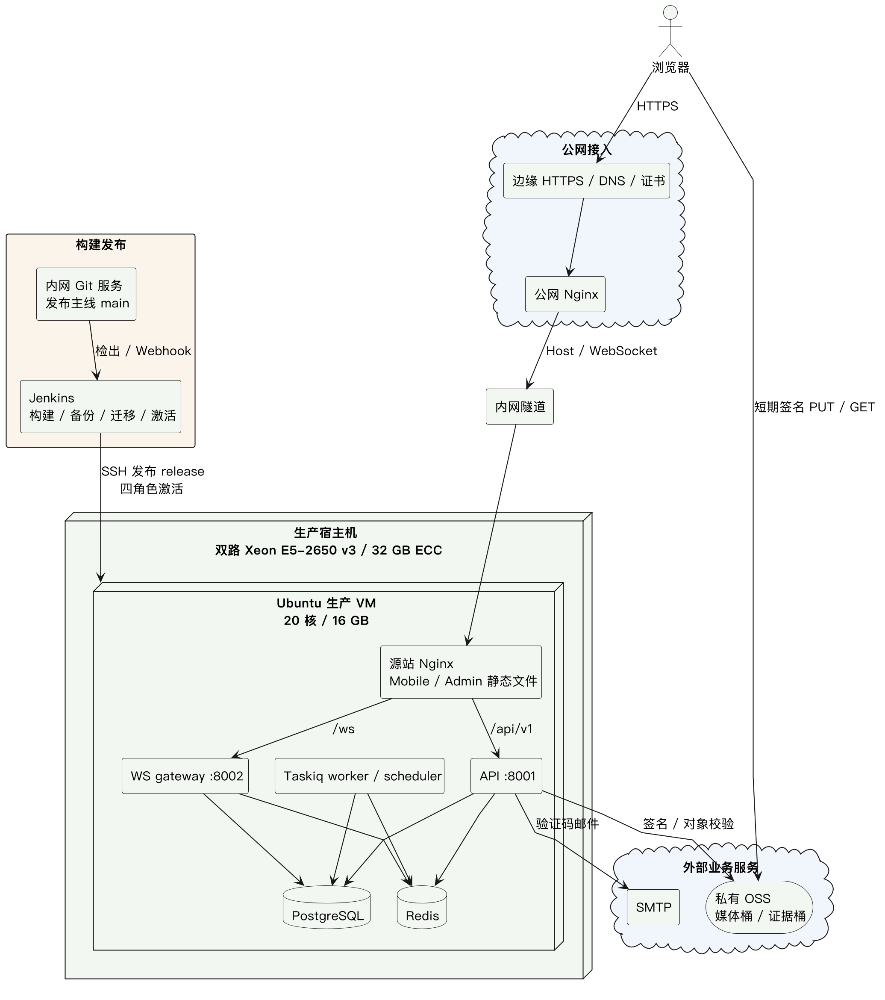

# 本次生产部署说明

## 部署总览

本系统采用双前端、四角色后端及独立数据服务的部署方式。浏览器经 HTTPS 接入公网入口，再通过隧道访问内网生产 VM；生产 VM 上的 Nginx 提供静态页面及 API、WebSocket 同源代理。代码由内网 Git 服务保存，Jenkins 通过 SSH 发布到生产 VM。



[PlantUML 源图](生产部署架构.puml)

| 层级 | 本次部署组成 | 职责 |
|---|---|---|
| 公网接入 | 边缘 HTTPS 接入、DNS/证书验证、公网 Nginx | HTTPS 终止、Host 转发、WebSocket 透传 |
| 网络连通 | 公网入口至内网源站的隧道 | 将两个前端域名的请求送达生产 VM |
| 虚拟化宿主机 | 2 × Xeon E5-2650 v3，2 × 16 GB DDR4 ECC | 承载生产虚拟机 |
| 生产 VM | Ubuntu Linux，20 核、16 GB 内存 | 运行源站 Nginx、四角色后端、PostgreSQL 和 Redis |
| 外部业务服务 | 阿里云 OSS 私有双桶、SMTP | 图片与证据存储、业务验证码邮件 |
| 构建与发布 | 内网 Git 服务、Jenkins、SSH | 检出、构建、发布包传输、备份、迁移与激活 |

公网入口为 `https://mobile.cm.iy88.site` 和 `https://admin.cm.iy88.site`，分别提供已部署的 demo-seed 移动用户端与管理端。

## 公网到应用的请求路径

| 请求 | 路径与处理 |
|---|---|
| 移动端页面 | 公网入口 → 隧道 → 源站 Nginx → `current/mobile` |
| 管理端页面 | 公网入口 → 隧道 → 源站 Nginx → `current/admin` |
| 业务 API | 同源 `/api/v1` → 源站 Nginx 的 `/api/` 路由 → `127.0.0.1:8001` |
| 实时连接 | 同源 `/ws` → WebSocket upgrade → `127.0.0.1:8002` |
| 图片上传 | API 签发短期 PUT URL → 浏览器直接上传 OSS → API 校验并确认业务引用 |
| 图片与证据读取 | API 按对象访问权限提供短期签名 GET URL → 浏览器读取私有 OSS 对象 |

公网和源站代理保持原始 Host；源站根据域名选择前端静态目录。源站代理向应用传递 HTTPS 协议信息，应用仅接受配置中列明的可信代理转发头。WebSocket 路由采用 300 秒代理超时并关闭查询参数访问日志；应用通过心跳维持连接。

两个前端使用根路径及 SPA 路由回退。入口页面和 Service Worker 采用及时更新策略，带内容摘要的静态资源使用长缓存。移动端生产构建生成 PWA manifest 与 Service Worker。

## 四角色后端与数据服务

| 服务 | 运行入口 | systemd unit | 职责 |
|---|---|---|---|
| API | `python -m app.manage serve-api` | `se-course-project1-api.service` | 身份、商品、交易、审核、上传租约等 HTTP 接口 |
| WebSocket | `python -m app.manage serve-ws` | `se-course-project1-ws.service` | ticket 鉴权、回放、推送、ACK 与重连补偿 |
| worker | `python -m app.manage taskiq-worker` | `se-course-project1-worker.service` | outbox、交易超时、保留策略和幂等清理任务 |
| scheduler | `python -m app.manage taskiq-scheduler` | `se-course-project1-scheduler.service` | 单实例派发定时任务和延迟重试 |

四个 unit 由 `deploy` 服务账号运行，共用当前 release 的生产配置。`APP_RUNTIME_ROLE` 指定角色，各角色的进程数、并发、预取、连接池及超时从生产 dotenv 读取。每个进程独立持有 SQL 和 Redis 连接池；scheduler 使用 Redis 调度状态。

| 数据服务 | 用途与配置 |
|---|---|
| PostgreSQL | 保存业务、审核、审计、持久事件和 outbox；应用、迁移登录、对象 owner 使用分离身份，结构由 Alembic 迁移维护 |
| Redis 8.2+ | 共享 ticket、连接计数、频控、实时 stream 和 Taskiq 队列；使用项目键前缀、明确连接预算及持久化配置 |
| OSS 媒体桶 | 商品、头像和聊天图片；私有 ACL、短期签名访问 |
| OSS 证据桶 | 举报和补充材料；通过业务权限控制访问 |
| SMTP | 注册、找回密码及换邮箱验证码邮件；连接参数由生产配置提供 |

业务变更与持久事件在 PostgreSQL 同一事务提交。worker 处理 outbox 并发布实时事件，WS 网关使用独立 Redis stream 游标接收事件，并结合 PostgreSQL 回放补偿；客户端按连续序号应用事件并 ACK。Taskiq 使用独立任务 stream/group 执行后台工作。

## CI/CD 链路

开发分支推送和代码合并审核触发仓库 CI，覆盖后端、实时集成、部署脚本、Rust 驱动和双前端检查。发布主线由内网 Git 服务保存，Jenkins 检出 `main` 执行生产发布；SSH 使用预登记主机公钥和 Jenkins 凭据。

| Jenkins 当前阶段 | 执行内容 |
|---|---|
| 检出与结构检查 | 检出发布主线，检查后端、双前端和锁文件入口 |
| 安装依赖 | 使用锁文件安装 Python 与 npm 依赖；当前构建配置使用 Python 3.13、Node.js 26.12.1 |
| 构建前端 | 以 `PROJECT1_FRONTEND_CONFIG=public` 构建双前端，同源 API 基址为 `/api/v1` |
| 校验锁文件 | 核对依赖安装和构建后的锁文件状态 |
| 打包与上传 | 打包后端、两个前端、部署资产；生成版本信息及 SHA-256 清单，经 SSH 上传 |
| 准备生产版本 | 解包、复制生产配置、安装生产依赖、运行四角色 preflight |
| 发布前备份 | 调用管理员安装的备份入口，取得完成标记 |
| 数据库迁移 | 执行 Alembic 迁移并核对数据库 revision |
| 激活 | 成套切换四角色，完成角色 readiness 与版本检查 |

Jenkins 当前将自动化测试阶段保留在注释块中，测试由仓库 CI 和本地执行承担。生产发布过程继续执行配置、连通性、备份、迁移版本及激活 readiness 检查。流水线禁止并发构建，总超时 30 分钟；构建失败和失败后恢复通过邮件通知。

## 发布目录与配置

```text
/srv/se-course-project1/
  current -> releases/<commit-sha>-<build-number>
  releases/<release-id>/
    backend/                 应用、迁移、虚拟环境和生产配置副本
    mobile/                  移动端静态产物
    admin/                   管理端静态产物
    deploy/                  systemd、Nginx、sudoers、检查和激活资产
    release.txt              版本信息
    SHA256SUMS               发布包摘要
    PREPARED                 准备完成标记
    MIGRATED                 迁移和备份关联标记
    ACTIVATED                激活版本与上一版本信息
  shared/
    .env.prod                持久生产配置源
    demo-manifest.json       演示数据清单
  .activation.lock
```

每个 release 使用独立虚拟环境，由 `uv sync --locked --no-dev` 安装生产依赖。准备阶段将 `shared/.env.prod` 复制为该 release 的私有配置副本；配置变更随新 release 生效。管理员维护 systemd、源站 Nginx、sudoers 和备份入口，Jenkins 发布账号负责版本目录与受限服务操作。

提交材料保留配置模板和字段说明。数据库连接、Redis 认证、OSS 密钥及桶名、SMTP 凭据、隧道配置、SSH 私钥、主机公钥登记和私有主机地址由部署环境管理。

## 激活、健康检查与回退

激活工具取得发布锁，确认发布标记和备份关联，停止上一版本四角色，切换 `current`，按 scheduler → worker → WS → API 顺序启动，再逐角色检查版本和 readiness。

| 检查 | 入口与判定 |
|---|---|
| API | `127.0.0.1:8001/api/health`，核对数据库、Redis 和 readiness |
| API / WS 进程健康 | `/health/live`、`/health/ready` |
| worker | `python -m app.manage health --role worker`，检查心跳并投递真实任务探针 |
| scheduler | `python -m app.manage health --role scheduler`，检查调度心跳 |
| 发布版本 | 核对 unit MainPID 的工作目录、release 标识和协议版本 |
| 公网访问 | 两个域名的页面、API 和双向 WS 消息 |

激活失败时，工具恢复上一 `current` 和对应服务集合，并记录失败标记。代码回退负责版本与进程恢复；数据库、Redis、OSS 和 Nginx 配置由管理员按备份及现场变更记录恢复。

## 备份与保留

管理员安装的发布前备份入口保存 PostgreSQL custom 归档、Redis RDB、元数据、摘要和完成标记。备份目录为 `/var/backups/se-course-project1/predeploy-*`，迁移和激活标记记录所用备份路径。OSS 对象采用独立的存储保护与恢复安排。

仓库提供定时保留策略模板：每日 04:30 附近执行，保留最近 5 个已激活 release 以及当前、上一版本；其他 release 经过 7 天后进入清理范围。备份保留 30 天且至少 10 份，被保留 release 引用的备份继续保留。清理与发布、备份共享文件锁。
