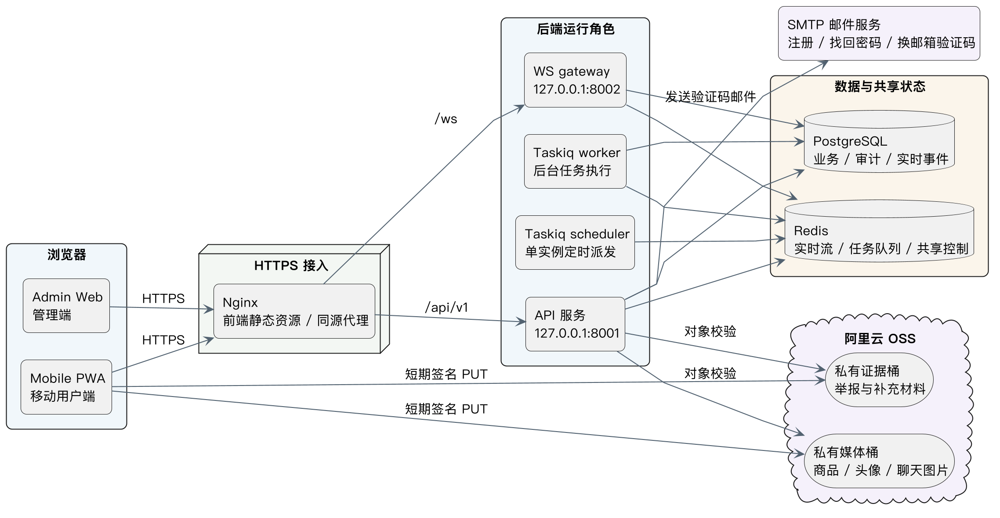

# Project1 系统说明

## 系统架构

[PlantUML 源图](系统架构.puml)

| 组件 | 职责 |
|---|---|
| Mobile PWA | 校园用户的商品浏览、发布、交易、即时消息和移动端体验。 |
| Admin Web | 商品审核、共享处置任务和管理操作。 |
| Nginx | HTTPS 接入、前端静态资源；将 `/api/` 转发到 API，将 `/ws` 转发到 WebSocket gateway。 |
| API | FastAPI 服务，处理身份认证、商品、交易、审核、上传授权和业务接口。 |
| WebSocket gateway | 实时连接、事件推送与客户端 ACK；通过 API 签发的一次性 ticket 建立连接。 |
| Taskiq worker / scheduler | worker 执行 outbox、超时、保留策略和幂等清理；单实例 scheduler 派发定时任务。 |
| PostgreSQL | 保存用户、商品、交易、审核、审计和实时事件等持久业务数据。 |
| Redis | 提供任务队列、实时事件分发、连接控制和跨进程状态。 |
| OSS | 私有媒体桶保存商品、头像和聊天图片；私有证据桶保存举报材料。客户端按短期授权直传，API 校验对象后建立业务引用。 |
| SMTP | 由 API 调用邮件服务，发送注册、找回密码和换邮箱验证码。 |

生产 API 与 WebSocket 使用独立进程和连接池；API、WebSocket、worker、scheduler 共用发布版本及生产配置。生产数据库结构通过显式迁移更新。

## 已生产部署的 demo-seed 入口

| 公网入口 | 页面 |
|---|---|
| `https://mobile.cm.iy88.site` | demo-seed 移动用户端 |
| `https://admin.cm.iy88.site` | demo-seed 管理端 |

两个入口通过同源 `/api/v1` 访问业务接口，移动端通过同源 `/ws` 建立实时连接。Nginx 将 `/api/` 转发到服务器本机 API `127.0.0.1:8001`，将 `/ws` 转发到 WebSocket gateway `127.0.0.1:8002`。后台任务使用 PostgreSQL、Redis 和 OSS 完成持久化、事件分发及图片处理。

## 性能基线

### 测试硬件和规模

| 环境 | 硬件 | 测试规模 |
|---|---|---|
| 生产服务器 VM | 宿主机 2 × Intel Xeon E5-2650 v3，32 GB DDR4 ECC；VM 分配双路各 10 核，共 20 核、16 GB 内存 | 100 用户、10,000 商品、10,000 张图片 |
| 本机 | Apple M5 Pro，arm64，18 个逻辑 CPU，64 GB 内存，macOS 27.2 | 100 用户、10,000 商品、10,000 张图片 |

两端均使用独立压测数据，通过同机 loopback 直接连接 API 与 WS 服务。

| 测试项 | 对照测试参数 |
|---|---|
| 数据 | load-seed v2，100 用户、10,000 商品、10,000 张图片 |
| Web 进程 | API worker 4 个，WS worker 2 个 |
| 稳态 | 预热 30 秒、采样 120 秒；场景结束后等待 1,000 ms |
| 搜索容量 | 25 RPS 起步，逐档到 200 RPS；每档预热 5 秒、采样 30 秒，候选强度持续验证 300 秒 |
| 混合容量 | 50 场景/秒起步，逐档到 100 场景/秒；每档预热 5 秒、采样 30 秒，候选强度持续验证 300 秒 |
| 容量调度 | 细测预算 12 次、分辨率 1、在途上限 2,048、调度延迟上限 100 ms、错误预算 0 |

### 性能测量配置

| 配置 | 服务器 | 本机 |
|---|---:|---:|
| API / WS worker | 4 / 2 | 4 / 2 |
| Taskiq worker 进程 | 2 | 2 |
| API / WS / jobs SQL 池大小（每进程） | 8 / 2 / 4 | 8 / 2 / 4 |
| SQL overflow | 0 | 0 |
| SQL / Redis 配置预算校验值 | 0 / 0 | 0 / 0 |
| SQL 池获取超时 | 1 秒 | 1 秒 |
| SQL 语句超时 / 空闲事务超时 | 2 秒 / 10 秒 | 2 秒 / 10 秒 |
| Taskiq 并发 / 预取 | 16 / 8 | 16 / 8 |
| Redis 控制池 API / WS / jobs（每进程） | 16 / 8 / 8 | 16 / 8 / 8 |
| WS 单 IP 连接上限 | 200 | 200 |
| WS 单 IP 每分钟握手限额 | 600 | 600 |
| API / WS loopback 端口 | 18080 / 18082 | 18080 / 18082 |

### 稳态性能对照

稳态测试采用相同用户规模、采样时长和后端进程配置。

| 稳态指标 | 服务器 | 本机 |
|---|---:|---:|
| 采样时长 | 120 秒 | 120 秒 |
| HTTP 请求 | 15,579 | 17,114 |
| 平均请求速率 | 129.82 RPS | 142.62 RPS |
| 预热 / 采样请求错误 | 0 / 0 | 0 / 0 |
| WS 断连 | 0 | 0 |
| 整轮结果 | 通过 | 通过 |

| 操作 | 服务器 P95 | 本机 P95 |
|---|---:|---:|
| 首页 | 129.30 ms | 14.87 ms |
| 搜索 | 177.98 ms | 25.88 ms |
| 商品详情 | 98.76 ms | 6.07 ms |
| 发布提交 | 276.10 ms | 46.06 ms |
| IM 发送 | 154.90 ms | 16.50 ms |
| IM 送达 | 687.37 ms | 678.95 ms |

### 容量性能对照

两端搜索最高配置为 200 HTTP RPS，混合业务最高配置为 100 场景/秒，各持续验证 300 秒。

| 搜索持续档指标 | 服务器 | 本机 |
|---|---:|---:|
| 验证速率 | 194 HTTP RPS | 200 HTTP RPS（配置最高档） |
| 采样时长 | 300 秒 | 300 秒 |
| 成功请求 | 58,200 | 60,000 |
| 请求错误 | 0 | 0 |
| 搜索 P95 | 156 ms | 12.65 ms |
| 搜索 P99 | 251 ms | 13.11 ms |

| 混合业务持续档指标 | 服务器 | 本机 |
|---|---:|---:|
| 场景启动速率 | 100/秒 | 100/秒 |
| 采样时长 | 300 秒 | 300 秒 |
| 总 HTTP 发起速率 | 150.02 RPS | 150.00 RPS |
| 应用 API 发起速率 | 145.02 RPS | 145.00 RPS |
| OSS PUT 速率 | 5.00/秒 | 5.00/秒 |
| 场景错误 / WS 断连 | 0 / 0 | 0 / 0 |
| IM 送达 P95 | 770 ms | 942.02 ms |
| IM 送达 P99 | 878 ms | 945.33 ms |

| 混合业务操作 | 服务器 P95 | 本机 P95 |
|---|---:|---:|
| 首页 | 109 ms | 9.04 ms |
| 搜索 | 160 ms | 20.27 ms |
| 商品详情 | 79 ms | 2.99 ms |
| 发布提交 | 248 ms | 35.63 ms |
| IM 发送 | 135 ms | 6.29 ms |

本机搜索在配置最高档 200 RPS 完成持续验证；两端混合业务均在配置最高档 100 场景/秒完成持续验证。
